<!-- Arquivo GERADO por tools/gerar_docs.py a partir de data/. Edite os dados, não este arquivo. -->

# Arquitetura do setup

[← Índice da documentação](README.md)

A pilha vai do público (topo) ao hardware (base). Cada linha é a ligação entre uma camada e a de baixo; o detalhe de cada ligação está na tabela abaixo e em cada página de camada.

```mermaid
flowchart TB
  L_oper["23 · Operação do grupo (esteira, marca, qualidade)<br/>32 blocos"]
  L_pub["22 · Público e canais<br/>12 blocos"]
  L_mkt["21 · Marketing, automação e medição<br/>30 blocos"]
  L_venda["20 · Plataformas de venda e recebimento<br/>15 blocos"]
  L_emp["19 · Pessoa física: impostos e finanças<br/>21 blocos"]
  L_web["18 · Vitrine web (sites e domínio)<br/>15 blocos"]
  L_prod["17 · Produtos (o que você vende)<br/>8 blocos"]
  L_neg["16 · Negócios do grupo (Barbacena)<br/>19 blocos"]
  L_editora["15 · Editora AMS Silva (produção de livros)<br/>36 blocos"]
  L_est["14 · Estudo e carreira<br/>16 blocos"]
  L_cont["13 · Produção de conteúdo<br/>8 blocos"]
  L_nuvem["12 · Nuvem, código e entrega<br/>32 blocos"]
  L_app["11 · Aplicação: sistemas AM (Aura)<br/>26 blocos"]
  L_obs["10 · Observabilidade<br/>10 blocos"]
  L_cnt["09 · Containers, Kubernetes e infra como código<br/>16 blocos"]
  L_clc["08 · Claude: recursos, conectores e plugins<br/>19 blocos"]
  L_chat["07 · Assistentes de IA (chat, pesquisa e estudo)<br/>10 blocos"]
  L_dados["06 · Dados e treino de IA<br/>22 blocos"]
  L_ia["05 · Agentes de IA e sandbox<br/>26 blocos"]
  L_lin["04 · Linux (Ubuntu no WSL2, Arch no 2º disco)<br/>29 blocos"]
  L_win["03 · Windows 11, apps e máquinas virtuais<br/>32 blocos"]
  L_seg["02 · Segurança e cofre<br/>25 blocos"]
  L_hw["01 · Hardware<br/>26 blocos"]
  L_oper --- L_pub
  L_pub --- L_mkt
  L_mkt --- L_venda
  L_venda --- L_emp
  L_emp --- L_web
  L_web --- L_prod
  L_prod --- L_neg
  L_neg --- L_editora
  L_editora --- L_est
  L_est --- L_cont
  L_cont --- L_nuvem
  L_nuvem --- L_app
  L_app --- L_obs
  L_obs --- L_cnt
  L_cnt --- L_clc
  L_clc --- L_chat
  L_chat --- L_dados
  L_dados --- L_ia
  L_ia --- L_lin
  L_lin --- L_win
  L_win --- L_seg
  L_seg --- L_hw
  classDef cam fill:#e2ecec,stroke:#0e3a45,color:#13262b
  class L_oper,L_pub,L_mkt,L_venda,L_emp,L_web,L_prod,L_neg,L_editora,L_est,L_cont,L_nuvem,L_app,L_obs,L_cnt,L_clc,L_chat,L_dados,L_ia,L_lin,L_win,L_seg,L_hw cam
```

## Camadas e ligações

| # | Camada | Blocos | Como se liga à camada de baixo |
|---|---|---|---|
| 23 | [Operação do grupo (esteira, marca, qualidade)](camadas/23-oper.md) | 32 | Toda oferta passa pela esteira e pelo padrão de qualidade antes de chegar ao público; cada venda e cada trabalho voltam como dado e conteúdo. |
| 22 | [Público e canais](camadas/22-pub.md) | 12 | Link na bio, vídeo, post, busca e indicação levam a pessoa até o site ou o WhatsApp. |
| 21 | [Marketing, automação e medição](camadas/21-mkt.md) | 30 | O que é publicado e anunciado aqui leva às plataformas de venda; cada venda volta como dado para o banco de métricas. |
| 20 | [Plataformas de venda e recebimento](camadas/20-venda.md) | 15 | Cada venda é lançada no carnê-leão e o dinheiro cai na sua conta separada. |
| 19 | [Pessoa física: impostos e finanças](camadas/19-emp.md) | 21 | Tudo no seu CPF por enquanto; o CNPJ entra quando a renda justificar. |
| 18 | [Vitrine web (sites e domínio)](camadas/18-web.md) | 15 | Os sites mostram e vendem os produtos e o seu portfólio. |
| 17 | [Produtos (o que você vende)](camadas/17-prod.md) | 8 | Cada produto nasce do conteúdo gravado, escrito ou programado. |
| 16 | [Negócios do grupo (Barbacena)](camadas/16-neg.md) | 19 | Os nove negócios físicos e de serviço usam os sistemas AM, a frota de entregas e o mesmo caixa de medição. |
| 15 | [Editora AMS Silva (produção de livros)](camadas/15-editora.md) | 36 | Cada livro sai do pipeline como produto pronto para as plataformas e para a gráfica. |
| 14 | [Estudo e carreira](camadas/14-est.md) | 16 | O que você estuda vira produto, aula, post e linha no currículo. |
| 13 | [Produção de conteúdo](camadas/13-cont.md) | 8 | Gravação e edição rodam no notebook; os arquivos finais sobem para as plataformas. |
| 12 | [Nuvem, código e entrega](camadas/12-nuvem.md) | 32 | git push via SSH leva o código ao GitHub; o Actions testa e publica. |
| 11 | [Aplicação: sistemas AM (Aura)](camadas/11-app.md) | 26 | A API envia logs, métricas e traces pelo OpenTelemetry. |
| 10 | [Observabilidade](camadas/10-obs.md) | 10 | Coletor, Prometheus e Grafana rodam como containers. |
| 09 | [Containers, Kubernetes e infra como código](camadas/09-cnt.md) | 16 | A CLI docker e o kubectl no Ubuntu falam com a engine do Docker no WSL2. |
| 08 | [Claude: recursos, conectores e plugins](camadas/08-clc.md) | 19 | Os conectores dão ao Claude acesso às suas contas, com permissão que você aprova; os plugins trazem rotinas prontas. |
| 07 | [Assistentes de IA (chat, pesquisa e estudo)](camadas/07-chat.md) | 10 | O que é código vai para o agente; o que é pesquisa e estudo fica nos assistentes e termina salvo no vault. |
| 06 | [Dados e treino de IA](camadas/06-dados.md) | 22 | Os seus dados viram tabelas limpas e datasets; o treino pesado roda numa GPU da nuvem e o modelo volta para o Ollama do notebook. |
| 05 | [Agentes de IA e sandbox](camadas/05-ia.md) | 26 | O agente roda dentro do ai-jail e só enxerga ~/dev/<projeto>. |
| 04 | [Linux (Ubuntu no WSL2, Arch no 2º disco)](camadas/04-lin.md) | 29 | O código fica no ext4 do Linux; o Windows enxerga pela ponte do WSL2. |
| 03 | [Windows 11, apps e máquinas virtuais](camadas/03-win.md) | 32 | O Windows depende de TPM, BitLocker e Defender para ficar protegido. |
| 02 | [Segurança e cofre](camadas/02-seg.md) | 25 | Drivers AMD e NVIDIA ligam o sistema ao hardware. |
| 01 | [Hardware](camadas/01-hw.md) | 26 | — |

## Princípios

- O Windows cuida só do que precisa de janela, GPU e segurança; o código vive e roda no Linux (Ubuntu no WSL2). Ver [ADR 0001](adr/0001-wsl2-em-vez-de-dual-boot.md).
- Agentes de IA trabalham dentro de sandbox e só enxergam a pasta do projeto. Ver [ADR 0002](adr/0002-agentes-de-ia-em-sandbox.md).
- Infraestrutura por código, Azure primeiro e AWS depois. Ver [ADR 0003](adr/0003-azure-primeiro.md).
- Produção barata em VM pelo Kamal, um deploy só. Ver [ADR 0005](adr/0005-deploy-em-vm-com-kamal.md). Contrato no OpenAPI e Zod só no front. Ver [ADR 0006](adr/0006-contratos-na-borda.md).
- Antes de construir, a triagem: subir pronto, colar ou construir (`just triagem`). Ver [Empresa solo](empresa-solo.md).
- Tudo conectado pelo Núcleo AMtech: as ferramentas falam com um banco central e os agentes agem pela política de autonomia. Ver [ADR 0009](adr/0009-nucleo-amtech.md).
- A melhor ferramenta para cada trabalho, sem linguagem proibida. Ver [ADR 0007](adr/0007-poliglota-por-funcao.md); principal e reserva de cada função no [ADR 0008](adr/0008-trocas-de-ferramenta-principal.md).
- Uma ferramenta por função: o que repete outra fica de fora ([decisões](fora-do-setup.md)).
- Segredos só no KeePassXC; nunca no repositório.
