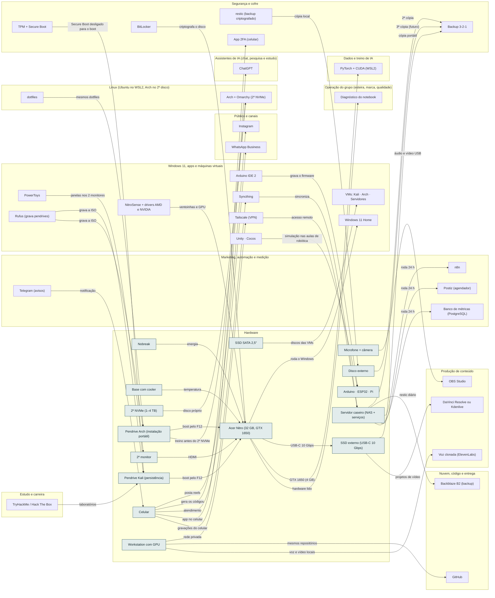

<!-- Arquivo GERADO por tools/gerar_docs.py a partir de data/. Edite os dados, não este arquivo. -->

# Camada 01 · Hardware

[← Arquitetura](../arquitetura.md) · [Índice da documentação](../README.md)

**15 blocos** · 0 precisam de conta · 5 marcados como futuro

## Mapa de conexões

## Blocos

| Bloco | Tipo | O que faz | Quando entra |
|---|---|---|---|
| [Nobreak](#ups) | Físico | Queda de energia no meio de um build, gravação ou atualização corrompe arquivo. Protege notebook, roteador e NAS. | passo 1.2 · Semana 1 · out/2026 |
| [Base com cooler](#cool) | Físico | O Nitro esquenta com Docker, VMs e Ollama; menos calor, menos queda de desempenho. | passo 1.2 · Semana 1 · out/2026 |
| [SSD SATA 2,5"](#sata) | Físico · futuro | Baia livre: espaço extra para VMs e imagens de laboratório. Confira cabo e suporte. | passo 24.4 · 2027, conforme cada compra |
| [Acer Nitro (32 GB, GTX 1650)](#nb) | Físico | Ryzen 7 5800H, 32 GB (até 64), SSD 1 TB. | passo 0.2 · Antes de tudo · semana 1 (out/2026); passo 1.2 · Semana 1 · out/2026 |
| [2º NVMe (1–4 TB)](#nvme) | Físico · futuro | Slot M.2 livre. | passo 24.1 · 2027, conforme cada compra |
| [2º monitor](#mon) | Físico | Código numa tela, app na outra. | passo 1.2 · Semana 1 · out/2026 |
| [Microfone + câmera](#mic) | Físico · futuro | Áudio limpo vende mais curso que câmera boa. | passo 24.6 · 2027, conforme cada compra |
| [Celular](#cel) | Físico | Reels, 2FA e atendimento. | passo 1.2 · Semana 1 · out/2026; passo 2.8 · Semana 1 · out/2026 (o e-mail e as críticas); o resto, 5 contas por semana até dez/2026; passo 4.9 · Semana 2 · nov/2026 |
| [Disco externo](#ext) | Físico | Segunda cópia do backup. | passo 1.1 · Semana 1 · out/2026; passo 1.2 · Semana 1 · out/2026; passo 2.10 · Semana 1 · out/2026 (o e-mail e as críticas); o resto, 5 contas por semana até dez/2026; passo 7.1 · Semana 3 · nov/2026 |
| [Pendrive Kali (persistência)](#pkali) | Físico | Kali Live com persistência criptografada (LUKS), 32 GB ou mais. Para estudar e fazer laboratório, só contra alvos seus ou de plataformas autorizadas. Dá boot pelo menu F12 com o Secure Boot desligado. | passo 21.1 · Pendrives, GPU e laboratório a partir da semana 2; Zoomcamp, dbt e Airflow junto do IA2 da Trilha de Dados e IA do vault (depois do Passo 8, ≈ 2028); dataset e treino do 8B junto do IA6 (≈ 2029) |
| [Pendrive Arch (instalação portátil)](#parch) | Físico | Um pendrive com a ISO para treinar a instalação e um pendrive rápido ou SSD USB (64 GB ou mais) com o Arch instalado de verdade, portátil. Pendrive comum fica lento como sistema. | passo 21.2 · Pendrives, GPU e laboratório a partir da semana 2; Zoomcamp, dbt e Airflow junto do IA2 da Trilha de Dados e IA do vault (depois do Passo 8, ≈ 2028); dataset e treino do 8B junto do IA6 (≈ 2029) |
| [Arduino · ESP32 · Pi](#rob) | Físico | Aulas, projeto agro e automação. | passo 1.2 · Semana 1 · out/2026; passo 22.16 · Fev a dez/2027, uma oferta por vez (começa quando: a primeira venda do mini-curso aconteceu) |
| [Servidor caseiro (NAS + serviços)](#nas) | Físico · futuro | PC antigo ou mini PC com 16 GB de RAM e dois HDs em RAID 1, com Ubuntu Server e Docker (ou OpenMediaVault). Guarda o backup local e roda n8n, Postiz, banco de métricas, Grafana, Uptime Kuma e Gitea 24 horas. | passo 31.1 · 2028, quando o grupo pedir |
| [SSD externo (USB-C 10 Gbps)](#ssdext) | Físico | NVMe em gabinete USB 3.2 Gen 2: projetos de vídeo e backup portátil, criptografado. A porta USB-C do Nitro é de 10 Gbps, sem Thunderbolt. | passo 1.2 · Semana 1 · out/2026 |
| [Workstation com GPU](#ws) | Físico · futuro | Segundo computador com 12 GB ou mais de memória de vídeo para voz, vídeo e IA locais. Só se sair mais barato que assinaturas e GPU por hora. | passo 31.3 · 2028, quando o grupo pedir |

### Nobreak

*Físico*

Queda de energia no meio de um build, gravação ou atualização corrompe arquivo. Protege notebook, roteador e NAS.

**Quando entra:** passo 1.2 · Semana 1 · out/2026 ([roteiro](../implantacao/roteiro.md))

| Direção | Bloco | Camada | O que passa |
|---|---|---|---|
| → envia para | [Acer Nitro (32 GB, GTX 1650)](01-hw.md#nb) | Hardware | energia |

### Base com cooler

*Físico*

O Nitro esquenta com Docker, VMs e Ollama; menos calor, menos queda de desempenho.

**Quando entra:** passo 1.2 · Semana 1 · out/2026 ([roteiro](../implantacao/roteiro.md))

| Direção | Bloco | Camada | O que passa |
|---|---|---|---|
| → envia para | [Acer Nitro (32 GB, GTX 1650)](01-hw.md#nb) | Hardware | temperatura |

### SSD SATA 2,5"

*Físico · futuro*

Baia livre: espaço extra para VMs e imagens de laboratório. Confira cabo e suporte.

**Quando entra:** passo 24.4 · 2027, conforme cada compra ([roteiro](../implantacao/roteiro.md))

| Direção | Bloco | Camada | O que passa |
|---|---|---|---|
| → envia para | [VMs: Kali · Arch · Servidores](03-win.md#vms) | Windows 11, apps e máquinas virtuais | discos das VMs |

### Acer Nitro (32 GB, GTX 1650)

*Físico*

Ryzen 7 5800H, 32 GB (até 64), SSD 1 TB.

**Quando entra:** passo 0.2 · Antes de tudo · semana 1 (out/2026); passo 1.2 · Semana 1 · out/2026 ([roteiro](../implantacao/roteiro.md))

| Direção | Bloco | Camada | O que passa |
|---|---|---|---|
| → envia para | [Windows 11 Home](03-win.md#w11) | Windows 11, apps e máquinas virtuais | roda o Windows |
| → envia para | [SSD externo (USB-C 10 Gbps)](01-hw.md#ssdext) | Hardware | USB-C 10 Gbps |
| → envia para | [PyTorch + CUDA (WSL2)](06-dados.md#torch) | Dados e treino de IA | GTX 1650 (4 GB) |
| → envia para | [Diagnóstico do notebook](23-oper.md#diag) | Operação do grupo (esteira, marca, qualidade) | hardware lido |
| ← recebe de | [2º monitor](01-hw.md#mon) | Hardware | HDMI |
| ← recebe de | [BitLocker](02-seg.md#bitl) | Segurança e cofre | criptografa o disco |
| ← recebe de | [NitroSense + drivers AMD e NVIDIA](03-win.md#nitro) | Windows 11, apps e máquinas virtuais | ventoinhas e GPU |
| ← recebe de | [Nobreak](01-hw.md#ups) | Hardware | energia |
| ← recebe de | [Base com cooler](01-hw.md#cool) | Hardware | temperatura |
| ← recebe de | [Pendrive Kali (persistência)](01-hw.md#pkali) | Hardware | boot pelo F12 |
| ← recebe de | [Pendrive Arch (instalação portátil)](01-hw.md#parch) | Hardware | boot pelo F12 |

### 2º NVMe (1–4 TB)

*Físico · futuro*

Slot M.2 livre.

**Quando entra:** passo 24.1 · 2027, conforme cada compra ([roteiro](../implantacao/roteiro.md))

| Direção | Bloco | Camada | O que passa |
|---|---|---|---|
| → envia para | [Arch + Omarchy (2º NVMe)](04-lin.md#arch) | Linux (Ubuntu no WSL2, Arch no 2º disco) | disco próprio |

### 2º monitor

*Físico*

Código numa tela, app na outra.

**Quando entra:** passo 1.2 · Semana 1 · out/2026 ([roteiro](../implantacao/roteiro.md))

| Direção | Bloco | Camada | O que passa |
|---|---|---|---|
| → envia para | [Acer Nitro (32 GB, GTX 1650)](01-hw.md#nb) | Hardware | HDMI |
| ← recebe de | [PowerToys](03-win.md#ptoys) | Windows 11, apps e máquinas virtuais | janelas nos 2 monitores |

### Microfone + câmera

*Físico · futuro*

Áudio limpo vende mais curso que câmera boa.

**Quando entra:** passo 24.6 · 2027, conforme cada compra ([roteiro](../implantacao/roteiro.md))

| Direção | Bloco | Camada | O que passa |
|---|---|---|---|
| → envia para | [OBS Studio](13-cont.md#obss) | Produção de conteúdo | áudio e vídeo USB |

### Celular

*Físico*

Reels, 2FA e atendimento.

**Quando entra:** passo 1.2 · Semana 1 · out/2026; passo 2.8 · Semana 1 · out/2026 (o e-mail e as críticas); o resto, 5 contas por semana até dez/2026; passo 4.9 · Semana 2 · nov/2026 ([roteiro](../implantacao/roteiro.md))

| Direção | Bloco | Camada | O que passa |
|---|---|---|---|
| → envia para | [Instagram](22-pub.md#ig) | Público e canais | posta reels |
| → envia para | [App 2FA (celular)](02-seg.md#tfa) | Segurança e cofre | gera os códigos |
| → envia para | [WhatsApp Business](22-pub.md#wa) | Público e canais | atendimento |
| → envia para | [ChatGPT](07-chat.md#gpt) | Assistentes de IA (chat, pesquisa e estudo) | app no celular |
| → envia para | [Syncthing](03-win.md#syncth) | Windows 11, apps e máquinas virtuais | gravações do celular |
| ← recebe de | [Telegram (avisos)](21-mkt.md#tg) | Marketing, automação e medição | notificação |

### Disco externo

*Físico*

Segunda cópia do backup.

**Quando entra:** passo 1.1 · Semana 1 · out/2026; passo 1.2 · Semana 1 · out/2026; passo 2.10 · Semana 1 · out/2026 (o e-mail e as críticas); o resto, 5 contas por semana até dez/2026; passo 7.1 · Semana 3 · nov/2026 ([roteiro](../implantacao/roteiro.md))

| Direção | Bloco | Camada | O que passa |
|---|---|---|---|
| → envia para | [Backup 3-2-1](02-seg.md#bkp) | Segurança e cofre | 2ª cópia |
| ← recebe de | [restic (backup criptografado)](02-seg.md#restic) | Segurança e cofre | cópia local |

### Pendrive Kali (persistência)

*Físico*

Kali Live com persistência criptografada (LUKS), 32 GB ou mais. Para estudar e fazer laboratório, só contra alvos seus ou de plataformas autorizadas. Dá boot pelo menu F12 com o Secure Boot desligado.

**Quando entra:** passo 21.1 · Pendrives, GPU e laboratório a partir da semana 2; Zoomcamp, dbt e Airflow junto do IA2 da Trilha de Dados e IA do vault (depois do Passo 8, ≈ 2028); dataset e treino do 8B junto do IA6 (≈ 2029) ([roteiro](../implantacao/roteiro.md))

| Direção | Bloco | Camada | O que passa |
|---|---|---|---|
| → envia para | [Acer Nitro (32 GB, GTX 1650)](01-hw.md#nb) | Hardware | boot pelo F12 |
| ← recebe de | [Rufus (grava pendrives)](03-win.md#rufus) | Windows 11, apps e máquinas virtuais | grava a ISO |
| ← recebe de | [TryHackMe / Hack The Box](14-est.md#thm) | Estudo e carreira | laboratórios |
| ← recebe de | [TPM + Secure Boot](02-seg.md#tpm) | Segurança e cofre | Secure Boot desligado para o boot |

### Pendrive Arch (instalação portátil)

*Físico*

Um pendrive com a ISO para treinar a instalação e um pendrive rápido ou SSD USB (64 GB ou mais) com o Arch instalado de verdade, portátil. Pendrive comum fica lento como sistema.

**Quando entra:** passo 21.2 · Pendrives, GPU e laboratório a partir da semana 2; Zoomcamp, dbt e Airflow junto do IA2 da Trilha de Dados e IA do vault (depois do Passo 8, ≈ 2028); dataset e treino do 8B junto do IA6 (≈ 2029) ([roteiro](../implantacao/roteiro.md))

| Direção | Bloco | Camada | O que passa |
|---|---|---|---|
| → envia para | [Acer Nitro (32 GB, GTX 1650)](01-hw.md#nb) | Hardware | boot pelo F12 |
| → envia para | [Arch + Omarchy (2º NVMe)](04-lin.md#arch) | Linux (Ubuntu no WSL2, Arch no 2º disco) | treino antes do 2º NVMe |
| ← recebe de | [Rufus (grava pendrives)](03-win.md#rufus) | Windows 11, apps e máquinas virtuais | grava a ISO |
| ← recebe de | [dotfiles](04-lin.md#dot) | Linux (Ubuntu no WSL2, Arch no 2º disco) | mesmos dotfiles |

### Arduino · ESP32 · Pi

*Físico*

Aulas, projeto agro e automação.

**Quando entra:** passo 1.2 · Semana 1 · out/2026; passo 22.16 · Fev a dez/2027, uma oferta por vez (começa quando: a primeira venda do mini-curso aconteceu) ([roteiro](../implantacao/roteiro.md))

| Direção | Bloco | Camada | O que passa |
|---|---|---|---|
| ← recebe de | [Arduino IDE 2](03-win.md#ard) | Windows 11, apps e máquinas virtuais | grava o firmware |
| ← recebe de | [Unity · Cocos](03-win.md#unity) | Windows 11, apps e máquinas virtuais | simulação nas aulas de robótica |

### Servidor caseiro (NAS + serviços)

*Físico · futuro*

PC antigo ou mini PC com 16 GB de RAM e dois HDs em RAID 1, com Ubuntu Server e Docker (ou OpenMediaVault). Guarda o backup local e roda n8n, Postiz, banco de métricas, Grafana, Uptime Kuma e Gitea 24 horas.

**Quando entra:** passo 31.1 · 2028, quando o grupo pedir ([roteiro](../implantacao/roteiro.md))

| Direção | Bloco | Camada | O que passa |
|---|---|---|---|
| → envia para | [Backup 3-2-1](02-seg.md#bkp) | Segurança e cofre | 3ª cópia (futuro) |
| → envia para | [Backblaze B2 (backup)](12-nuvem.md#b2) | Nuvem, código e entrega | restic diário |
| → envia para | [n8n](21-mkt.md#n8n) | Marketing, automação e medição | roda 24 h |
| → envia para | [Postiz (agendador)](21-mkt.md#postiz) | Marketing, automação e medição | roda 24 h |
| → envia para | [Banco de métricas (PostgreSQL)](21-mkt.md#metrics) | Marketing, automação e medição | roda 24 h |
| ← recebe de | [Tailscale (VPN)](03-win.md#tail) | Windows 11, apps e máquinas virtuais | acesso remoto |
| ← recebe de | [Syncthing](03-win.md#syncth) | Windows 11, apps e máquinas virtuais | sincroniza |

### SSD externo (USB-C 10 Gbps)

*Físico*

NVMe em gabinete USB 3.2 Gen 2: projetos de vídeo e backup portátil, criptografado. A porta USB-C do Nitro é de 10 Gbps, sem Thunderbolt.

**Quando entra:** passo 1.2 · Semana 1 · out/2026 ([roteiro](../implantacao/roteiro.md))

| Direção | Bloco | Camada | O que passa |
|---|---|---|---|
| → envia para | [Backup 3-2-1](02-seg.md#bkp) | Segurança e cofre | cópia portátil |
| → envia para | [DaVinci Resolve ou Kdenlive](13-cont.md#edit) | Produção de conteúdo | projetos de vídeo |
| ← recebe de | [Acer Nitro (32 GB, GTX 1650)](01-hw.md#nb) | Hardware | USB-C 10 Gbps |

### Workstation com GPU

*Físico · futuro*

Segundo computador com 12 GB ou mais de memória de vídeo para voz, vídeo e IA locais. Só se sair mais barato que assinaturas e GPU por hora.

**Quando entra:** passo 31.3 · 2028, quando o grupo pedir ([roteiro](../implantacao/roteiro.md))

| Direção | Bloco | Camada | O que passa |
|---|---|---|---|
| → envia para | [Tailscale (VPN)](03-win.md#tail) | Windows 11, apps e máquinas virtuais | rede privada |
| → envia para | [GitHub](12-nuvem.md#gh) | Nuvem, código e entrega | mesmos repositórios |
| → envia para | [Voz clonada (ElevenLabs)](13-cont.md#voz) | Produção de conteúdo | voz e vídeo locais |

---

[↑ Camada 02 · Segurança e cofre](02-seg.md)
