<!-- Arquivo GERADO por tools/gerar_docs.py a partir de data/. Edite os dados, não este arquivo. -->

# Camada 01 · Hardware

[← Arquitetura](../arquitetura.md) · [Índice da documentação](../README.md)

**26 blocos** · 0 precisam de conta · 15 marcados como futuro

## Mapa de conexões

```mermaid
flowchart LR
  subgraph L_hw["Hardware"]
    n_ups["Nobreak"]
    n_cool["Base com cooler"]
    n_sata["SSD SATA 2,5#quot;"]
    n_nb["Acer Nitro (32 GB, GTX 1650)"]
    n_nvme["2º NVMe (1–4 TB)"]
    n_mon["2º monitor"]
    n_mic["Microfone + câmera"]
    n_cel["Celular"]
    n_ext["Disco externo"]
    n_pkali["Pendrive Kali (persistência)"]
    n_parch["Pendrive Arch (instalação portátil)"]
    n_rob["Arduino · ESP32 · Pi"]
    n_nas["Servidor caseiro (NAS + serviços)"]
    n_ssdext["SSD externo (USB-C 10 Gbps)"]
    n_ws["Workstation com GPU"]
    n_ha["Home Assistant"]
    n_srvcasa["Servidor da casa (N100 ou Pi 5)"]
    n_zbdongle["Coordenador Zigbee (USB)"]
    n_satvoz["Satélites de voz (ESP32-S3)"]
    n_dispcasa["Tomadas, sensores e atuadores"]
    n_cams["Câmeras IP (RTSP)"]
    n_aguacam["Leitor do hidrômetro (ESP32-CAM)"]
    n_so101["Braços SO-101 (líder + seguidor)"]
    n_reachy["Reachy Mini (corpo do Jarvis)"]
    n_kitcampo["Kit de campo (LoRa, umidade, ultrassom)"]
    n_analog["Analisador lógico (8 canais USB)"]
  end
  subgraph L_oper["Operação do grupo (esteira, marca, qualidade)"]
    n_diag["Diagnóstico do notebook"]
  end
  subgraph L_pub["Público e canais"]
    n_ig["Instagram"]
    n_wa["WhatsApp Business"]
  end
  subgraph L_mkt["Marketing, automação e medição"]
    n_metrics["Banco de métricas (PostgreSQL)"]
    n_n8n["n8n"]
    n_postiz["Postiz (agendador)"]
    n_tg["Telegram (avisos)"]
  end
  subgraph L_est["Estudo e carreira"]
    n_thm["TryHackMe / Hack The Box"]
  end
  subgraph L_cont["Produção de conteúdo"]
    n_edit["DaVinci Resolve ou Kdenlive"]
    n_obss["OBS Studio"]
    n_voz["Voz clonada (ElevenLabs)"]
  end
  subgraph L_nuvem["Nuvem, código e entrega"]
    n_b2["Backblaze B2 (backup)"]
    n_gh["GitHub"]
    n_softserve["Soft Serve (Git por SSH em casa)"]
  end
  subgraph L_app["Aplicação: sistemas AM (Aura)"]
    n_rust["Rust (firmware e CLIs)"]
  end
  subgraph L_cnt["Containers, Kubernetes e infra como código"]
    n_docker["Docker + Compose"]
    n_esphome["ESPHome"]
    n_frigate["Frigate (câmeras com detecção)"]
    n_mqtt["Mosquitto (MQTT)"]
    n_z2m["Zigbee2MQTT"]
  end
  subgraph L_chat["Assistentes de IA (chat, pesquisa e estudo)"]
    n_gpt["ChatGPT"]
  end
  subgraph L_dados["Dados e treino de IA"]
    n_hf["Hugging Face (modelos e Hub)"]
    n_lerobot["LeRobot (robôs que aprendem)"]
    n_torch["PyTorch + CUDA (WSL2)"]
  end
  subgraph L_ia["Agentes de IA e sandbox"]
    n_hamcp["MCP do Home Assistant"]
    n_jarvis["Jarvis (porta única dos agentes)"]
    n_jvoz["Voz local: Whisper, Piper, openWakeWord"]
    n_strata["Strata (MoE grande)"]
  end
  subgraph L_lin["Linux (Ubuntu no WSL2, Arch no 2º disco)"]
    n_arch["Arch + Omarchy (2º NVMe)"]
    n_dot["dotfiles"]
    n_ros2["ROS 2 + ponte MQTT"]
  end
  subgraph L_win["Windows 11, apps e máquinas virtuais"]
    n_ard["Arduino IDE 2"]
    n_kicad["KiCad · PulseView · tio (bancada)"]
    n_nitro["NitroSense + drivers AMD e NVIDIA"]
    n_probers["probe-rs (grava e depura chips)"]
    n_ptoys["PowerToys"]
    n_rufus["Rufus (grava pendrives)"]
    n_syncth["Syncthing"]
    n_tail["Tailscale (VPN)"]
    n_unity["Unity · Cocos"]
    n_vms["VMs: Kali · Arch · Servidores"]
    n_w11["Windows 11 Home"]
  end
  subgraph L_seg["Segurança e cofre"]
    n_bitl["BitLocker"]
    n_bkp["Backup 3-2-1"]
    n_restic["restic (backup criptografado)"]
    n_tfa["App 2FA (celular)"]
    n_tpm["TPM + Secure Boot"]
  end
  n_ups -->|"energia"| n_nb
  n_ups -->|"energia"| n_srvcasa
  n_cool -->|"temperatura"| n_nb
  n_sata -->|"discos das VMs"| n_vms
  n_nb -->|"roda o Windows"| n_w11
  n_nb -->|"USB-C 10 Gbps"| n_ssdext
  n_nb -->|"GTX 1650 (4 GB)"| n_torch
  n_nb -->|"hardware lido"| n_diag
  n_mon -->|"HDMI"| n_nb
  n_bitl -->|"criptografa o disco"| n_nb
  n_nitro -->|"ventoinhas e GPU"| n_nb
  n_pkali -->|"boot pelo F12"| n_nb
  n_parch -->|"boot pelo F12"| n_nb
  n_nvme -->|"disco próprio"| n_arch
  n_ptoys -->|"janelas nos 2 monitores"| n_mon
  n_mic -->|"áudio e vídeo USB"| n_obss
  n_cel -->|"posta reels"| n_ig
  n_cel -->|"gera os códigos"| n_tfa
  n_cel -->|"atendimento"| n_wa
  n_cel -->|"app no celular"| n_gpt
  n_cel -->|"gravações do celular"| n_syncth
  n_tg -->|"notificação"| n_cel
  n_ext -->|"2ª cópia"| n_bkp
  n_restic -->|"cópia local"| n_ext
  n_rufus -->|"grava a ISO"| n_pkali
  n_thm -->|"laboratórios"| n_pkali
  n_tpm -->|"Secure Boot desligado para o boot"| n_pkali
  n_parch -->|"treino antes do 2º NVMe"| n_arch
  n_rufus -->|"grava a ISO"| n_parch
  n_dot -->|"mesmos dotfiles"| n_parch
  n_rob -->|"ESP32"| n_esphome
  n_rob -->|"Raspberry Pi"| n_ros2
  n_ard -->|"grava o firmware"| n_rob
  n_unity -->|"simulação nas aulas de robótica"| n_rob
  n_so101 -->|"aulas de robótica"| n_rob
  n_kicad -->|"desenha as placas"| n_rob
  n_analog -->|"mede os sinais"| n_rob
  n_rust -->|"firmware das placas"| n_rob
  n_probers -->|"grava o firmware"| n_rob
  n_nas -->|"3ª cópia (futuro)"| n_bkp
  n_nas -->|"restic diário"| n_b2
  n_nas -->|"roda 24 h"| n_n8n
  n_nas -->|"roda 24 h"| n_postiz
  n_nas -->|"roda 24 h"| n_metrics
  n_tail -->|"acesso remoto"| n_nas
  n_syncth -->|"sincroniza"| n_nas
  n_ssdext -->|"cópia portátil"| n_bkp
  n_ssdext -->|"projetos de vídeo"| n_edit
  n_ws -->|"rede privada"| n_tail
  n_ws -->|"mesmos repositórios"| n_gh
  n_ws -->|"voz e vídeo locais"| n_voz
  n_strata -->|"precisa de"| n_ws
  n_docker -->|"roda"| n_ha
  n_jarvis -->|"comanda a casa"| n_ha
  n_srvcasa -->|"roda o"| n_ha
  n_mqtt -->|"integra"| n_ha
  n_esphome -->|"entidades"| n_ha
  n_jvoz -->|"Assist local"| n_ha
  n_hamcp -->|"entidades expostas"| n_ha
  n_tail -->|"acesso de fora"| n_srvcasa
  n_softserve -->|"roda no servidor da casa"| n_srvcasa
  n_zbdongle -->|"rádio"| n_z2m
  n_dispcasa -->|"Zigbee"| n_zbdongle
  n_satvoz -->|"firmware"| n_esphome
  n_cams -->|"RTSP"| n_frigate
  n_aguacam -->|"leitura do hidrômetro"| n_mqtt
  n_so101 -->|"teleoperação e gravação"| n_lerobot
  n_reachy -->|"corpo na mesa"| n_jarvis
  n_reachy -->|"apps do Hub"| n_hf
  n_kitcampo -->|"firmware"| n_esphome
  n_kitcampo -->|"leituras de longe"| n_mqtt
  n_analog -->|"lido pelo PulseView"| n_kicad
  classDef desta fill:#e2ecec,stroke:#0e3a45,color:#13262b
  class n_ups,n_cool,n_sata,n_nb,n_nvme,n_mon,n_mic,n_cel,n_ext,n_pkali,n_parch,n_rob,n_nas,n_ssdext,n_ws,n_ha,n_srvcasa,n_zbdongle,n_satvoz,n_dispcasa,n_cams,n_aguacam,n_so101,n_reachy,n_kitcampo,n_analog desta
```

## Blocos

| Bloco | Tipo | O que faz | Quando entra |
|---|---|---|---|
| [Nobreak](#ups) | Físico | Queda de energia no meio de um build, gravação ou atualização corrompe arquivo. Protege notebook, roteador e NAS. | passo 1.2 · Semana 1 · out/2026 |
| [Base com cooler](#cool) | Físico | O Nitro esquenta com Docker, VMs e Ollama; menos calor, menos queda de desempenho. | passo 1.2 · Semana 1 · out/2026 |
| [SSD SATA 2,5"](#sata) | Físico · futuro | Baia livre: espaço extra para VMs e imagens de laboratório. Confira cabo e suporte. | passo 48.4 · 2027, conforme cada compra |
| [Acer Nitro (32 GB, GTX 1650)](#nb) | Físico | Ryzen 7 5800H, 32 GB (até 64), SSD 1 TB. | passo 0.2 · Antes de tudo · semana 1 (out/2026); passo 1.2 · Semana 1 · out/2026 |
| [2º NVMe (1–4 TB)](#nvme) | Físico · futuro | Slot M.2 livre. | passo 48.1 · 2027, conforme cada compra |
| [2º monitor](#mon) | Físico | Código numa tela, app na outra. | passo 1.2 · Semana 1 · out/2026 |
| [Microfone + câmera](#mic) | Físico · futuro | Áudio limpo vende mais curso que câmera boa. | passo 48.6 · 2027, conforme cada compra |
| [Celular](#cel) | Físico | Reels, 2FA e atendimento. | passo 1.2 · Semana 1 · out/2026; passo 2.9 · Semana 1 · out/2026 (o e-mail e as críticas); o resto, 5 contas por semana até dez/2026; passo 4.9 · Semana 2 · nov/2026 |
| [Disco externo](#ext) | Físico | Segunda cópia do backup. | passo 1.1 · Semana 1 · out/2026; passo 1.2 · Semana 1 · out/2026; passo 2.11 · Semana 1 · out/2026 (o e-mail e as críticas); o resto, 5 contas por semana até dez/2026; passo 7.1 · Semana 3 · nov/2026 |
| [Pendrive Kali (persistência)](#pkali) | Físico | Kali Live com persistência criptografada (LUKS), 32 GB ou mais. Para estudar e fazer laboratório, só contra alvos seus ou de plataformas autorizadas. Dá boot pelo menu F12 com o Secure Boot desligado. | passo 44.1 · Pendrives, GPU e laboratório a partir da semana 2; Zoomcamp, dbt e Airflow junto do IA2 da Trilha de Dados e IA do vault (depois do Passo 8, ≈ 2028); dataset e treino do 8B junto do IA6 (≈ 2029) |
| [Pendrive Arch (instalação portátil)](#parch) | Físico | Um pendrive com a ISO para treinar a instalação e um pendrive rápido ou SSD USB (64 GB ou mais) com o Arch instalado de verdade, portátil. Pendrive comum fica lento como sistema. | passo 44.2 · Pendrives, GPU e laboratório a partir da semana 2; Zoomcamp, dbt e Airflow junto do IA2 da Trilha de Dados e IA do vault (depois do Passo 8, ≈ 2028); dataset e treino do 8B junto do IA6 (≈ 2029) |
| [Arduino · ESP32 · Pi](#rob) | Físico | Aulas, projeto agro e automação. | passo 1.2 · Semana 1 · out/2026; passo 46.16 · Fev a dez/2027, uma oferta por vez (começa quando: a primeira venda do mini-curso aconteceu) |
| [Servidor caseiro (NAS + serviços)](#nas) | Físico · futuro | PC antigo ou mini PC com 16 GB de RAM e dois HDs em RAID 1, com Ubuntu Server e Docker (ou OpenMediaVault). Guarda o backup local e roda n8n, Postiz, banco de métricas, Grafana, Uptime Kuma e Gitea 24 horas. | passo 55.1 · 2028, quando o grupo pedir |
| [SSD externo (USB-C 10 Gbps)](#ssdext) | Físico | NVMe em gabinete USB 3.2 Gen 2: projetos de vídeo e backup portátil, criptografado. A porta USB-C do Nitro é de 10 Gbps, sem Thunderbolt. | passo 1.2 · Semana 1 · out/2026 |
| [Workstation com GPU](#ws) | Físico · futuro | Segundo computador com 12 GB ou mais de memória de vídeo para voz, vídeo e IA locais. Só se sair mais barato que assinaturas e GPU por hora. | passo 29.6 · 2027, depois do primeiro fine-tuning de 8B; passo 55.3 · 2028, quando o grupo pedir |
| [Home Assistant](#ha) | Local | Casa inteligente local: sensores, luzes, avisos e a base da robótica pessoal. | passo 19.1 · Dez/2026; passo 19.6 · Dez/2026 |
| [Servidor da casa (N100 ou Pi 5)](#srvcasa) | Físico · futuro | Mini PC N100 (ou Raspberry Pi 5) com Home Assistant OS, ligado no nobreak: a casa funciona com o notebook desligado (ADR 0004). | passo 59.4 · Voz no PC e política em dez/2026; servidor da casa e cada aparelho conforme a compra (2027); orquestrador depois da Operação 24 horas |
| [Coordenador Zigbee (USB)](#zbdongle) | Físico · futuro | Rádio Zigbee no servidor da casa: tomadas, sensores e atuadores conversam sem nuvem e sem Wi-Fi. | passo 59.7 · Voz no PC e política em dez/2026; servidor da casa e cada aparelho conforme a compra (2027); orquestrador depois da Operação 24 horas |
| [Satélites de voz (ESP32-S3)](#satvoz) | Físico · futuro | Microfone e alto-falante por cômodo, com a palavra de ativação no próprio chip (microWakeWord). O ESP32 comum não tem fôlego para isso. | passo 59.6 · Voz no PC e política em dez/2026; servidor da casa e cada aparelho conforme a compra (2027); orquestrador depois da Operação 24 horas |
| [Tomadas, sensores e atuadores](#dispcasa) | Físico · futuro | Tomadas com medição (geladeira, chuveiro), medidor no quadro, sensores de porta e janela, fechadura, motores de janela e cortina. | passo 59.7 · Voz no PC e política em dez/2026; servidor da casa e cada aparelho conforme a compra (2027); orquestrador depois da Operação 24 horas |
| [Câmeras IP (RTSP)](#cams) | Físico · futuro | Câmeras com RTSP local, sem depender da nuvem do fabricante; só apontando para a sua casa. | passo 59.9 · Voz no PC e política em dez/2026; servidor da casa e cada aparelho conforme a compra (2027); orquestrador depois da Operação 24 horas |
| [Leitor do hidrômetro (ESP32-CAM)](#aguacam) | Físico · futuro | AI-on-the-edge-device: uma ESP32-CAM fotografa o hidrômetro e lê os números no próprio chip. Só lê, nunca mexe no medidor da concessionária. | passo 59.8 · Voz no PC e política em dez/2026; servidor da casa e cada aparelho conforme a compra (2027); orquestrador depois da Operação 24 horas |
| [Braços SO-101 (líder + seguidor)](#so101) | Físico · futuro | Braço robótico aberto da Hugging Face: você move o líder, o seguidor copia e o LeRobot grava para o robô aprender. | passo 60.7 · Modelos em dez/2026 (nada a comprar); SO-101 na primeira compra de robótica de 2027; Reachy Mini e LeKiwi depois do primeiro treino |
| [Reachy Mini (corpo do Jarvis)](#reachy) | Físico · futuro | Robô de mesa aberto da Hugging Face e Pollen: 4 microfones, câmera, alto-falante e cabeça que se mexe, programado em Python. | passo 60.11 · Modelos em dez/2026 (nada a comprar); SO-101 na primeira compra de robótica de 2027; Reachy Mini e LeKiwi depois do primeiro treino |
| [Kit de campo (LoRa, umidade, ultrassom)](#kitcampo) | Físico · futuro | ESP32 com rádio LoRa, sensores de umidade capacitivos, válvula solenoide, ultrassom e célula de carga: horta, irrigação, bebedouro, cocho e balança. | passo 60.13 · Modelos em dez/2026 (nada a comprar); SO-101 na primeira compra de robótica de 2027; Reachy Mini e LeKiwi depois do primeiro treino |
| [Analisador lógico (8 canais USB)](#analog) | Físico · futuro | Clone de 8 canais compatível com o sigrok, por cerca de R$ 40 a R$ 80. Mostra o que o sensor e o ESP32 estão dizendo de verdade no fio. | passo 21.9 · Semana 5 · nov/2026 (tudo grátis, em sessões curtas); o analisador lógico entra com a primeira compra de robótica |

### Nobreak

*Físico*

Queda de energia no meio de um build, gravação ou atualização corrompe arquivo. Protege notebook, roteador e NAS.

**Quando entra:** passo 1.2 · Semana 1 · out/2026 ([roteiro](../implantacao/roteiro.md))

| Direção | Bloco | Camada | O que passa |
|---|---|---|---|
| → envia para | [Acer Nitro (32 GB, GTX 1650)](01-hw.md#nb) | Hardware | energia |
| → envia para | [Servidor da casa (N100 ou Pi 5)](01-hw.md#srvcasa) | Hardware | energia |

### Base com cooler

*Físico*

O Nitro esquenta com Docker, VMs e Ollama; menos calor, menos queda de desempenho.

**Quando entra:** passo 1.2 · Semana 1 · out/2026 ([roteiro](../implantacao/roteiro.md))

| Direção | Bloco | Camada | O que passa |
|---|---|---|---|
| → envia para | [Acer Nitro (32 GB, GTX 1650)](01-hw.md#nb) | Hardware | temperatura |

### SSD SATA 2,5"

*Físico · futuro*

Baia livre: espaço extra para VMs e imagens de laboratório. Confira cabo e suporte.

**Quando entra:** passo 48.4 · 2027, conforme cada compra ([roteiro](../implantacao/roteiro.md))

| Direção | Bloco | Camada | O que passa |
|---|---|---|---|
| → envia para | [VMs: Kali · Arch · Servidores](03-win.md#vms) | Windows 11, apps e máquinas virtuais | discos das VMs |

### Acer Nitro (32 GB, GTX 1650)

*Físico*

Ryzen 7 5800H, 32 GB (até 64), SSD 1 TB.

**Quando entra:** passo 0.2 · Antes de tudo · semana 1 (out/2026); passo 1.2 · Semana 1 · out/2026 ([roteiro](../implantacao/roteiro.md))

| Direção | Bloco | Camada | O que passa |
|---|---|---|---|
| → envia para | [Windows 11 Home](03-win.md#w11) | Windows 11, apps e máquinas virtuais | roda o Windows |
| → envia para | [SSD externo (USB-C 10 Gbps)](01-hw.md#ssdext) | Hardware | USB-C 10 Gbps |
| → envia para | [PyTorch + CUDA (WSL2)](06-dados.md#torch) | Dados e treino de IA | GTX 1650 (4 GB) |
| → envia para | [Diagnóstico do notebook](23-oper.md#diag) | Operação do grupo (esteira, marca, qualidade) | hardware lido |
| ← recebe de | [2º monitor](01-hw.md#mon) | Hardware | HDMI |
| ← recebe de | [BitLocker](02-seg.md#bitl) | Segurança e cofre | criptografa o disco |
| ← recebe de | [NitroSense + drivers AMD e NVIDIA](03-win.md#nitro) | Windows 11, apps e máquinas virtuais | ventoinhas e GPU |
| ← recebe de | [Nobreak](01-hw.md#ups) | Hardware | energia |
| ← recebe de | [Base com cooler](01-hw.md#cool) | Hardware | temperatura |
| ← recebe de | [Pendrive Kali (persistência)](01-hw.md#pkali) | Hardware | boot pelo F12 |
| ← recebe de | [Pendrive Arch (instalação portátil)](01-hw.md#parch) | Hardware | boot pelo F12 |

### 2º NVMe (1–4 TB)

*Físico · futuro*

Slot M.2 livre.

**Quando entra:** passo 48.1 · 2027, conforme cada compra ([roteiro](../implantacao/roteiro.md))

| Direção | Bloco | Camada | O que passa |
|---|---|---|---|
| → envia para | [Arch + Omarchy (2º NVMe)](04-lin.md#arch) | Linux (Ubuntu no WSL2, Arch no 2º disco) | disco próprio |

### 2º monitor

*Físico*

Código numa tela, app na outra.

**Quando entra:** passo 1.2 · Semana 1 · out/2026 ([roteiro](../implantacao/roteiro.md))

| Direção | Bloco | Camada | O que passa |
|---|---|---|---|
| → envia para | [Acer Nitro (32 GB, GTX 1650)](01-hw.md#nb) | Hardware | HDMI |
| ← recebe de | [PowerToys](03-win.md#ptoys) | Windows 11, apps e máquinas virtuais | janelas nos 2 monitores |

### Microfone + câmera

*Físico · futuro*

Áudio limpo vende mais curso que câmera boa.

**Quando entra:** passo 48.6 · 2027, conforme cada compra ([roteiro](../implantacao/roteiro.md))

| Direção | Bloco | Camada | O que passa |
|---|---|---|---|
| → envia para | [OBS Studio](13-cont.md#obss) | Produção de conteúdo | áudio e vídeo USB |

### Celular

*Físico*

Reels, 2FA e atendimento.

**Quando entra:** passo 1.2 · Semana 1 · out/2026; passo 2.9 · Semana 1 · out/2026 (o e-mail e as críticas); o resto, 5 contas por semana até dez/2026; passo 4.9 · Semana 2 · nov/2026 ([roteiro](../implantacao/roteiro.md))

| Direção | Bloco | Camada | O que passa |
|---|---|---|---|
| → envia para | [Instagram](22-pub.md#ig) | Público e canais | posta reels |
| → envia para | [App 2FA (celular)](02-seg.md#tfa) | Segurança e cofre | gera os códigos |
| → envia para | [WhatsApp Business](22-pub.md#wa) | Público e canais | atendimento |
| → envia para | [ChatGPT](07-chat.md#gpt) | Assistentes de IA (chat, pesquisa e estudo) | app no celular |
| → envia para | [Syncthing](03-win.md#syncth) | Windows 11, apps e máquinas virtuais | gravações do celular |
| ← recebe de | [Telegram (avisos)](21-mkt.md#tg) | Marketing, automação e medição | notificação |

### Disco externo

*Físico*

Segunda cópia do backup.

**Quando entra:** passo 1.1 · Semana 1 · out/2026; passo 1.2 · Semana 1 · out/2026; passo 2.11 · Semana 1 · out/2026 (o e-mail e as críticas); o resto, 5 contas por semana até dez/2026; passo 7.1 · Semana 3 · nov/2026 ([roteiro](../implantacao/roteiro.md))

| Direção | Bloco | Camada | O que passa |
|---|---|---|---|
| → envia para | [Backup 3-2-1](02-seg.md#bkp) | Segurança e cofre | 2ª cópia |
| ← recebe de | [restic (backup criptografado)](02-seg.md#restic) | Segurança e cofre | cópia local |

### Pendrive Kali (persistência)

*Físico*

Kali Live com persistência criptografada (LUKS), 32 GB ou mais. Para estudar e fazer laboratório, só contra alvos seus ou de plataformas autorizadas. Dá boot pelo menu F12 com o Secure Boot desligado.

**Quando entra:** passo 44.1 · Pendrives, GPU e laboratório a partir da semana 2; Zoomcamp, dbt e Airflow junto do IA2 da Trilha de Dados e IA do vault (depois do Passo 8, ≈ 2028); dataset e treino do 8B junto do IA6 (≈ 2029) ([roteiro](../implantacao/roteiro.md))

| Direção | Bloco | Camada | O que passa |
|---|---|---|---|
| → envia para | [Acer Nitro (32 GB, GTX 1650)](01-hw.md#nb) | Hardware | boot pelo F12 |
| ← recebe de | [Rufus (grava pendrives)](03-win.md#rufus) | Windows 11, apps e máquinas virtuais | grava a ISO |
| ← recebe de | [TryHackMe / Hack The Box](14-est.md#thm) | Estudo e carreira | laboratórios |
| ← recebe de | [TPM + Secure Boot](02-seg.md#tpm) | Segurança e cofre | Secure Boot desligado para o boot |

### Pendrive Arch (instalação portátil)

*Físico*

Um pendrive com a ISO para treinar a instalação e um pendrive rápido ou SSD USB (64 GB ou mais) com o Arch instalado de verdade, portátil. Pendrive comum fica lento como sistema.

**Quando entra:** passo 44.2 · Pendrives, GPU e laboratório a partir da semana 2; Zoomcamp, dbt e Airflow junto do IA2 da Trilha de Dados e IA do vault (depois do Passo 8, ≈ 2028); dataset e treino do 8B junto do IA6 (≈ 2029) ([roteiro](../implantacao/roteiro.md))

| Direção | Bloco | Camada | O que passa |
|---|---|---|---|
| → envia para | [Acer Nitro (32 GB, GTX 1650)](01-hw.md#nb) | Hardware | boot pelo F12 |
| → envia para | [Arch + Omarchy (2º NVMe)](04-lin.md#arch) | Linux (Ubuntu no WSL2, Arch no 2º disco) | treino antes do 2º NVMe |
| ← recebe de | [Rufus (grava pendrives)](03-win.md#rufus) | Windows 11, apps e máquinas virtuais | grava a ISO |
| ← recebe de | [dotfiles](04-lin.md#dot) | Linux (Ubuntu no WSL2, Arch no 2º disco) | mesmos dotfiles |

### Arduino · ESP32 · Pi

*Físico*

Aulas, projeto agro e automação.

**Quando entra:** passo 1.2 · Semana 1 · out/2026; passo 46.16 · Fev a dez/2027, uma oferta por vez (começa quando: a primeira venda do mini-curso aconteceu) ([roteiro](../implantacao/roteiro.md))

| Direção | Bloco | Camada | O que passa |
|---|---|---|---|
| → envia para | [ESPHome](09-cnt.md#esphome) | Containers, Kubernetes e infra como código | ESP32 |
| → envia para | [ROS 2 + ponte MQTT](04-lin.md#ros2) | Linux (Ubuntu no WSL2, Arch no 2º disco) | Raspberry Pi |
| ← recebe de | [Arduino IDE 2](03-win.md#ard) | Windows 11, apps e máquinas virtuais | grava o firmware |
| ← recebe de | [Unity · Cocos](03-win.md#unity) | Windows 11, apps e máquinas virtuais | simulação nas aulas de robótica |
| ← recebe de | [Braços SO-101 (líder + seguidor)](01-hw.md#so101) | Hardware | aulas de robótica |
| ← recebe de | [KiCad · PulseView · tio (bancada)](03-win.md#kicad) | Windows 11, apps e máquinas virtuais | desenha as placas |
| ← recebe de | [Analisador lógico (8 canais USB)](01-hw.md#analog) | Hardware | mede os sinais |
| ← recebe de | [Rust (firmware e CLIs)](11-app.md#rust) | Aplicação: sistemas AM (Aura) | firmware das placas |
| ← recebe de | [probe-rs (grava e depura chips)](03-win.md#probers) | Windows 11, apps e máquinas virtuais | grava o firmware |

### Servidor caseiro (NAS + serviços)

*Físico · futuro*

PC antigo ou mini PC com 16 GB de RAM e dois HDs em RAID 1, com Ubuntu Server e Docker (ou OpenMediaVault). Guarda o backup local e roda n8n, Postiz, banco de métricas, Grafana, Uptime Kuma e Gitea 24 horas.

**Quando entra:** passo 55.1 · 2028, quando o grupo pedir ([roteiro](../implantacao/roteiro.md))

| Direção | Bloco | Camada | O que passa |
|---|---|---|---|
| → envia para | [Backup 3-2-1](02-seg.md#bkp) | Segurança e cofre | 3ª cópia (futuro) |
| → envia para | [Backblaze B2 (backup)](12-nuvem.md#b2) | Nuvem, código e entrega | restic diário |
| → envia para | [n8n](21-mkt.md#n8n) | Marketing, automação e medição | roda 24 h |
| → envia para | [Postiz (agendador)](21-mkt.md#postiz) | Marketing, automação e medição | roda 24 h |
| → envia para | [Banco de métricas (PostgreSQL)](21-mkt.md#metrics) | Marketing, automação e medição | roda 24 h |
| ← recebe de | [Tailscale (VPN)](03-win.md#tail) | Windows 11, apps e máquinas virtuais | acesso remoto |
| ← recebe de | [Syncthing](03-win.md#syncth) | Windows 11, apps e máquinas virtuais | sincroniza |

### SSD externo (USB-C 10 Gbps)

*Físico*

NVMe em gabinete USB 3.2 Gen 2: projetos de vídeo e backup portátil, criptografado. A porta USB-C do Nitro é de 10 Gbps, sem Thunderbolt.

**Quando entra:** passo 1.2 · Semana 1 · out/2026 ([roteiro](../implantacao/roteiro.md))

| Direção | Bloco | Camada | O que passa |
|---|---|---|---|
| → envia para | [Backup 3-2-1](02-seg.md#bkp) | Segurança e cofre | cópia portátil |
| → envia para | [DaVinci Resolve ou Kdenlive](13-cont.md#edit) | Produção de conteúdo | projetos de vídeo |
| ← recebe de | [Acer Nitro (32 GB, GTX 1650)](01-hw.md#nb) | Hardware | USB-C 10 Gbps |

### Workstation com GPU

*Físico · futuro*

Segundo computador com 12 GB ou mais de memória de vídeo para voz, vídeo e IA locais. Só se sair mais barato que assinaturas e GPU por hora.

**Quando entra:** passo 29.6 · 2027, depois do primeiro fine-tuning de 8B; passo 55.3 · 2028, quando o grupo pedir ([roteiro](../implantacao/roteiro.md))

| Direção | Bloco | Camada | O que passa |
|---|---|---|---|
| → envia para | [Tailscale (VPN)](03-win.md#tail) | Windows 11, apps e máquinas virtuais | rede privada |
| → envia para | [GitHub](12-nuvem.md#gh) | Nuvem, código e entrega | mesmos repositórios |
| → envia para | [Voz clonada (ElevenLabs)](13-cont.md#voz) | Produção de conteúdo | voz e vídeo locais |
| ← recebe de | [Strata (MoE grande)](05-ia.md#strata) | Agentes de IA e sandbox | precisa de |

### Home Assistant

*Local*

Casa inteligente local: sensores, luzes, avisos e a base da robótica pessoal.

**Quando entra:** passo 19.1 · Dez/2026; passo 19.6 · Dez/2026 ([roteiro](../implantacao/roteiro.md))

| Direção | Bloco | Camada | O que passa |
|---|---|---|---|
| ← recebe de | [Docker + Compose](09-cnt.md#docker) | Containers, Kubernetes e infra como código | roda |
| ← recebe de | [Jarvis (porta única dos agentes)](05-ia.md#jarvis) | Agentes de IA e sandbox | comanda a casa |
| ← recebe de | [Servidor da casa (N100 ou Pi 5)](01-hw.md#srvcasa) | Hardware | roda o |
| ← recebe de | [Mosquitto (MQTT)](09-cnt.md#mqtt) | Containers, Kubernetes e infra como código | integra |
| ← recebe de | [ESPHome](09-cnt.md#esphome) | Containers, Kubernetes e infra como código | entidades |
| ← recebe de | [Voz local: Whisper, Piper, openWakeWord](05-ia.md#jvoz) | Agentes de IA e sandbox | Assist local |
| ← recebe de | [MCP do Home Assistant](05-ia.md#hamcp) | Agentes de IA e sandbox | entidades expostas |

### Servidor da casa (N100 ou Pi 5)

*Físico · futuro*

Mini PC N100 (ou Raspberry Pi 5) com Home Assistant OS, ligado no nobreak: a casa funciona com o notebook desligado (ADR 0004).

**Quando entra:** passo 59.4 · Voz no PC e política em dez/2026; servidor da casa e cada aparelho conforme a compra (2027); orquestrador depois da Operação 24 horas ([roteiro](../implantacao/roteiro.md))

| Direção | Bloco | Camada | O que passa |
|---|---|---|---|
| → envia para | [Home Assistant](01-hw.md#ha) | Hardware | roda o |
| ← recebe de | [Nobreak](01-hw.md#ups) | Hardware | energia |
| ← recebe de | [Tailscale (VPN)](03-win.md#tail) | Windows 11, apps e máquinas virtuais | acesso de fora |
| ← recebe de | [Soft Serve (Git por SSH em casa)](12-nuvem.md#softserve) | Nuvem, código e entrega | roda no servidor da casa |

### Coordenador Zigbee (USB)

*Físico · futuro*

Rádio Zigbee no servidor da casa: tomadas, sensores e atuadores conversam sem nuvem e sem Wi-Fi.

**Quando entra:** passo 59.7 · Voz no PC e política em dez/2026; servidor da casa e cada aparelho conforme a compra (2027); orquestrador depois da Operação 24 horas ([roteiro](../implantacao/roteiro.md))

| Direção | Bloco | Camada | O que passa |
|---|---|---|---|
| → envia para | [Zigbee2MQTT](09-cnt.md#z2m) | Containers, Kubernetes e infra como código | rádio |
| ← recebe de | [Tomadas, sensores e atuadores](01-hw.md#dispcasa) | Hardware | Zigbee |

### Satélites de voz (ESP32-S3)

*Físico · futuro*

Microfone e alto-falante por cômodo, com a palavra de ativação no próprio chip (microWakeWord). O ESP32 comum não tem fôlego para isso.

**Quando entra:** passo 59.6 · Voz no PC e política em dez/2026; servidor da casa e cada aparelho conforme a compra (2027); orquestrador depois da Operação 24 horas ([roteiro](../implantacao/roteiro.md))

| Direção | Bloco | Camada | O que passa |
|---|---|---|---|
| → envia para | [ESPHome](09-cnt.md#esphome) | Containers, Kubernetes e infra como código | firmware |

### Tomadas, sensores e atuadores

*Físico · futuro*

Tomadas com medição (geladeira, chuveiro), medidor no quadro, sensores de porta e janela, fechadura, motores de janela e cortina.

**Quando entra:** passo 59.7 · Voz no PC e política em dez/2026; servidor da casa e cada aparelho conforme a compra (2027); orquestrador depois da Operação 24 horas ([roteiro](../implantacao/roteiro.md))

| Direção | Bloco | Camada | O que passa |
|---|---|---|---|
| → envia para | [Coordenador Zigbee (USB)](01-hw.md#zbdongle) | Hardware | Zigbee |

### Câmeras IP (RTSP)

*Físico · futuro*

Câmeras com RTSP local, sem depender da nuvem do fabricante; só apontando para a sua casa.

**Quando entra:** passo 59.9 · Voz no PC e política em dez/2026; servidor da casa e cada aparelho conforme a compra (2027); orquestrador depois da Operação 24 horas ([roteiro](../implantacao/roteiro.md))

| Direção | Bloco | Camada | O que passa |
|---|---|---|---|
| → envia para | [Frigate (câmeras com detecção)](09-cnt.md#frigate) | Containers, Kubernetes e infra como código | RTSP |

### Leitor do hidrômetro (ESP32-CAM)

*Físico · futuro*

AI-on-the-edge-device: uma ESP32-CAM fotografa o hidrômetro e lê os números no próprio chip. Só lê, nunca mexe no medidor da concessionária.

**Quando entra:** passo 59.8 · Voz no PC e política em dez/2026; servidor da casa e cada aparelho conforme a compra (2027); orquestrador depois da Operação 24 horas ([roteiro](../implantacao/roteiro.md))

| Direção | Bloco | Camada | O que passa |
|---|---|---|---|
| → envia para | [Mosquitto (MQTT)](09-cnt.md#mqtt) | Containers, Kubernetes e infra como código | leitura do hidrômetro |

### Braços SO-101 (líder + seguidor)

*Físico · futuro*

Braço robótico aberto da Hugging Face: você move o líder, o seguidor copia e o LeRobot grava para o robô aprender.

**Quando entra:** passo 60.7 · Modelos em dez/2026 (nada a comprar); SO-101 na primeira compra de robótica de 2027; Reachy Mini e LeKiwi depois do primeiro treino ([roteiro](../implantacao/roteiro.md))

| Direção | Bloco | Camada | O que passa |
|---|---|---|---|
| → envia para | [LeRobot (robôs que aprendem)](06-dados.md#lerobot) | Dados e treino de IA | teleoperação e gravação |
| → envia para | [Arduino · ESP32 · Pi](01-hw.md#rob) | Hardware | aulas de robótica |

### Reachy Mini (corpo do Jarvis)

*Físico · futuro*

Robô de mesa aberto da Hugging Face e Pollen: 4 microfones, câmera, alto-falante e cabeça que se mexe, programado em Python.

**Quando entra:** passo 60.11 · Modelos em dez/2026 (nada a comprar); SO-101 na primeira compra de robótica de 2027; Reachy Mini e LeKiwi depois do primeiro treino ([roteiro](../implantacao/roteiro.md))

| Direção | Bloco | Camada | O que passa |
|---|---|---|---|
| → envia para | [Jarvis (porta única dos agentes)](05-ia.md#jarvis) | Agentes de IA e sandbox | corpo na mesa |
| → envia para | [Hugging Face (modelos e Hub)](06-dados.md#hf) | Dados e treino de IA | apps do Hub |

### Kit de campo (LoRa, umidade, ultrassom)

*Físico · futuro*

ESP32 com rádio LoRa, sensores de umidade capacitivos, válvula solenoide, ultrassom e célula de carga: horta, irrigação, bebedouro, cocho e balança.

**Quando entra:** passo 60.13 · Modelos em dez/2026 (nada a comprar); SO-101 na primeira compra de robótica de 2027; Reachy Mini e LeKiwi depois do primeiro treino ([roteiro](../implantacao/roteiro.md))

| Direção | Bloco | Camada | O que passa |
|---|---|---|---|
| → envia para | [ESPHome](09-cnt.md#esphome) | Containers, Kubernetes e infra como código | firmware |
| → envia para | [Mosquitto (MQTT)](09-cnt.md#mqtt) | Containers, Kubernetes e infra como código | leituras de longe |

### Analisador lógico (8 canais USB)

*Físico · futuro*

Clone de 8 canais compatível com o sigrok, por cerca de R$ 40 a R$ 80. Mostra o que o sensor e o ESP32 estão dizendo de verdade no fio.

**Quando entra:** passo 21.9 · Semana 5 · nov/2026 (tudo grátis, em sessões curtas); o analisador lógico entra com a primeira compra de robótica ([roteiro](../implantacao/roteiro.md))

| Direção | Bloco | Camada | O que passa |
|---|---|---|---|
| → envia para | [KiCad · PulseView · tio (bancada)](03-win.md#kicad) | Windows 11, apps e máquinas virtuais | lido pelo PulseView |
| → envia para | [Arduino · ESP32 · Pi](01-hw.md#rob) | Hardware | mede os sinais |

---

[↑ Camada 02 · Segurança e cofre](02-seg.md)
