<!-- Arquivo GERADO por tools/gerar_docs.py a partir de data/. Edite os dados, não este arquivo. -->

# Camada 02 · Segurança e cofre

[← Arquitetura](../arquitetura.md) · [Índice da documentação](../README.md)

> **Ligação com a camada de baixo:** Drivers AMD e NVIDIA ligam o sistema ao hardware.

**25 blocos** · 0 precisam de conta · 2 marcados como futuro

## Mapa de conexões

```mermaid
flowchart LR
  subgraph L_seg["Segurança e cofre"]
    n_sign["Commits assinados (chave SSH)"]
    n_restic["restic (backup criptografado)"]
    n_ykey["Chave física (YubiKey)"]
    n_tpm["TPM + Secure Boot"]
    n_bitl["BitLocker"]
    n_def["Defender + Firewall"]
    n_kee["KeePassXC"]
    n_tfa["App 2FA (celular)"]
    n_bkp["Backup 3-2-1"]
    n_organizar["Organizadores"]
    n_segredos["Segredos do cofre (keepassxc-cli)"]
    n_restauracao["Teste de restauração"]
    n_relab["Lab de engenharia reversa"]
    n_ghidramcp["GhidraMCP (IA no Ghidra)"]
    n_labseg["Lab de ataque (Juice Shop, WebGoat)"]
    n_kitpent["Kit de pentest (Burp, ZAP, nmap…)"]
    n_appsec["AppSec nos seus sistemas"]
    n_escopo["Guarda de escopo (autorização)"]
    n_relpent["Relatório de pentest (CVSS)"]
    n_politica["Política do Jarvis (níveis de risco)"]
    n_labalvo["Lab de alvo isolado (rede sem internet)"]
    n_age["age · sops (arquivos cifrados)"]
    n_gocryptfs["gocryptfs (pasta dos alvos cifrada)"]
    n_radare2["radare2 (triagem de binários)"]
    n_politicaaut["Política de autonomia"]
  end
  subgraph L_oper["Operação do grupo (esteira, marca, qualidade)"]
    n_nucleo["Núcleo AMtech (banco central)"]
  end
  subgraph L_mkt["Marketing, automação e medição"]
    n_painel["Painel de lucro (Grafana)"]
    n_tg["Telegram (avisos)"]
  end
  subgraph L_venda["Plataformas de venda e recebimento"]
    n_hotm["Hotmart"]
  end
  subgraph L_neg["Negócios do grupo (Barbacena)"]
    n_nseg["AMtech Segurança (pentest)"]
  end
  subgraph L_est["Estudo e carreira"]
    n_bbplat["BugHunt · HackerOne (bug bounty)"]
    n_crackmes["Crackmes (OWASP MAS, crackmes.one)"]
    n_godbolt["Compiler Explorer (godbolt)"]
    n_portsw["PortSwigger Web Security Academy"]
    n_thm["TryHackMe / Hack The Box"]
  end
  subgraph L_nuvem["Nuvem, código e entrega"]
    n_azure["Azure"]
    n_b2["Backblaze B2 (backup)"]
    n_dbot["Dependabot + CodeQL"]
    n_gdrv["Google Drive (seus documentos)"]
    n_gh["GitHub"]
    n_kamal["Kamal (deploy em VM por SSH)"]
    n_repopadrao["Repositório padrão"]
  end
  subgraph L_app["Aplicação: sistemas AM (Aura)"]
    n_nkaix["AM Kaixara (PDV e cardápio)"]
  end
  subgraph L_ia["Agentes de IA e sandbox"]
    n_hamcp["MCP do Home Assistant"]
    n_jarvis["Jarvis (porta única dos agentes)"]
    n_mcp["Servidores MCP"]
    n_oll["Ollama"]
    n_orquestrador["Orquestrador de agentes (24 h)"]
  end
  subgraph L_lin["Linux (Ubuntu no WSL2, Arch no 2º disco)"]
    n_chezmoi["chezmoi (dotfiles com o cofre)"]
    n_podman["Podman (containers sem root)"]
    n_wsl["Ubuntu (WSL2)"]
  end
  subgraph L_win["Windows 11, apps e máquinas virtuais"]
    n_obsd["Obsidian + Git"]
    n_syncth["Syncthing"]
    n_vms["VMs: Kali · Arch · Servidores"]
    n_w11["Windows 11 Home"]
  end
  subgraph L_hw["Hardware"]
    n_cel["Celular"]
    n_ext["Disco externo"]
    n_nas["Servidor caseiro (NAS + serviços)"]
    n_nb["Acer Nitro (32 GB, GTX 1650)"]
    n_pkali["Pendrive Kali (persistência)"]
    n_ssdext["SSD externo (USB-C 10 Gbps)"]
  end
  n_sign -->|"Verified"| n_gh
  n_restic -->|"cópia local"| n_ext
  n_restic -->|"executa"| n_bkp
  n_restic -->|"criptografado"| n_b2
  n_restic -->|"registra o backup"| n_nucleo
  n_ykey -->|"2FA"| n_gh
  n_tpm -->|"protege a chave"| n_bitl
  n_tpm -->|"Secure Boot desligado para o boot"| n_pkali
  n_bitl -->|"criptografa o disco"| n_nb
  n_def -->|"protege"| n_w11
  n_kee -->|"senha aqui, código no app"| n_tfa
  n_kee -->|"senhas e tokens"| n_gh
  n_kee -->|"senhas"| n_hotm
  n_kee -->|"senhas"| n_azure
  n_syncth -->|"cofre de senhas"| n_kee
  n_organizar -->|"importa senhas"| n_kee
  n_segredos -->|"lê do cofre"| n_kee
  n_chezmoi -->|"lê segredos do cofre"| n_kee
  n_age -->|"segredo segue no cofre"| n_kee
  n_cel -->|"gera os códigos"| n_tfa
  n_bkp -->|"copia ~/dev"| n_wsl
  n_bkp -->|"copia o vault"| n_obsd
  n_ext -->|"2ª cópia"| n_bkp
  n_nas -->|"3ª cópia (futuro)"| n_bkp
  n_ssdext -->|"cópia portátil"| n_bkp
  n_kamal -->|"lê os segredos"| n_segredos
  n_restauracao -->|"resultado do teste"| n_painel
  n_relab -->|"plugin"| n_ghidramcp
  n_relab -->|"o que estudou vira alvo"| n_labalvo
  n_crackmes -->|"desafios"| n_relab
  n_godbolt -->|"do C ao assembly"| n_relab
  n_gocryptfs -->|"guarda os alvos"| n_relab
  n_radare2 -->|"triagem antes do Ghidra"| n_relab
  n_ghidramcp -->|"fala por MCP"| n_mcp
  n_ghidramcp -->|"binário de cliente: modelo local"| n_oll
  n_kitpent -->|"treina em"| n_labseg
  n_kitpent -->|"achados"| n_relpent
  n_kitpent -->|"ataca"| n_labalvo
  n_vms -->|"Kali roda o kit"| n_kitpent
  n_portsw -->|"ensina o Burp"| n_kitpent
  n_thm -->|"laboratórios guiados"| n_kitpent
  n_bbplat -->|"programas com escopo"| n_kitpent
  n_escopo -->|"libera o alvo"| n_kitpent
  n_appsec -->|"soma ao CI"| n_repopadrao
  n_appsec -->|"ameaças do Kaixara"| n_nkaix
  n_appsec -->|"CodeQL"| n_dbot
  n_escopo -->|"registro de atividades"| n_relpent
  n_relpent -->|"entregável"| n_nseg
  n_labalvo -->|"achados"| n_relpent
  n_politica -->|"níveis de risco"| n_jarvis
  n_politica -->|"o que expor"| n_hamcp
  n_vms -->|"VMs Kali e Alvo"| n_labalvo
  n_podman -->|"alvo sem root"| n_labalvo
  n_age -->|"cifra antes de subir"| n_gdrv
  n_politicaaut -->|"ok no celular"| n_tg
  n_orquestrador -->|"pede o nível"| n_politicaaut
  classDef desta fill:#e2ecec,stroke:#0e3a45,color:#13262b
  class n_sign,n_restic,n_ykey,n_tpm,n_bitl,n_def,n_kee,n_tfa,n_bkp,n_organizar,n_segredos,n_restauracao,n_relab,n_ghidramcp,n_labseg,n_kitpent,n_appsec,n_escopo,n_relpent,n_politica,n_labalvo,n_age,n_gocryptfs,n_radare2,n_politicaaut desta
```

## Blocos

| Bloco | Tipo | O que faz | Quando entra |
|---|---|---|---|
| [Commits assinados (chave SSH)](#sign) | Local | Selo Verified no GitHub: prova que o commit é seu. Usa a chave SSH que você já tem. | passo 4.6 · Semana 2 · nov/2026; passo 39.1 · Semana 11 · jan/2027 |
| [restic (backup criptografado)](#restic) | Local | Backup criptografado e incremental para o disco externo e para a nuvem (ex.: armazenamento do seu plano Google). | passo 7.1 · Semana 3 · nov/2026; passo 7.4 · Semana 3 · nov/2026; passo 10.7 · Semana 4 · nov/2026; passo 22.2 · Nov/2026 a abr/2027, uma fase por vez, dentro das 7 h extras por semana; fases 0 e 1 primeiro, o garimpo logo depois |
| [Chave física (YubiKey)](#ykey) | Físico · futuro | 2FA à prova de phishing para GitHub, Google e Microsoft. | passo 48.5 · 2027, conforme cada compra |
| [TPM + Secure Boot](#tpm) | Físico | Só sistema assinado dá boot. Para usar os pendrives de Kali e Arch, o Secure Boot precisa ser desligado; suspenda o BitLocker antes, senão o Windows pede a chave de recuperação. | passo 3.3 · Semana 1 · out/2026 |
| [BitLocker](#bitl) | Local | Disco criptografado; chave guardada fora da máquina. | passo 3.3 · Semana 1 · out/2026 |
| [Defender + Firewall](#def) | Local | Antivírus e bloqueio de rede. | passo 3.4 · Semana 1 · out/2026 |
| [KeePassXC](#kee) | Local | Cofre de todas as senhas das contas marcadas com o ponto dourado. | passo 2.1 · Semana 1 · out/2026 (o e-mail e as críticas); o resto, 5 contas por semana até dez/2026; passo 2.2 · Semana 1 · out/2026 (o e-mail e as críticas); o resto, 5 contas por semana até dez/2026; passo 2.3 · Semana 1 · out/2026 (o e-mail e as críticas); o resto, 5 contas por semana até dez/2026; passo 2.4 · Semana 1 · out/2026 (o e-mail e as críticas); o resto, 5 contas por semana até dez/2026; passo 2.5 · Semana 1 · out/2026 (o e-mail e as críticas); o resto, 5 contas por semana até dez/2026; passo 2.6 · Semana 1 · out/2026 (o e-mail e as críticas); o resto, 5 contas por semana até dez/2026; passo 2.7 · Semana 1 · out/2026 (o e-mail e as críticas); o resto, 5 contas por semana até dez/2026; passo 2.8 · Semana 1 · out/2026 (o e-mail e as críticas); o resto, 5 contas por semana até dez/2026; passo 2.9 · Semana 1 · out/2026 (o e-mail e as críticas); o resto, 5 contas por semana até dez/2026; passo 2.10 · Semana 1 · out/2026 (o e-mail e as críticas); o resto, 5 contas por semana até dez/2026; passo 2.11 · Semana 1 · out/2026 (o e-mail e as críticas); o resto, 5 contas por semana até dez/2026; passo 2.12 · Semana 1 · out/2026 (o e-mail e as críticas); o resto, 5 contas por semana até dez/2026; passo 2.13 · Semana 1 · out/2026 (o e-mail e as críticas); o resto, 5 contas por semana até dez/2026; passo 2.14 · Semana 1 · out/2026 (o e-mail e as críticas); o resto, 5 contas por semana até dez/2026; passo 2.15 · Semana 1 · out/2026 (o e-mail e as críticas); o resto, 5 contas por semana até dez/2026; passo 2.16 · Semana 1 · out/2026 (o e-mail e as críticas); o resto, 5 contas por semana até dez/2026; passo 18.1 · Semana 5 · nov/2026 |
| [App 2FA (celular)](#tfa) | Local | Segundo fator de todas as contas. | passo 1.4 · Semana 1 · out/2026; passo 2.3 · Semana 1 · out/2026 (o e-mail e as críticas); o resto, 5 contas por semana até dez/2026; passo 2.7 · Semana 1 · out/2026 (o e-mail e as críticas); o resto, 5 contas por semana até dez/2026 |
| [Backup 3-2-1](#bkp) | Local | GitHub + disco externo + (depois) NAS. | passo 2.11 · Semana 1 · out/2026 (o e-mail e as críticas); o resto, 5 contas por semana até dez/2026; passo 7.1 · Semana 3 · nov/2026; passo 7.2 · Semana 3 · nov/2026; passo 7.3 · Semana 3 · nov/2026; passo 8.2 · Semanas 3 e 4 · nov/2026 |
| [Organizadores](#organizar) | Local | Downloads por tipo (sem apagar nada) e exportação de senhas pronta para o KeePassXC. | passo 2.4 · Semana 1 · out/2026 (o e-mail e as críticas); o resto, 5 contas por semana até dez/2026; passo 17.2 · Semana 4 · nov/2026 |
| [Segredos do cofre (keepassxc-cli)](#segredos) | Local | O comando recebe o segredo direto do KeePassXC, sem .env em texto puro. | passo 20.6 · Semana 5 · nov/2026 |
| [Teste de restauração](#restauracao) | Local | Restaura o último backup numa pasta temporária e confere. Backup não testado não conta. | passo 20.7 · Semana 5 · nov/2026 |
| [Lab de engenharia reversa](#relab) | Local | Ghidra, ILSpy, gdb e strace (scripts/wsl/ferramentas-re.sh) para estudar binários seus, crackmes e a aula dos alunos. Binário de terceiro só com autorização escrita. Padrão sala limpa: alvos/ (binários brutos, fora do Git) → specs/ (o protocolo em Markdown) → src/ (reimplementação limpa em C# ou TypeScript, sem copiar código do alvo). | passo 58.1 · Dez/2026 em diante: 1 bloco de 1 h por semana dentro do estudo da manhã; serviços pagos só depois dos portões (eJPT, ensaio, OSCP) |
| [GhidraMCP (IA no Ghidra)](#ghidramcp) | Local | Servidor MCP que deixa o Claude listar, renomear e explicar funções no Ghidra. Binário de cliente só com modelo local (Ollama) e cláusula no contrato. | passo 58.3 · Dez/2026 em diante: 1 bloco de 1 h por semana dentro do estudo da manhã; serviços pagos só depois dos portões (eJPT, ensaio, OSCP) |
| [Lab de ataque (Juice Shop, WebGoat)](#labseg) | Local | infra/lab-seguranca: aplicações vulneráveis de propósito, presas em 127.0.0.1, para treinar o OWASP Top 10 sem tocar em sistema real. | passo 58.5 · Dez/2026 em diante: 1 bloco de 1 h por semana dentro do estudo da manhã; serviços pagos só depois dos portões (eJPT, ensaio, OSCP) |
| [Kit de pentest (Burp, ZAP, nmap…)](#kitpent) | Local | Ferramentas maduras do mercado na VM Kali: Burp Suite, OWASP ZAP, nmap, ffuf, nuclei, sqlmap e Metasploit. Usar, não reescrever. | passo 58.9 · Dez/2026 em diante: 1 bloco de 1 h por semana dentro do estudo da manhã; serviços pagos só depois dos portões (eJPT, ensaio, OSCP) |
| [AppSec nos seus sistemas](#appsec) | Local | Modelagem de ameaças (STRIDE), checklist ASVS e ZAP na homologação, por cima do gitleaks, Trivy e Semgrep do repositório padrão. | passo 58.10 · Dez/2026 em diante: 1 bloco de 1 h por semana dentro do estudo da manhã; serviços pagos só depois dos portões (eJPT, ensaio, OSCP) |
| [Guarda de escopo (autorização)](#escopo) | Local | tools/seguranca/escopo.py: nenhum teste roda sem termo assinado, dentro da janela e do escopo; cada comando fica registrado. | passo 58.13 · Dez/2026 em diante: 1 bloco de 1 h por semana dentro do estudo da manhã; serviços pagos só depois dos portões (eJPT, ensaio, OSCP) |
| [Relatório de pentest (CVSS)](#relpent) | Local | tools/seguranca/relatorio.py e cvss.py: do sumário executivo ao registro de atividades, com a nota CVSS 3.1 calculada, nunca escrita à mão. | passo 58.13 · Dez/2026 em diante: 1 bloco de 1 h por semana dentro do estudo da manhã; serviços pagos só depois dos portões (eJPT, ensaio, OSCP) |
| [Política do Jarvis (níveis de risco)](#politica) | Local | tools/jarvis/politica.py: livre, voz, celular ou proibido por ação; destrancar, abrir janela e desligar geladeira nunca só por voz. | passo 59.3 · Voz no PC e política em dez/2026; servidor da casa e cada aparelho conforme a compra (2027); orquestrador depois da Operação 24 horas |
| [Lab de alvo isolado (rede sem internet)](#labalvo) | Local | O software que você estudou roda numa rede sem internet, só com o atacante: containers (scripts/wsl/lab-alvo.sh) ou VMs Kali e Alvo no VirtualBox (scripts/windows/lab-alvo.ps1), com foto para desfazer o ataque. | passo 58.6 · Dez/2026 em diante: 1 bloco de 1 h por semana dentro do estudo da manhã; serviços pagos só depois dos portões (eJPT, ensaio, OSCP) |
| [age · sops (arquivos cifrados)](#age) | Local | age cifra arquivos que saem da máquina (exportações, entregas a cliente, cópia extra do cofre); sops cifra configurações de VM guardadas fora do Git. Segredo do dia a dia segue só no KeePassXC. | passo 21.12 · Semana 5 · nov/2026 (tudo grátis, em sessões curtas); o analisador lógico entra com a primeira compra de robótica |
| [gocryptfs (pasta dos alvos cifrada)](#gocryptfs) | Local | A pasta dos alvos da sala limpa fica cifrada mesmo com o disco aberto: agentes, backups e sincronização só veem bytes embaralhados. | passo 58.21 · Dez/2026 em diante: 1 bloco de 1 h por semana dentro do estudo da manhã; serviços pagos só depois dos portões (eJPT, ensaio, OSCP) |
| [radare2 (triagem de binários)](#radare2) | Local | Triagem rápida e scripts (r2pipe) antes de abrir o Ghidra, que segue como descompilador principal. | passo 58.20 · Dez/2026 em diante: 1 bloco de 1 h por semana dentro do estudo da manhã; serviços pagos só depois dos portões (eJPT, ensaio, OSCP) |
| [Política de autonomia](#politicaaut) | Local · futuro | Cada ação de agente tem um nível: automático, avisa, pede ok (toque no Telegram) ou proibido. Botão de parar tudo. Estende a política do Jarvis a todo o setup. | passo 22.7 · Nov/2026 a abr/2027, uma fase por vez, dentro das 7 h extras por semana; fases 0 e 1 primeiro, o garimpo logo depois; passo 23.6 · Nov/2026 a jan/2027 (no CPF); o CNPJ quando a renda de software passar do ponto de virada |

### Commits assinados (chave SSH)

*Local*

Selo Verified no GitHub: prova que o commit é seu. Usa a chave SSH que você já tem.

**Quando entra:** passo 4.6 · Semana 2 · nov/2026; passo 39.1 · Semana 11 · jan/2027 ([roteiro](../implantacao/roteiro.md))

| Direção | Bloco | Camada | O que passa |
|---|---|---|---|
| → envia para | [GitHub](12-nuvem.md#gh) | Nuvem, código e entrega | Verified |

### restic (backup criptografado)

*Local*

Backup criptografado e incremental para o disco externo e para a nuvem (ex.: armazenamento do seu plano Google).

**Quando entra:** passo 7.1 · Semana 3 · nov/2026; passo 7.4 · Semana 3 · nov/2026; passo 10.7 · Semana 4 · nov/2026; passo 22.2 · Nov/2026 a abr/2027, uma fase por vez, dentro das 7 h extras por semana; fases 0 e 1 primeiro, o garimpo logo depois ([roteiro](../implantacao/roteiro.md))

| Direção | Bloco | Camada | O que passa |
|---|---|---|---|
| → envia para | [Disco externo](01-hw.md#ext) | Hardware | cópia local |
| → envia para | [Backup 3-2-1](02-seg.md#bkp) | Segurança e cofre | executa |
| → envia para | [Backblaze B2 (backup)](12-nuvem.md#b2) | Nuvem, código e entrega | criptografado |
| → envia para | [Núcleo AMtech (banco central)](23-oper.md#nucleo) | Operação do grupo (esteira, marca, qualidade) | registra o backup |

### Chave física (YubiKey)

*Físico · futuro*

2FA à prova de phishing para GitHub, Google e Microsoft.

**Quando entra:** passo 48.5 · 2027, conforme cada compra ([roteiro](../implantacao/roteiro.md))

| Direção | Bloco | Camada | O que passa |
|---|---|---|---|
| → envia para | [GitHub](12-nuvem.md#gh) | Nuvem, código e entrega | 2FA |

### TPM + Secure Boot

*Físico*

Só sistema assinado dá boot. Para usar os pendrives de Kali e Arch, o Secure Boot precisa ser desligado; suspenda o BitLocker antes, senão o Windows pede a chave de recuperação.

**Quando entra:** passo 3.3 · Semana 1 · out/2026 ([roteiro](../implantacao/roteiro.md))

| Direção | Bloco | Camada | O que passa |
|---|---|---|---|
| → envia para | [BitLocker](02-seg.md#bitl) | Segurança e cofre | protege a chave |
| → envia para | [Pendrive Kali (persistência)](01-hw.md#pkali) | Hardware | Secure Boot desligado para o boot |

### BitLocker

*Local*

Disco criptografado; chave guardada fora da máquina.

**Quando entra:** passo 3.3 · Semana 1 · out/2026 ([roteiro](../implantacao/roteiro.md))

| Direção | Bloco | Camada | O que passa |
|---|---|---|---|
| → envia para | [Acer Nitro (32 GB, GTX 1650)](01-hw.md#nb) | Hardware | criptografa o disco |
| ← recebe de | [TPM + Secure Boot](02-seg.md#tpm) | Segurança e cofre | protege a chave |

### Defender + Firewall

*Local*

Antivírus e bloqueio de rede.

**Quando entra:** passo 3.4 · Semana 1 · out/2026 ([roteiro](../implantacao/roteiro.md))

| Direção | Bloco | Camada | O que passa |
|---|---|---|---|
| → envia para | [Windows 11 Home](03-win.md#w11) | Windows 11, apps e máquinas virtuais | protege |

### KeePassXC

*Local*

Cofre de todas as senhas das contas marcadas com o ponto dourado.

**Quando entra:** passo 2.1 · Semana 1 · out/2026 (o e-mail e as críticas); o resto, 5 contas por semana até dez/2026; passo 2.2 · Semana 1 · out/2026 (o e-mail e as críticas); o resto, 5 contas por semana até dez/2026; passo 2.3 · Semana 1 · out/2026 (o e-mail e as críticas); o resto, 5 contas por semana até dez/2026; passo 2.4 · Semana 1 · out/2026 (o e-mail e as críticas); o resto, 5 contas por semana até dez/2026; passo 2.5 · Semana 1 · out/2026 (o e-mail e as críticas); o resto, 5 contas por semana até dez/2026; passo 2.6 · Semana 1 · out/2026 (o e-mail e as críticas); o resto, 5 contas por semana até dez/2026; passo 2.7 · Semana 1 · out/2026 (o e-mail e as críticas); o resto, 5 contas por semana até dez/2026; passo 2.8 · Semana 1 · out/2026 (o e-mail e as críticas); o resto, 5 contas por semana até dez/2026; passo 2.9 · Semana 1 · out/2026 (o e-mail e as críticas); o resto, 5 contas por semana até dez/2026; passo 2.10 · Semana 1 · out/2026 (o e-mail e as críticas); o resto, 5 contas por semana até dez/2026; passo 2.11 · Semana 1 · out/2026 (o e-mail e as críticas); o resto, 5 contas por semana até dez/2026; passo 2.12 · Semana 1 · out/2026 (o e-mail e as críticas); o resto, 5 contas por semana até dez/2026; passo 2.13 · Semana 1 · out/2026 (o e-mail e as críticas); o resto, 5 contas por semana até dez/2026; passo 2.14 · Semana 1 · out/2026 (o e-mail e as críticas); o resto, 5 contas por semana até dez/2026; passo 2.15 · Semana 1 · out/2026 (o e-mail e as críticas); o resto, 5 contas por semana até dez/2026; passo 2.16 · Semana 1 · out/2026 (o e-mail e as críticas); o resto, 5 contas por semana até dez/2026; passo 18.1 · Semana 5 · nov/2026 ([roteiro](../implantacao/roteiro.md))

| Direção | Bloco | Camada | O que passa |
|---|---|---|---|
| → envia para | [App 2FA (celular)](02-seg.md#tfa) | Segurança e cofre | senha aqui, código no app |
| → envia para | [GitHub](12-nuvem.md#gh) | Nuvem, código e entrega | senhas e tokens |
| → envia para | [Hotmart](20-venda.md#hotm) | Plataformas de venda e recebimento | senhas |
| → envia para | [Azure](12-nuvem.md#azure) | Nuvem, código e entrega | senhas |
| ← recebe de | [Syncthing](03-win.md#syncth) | Windows 11, apps e máquinas virtuais | cofre de senhas |
| ← recebe de | [Organizadores](02-seg.md#organizar) | Segurança e cofre | importa senhas |
| ← recebe de | [Segredos do cofre (keepassxc-cli)](02-seg.md#segredos) | Segurança e cofre | lê do cofre |
| ← recebe de | [chezmoi (dotfiles com o cofre)](04-lin.md#chezmoi) | Linux (Ubuntu no WSL2, Arch no 2º disco) | lê segredos do cofre |
| ← recebe de | [age · sops (arquivos cifrados)](02-seg.md#age) | Segurança e cofre | segredo segue no cofre |

### App 2FA (celular)

*Local*

Segundo fator de todas as contas.

**Quando entra:** passo 1.4 · Semana 1 · out/2026; passo 2.3 · Semana 1 · out/2026 (o e-mail e as críticas); o resto, 5 contas por semana até dez/2026; passo 2.7 · Semana 1 · out/2026 (o e-mail e as críticas); o resto, 5 contas por semana até dez/2026 ([roteiro](../implantacao/roteiro.md))

| Direção | Bloco | Camada | O que passa |
|---|---|---|---|
| ← recebe de | [Celular](01-hw.md#cel) | Hardware | gera os códigos |
| ← recebe de | [KeePassXC](02-seg.md#kee) | Segurança e cofre | senha aqui, código no app |

### Backup 3-2-1

*Local*

GitHub + disco externo + (depois) NAS.

**Quando entra:** passo 2.11 · Semana 1 · out/2026 (o e-mail e as críticas); o resto, 5 contas por semana até dez/2026; passo 7.1 · Semana 3 · nov/2026; passo 7.2 · Semana 3 · nov/2026; passo 7.3 · Semana 3 · nov/2026; passo 8.2 · Semanas 3 e 4 · nov/2026 ([roteiro](../implantacao/roteiro.md))

| Direção | Bloco | Camada | O que passa |
|---|---|---|---|
| → envia para | [Ubuntu (WSL2)](04-lin.md#wsl) | Linux (Ubuntu no WSL2, Arch no 2º disco) | copia ~/dev |
| → envia para | [Obsidian + Git](03-win.md#obsd) | Windows 11, apps e máquinas virtuais | copia o vault |
| ← recebe de | [Disco externo](01-hw.md#ext) | Hardware | 2ª cópia |
| ← recebe de | [Servidor caseiro (NAS + serviços)](01-hw.md#nas) | Hardware | 3ª cópia (futuro) |
| ← recebe de | [restic (backup criptografado)](02-seg.md#restic) | Segurança e cofre | executa |
| ← recebe de | [SSD externo (USB-C 10 Gbps)](01-hw.md#ssdext) | Hardware | cópia portátil |

### Organizadores

*Local*

Downloads por tipo (sem apagar nada) e exportação de senhas pronta para o KeePassXC.

**Quando entra:** passo 2.4 · Semana 1 · out/2026 (o e-mail e as críticas); o resto, 5 contas por semana até dez/2026; passo 17.2 · Semana 4 · nov/2026 ([roteiro](../implantacao/roteiro.md))

| Direção | Bloco | Camada | O que passa |
|---|---|---|---|
| → envia para | [KeePassXC](02-seg.md#kee) | Segurança e cofre | importa senhas |

### Segredos do cofre (keepassxc-cli)

*Local*

O comando recebe o segredo direto do KeePassXC, sem .env em texto puro.

**Quando entra:** passo 20.6 · Semana 5 · nov/2026 ([roteiro](../implantacao/roteiro.md))

| Direção | Bloco | Camada | O que passa |
|---|---|---|---|
| → envia para | [KeePassXC](02-seg.md#kee) | Segurança e cofre | lê do cofre |
| ← recebe de | [Kamal (deploy em VM por SSH)](12-nuvem.md#kamal) | Nuvem, código e entrega | lê os segredos |

### Teste de restauração

*Local*

Restaura o último backup numa pasta temporária e confere. Backup não testado não conta.

**Quando entra:** passo 20.7 · Semana 5 · nov/2026 ([roteiro](../implantacao/roteiro.md))

| Direção | Bloco | Camada | O que passa |
|---|---|---|---|
| → envia para | [Painel de lucro (Grafana)](21-mkt.md#painel) | Marketing, automação e medição | resultado do teste |

### Lab de engenharia reversa

*Local*

Ghidra, ILSpy, gdb e strace (scripts/wsl/ferramentas-re.sh) para estudar binários seus, crackmes e a aula dos alunos. Binário de terceiro só com autorização escrita. Padrão sala limpa: alvos/ (binários brutos, fora do Git) → specs/ (o protocolo em Markdown) → src/ (reimplementação limpa em C# ou TypeScript, sem copiar código do alvo).

**Quando entra:** passo 58.1 · Dez/2026 em diante: 1 bloco de 1 h por semana dentro do estudo da manhã; serviços pagos só depois dos portões (eJPT, ensaio, OSCP) ([roteiro](../implantacao/roteiro.md))

| Direção | Bloco | Camada | O que passa |
|---|---|---|---|
| → envia para | [GhidraMCP (IA no Ghidra)](02-seg.md#ghidramcp) | Segurança e cofre | plugin |
| → envia para | [Lab de alvo isolado (rede sem internet)](02-seg.md#labalvo) | Segurança e cofre | o que estudou vira alvo |
| ← recebe de | [Crackmes (OWASP MAS, crackmes.one)](14-est.md#crackmes) | Estudo e carreira | desafios |
| ← recebe de | [Compiler Explorer (godbolt)](14-est.md#godbolt) | Estudo e carreira | do C ao assembly |
| ← recebe de | [gocryptfs (pasta dos alvos cifrada)](02-seg.md#gocryptfs) | Segurança e cofre | guarda os alvos |
| ← recebe de | [radare2 (triagem de binários)](02-seg.md#radare2) | Segurança e cofre | triagem antes do Ghidra |

### GhidraMCP (IA no Ghidra)

*Local*

Servidor MCP que deixa o Claude listar, renomear e explicar funções no Ghidra. Binário de cliente só com modelo local (Ollama) e cláusula no contrato.

**Quando entra:** passo 58.3 · Dez/2026 em diante: 1 bloco de 1 h por semana dentro do estudo da manhã; serviços pagos só depois dos portões (eJPT, ensaio, OSCP) ([roteiro](../implantacao/roteiro.md))

| Direção | Bloco | Camada | O que passa |
|---|---|---|---|
| → envia para | [Servidores MCP](05-ia.md#mcp) | Agentes de IA e sandbox | fala por MCP |
| → envia para | [Ollama](05-ia.md#oll) | Agentes de IA e sandbox | binário de cliente: modelo local |
| ← recebe de | [Lab de engenharia reversa](02-seg.md#relab) | Segurança e cofre | plugin |

### Lab de ataque (Juice Shop, WebGoat)

*Local*

infra/lab-seguranca: aplicações vulneráveis de propósito, presas em 127.0.0.1, para treinar o OWASP Top 10 sem tocar em sistema real.

**Quando entra:** passo 58.5 · Dez/2026 em diante: 1 bloco de 1 h por semana dentro do estudo da manhã; serviços pagos só depois dos portões (eJPT, ensaio, OSCP) ([roteiro](../implantacao/roteiro.md))

| Direção | Bloco | Camada | O que passa |
|---|---|---|---|
| ← recebe de | [Kit de pentest (Burp, ZAP, nmap…)](02-seg.md#kitpent) | Segurança e cofre | treina em |

### Kit de pentest (Burp, ZAP, nmap…)

*Local*

Ferramentas maduras do mercado na VM Kali: Burp Suite, OWASP ZAP, nmap, ffuf, nuclei, sqlmap e Metasploit. Usar, não reescrever.

**Quando entra:** passo 58.9 · Dez/2026 em diante: 1 bloco de 1 h por semana dentro do estudo da manhã; serviços pagos só depois dos portões (eJPT, ensaio, OSCP) ([roteiro](../implantacao/roteiro.md))

| Direção | Bloco | Camada | O que passa |
|---|---|---|---|
| → envia para | [Lab de ataque (Juice Shop, WebGoat)](02-seg.md#labseg) | Segurança e cofre | treina em |
| → envia para | [Relatório de pentest (CVSS)](02-seg.md#relpent) | Segurança e cofre | achados |
| → envia para | [Lab de alvo isolado (rede sem internet)](02-seg.md#labalvo) | Segurança e cofre | ataca |
| ← recebe de | [VMs: Kali · Arch · Servidores](03-win.md#vms) | Windows 11, apps e máquinas virtuais | Kali roda o kit |
| ← recebe de | [PortSwigger Web Security Academy](14-est.md#portsw) | Estudo e carreira | ensina o Burp |
| ← recebe de | [TryHackMe / Hack The Box](14-est.md#thm) | Estudo e carreira | laboratórios guiados |
| ← recebe de | [BugHunt · HackerOne (bug bounty)](14-est.md#bbplat) | Estudo e carreira | programas com escopo |
| ← recebe de | [Guarda de escopo (autorização)](02-seg.md#escopo) | Segurança e cofre | libera o alvo |

### AppSec nos seus sistemas

*Local*

Modelagem de ameaças (STRIDE), checklist ASVS e ZAP na homologação, por cima do gitleaks, Trivy e Semgrep do repositório padrão.

**Quando entra:** passo 58.10 · Dez/2026 em diante: 1 bloco de 1 h por semana dentro do estudo da manhã; serviços pagos só depois dos portões (eJPT, ensaio, OSCP) ([roteiro](../implantacao/roteiro.md))

| Direção | Bloco | Camada | O que passa |
|---|---|---|---|
| → envia para | [Repositório padrão](12-nuvem.md#repopadrao) | Nuvem, código e entrega | soma ao CI |
| → envia para | [AM Kaixara (PDV e cardápio)](11-app.md#nkaix) | Aplicação: sistemas AM (Aura) | ameaças do Kaixara |
| → envia para | [Dependabot + CodeQL](12-nuvem.md#dbot) | Nuvem, código e entrega | CodeQL |

### Guarda de escopo (autorização)

*Local*

tools/seguranca/escopo.py: nenhum teste roda sem termo assinado, dentro da janela e do escopo; cada comando fica registrado.

**Quando entra:** passo 58.13 · Dez/2026 em diante: 1 bloco de 1 h por semana dentro do estudo da manhã; serviços pagos só depois dos portões (eJPT, ensaio, OSCP) ([roteiro](../implantacao/roteiro.md))

| Direção | Bloco | Camada | O que passa |
|---|---|---|---|
| → envia para | [Kit de pentest (Burp, ZAP, nmap…)](02-seg.md#kitpent) | Segurança e cofre | libera o alvo |
| → envia para | [Relatório de pentest (CVSS)](02-seg.md#relpent) | Segurança e cofre | registro de atividades |

### Relatório de pentest (CVSS)

*Local*

tools/seguranca/relatorio.py e cvss.py: do sumário executivo ao registro de atividades, com a nota CVSS 3.1 calculada, nunca escrita à mão.

**Quando entra:** passo 58.13 · Dez/2026 em diante: 1 bloco de 1 h por semana dentro do estudo da manhã; serviços pagos só depois dos portões (eJPT, ensaio, OSCP) ([roteiro](../implantacao/roteiro.md))

| Direção | Bloco | Camada | O que passa |
|---|---|---|---|
| → envia para | [AMtech Segurança (pentest)](16-neg.md#nseg) | Negócios do grupo (Barbacena) | entregável |
| ← recebe de | [Kit de pentest (Burp, ZAP, nmap…)](02-seg.md#kitpent) | Segurança e cofre | achados |
| ← recebe de | [Guarda de escopo (autorização)](02-seg.md#escopo) | Segurança e cofre | registro de atividades |
| ← recebe de | [Lab de alvo isolado (rede sem internet)](02-seg.md#labalvo) | Segurança e cofre | achados |

### Política do Jarvis (níveis de risco)

*Local*

tools/jarvis/politica.py: livre, voz, celular ou proibido por ação; destrancar, abrir janela e desligar geladeira nunca só por voz.

**Quando entra:** passo 59.3 · Voz no PC e política em dez/2026; servidor da casa e cada aparelho conforme a compra (2027); orquestrador depois da Operação 24 horas ([roteiro](../implantacao/roteiro.md))

| Direção | Bloco | Camada | O que passa |
|---|---|---|---|
| → envia para | [Jarvis (porta única dos agentes)](05-ia.md#jarvis) | Agentes de IA e sandbox | níveis de risco |
| → envia para | [MCP do Home Assistant](05-ia.md#hamcp) | Agentes de IA e sandbox | o que expor |

### Lab de alvo isolado (rede sem internet)

*Local*

O software que você estudou roda numa rede sem internet, só com o atacante: containers (scripts/wsl/lab-alvo.sh) ou VMs Kali e Alvo no VirtualBox (scripts/windows/lab-alvo.ps1), com foto para desfazer o ataque.

**Quando entra:** passo 58.6 · Dez/2026 em diante: 1 bloco de 1 h por semana dentro do estudo da manhã; serviços pagos só depois dos portões (eJPT, ensaio, OSCP) ([roteiro](../implantacao/roteiro.md))

| Direção | Bloco | Camada | O que passa |
|---|---|---|---|
| → envia para | [Relatório de pentest (CVSS)](02-seg.md#relpent) | Segurança e cofre | achados |
| ← recebe de | [Lab de engenharia reversa](02-seg.md#relab) | Segurança e cofre | o que estudou vira alvo |
| ← recebe de | [Kit de pentest (Burp, ZAP, nmap…)](02-seg.md#kitpent) | Segurança e cofre | ataca |
| ← recebe de | [VMs: Kali · Arch · Servidores](03-win.md#vms) | Windows 11, apps e máquinas virtuais | VMs Kali e Alvo |
| ← recebe de | [Podman (containers sem root)](04-lin.md#podman) | Linux (Ubuntu no WSL2, Arch no 2º disco) | alvo sem root |

### age · sops (arquivos cifrados)

*Local*

age cifra arquivos que saem da máquina (exportações, entregas a cliente, cópia extra do cofre); sops cifra configurações de VM guardadas fora do Git. Segredo do dia a dia segue só no KeePassXC.

**Quando entra:** passo 21.12 · Semana 5 · nov/2026 (tudo grátis, em sessões curtas); o analisador lógico entra com a primeira compra de robótica ([roteiro](../implantacao/roteiro.md))

| Direção | Bloco | Camada | O que passa |
|---|---|---|---|
| → envia para | [Google Drive (seus documentos)](12-nuvem.md#gdrv) | Nuvem, código e entrega | cifra antes de subir |
| → envia para | [KeePassXC](02-seg.md#kee) | Segurança e cofre | segredo segue no cofre |

### gocryptfs (pasta dos alvos cifrada)

*Local*

A pasta dos alvos da sala limpa fica cifrada mesmo com o disco aberto: agentes, backups e sincronização só veem bytes embaralhados.

**Quando entra:** passo 58.21 · Dez/2026 em diante: 1 bloco de 1 h por semana dentro do estudo da manhã; serviços pagos só depois dos portões (eJPT, ensaio, OSCP) ([roteiro](../implantacao/roteiro.md))

| Direção | Bloco | Camada | O que passa |
|---|---|---|---|
| → envia para | [Lab de engenharia reversa](02-seg.md#relab) | Segurança e cofre | guarda os alvos |

### radare2 (triagem de binários)

*Local*

Triagem rápida e scripts (r2pipe) antes de abrir o Ghidra, que segue como descompilador principal.

**Quando entra:** passo 58.20 · Dez/2026 em diante: 1 bloco de 1 h por semana dentro do estudo da manhã; serviços pagos só depois dos portões (eJPT, ensaio, OSCP) ([roteiro](../implantacao/roteiro.md))

| Direção | Bloco | Camada | O que passa |
|---|---|---|---|
| → envia para | [Lab de engenharia reversa](02-seg.md#relab) | Segurança e cofre | triagem antes do Ghidra |

### Política de autonomia

*Local · futuro*

Cada ação de agente tem um nível: automático, avisa, pede ok (toque no Telegram) ou proibido. Botão de parar tudo. Estende a política do Jarvis a todo o setup.

**Quando entra:** passo 22.7 · Nov/2026 a abr/2027, uma fase por vez, dentro das 7 h extras por semana; fases 0 e 1 primeiro, o garimpo logo depois; passo 23.6 · Nov/2026 a jan/2027 (no CPF); o CNPJ quando a renda de software passar do ponto de virada ([roteiro](../implantacao/roteiro.md))

| Direção | Bloco | Camada | O que passa |
|---|---|---|---|
| → envia para | [Telegram (avisos)](21-mkt.md#tg) | Marketing, automação e medição | ok no celular |
| ← recebe de | [Orquestrador de agentes (24 h)](05-ia.md#orquestrador) | Agentes de IA e sandbox | pede o nível |

---

[↑ Camada 03 · Windows 11, apps e máquinas virtuais](03-win.md) · [↓ Camada 01 · Hardware](01-hw.md)
