<!-- Arquivo GERADO por tools/gerar_docs.py a partir de data/. Edite os dados, não este arquivo. -->

# Camada 03 · Windows 11, apps e máquinas virtuais

[← Arquitetura](../arquitetura.md) · [Índice da documentação](../README.md)

> **Ligação com a camada de baixo:** O Windows depende de TPM, BitLocker e Defender para ficar protegido.

**32 blocos** · 3 precisam de conta · 4 marcados como futuro

## Mapa de conexões

```mermaid
flowchart LR
  subgraph L_win["Windows 11, apps e máquinas virtuais"]
    n_tail["Tailscale (VPN)"]
    n_wslcfg[".wslconfig + localhost"]
    n_wterm["Terminal · PowerShell · winget"]
    n_draw["Excalidraw / draw.io"]
    n_unity["Unity · Cocos"]
    n_boot["Gerenciador de boot"]
    n_nitro["NitroSense + drivers AMD e NVIDIA"]
    n_zip["7-Zip"]
    n_ptoys["PowerToys"]
    n_pdf["SumatraPDF"]
    n_sharex["ShareX"]
    n_office["LibreOffice"]
    n_ffox["Firefox (2º navegador)"]
    n_w11["Windows 11 Home"]
    n_vsc["VS Code"]
    n_obsd["Obsidian + Git"]
    n_syncth["Syncthing"]
    n_dbv["DBeaver · Bruno"]
    n_nav["Navegador + Claude in Chrome"]
    n_vbox["VirtualBox"]
    n_wshark["Wireshark"]
    n_vms["VMs: Kali · Arch · Servidores"]
    n_ard["Arduino IDE 2"]
    n_rufus["Rufus (grava pendrives)"]
    n_aw["ActivityWatch"]
    n_bonsai["Bonsai + IfcOpenShell (BIM aberto)"]
    n_freecad["FreeCAD 1.1 (BIM, 2D e FEM)"]
    n_adskedu["Autodesk educacional (Revit, Civil 3D)"]
    n_qgis["QGIS (terreno e mapas)"]
    n_kicad["KiCad · PulseView · tio (bancada)"]
    n_probers["probe-rs (grava e depura chips)"]
    n_logseq["Logseq (diário e runbooks)"]
  end
  subgraph L_oper["Operação do grupo (esteira, marca, qualidade)"]
    n_acv["Acervo (seus documentos)"]
    n_ifcresumo["Resumo de IFC (ifc_resumo.py)"]
    n_overif["Verificadores"]
  end
  subgraph L_pub["Público e canais"]
    n_ig["Instagram"]
  end
  subgraph L_mkt["Marketing, automação e medição"]
    n_painel["Painel de lucro (Grafana)"]
  end
  subgraph L_venda["Plataformas de venda e recebimento"]
    n_dio["DIO (parceria)"]
    n_hotm["Hotmart"]
  end
  subgraph L_web["Vitrine web (sites e domínio)"]
    n_inst["Instituto AMS"]
    n_site["Site pessoal + blog (Jekyll)"]
  end
  subgraph L_prod["Produtos (o que você vende)"]
    n_curso["Mini-curso Lógica de Programação"]
    n_livro["Livro Lógica e Máquina"]
    n_sites["Sites para pequenas empresas"]
    n_tmpl["Templates e código-fonte"]
  end
  subgraph L_editora["Editora AMS Silva (produção de livros)"]
    n_fonte["Fonte única (Markdown + Pandoc)"]
  end
  subgraph L_est["Estudo e carreira"]
    n_akita["Escola Akita (regras com seu ok)"]
    n_anki["Anki"]
    n_labrede["Laboratório de redes"]
    n_plat["Alura · Rocketseat · DIO · Udemy"]
    n_professor["Professor do setup (aula e revisão)"]
    n_road["roadmap.sh + Akita"]
    n_thm["TryHackMe / Hack The Box"]
  end
  subgraph L_cont["Produção de conteúdo"]
    n_whis["Whisper (local)"]
  end
  subgraph L_nuvem["Nuvem, código e entrega"]
    n_gh["GitHub"]
    n_headscale["Headscale (rede própria)"]
    n_speckle["Speckle (modelos na web)"]
    n_vm247["VM sempre ligada (Oracle grátis)"]
  end
  subgraph L_app["Aplicação: sistemas AM (Aura)"]
    n_api["API ASP.NET Core"]
    n_front["Next.js + Aura Design System"]
    n_oapi["OpenAPI + Scalar"]
  end
  subgraph L_cnt["Containers, Kubernetes e infra como código"]
    n_pg["PostgreSQL"]
  end
  subgraph L_clc["Claude: recursos, conectores e plugins"]
    n_cchr["Claude in Chrome + uso do computador"]
    n_cdup["Notion · monday · GitBook · Stripe"]
    n_cgws["Conector Google (Gmail, Drive…)"]
  end
  subgraph L_chat["Assistentes de IA (chat, pesquisa e estudo)"]
    n_capp2["Claude (app)"]
    n_codex["Codex (OpenAI)"]
    n_copi["GitHub Copilot"]
    n_gpt["ChatGPT"]
    n_nblm["NotebookLM"]
    n_perp["Perplexity"]
  end
  subgraph L_dados["Dados e treino de IA"]
    n_dset["Seus datasets (só conteúdo seu)"]
  end
  subgraph L_ia["Agentes de IA e sandbox"]
    n_iacluster["Cluster de IA na rede"]
    n_ifcmcp["MCP do IfcOpenShell"]
    n_rag["Base de conhecimento (RAG) das suas notas"]
  end
  subgraph L_lin["Linux (Ubuntu no WSL2, Arch no 2º disco)"]
    n_adguard["AdGuard Home (DNS)"]
    n_arch["Arch + Omarchy (2º NVMe)"]
    n_netw["nmap · dig · curl"]
    n_wireguard["WireGuard (na mão)"]
    n_wsl["Ubuntu (WSL2)"]
  end
  subgraph L_seg["Segurança e cofre"]
    n_bkp["Backup 3-2-1"]
    n_def["Defender + Firewall"]
    n_kee["KeePassXC"]
    n_kitpent["Kit de pentest (Burp, ZAP, nmap…)"]
    n_labalvo["Lab de alvo isolado (rede sem internet)"]
  end
  subgraph L_hw["Hardware"]
    n_analog["Analisador lógico (8 canais USB)"]
    n_cel["Celular"]
    n_mon["2º monitor"]
    n_nas["Servidor caseiro (NAS + serviços)"]
    n_nb["Acer Nitro (32 GB, GTX 1650)"]
    n_parch["Pendrive Arch (instalação portátil)"]
    n_pkali["Pendrive Kali (persistência)"]
    n_rob["Arduino · ESP32 · Pi"]
    n_sata["SSD SATA 2,5#quot;"]
    n_srvcasa["Servidor da casa (N100 ou Pi 5)"]
    n_ws["Workstation com GPU"]
  end
  n_tail -->|"acesso remoto"| n_nas
  n_tail -->|"acesso de fora"| n_srvcasa
  n_ws -->|"rede privada"| n_tail
  n_iacluster -->|"pela rede privada"| n_tail
  n_syncth -->|"pela rede privada"| n_tail
  n_adguard -->|"DNS da rede"| n_tail
  n_labrede -->|"pratica antes"| n_tail
  n_wireguard -->|"base de"| n_tail
  n_vm247 -->|"pela rede privada"| n_tail
  n_headscale -->|"reserva do Tailscale"| n_tail
  n_wslcfg -->|"limite de RAM"| n_wsl
  n_wterm -->|"abre o Ubuntu"| n_wsl
  n_draw -->|"diagramas"| n_obsd
  n_unity -->|"simulação nas aulas de robótica"| n_rob
  n_boot -->|"boot"| n_arch
  n_boot -->|"boot"| n_w11
  n_nitro -->|"ventoinhas e GPU"| n_nb
  n_zip -->|"empacota o download"| n_tmpl
  n_ptoys -->|"janelas nos 2 monitores"| n_mon
  n_pdf -->|"revisão do PDF"| n_livro
  n_sharex -->|"GIFs e prints"| n_ig
  n_sharex -->|"demonstrações"| n_curso
  n_office -->|"documentos de clientes"| n_sites
  n_ffox -->|"teste em outro navegador"| n_inst
  n_w11 -->|"WSL2"| n_wsl
  n_w11 -->|"hipervisor"| n_vbox
  n_nb -->|"roda o Windows"| n_w11
  n_def -->|"protege"| n_w11
  n_cchr -->|"opera apps"| n_w11
  n_overif -->|"confere"| n_w11
  n_vsc -->|"Remote – WSL"| n_wsl
  n_copi -->|"autocompletar"| n_vsc
  n_codex -->|"extensão"| n_vsc
  n_obsd -->|"Obsidian Git"| n_gh
  n_obsd -->|"indexa as notas"| n_rag
  n_obsd -->|"artigos e projetos"| n_dio
  n_obsd -->|"notas viram cartões"| n_anki
  n_obsd -->|"roteiro"| n_curso
  n_obsd -->|"rascunho"| n_fonte
  n_obsd -->|"posts do blog"| n_site
  n_obsd -->|"suas notas"| n_dset
  n_bkp -->|"copia o vault"| n_obsd
  n_capp2 -->|"roteiros e planos"| n_obsd
  n_gpt -->|"respostas salvas no vault"| n_obsd
  n_nblm -->|"resumos de estudo"| n_obsd
  n_perp -->|"pesquisa com fontes"| n_obsd
  n_plat -->|"suas anotações"| n_obsd
  n_road -->|"roteiro"| n_obsd
  n_cgws -->|"resumos de e-mail e agenda"| n_obsd
  n_whis -->|"transcrição"| n_obsd
  n_syncth -->|"vault"| n_obsd
  n_cdup -->|"substituídos pelo Obsidian"| n_obsd
  n_thm -->|"writeups"| n_obsd
  n_acv -->|"Markdown no cofre"| n_obsd
  n_logseq -->|"mesma pasta do vault"| n_obsd
  n_akita -->|"uma nota por post"| n_obsd
  n_professor -->|"aulas e provas"| n_obsd
  n_syncth -->|"sincroniza"| n_nas
  n_syncth -->|"cofre de senhas"| n_kee
  n_cel -->|"gravações do celular"| n_syncth
  n_dbv -->|"porta 5432"| n_pg
  n_dbv -->|"HTTP (Bruno)"| n_api
  n_oapi -->|"Bruno importa"| n_dbv
  n_nav -->|"localhost:3000"| n_front
  n_nav -->|"painel web"| n_hotm
  n_cchr -->|"opera o navegador"| n_nav
  n_vbox -->|"executa"| n_vms
  n_wshark -->|"captura o tráfego do lab"| n_vms
  n_vms -->|"Kali roda o kit"| n_kitpent
  n_vms -->|"VMs Kali e Alvo"| n_labalvo
  n_netw -->|"diagnóstico"| n_vms
  n_sata -->|"discos das VMs"| n_vms
  n_thm -->|"prática"| n_vms
  n_ard -->|"grava o firmware"| n_rob
  n_rufus -->|"grava a ISO"| n_pkali
  n_rufus -->|"grava a ISO"| n_parch
  n_aw -->|"horas por renda"| n_painel
  n_bonsai -->|"exporta IFC"| n_ifcresumo
  n_bonsai -->|"publica na web"| n_speckle
  n_qgis -->|"terreno"| n_bonsai
  n_ifcmcp -->|"consulta e edita o modelo"| n_bonsai
  n_freecad -->|"exporta IFC"| n_ifcresumo
  n_kicad -->|"placa para o gabinete"| n_freecad
  n_adskedu -->|"IFC do Revit"| n_ifcresumo
  n_kicad -->|"desenha as placas"| n_rob
  n_analog -->|"lido pelo PulseView"| n_kicad
  n_probers -->|"grava o firmware"| n_rob
  classDef desta fill:#e2ecec,stroke:#0e3a45,color:#13262b
  class n_tail,n_wslcfg,n_wterm,n_draw,n_unity,n_boot,n_nitro,n_zip,n_ptoys,n_pdf,n_sharex,n_office,n_ffox,n_w11,n_vsc,n_obsd,n_syncth,n_dbv,n_nav,n_vbox,n_wshark,n_vms,n_ard,n_rufus,n_aw,n_bonsai,n_freecad,n_adskedu,n_qgis,n_kicad,n_probers,n_logseq desta
```

## Blocos

| Bloco | Tipo | O que faz | Quando entra |
|---|---|---|---|
| [Tailscale (VPN)](#tail) | Remoto · precisa de conta · futuro | Acesso seguro ao homelab e ao notebook de qualquer lugar, sem abrir porta no roteador. Grátis para uso pessoal. | passo 29.2 · 2027, depois do primeiro fine-tuning de 8B; passo 30.1 · Semana 6 · nov/2026; passo 30.2 · Semana 6 · nov/2026; passo 31.4 · Dez/2026 a jan/2027; passo 46.11 · Fev a dez/2027, uma oferta por vez (começa quando: a primeira venda do mini-curso aconteceu); passo 55.2 · 2028, quando o grupo pedir |
| [.wslconfig + localhost](#wslcfg) | Local | Limita o WSL a 12 GB de RAM e faz o localhost do Windows abrir os apps que rodam no Linux. | passo 3.2 · Semana 1 · out/2026 |
| [Terminal · PowerShell · winget](#wterm) | Local | Terminal com abas para Ubuntu e PowerShell; winget instala e atualiza programas. | passo 3.2 · Semana 1 · out/2026 |
| [Excalidraw / draw.io](#draw) | Local | Diagramas de arquitetura para ADRs, aulas e entrevistas. | passo 3.2 · Semana 1 · out/2026 |
| [Unity · Cocos](#unity) | Local | Mantidos para as aulas de robótica. Decisão sua: ficam ou saem. | passo 3.8 · Semana 1 · out/2026 |
| [Gerenciador de boot](#boot) | Local · futuro | Escolhe Windows ou Arch ao ligar; cada sistema no próprio disco. | passo 48.1 · 2027, conforme cada compra |
| [NitroSense + drivers AMD e NVIDIA](#nitro) | Local | Controle das ventoinhas e modos de energia do Nitro, mais os drivers de vídeo. Não remover. | passo 1.3 · Semana 1 · out/2026 |
| [7-Zip](#zip) | Local | Abre e cria .zip, .7z e .tar (ISOs, backups, materiais de aula). | passo 3.2 · Semana 1 · out/2026 |
| [PowerToys](#ptoys) | Local | Utilitários da Microsoft: organizar janelas nos dois monitores, renomear em lote, color picker para o design. | passo 3.2 · Semana 1 · out/2026 |
| [SumatraPDF](#pdf) | Local | Leitor de PDF leve para livros, apostilas e o PDF do Lógica e Máquina. | passo 3.2 · Semana 1 · out/2026 |
| [ShareX](#sharex) | Local | Prints, GIFs e gravações curtas da tela para aulas, posts e issues do GitHub. | passo 3.2 · Semana 1 · out/2026 |
| [LibreOffice](#office) | Local | Abrir e editar .docx, .xlsx e .pptx que chegam da escola e de clientes. | passo 3.2 · Semana 1 · out/2026 |
| [Firefox (2º navegador)](#ffox) | Local | Testar os sites em outro motor de navegador e separar contas pessoais das da empresa. | passo 3.2 · Semana 1 · out/2026 |
| [Windows 11 Home](#w11) | Local · precisa de conta | Host do dia a dia (conta local, sem conta Microsoft). | passo 0.3 · Antes de tudo · semana 1 (out/2026); passo 0.4 · Antes de tudo · semana 1 (out/2026); passo 1.3 · Semana 1 · out/2026 |
| [VS Code](#vsc) | Local | Editor; abre os projetos dentro do Linux. | passo 3.2 · Semana 1 · out/2026; passo 3.5 · Semana 1 · out/2026 |
| [Obsidian + Git](#obsd) | Local | Vault de estudo, roteiros e planejamento. | passo 3.2 · Semana 1 · out/2026; passo 4.8 · Semana 2 · nov/2026; passo 8.4 · Semanas 3 e 4 · nov/2026; passo 26.5 · Nov/2026 em diante: a era da IA (191 posts) primeiro, os episódios do Akitando depois, o histórico por último |
| [Syncthing](#syncth) | Local | Sincroniza vault, projetos de vídeo e o cofre do KeePassXC entre as máquinas, sem nuvem no meio. Open source. | passo 2.9 · Semana 1 · out/2026 (o e-mail e as críticas); o resto, 5 contas por semana até dez/2026; passo 3.2 · Semana 1 · out/2026; passo 4.9 · Semana 2 · nov/2026; passo 30.3 · Semana 6 · nov/2026 |
| [DBeaver · Bruno](#dbv) | Local | Banco de dados e testes de API. | passo 3.2 · Semana 1 · out/2026 |
| [Navegador + Claude in Chrome](#nav) | Local | Testes, DevTools e acesso a todas as contas web. | passo 2.5 · Semana 1 · out/2026 (o e-mail e as críticas); o resto, 5 contas por semana até dez/2026; passo 2.10 · Semana 1 · out/2026 (o e-mail e as críticas); o resto, 5 contas por semana até dez/2026; passo 3.6 · Semana 1 · out/2026 |
| [VirtualBox](#vbox) | Local | Roda as VMs de estudo. | passo 3.2 · Semana 1 · out/2026 |
| [Wireshark](#wshark) | Local | Captura e lê o tráfego de rede no laboratório de segurança. Instalado pelo winget. | passo 3.2 · Semana 1 · out/2026 |
| [VMs: Kali · Arch · Servidores](#vms) | Local · futuro | Kali (segurança), Arch (treino da instalação), Ubuntu Server (deploy), Windows Server com Active Directory e RHEL/Rocky (corporativo). Kali e Arch também ficam em pendrive. | passo 48.3 · 2027, conforme cada compra |
| [Arduino IDE 2](#ard) | Local | Programação das placas de robótica. | passo 3.2 · Semana 1 · out/2026; passo 46.16 · Fev a dez/2027, uma oferta por vez (começa quando: a primeira venda do mini-curso aconteceu) |
| [Rufus (grava pendrives)](#rufus) | Local | Grava as ISOs do Kali e do Arch nos pendrives. Instalado pelo winget. | passo 44.1 · Pendrives, GPU e laboratório a partir da semana 2; Zoomcamp, dbt e Airflow junto do IA2 da Trilha de Dados e IA do vault (depois do Passo 8, ≈ 2028); dataset e treino do 8B junto do IA6 (≈ 2029) |
| [ActivityWatch](#aw) | Local | Mede sozinho em que programas e sites vai o seu tempo. Base do retorno por hora de cada renda. Fica no seu PC. | passo 17.1 · Semana 4 · nov/2026 |
| [Bonsai + IfcOpenShell (BIM aberto)](#bonsai) | Local | BIM no formato aberto IFC dentro do Blender: plantas, cortes e quantitativos, de graça. | passo 61.3 · Ferramentas grátis no estudo da manhã a partir de jan/2027; serviços e o AM Obra só depois das rendas de agora passarem no portão |
| [FreeCAD 1.1 (BIM, 2D e FEM)](#freecad) | Local | Desenho técnico, BIM e elementos finitos no mesmo programa aberto. | passo 61.2 · Ferramentas grátis no estudo da manhã a partir de jan/2027; serviços e o AM Obra só depois das rendas de agora passarem no portão |
| [Autodesk educacional (Revit, Civil 3D)](#adskedu) | Local · precisa de conta | Revit, AutoCAD, Civil 3D e Robot Structural grátis para professor; só estudo e ensino, nunca trabalho pago. | passo 61.5 · Ferramentas grátis no estudo da manhã a partir de jan/2027; serviços e o AM Obra só depois das rendas de agora passarem no portão |
| [QGIS (terreno e mapas)](#qgis) | Local | Topografia, mapa do terreno e dados do IBGE e da prefeitura. | passo 61.4 · Ferramentas grátis no estudo da manhã a partir de jan/2027; serviços e o AM Obra só depois das rendas de agora passarem no portão |
| [KiCad · PulseView · tio (bancada)](#kicad) | Local | KiCad desenha esquemático e placa (com a BOM interativa do InteractiveHtmlBom); PulseView decodifica I2C, SPI e UART do analisador lógico; tio abre a serial no Ubuntu (USB pelo usbipd). | passo 21.8 · Semana 5 · nov/2026 (tudo grátis, em sessões curtas); o analisador lógico entra com a primeira compra de robótica |
| [probe-rs (grava e depura chips)](#probers) | Local · futuro | Grava e depura firmware em chips ARM e RISC-V (ESP32-C3/C6, STM32) por USB. Entra com a primeira placa que não seja ESP32 clássico. | passo 21.18 · Semana 5 · nov/2026 (tudo grátis, em sessões curtas); o analisador lógico entra com a primeira compra de robótica |
| [Logseq (diário e runbooks)](#logseq) | Local | Diário e runbooks em tópicos sobre a mesma pasta Markdown do vault. O Obsidian segue principal. | passo 21.17 · Semana 5 · nov/2026 (tudo grátis, em sessões curtas); o analisador lógico entra com a primeira compra de robótica |

### Tailscale (VPN)

*Remoto · precisa de conta · futuro*

Acesso seguro ao homelab e ao notebook de qualquer lugar, sem abrir porta no roteador. Grátis para uso pessoal.

**Quando entra:** passo 29.2 · 2027, depois do primeiro fine-tuning de 8B; passo 30.1 · Semana 6 · nov/2026; passo 30.2 · Semana 6 · nov/2026; passo 31.4 · Dez/2026 a jan/2027; passo 46.11 · Fev a dez/2027, uma oferta por vez (começa quando: a primeira venda do mini-curso aconteceu); passo 55.2 · 2028, quando o grupo pedir ([roteiro](../implantacao/roteiro.md))

| Direção | Bloco | Camada | O que passa |
|---|---|---|---|
| → envia para | [Servidor caseiro (NAS + serviços)](01-hw.md#nas) | Hardware | acesso remoto |
| → envia para | [Servidor da casa (N100 ou Pi 5)](01-hw.md#srvcasa) | Hardware | acesso de fora |
| ← recebe de | [Workstation com GPU](01-hw.md#ws) | Hardware | rede privada |
| ← recebe de | [Cluster de IA na rede](05-ia.md#iacluster) | Agentes de IA e sandbox | pela rede privada |
| ← recebe de | [Syncthing](03-win.md#syncth) | Windows 11, apps e máquinas virtuais | pela rede privada |
| ← recebe de | [AdGuard Home (DNS)](04-lin.md#adguard) | Linux (Ubuntu no WSL2, Arch no 2º disco) | DNS da rede |
| ← recebe de | [Laboratório de redes](14-est.md#labrede) | Estudo e carreira | pratica antes |
| ← recebe de | [WireGuard (na mão)](04-lin.md#wireguard) | Linux (Ubuntu no WSL2, Arch no 2º disco) | base de |
| ← recebe de | [VM sempre ligada (Oracle grátis)](12-nuvem.md#vm247) | Nuvem, código e entrega | pela rede privada |
| ← recebe de | [Headscale (rede própria)](12-nuvem.md#headscale) | Nuvem, código e entrega | reserva do Tailscale |

### .wslconfig + localhost

*Local*

Limita o WSL a 12 GB de RAM e faz o localhost do Windows abrir os apps que rodam no Linux.

**Quando entra:** passo 3.2 · Semana 1 · out/2026 ([roteiro](../implantacao/roteiro.md))

| Direção | Bloco | Camada | O que passa |
|---|---|---|---|
| → envia para | [Ubuntu (WSL2)](04-lin.md#wsl) | Linux (Ubuntu no WSL2, Arch no 2º disco) | limite de RAM |

### Terminal · PowerShell · winget

*Local*

Terminal com abas para Ubuntu e PowerShell; winget instala e atualiza programas.

**Quando entra:** passo 3.2 · Semana 1 · out/2026 ([roteiro](../implantacao/roteiro.md))

| Direção | Bloco | Camada | O que passa |
|---|---|---|---|
| → envia para | [Ubuntu (WSL2)](04-lin.md#wsl) | Linux (Ubuntu no WSL2, Arch no 2º disco) | abre o Ubuntu |

### Excalidraw / draw.io

*Local*

Diagramas de arquitetura para ADRs, aulas e entrevistas.

**Quando entra:** passo 3.2 · Semana 1 · out/2026 ([roteiro](../implantacao/roteiro.md))

| Direção | Bloco | Camada | O que passa |
|---|---|---|---|
| → envia para | [Obsidian + Git](03-win.md#obsd) | Windows 11, apps e máquinas virtuais | diagramas |

### Unity · Cocos

*Local*

Mantidos para as aulas de robótica. Decisão sua: ficam ou saem.

**Quando entra:** passo 3.8 · Semana 1 · out/2026 ([roteiro](../implantacao/roteiro.md))

| Direção | Bloco | Camada | O que passa |
|---|---|---|---|
| → envia para | [Arduino · ESP32 · Pi](01-hw.md#rob) | Hardware | simulação nas aulas de robótica |

### Gerenciador de boot

*Local · futuro*

Escolhe Windows ou Arch ao ligar; cada sistema no próprio disco.

**Quando entra:** passo 48.1 · 2027, conforme cada compra ([roteiro](../implantacao/roteiro.md))

| Direção | Bloco | Camada | O que passa |
|---|---|---|---|
| → envia para | [Arch + Omarchy (2º NVMe)](04-lin.md#arch) | Linux (Ubuntu no WSL2, Arch no 2º disco) | boot |
| → envia para | [Windows 11 Home](03-win.md#w11) | Windows 11, apps e máquinas virtuais | boot |

### NitroSense + drivers AMD e NVIDIA

*Local*

Controle das ventoinhas e modos de energia do Nitro, mais os drivers de vídeo. Não remover.

**Quando entra:** passo 1.3 · Semana 1 · out/2026 ([roteiro](../implantacao/roteiro.md))

| Direção | Bloco | Camada | O que passa |
|---|---|---|---|
| → envia para | [Acer Nitro (32 GB, GTX 1650)](01-hw.md#nb) | Hardware | ventoinhas e GPU |

### 7-Zip

*Local*

Abre e cria .zip, .7z e .tar (ISOs, backups, materiais de aula).

**Quando entra:** passo 3.2 · Semana 1 · out/2026 ([roteiro](../implantacao/roteiro.md))

| Direção | Bloco | Camada | O que passa |
|---|---|---|---|
| → envia para | [Templates e código-fonte](17-prod.md#tmpl) | Produtos (o que você vende) | empacota o download |

### PowerToys

*Local*

Utilitários da Microsoft: organizar janelas nos dois monitores, renomear em lote, color picker para o design.

**Quando entra:** passo 3.2 · Semana 1 · out/2026 ([roteiro](../implantacao/roteiro.md))

| Direção | Bloco | Camada | O que passa |
|---|---|---|---|
| → envia para | [2º monitor](01-hw.md#mon) | Hardware | janelas nos 2 monitores |

### SumatraPDF

*Local*

Leitor de PDF leve para livros, apostilas e o PDF do Lógica e Máquina.

**Quando entra:** passo 3.2 · Semana 1 · out/2026 ([roteiro](../implantacao/roteiro.md))

| Direção | Bloco | Camada | O que passa |
|---|---|---|---|
| → envia para | [Livro Lógica e Máquina](17-prod.md#livro) | Produtos (o que você vende) | revisão do PDF |

### ShareX

*Local*

Prints, GIFs e gravações curtas da tela para aulas, posts e issues do GitHub.

**Quando entra:** passo 3.2 · Semana 1 · out/2026 ([roteiro](../implantacao/roteiro.md))

| Direção | Bloco | Camada | O que passa |
|---|---|---|---|
| → envia para | [Instagram](22-pub.md#ig) | Público e canais | GIFs e prints |
| → envia para | [Mini-curso Lógica de Programação](17-prod.md#curso) | Produtos (o que você vende) | demonstrações |

### LibreOffice

*Local*

Abrir e editar .docx, .xlsx e .pptx que chegam da escola e de clientes.

**Quando entra:** passo 3.2 · Semana 1 · out/2026 ([roteiro](../implantacao/roteiro.md))

| Direção | Bloco | Camada | O que passa |
|---|---|---|---|
| → envia para | [Sites para pequenas empresas](17-prod.md#sites) | Produtos (o que você vende) | documentos de clientes |

### Firefox (2º navegador)

*Local*

Testar os sites em outro motor de navegador e separar contas pessoais das da empresa.

**Quando entra:** passo 3.2 · Semana 1 · out/2026 ([roteiro](../implantacao/roteiro.md))

| Direção | Bloco | Camada | O que passa |
|---|---|---|---|
| → envia para | [Instituto AMS](18-web.md#inst) | Vitrine web (sites e domínio) | teste em outro navegador |

### Windows 11 Home

*Local · precisa de conta*

Host do dia a dia (conta local, sem conta Microsoft).

**Quando entra:** passo 0.3 · Antes de tudo · semana 1 (out/2026); passo 0.4 · Antes de tudo · semana 1 (out/2026); passo 1.3 · Semana 1 · out/2026 ([roteiro](../implantacao/roteiro.md))

| Direção | Bloco | Camada | O que passa |
|---|---|---|---|
| → envia para | [Ubuntu (WSL2)](04-lin.md#wsl) | Linux (Ubuntu no WSL2, Arch no 2º disco) | WSL2 |
| → envia para | [VirtualBox](03-win.md#vbox) | Windows 11, apps e máquinas virtuais | hipervisor |
| ← recebe de | [Acer Nitro (32 GB, GTX 1650)](01-hw.md#nb) | Hardware | roda o Windows |
| ← recebe de | [Defender + Firewall](02-seg.md#def) | Segurança e cofre | protege |
| ← recebe de | [Gerenciador de boot](03-win.md#boot) | Windows 11, apps e máquinas virtuais | boot |
| ← recebe de | [Claude in Chrome + uso do computador](08-clc.md#cchr) | Claude: recursos, conectores e plugins | opera apps |
| ← recebe de | [Verificadores](23-oper.md#overif) | Operação do grupo (esteira, marca, qualidade) | confere |

### VS Code

*Local*

Editor; abre os projetos dentro do Linux.

**Quando entra:** passo 3.2 · Semana 1 · out/2026; passo 3.5 · Semana 1 · out/2026 ([roteiro](../implantacao/roteiro.md))

| Direção | Bloco | Camada | O que passa |
|---|---|---|---|
| → envia para | [Ubuntu (WSL2)](04-lin.md#wsl) | Linux (Ubuntu no WSL2, Arch no 2º disco) | Remote – WSL |
| ← recebe de | [GitHub Copilot](07-chat.md#copi) | Assistentes de IA (chat, pesquisa e estudo) | autocompletar |
| ← recebe de | [Codex (OpenAI)](07-chat.md#codex) | Assistentes de IA (chat, pesquisa e estudo) | extensão |

### Obsidian + Git

*Local*

Vault de estudo, roteiros e planejamento.

**Quando entra:** passo 3.2 · Semana 1 · out/2026; passo 4.8 · Semana 2 · nov/2026; passo 8.4 · Semanas 3 e 4 · nov/2026; passo 26.5 · Nov/2026 em diante: a era da IA (191 posts) primeiro, os episódios do Akitando depois, o histórico por último ([roteiro](../implantacao/roteiro.md))

| Direção | Bloco | Camada | O que passa |
|---|---|---|---|
| → envia para | [GitHub](12-nuvem.md#gh) | Nuvem, código e entrega | Obsidian Git |
| → envia para | [Base de conhecimento (RAG) das suas notas](05-ia.md#rag) | Agentes de IA e sandbox | indexa as notas |
| → envia para | [DIO (parceria)](20-venda.md#dio) | Plataformas de venda e recebimento | artigos e projetos |
| → envia para | [Anki](14-est.md#anki) | Estudo e carreira | notas viram cartões |
| → envia para | [Mini-curso Lógica de Programação](17-prod.md#curso) | Produtos (o que você vende) | roteiro |
| → envia para | [Fonte única (Markdown + Pandoc)](15-editora.md#fonte) | Editora AMS Silva (produção de livros) | rascunho |
| → envia para | [Site pessoal + blog (Jekyll)](18-web.md#site) | Vitrine web (sites e domínio) | posts do blog |
| → envia para | [Seus datasets (só conteúdo seu)](06-dados.md#dset) | Dados e treino de IA | suas notas |
| ← recebe de | [Backup 3-2-1](02-seg.md#bkp) | Segurança e cofre | copia o vault |
| ← recebe de | [Claude (app)](07-chat.md#capp2) | Assistentes de IA (chat, pesquisa e estudo) | roteiros e planos |
| ← recebe de | [ChatGPT](07-chat.md#gpt) | Assistentes de IA (chat, pesquisa e estudo) | respostas salvas no vault |
| ← recebe de | [NotebookLM](07-chat.md#nblm) | Assistentes de IA (chat, pesquisa e estudo) | resumos de estudo |
| ← recebe de | [Perplexity](07-chat.md#perp) | Assistentes de IA (chat, pesquisa e estudo) | pesquisa com fontes |
| ← recebe de | [Alura · Rocketseat · DIO · Udemy](14-est.md#plat) | Estudo e carreira | suas anotações |
| ← recebe de | [Excalidraw / draw.io](03-win.md#draw) | Windows 11, apps e máquinas virtuais | diagramas |
| ← recebe de | [roadmap.sh + Akita](14-est.md#road) | Estudo e carreira | roteiro |
| ← recebe de | [Conector Google (Gmail, Drive…)](08-clc.md#cgws) | Claude: recursos, conectores e plugins | resumos de e-mail e agenda |
| ← recebe de | [Whisper (local)](13-cont.md#whis) | Produção de conteúdo | transcrição |
| ← recebe de | [Syncthing](03-win.md#syncth) | Windows 11, apps e máquinas virtuais | vault |
| ← recebe de | [Notion · monday · GitBook · Stripe](08-clc.md#cdup) | Claude: recursos, conectores e plugins | substituídos pelo Obsidian |
| ← recebe de | [TryHackMe / Hack The Box](14-est.md#thm) | Estudo e carreira | writeups |
| ← recebe de | [Acervo (seus documentos)](23-oper.md#acv) | Operação do grupo (esteira, marca, qualidade) | Markdown no cofre |
| ← recebe de | [Logseq (diário e runbooks)](03-win.md#logseq) | Windows 11, apps e máquinas virtuais | mesma pasta do vault |
| ← recebe de | [Escola Akita (regras com seu ok)](14-est.md#akita) | Estudo e carreira | uma nota por post |
| ← recebe de | [Professor do setup (aula e revisão)](14-est.md#professor) | Estudo e carreira | aulas e provas |

### Syncthing

*Local*

Sincroniza vault, projetos de vídeo e o cofre do KeePassXC entre as máquinas, sem nuvem no meio. Open source.

**Quando entra:** passo 2.9 · Semana 1 · out/2026 (o e-mail e as críticas); o resto, 5 contas por semana até dez/2026; passo 3.2 · Semana 1 · out/2026; passo 4.9 · Semana 2 · nov/2026; passo 30.3 · Semana 6 · nov/2026 ([roteiro](../implantacao/roteiro.md))

| Direção | Bloco | Camada | O que passa |
|---|---|---|---|
| → envia para | [Servidor caseiro (NAS + serviços)](01-hw.md#nas) | Hardware | sincroniza |
| → envia para | [Obsidian + Git](03-win.md#obsd) | Windows 11, apps e máquinas virtuais | vault |
| → envia para | [KeePassXC](02-seg.md#kee) | Segurança e cofre | cofre de senhas |
| → envia para | [Tailscale (VPN)](03-win.md#tail) | Windows 11, apps e máquinas virtuais | pela rede privada |
| ← recebe de | [Celular](01-hw.md#cel) | Hardware | gravações do celular |

### DBeaver · Bruno

*Local*

Banco de dados e testes de API.

**Quando entra:** passo 3.2 · Semana 1 · out/2026 ([roteiro](../implantacao/roteiro.md))

| Direção | Bloco | Camada | O que passa |
|---|---|---|---|
| → envia para | [PostgreSQL](09-cnt.md#pg) | Containers, Kubernetes e infra como código | porta 5432 |
| → envia para | [API ASP.NET Core](11-app.md#api) | Aplicação: sistemas AM (Aura) | HTTP (Bruno) |
| ← recebe de | [OpenAPI + Scalar](11-app.md#oapi) | Aplicação: sistemas AM (Aura) | Bruno importa |

### Navegador + Claude in Chrome

*Local*

Testes, DevTools e acesso a todas as contas web.

**Quando entra:** passo 2.5 · Semana 1 · out/2026 (o e-mail e as críticas); o resto, 5 contas por semana até dez/2026; passo 2.10 · Semana 1 · out/2026 (o e-mail e as críticas); o resto, 5 contas por semana até dez/2026; passo 3.6 · Semana 1 · out/2026 ([roteiro](../implantacao/roteiro.md))

| Direção | Bloco | Camada | O que passa |
|---|---|---|---|
| → envia para | [Next.js + Aura Design System](11-app.md#front) | Aplicação: sistemas AM (Aura) | localhost:3000 |
| → envia para | [Hotmart](20-venda.md#hotm) | Plataformas de venda e recebimento | painel web |
| ← recebe de | [Claude in Chrome + uso do computador](08-clc.md#cchr) | Claude: recursos, conectores e plugins | opera o navegador |

### VirtualBox

*Local*

Roda as VMs de estudo.

**Quando entra:** passo 3.2 · Semana 1 · out/2026 ([roteiro](../implantacao/roteiro.md))

| Direção | Bloco | Camada | O que passa |
|---|---|---|---|
| → envia para | [VMs: Kali · Arch · Servidores](03-win.md#vms) | Windows 11, apps e máquinas virtuais | executa |
| ← recebe de | [Windows 11 Home](03-win.md#w11) | Windows 11, apps e máquinas virtuais | hipervisor |

### Wireshark

*Local*

Captura e lê o tráfego de rede no laboratório de segurança. Instalado pelo winget.

**Quando entra:** passo 3.2 · Semana 1 · out/2026 ([roteiro](../implantacao/roteiro.md))

| Direção | Bloco | Camada | O que passa |
|---|---|---|---|
| → envia para | [VMs: Kali · Arch · Servidores](03-win.md#vms) | Windows 11, apps e máquinas virtuais | captura o tráfego do lab |

### VMs: Kali · Arch · Servidores

*Local · futuro*

Kali (segurança), Arch (treino da instalação), Ubuntu Server (deploy), Windows Server com Active Directory e RHEL/Rocky (corporativo). Kali e Arch também ficam em pendrive.

**Quando entra:** passo 48.3 · 2027, conforme cada compra ([roteiro](../implantacao/roteiro.md))

| Direção | Bloco | Camada | O que passa |
|---|---|---|---|
| → envia para | [Kit de pentest (Burp, ZAP, nmap…)](02-seg.md#kitpent) | Segurança e cofre | Kali roda o kit |
| → envia para | [Lab de alvo isolado (rede sem internet)](02-seg.md#labalvo) | Segurança e cofre | VMs Kali e Alvo |
| ← recebe de | [VirtualBox](03-win.md#vbox) | Windows 11, apps e máquinas virtuais | executa |
| ← recebe de | [nmap · dig · curl](04-lin.md#netw) | Linux (Ubuntu no WSL2, Arch no 2º disco) | diagnóstico |
| ← recebe de | [SSD SATA 2,5"](01-hw.md#sata) | Hardware | discos das VMs |
| ← recebe de | [TryHackMe / Hack The Box](14-est.md#thm) | Estudo e carreira | prática |
| ← recebe de | [Wireshark](03-win.md#wshark) | Windows 11, apps e máquinas virtuais | captura o tráfego do lab |

### Arduino IDE 2

*Local*

Programação das placas de robótica.

**Quando entra:** passo 3.2 · Semana 1 · out/2026; passo 46.16 · Fev a dez/2027, uma oferta por vez (começa quando: a primeira venda do mini-curso aconteceu) ([roteiro](../implantacao/roteiro.md))

| Direção | Bloco | Camada | O que passa |
|---|---|---|---|
| → envia para | [Arduino · ESP32 · Pi](01-hw.md#rob) | Hardware | grava o firmware |

### Rufus (grava pendrives)

*Local*

Grava as ISOs do Kali e do Arch nos pendrives. Instalado pelo winget.

**Quando entra:** passo 44.1 · Pendrives, GPU e laboratório a partir da semana 2; Zoomcamp, dbt e Airflow junto do IA2 da Trilha de Dados e IA do vault (depois do Passo 8, ≈ 2028); dataset e treino do 8B junto do IA6 (≈ 2029) ([roteiro](../implantacao/roteiro.md))

| Direção | Bloco | Camada | O que passa |
|---|---|---|---|
| → envia para | [Pendrive Kali (persistência)](01-hw.md#pkali) | Hardware | grava a ISO |
| → envia para | [Pendrive Arch (instalação portátil)](01-hw.md#parch) | Hardware | grava a ISO |

### ActivityWatch

*Local*

Mede sozinho em que programas e sites vai o seu tempo. Base do retorno por hora de cada renda. Fica no seu PC.

**Quando entra:** passo 17.1 · Semana 4 · nov/2026 ([roteiro](../implantacao/roteiro.md))

| Direção | Bloco | Camada | O que passa |
|---|---|---|---|
| → envia para | [Painel de lucro (Grafana)](21-mkt.md#painel) | Marketing, automação e medição | horas por renda |

### Bonsai + IfcOpenShell (BIM aberto)

*Local*

BIM no formato aberto IFC dentro do Blender: plantas, cortes e quantitativos, de graça.

**Quando entra:** passo 61.3 · Ferramentas grátis no estudo da manhã a partir de jan/2027; serviços e o AM Obra só depois das rendas de agora passarem no portão ([roteiro](../implantacao/roteiro.md))

| Direção | Bloco | Camada | O que passa |
|---|---|---|---|
| → envia para | [Resumo de IFC (ifc_resumo.py)](23-oper.md#ifcresumo) | Operação do grupo (esteira, marca, qualidade) | exporta IFC |
| → envia para | [Speckle (modelos na web)](12-nuvem.md#speckle) | Nuvem, código e entrega | publica na web |
| ← recebe de | [QGIS (terreno e mapas)](03-win.md#qgis) | Windows 11, apps e máquinas virtuais | terreno |
| ← recebe de | [MCP do IfcOpenShell](05-ia.md#ifcmcp) | Agentes de IA e sandbox | consulta e edita o modelo |

### FreeCAD 1.1 (BIM, 2D e FEM)

*Local*

Desenho técnico, BIM e elementos finitos no mesmo programa aberto.

**Quando entra:** passo 61.2 · Ferramentas grátis no estudo da manhã a partir de jan/2027; serviços e o AM Obra só depois das rendas de agora passarem no portão ([roteiro](../implantacao/roteiro.md))

| Direção | Bloco | Camada | O que passa |
|---|---|---|---|
| → envia para | [Resumo de IFC (ifc_resumo.py)](23-oper.md#ifcresumo) | Operação do grupo (esteira, marca, qualidade) | exporta IFC |
| ← recebe de | [KiCad · PulseView · tio (bancada)](03-win.md#kicad) | Windows 11, apps e máquinas virtuais | placa para o gabinete |

### Autodesk educacional (Revit, Civil 3D)

*Local · precisa de conta*

Revit, AutoCAD, Civil 3D e Robot Structural grátis para professor; só estudo e ensino, nunca trabalho pago.

**Quando entra:** passo 61.5 · Ferramentas grátis no estudo da manhã a partir de jan/2027; serviços e o AM Obra só depois das rendas de agora passarem no portão ([roteiro](../implantacao/roteiro.md))

| Direção | Bloco | Camada | O que passa |
|---|---|---|---|
| → envia para | [Resumo de IFC (ifc_resumo.py)](23-oper.md#ifcresumo) | Operação do grupo (esteira, marca, qualidade) | IFC do Revit |

### QGIS (terreno e mapas)

*Local*

Topografia, mapa do terreno e dados do IBGE e da prefeitura.

**Quando entra:** passo 61.4 · Ferramentas grátis no estudo da manhã a partir de jan/2027; serviços e o AM Obra só depois das rendas de agora passarem no portão ([roteiro](../implantacao/roteiro.md))

| Direção | Bloco | Camada | O que passa |
|---|---|---|---|
| → envia para | [Bonsai + IfcOpenShell (BIM aberto)](03-win.md#bonsai) | Windows 11, apps e máquinas virtuais | terreno |

### KiCad · PulseView · tio (bancada)

*Local*

KiCad desenha esquemático e placa (com a BOM interativa do InteractiveHtmlBom); PulseView decodifica I2C, SPI e UART do analisador lógico; tio abre a serial no Ubuntu (USB pelo usbipd).

**Quando entra:** passo 21.8 · Semana 5 · nov/2026 (tudo grátis, em sessões curtas); o analisador lógico entra com a primeira compra de robótica ([roteiro](../implantacao/roteiro.md))

| Direção | Bloco | Camada | O que passa |
|---|---|---|---|
| → envia para | [Arduino · ESP32 · Pi](01-hw.md#rob) | Hardware | desenha as placas |
| → envia para | [FreeCAD 1.1 (BIM, 2D e FEM)](03-win.md#freecad) | Windows 11, apps e máquinas virtuais | placa para o gabinete |
| ← recebe de | [Analisador lógico (8 canais USB)](01-hw.md#analog) | Hardware | lido pelo PulseView |

### probe-rs (grava e depura chips)

*Local · futuro*

Grava e depura firmware em chips ARM e RISC-V (ESP32-C3/C6, STM32) por USB. Entra com a primeira placa que não seja ESP32 clássico.

**Quando entra:** passo 21.18 · Semana 5 · nov/2026 (tudo grátis, em sessões curtas); o analisador lógico entra com a primeira compra de robótica ([roteiro](../implantacao/roteiro.md))

| Direção | Bloco | Camada | O que passa |
|---|---|---|---|
| → envia para | [Arduino · ESP32 · Pi](01-hw.md#rob) | Hardware | grava o firmware |

### Logseq (diário e runbooks)

*Local*

Diário e runbooks em tópicos sobre a mesma pasta Markdown do vault. O Obsidian segue principal.

**Quando entra:** passo 21.17 · Semana 5 · nov/2026 (tudo grátis, em sessões curtas); o analisador lógico entra com a primeira compra de robótica ([roteiro](../implantacao/roteiro.md))

| Direção | Bloco | Camada | O que passa |
|---|---|---|---|
| → envia para | [Obsidian + Git](03-win.md#obsd) | Windows 11, apps e máquinas virtuais | mesma pasta do vault |

---

[↑ Camada 04 · Linux (Ubuntu no WSL2, Arch no 2º disco)](04-lin.md) · [↓ Camada 02 · Segurança e cofre](02-seg.md)
