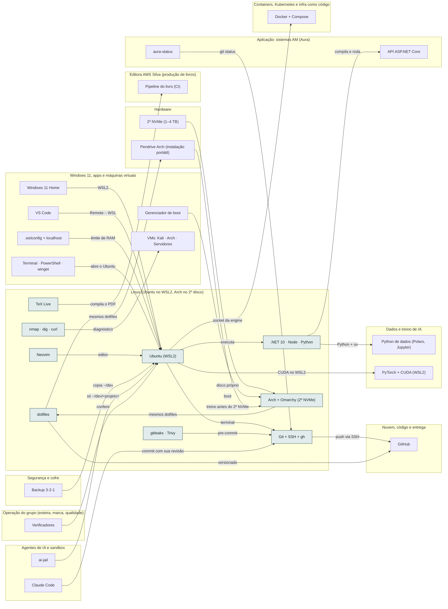

<!-- Arquivo GERADO por tools/gerar_docs.py a partir de data/. Edite os dados, não este arquivo. -->

# Camada 04 · Linux (Ubuntu no WSL2, Arch no 2º disco)

[← Arquitetura](../arquitetura.md) · [Índice da documentação](../README.md)

> **Ligação com a camada de baixo:** O código fica no ext4 do Linux; o Windows enxerga pela ponte do WSL2.

**9 blocos** · 0 precisam de conta · 2 marcados como futuro

## Mapa de conexões

## Blocos

| Bloco | Tipo | O que faz | Quando entra |
|---|---|---|---|
| [Neovim](#nvim) | Local · futuro | Editor de terminal da trilha Arch e Akita. Aprender aos poucos; não substitui o VS Code no começo. | passo 24.2 · 2027, conforme cada compra |
| [nmap · dig · curl](#netw) | Local | Diagnóstico de rede no Ubuntu: portas, DNS e requisições HTTP. Instalados pelo bootstrap.sh. | passo 4.4 · Semana 2 · nov/2026 |
| [Ubuntu (WSL2)](#wsl) | Local | Onde o código vive e roda. | passo 4.1 · Semana 2 · nov/2026; passo 4.5 · Semana 2 · nov/2026 |
| [Git + SSH + gh](#git) | Local | Versionamento e acesso ao GitHub. | passo 4.4 · Semana 2 · nov/2026; passo 4.6 · Semana 2 · nov/2026 |
| [.NET 10 · Node · Python](#rt) | Local | Runtimes das APIs, do front e dos scripts. | passo 4.4 · Semana 2 · nov/2026 |
| [TeX Live](#tex) | Local | Compila o livro e as apostilas. | passo 4.4 · Semana 2 · nov/2026 |
| [gitleaks · Trivy](#sec) | Local | Barra senha no commit e acha vulnerabilidades em imagens. | passo 4.4 · Semana 2 · nov/2026 |
| [dotfiles](#dot) | Local | Configuração versionada do ambiente. | passo 4.7 · Semana 2 · nov/2026 |
| [Arch + Omarchy (2º NVMe)](#arch) | Local · futuro | Linux nativo com boot próprio, sem tocar no Windows. Antes dele, o Arch portátil em pendrive ou SSD USB. | passo 24.1 · 2027, conforme cada compra |

### Neovim

*Local · futuro*

Editor de terminal da trilha Arch e Akita. Aprender aos poucos; não substitui o VS Code no começo.

**Quando entra:** passo 24.2 · 2027, conforme cada compra ([roteiro](../implantacao/roteiro.md))

| Direção | Bloco | Camada | O que passa |
|---|---|---|---|
| → envia para | [Ubuntu (WSL2)](04-lin.md#wsl) | Linux (Ubuntu no WSL2, Arch no 2º disco) | editor |

### nmap · dig · curl

*Local*

Diagnóstico de rede no Ubuntu: portas, DNS e requisições HTTP. Instalados pelo bootstrap.sh.

**Quando entra:** passo 4.4 · Semana 2 · nov/2026 ([roteiro](../implantacao/roteiro.md))

| Direção | Bloco | Camada | O que passa |
|---|---|---|---|
| → envia para | [VMs: Kali · Arch · Servidores](03-win.md#vms) | Windows 11, apps e máquinas virtuais | diagnóstico |

### Ubuntu (WSL2)

*Local*

Onde o código vive e roda.

**Quando entra:** passo 4.1 · Semana 2 · nov/2026; passo 4.5 · Semana 2 · nov/2026 ([roteiro](../implantacao/roteiro.md))

| Direção | Bloco | Camada | O que passa |
|---|---|---|---|
| → envia para | [Git + SSH + gh](04-lin.md#git) | Linux (Ubuntu no WSL2, Arch no 2º disco) | terminal |
| → envia para | [.NET 10 · Node · Python](04-lin.md#rt) | Linux (Ubuntu no WSL2, Arch no 2º disco) | executa |
| → envia para | [Docker + Compose](09-cnt.md#docker) | Containers, Kubernetes e infra como código | socket da engine |
| → envia para | [PyTorch + CUDA (WSL2)](06-dados.md#torch) | Dados e treino de IA | CUDA no WSL2 |
| ← recebe de | [Backup 3-2-1](02-seg.md#bkp) | Segurança e cofre | copia ~/dev |
| ← recebe de | [Windows 11 Home](03-win.md#w11) | Windows 11, apps e máquinas virtuais | WSL2 |
| ← recebe de | [VS Code](03-win.md#vsc) | Windows 11, apps e máquinas virtuais | Remote – WSL |
| ← recebe de | [ai-jail](05-ia.md#jail) | Agentes de IA e sandbox | só ~/dev/<projeto> |
| ← recebe de | [Neovim](04-lin.md#nvim) | Linux (Ubuntu no WSL2, Arch no 2º disco) | editor |
| ← recebe de | [.wslconfig + localhost](03-win.md#wslcfg) | Windows 11, apps e máquinas virtuais | limite de RAM |
| ← recebe de | [Terminal · PowerShell · winget](03-win.md#wterm) | Windows 11, apps e máquinas virtuais | abre o Ubuntu |
| ← recebe de | [Verificadores](23-oper.md#overif) | Operação do grupo (esteira, marca, qualidade) | confere |

### Git + SSH + gh

*Local*

Versionamento e acesso ao GitHub.

**Quando entra:** passo 4.4 · Semana 2 · nov/2026; passo 4.6 · Semana 2 · nov/2026 ([roteiro](../implantacao/roteiro.md))

| Direção | Bloco | Camada | O que passa |
|---|---|---|---|
| → envia para | [GitHub](12-nuvem.md#gh) | Nuvem, código e entrega | push via SSH |
| ← recebe de | [Ubuntu (WSL2)](04-lin.md#wsl) | Linux (Ubuntu no WSL2, Arch no 2º disco) | terminal |
| ← recebe de | [gitleaks · Trivy](04-lin.md#sec) | Linux (Ubuntu no WSL2, Arch no 2º disco) | pre-commit |
| ← recebe de | [aura-status](11-app.md#status) | Aplicação: sistemas AM (Aura) | git status |
| ← recebe de | [Claude Code](05-ia.md#cc) | Agentes de IA e sandbox | commit com sua revisão |

### .NET 10 · Node · Python

*Local*

Runtimes das APIs, do front e dos scripts.

**Quando entra:** passo 4.4 · Semana 2 · nov/2026 ([roteiro](../implantacao/roteiro.md))

| Direção | Bloco | Camada | O que passa |
|---|---|---|---|
| → envia para | [API ASP.NET Core](11-app.md#api) | Aplicação: sistemas AM (Aura) | compila e roda |
| → envia para | [Python de dados (Polars, Jupyter)](06-dados.md#pyds) | Dados e treino de IA | Python + uv |
| ← recebe de | [Ubuntu (WSL2)](04-lin.md#wsl) | Linux (Ubuntu no WSL2, Arch no 2º disco) | executa |

### TeX Live

*Local*

Compila o livro e as apostilas.

**Quando entra:** passo 4.4 · Semana 2 · nov/2026 ([roteiro](../implantacao/roteiro.md))

| Direção | Bloco | Camada | O que passa |
|---|---|---|---|
| → envia para | [Pipeline do livro (CI)](15-editora.md#bci) | Editora AMS Silva (produção de livros) | compila o PDF |

### gitleaks · Trivy

*Local*

Barra senha no commit e acha vulnerabilidades em imagens.

**Quando entra:** passo 4.4 · Semana 2 · nov/2026 ([roteiro](../implantacao/roteiro.md))

| Direção | Bloco | Camada | O que passa |
|---|---|---|---|
| → envia para | [Git + SSH + gh](04-lin.md#git) | Linux (Ubuntu no WSL2, Arch no 2º disco) | pre-commit |

### dotfiles

*Local*

Configuração versionada do ambiente.

**Quando entra:** passo 4.7 · Semana 2 · nov/2026 ([roteiro](../implantacao/roteiro.md))

| Direção | Bloco | Camada | O que passa |
|---|---|---|---|
| → envia para | [GitHub](12-nuvem.md#gh) | Nuvem, código e entrega | versionado |
| → envia para | [Pendrive Arch (instalação portátil)](01-hw.md#parch) | Hardware | mesmos dotfiles |
| ← recebe de | [Arch + Omarchy (2º NVMe)](04-lin.md#arch) | Linux (Ubuntu no WSL2, Arch no 2º disco) | mesmos dotfiles |

### Arch + Omarchy (2º NVMe)

*Local · futuro*

Linux nativo com boot próprio, sem tocar no Windows. Antes dele, o Arch portátil em pendrive ou SSD USB.

**Quando entra:** passo 24.1 · 2027, conforme cada compra ([roteiro](../implantacao/roteiro.md))

| Direção | Bloco | Camada | O que passa |
|---|---|---|---|
| → envia para | [dotfiles](04-lin.md#dot) | Linux (Ubuntu no WSL2, Arch no 2º disco) | mesmos dotfiles |
| ← recebe de | [2º NVMe (1–4 TB)](01-hw.md#nvme) | Hardware | disco próprio |
| ← recebe de | [Gerenciador de boot](03-win.md#boot) | Windows 11, apps e máquinas virtuais | boot |
| ← recebe de | [Pendrive Arch (instalação portátil)](01-hw.md#parch) | Hardware | treino antes do 2º NVMe |

---

[↑ Camada 05 · Agentes de IA e sandbox](05-ia.md) · [↓ Camada 03 · Windows 11, apps e máquinas virtuais](03-win.md)
