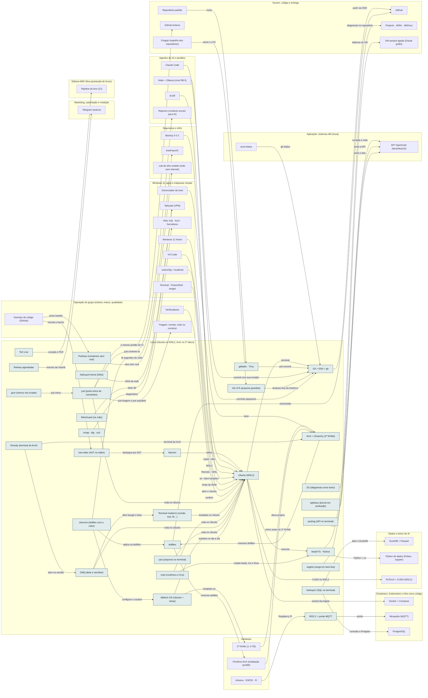

<!-- Arquivo GERADO por tools/gerar_docs.py a partir de data/. Edite os dados, não este arquivo. -->

# Camada 04 · Linux (Ubuntu no WSL2, Arch no 2º disco)

[← Arquitetura](../arquitetura.md) · [Índice da documentação](../README.md)

> **Ligação com a camada de baixo:** O código fica no ext4 do Linux; o Windows enxerga pela ponte do WSL2.

**30 blocos** · 0 precisam de conta · 6 marcados como futuro

## Mapa de conexões

## Blocos

| Bloco | Tipo | O que faz | Quando entra |
|---|---|---|---|
| [Neovim](#nvim) | Local · futuro | Editor de terminal da trilha Arch e Akita. Aprender aos poucos; não substitui o VS Code no começo. | passo 49.2 · 2027, conforme cada compra |
| [nmap · dig · curl](#netw) | Local | Diagnóstico de rede no Ubuntu: portas, DNS, requisições HTTP e captura de pacotes (tcpdump). Instalados pelo bootstrap.sh. | passo 4.4 · Semana 2 · nov/2026 |
| [Ubuntu (WSL2)](#wsl) | Local | Onde o código vive e roda. | passo 4.1 · Semana 2 · nov/2026; passo 4.5 · Semana 2 · nov/2026 |
| [Git + SSH + gh](#git) | Local | Versionamento e acesso ao GitHub. | passo 4.4 · Semana 2 · nov/2026; passo 4.6 · Semana 2 · nov/2026 |
| [Node/TS · Python](#rt) | Local | Runtimes das APIs, do front e dos scripts. | passo 4.4 · Semana 2 · nov/2026 |
| [TeX Live](#tex) | Local | Compila o livro e as apostilas. | passo 4.4 · Semana 2 · nov/2026 |
| [gitleaks · Trivy](#sec) | Local | Barra senha no commit e acha vulnerabilidades em imagens. | passo 4.4 · Semana 2 · nov/2026; passo 20.2 · Semana 5 · nov/2026; passo 20.3 · Semana 5 · nov/2026 |
| [dotfiles](#dot) | Local | Configuração versionada do ambiente, aplicada pelo chezmoi a partir de infra/dotfiles. | passo 4.7 · Semana 2 · nov/2026 |
| [Arch + Omarchy (2º NVMe)](#arch) | Local · futuro | Linux nativo com boot próprio, sem tocar no Windows. Antes dele, o Arch portátil em pendrive ou SSD USB. | passo 49.1 · 2027, conforme cada compra |
| [AMtech OS (Ubuntu + setup)](#amtechos) | Local · futuro | O dev-setup como sistema operacional (ADR 0016): os/instalar.sh transforma um Ubuntu LTS no AMtech OS, com perfis, tema, firewall, snapshots e o comando amtech. VM primeiro; depois o 2º NVMe, com o Windows intocado. | passo 48.1 · Nov/2026: teste na VM (grátis, 2 h); no notebook quando o 2º NVMe chegar; venda depois de alguns meses de uso; passo 48.4 · Nov/2026: teste na VM (grátis, 2 h); no notebook quando o 2º NVMe chegar; venda depois de alguns meses de uso |
| [Rotinas agendadas](#rotinas) | Local | Resumo da manhã no Telegram e manutenção semanal, pelo cron do Ubuntu. | passo 17.3 · Semana 4 · nov/2026; passo 17.4 · Semana 4 · nov/2026; passo 17.5 · Semana 4 · nov/2026 |
| [AdGuard Home (DNS)](#adguard) | Local | DNS da casa com bloqueio de anúncios e rastreadores, também pelo Tailscale. | passo 30.4 · Semana 6 · nov/2026 |
| [WireGuard (na mão)](#wireguard) | Local | Túnel montado à mão entre duas máquinas, para entender o que o Tailscale faz. | passo 30.6 · Semana 6 · nov/2026 |
| [ROS 2 + ponte MQTT](#ros2) | Local · futuro | Robôs no Raspberry Pi com ROS 2; o mqtt_client leva os tópicos para o MQTT e o Home Assistant manda e recebe comandos. | passo 60.10 · Voz no PC e política em dez/2026; servidor da casa e cada aparelho conforme a compra (2027); orquestrador depois da Operação 24 horas |
| [just (porta única de comandos)](#just) | Local | O justfile na raiz do repositório junta os comandos do setup: just check (o mesmo portão do CI), just triagem, just arquiteto, just docs, just medir. Binário único, instalado pelo bootstrap.sh. | passo 21.1 · Semana 5 · nov/2026 (tudo grátis, em sessões curtas); o analisador lógico entra com a primeira compra de robótica; passo 21.2 · Semana 5 · nov/2026 (tudo grátis, em sessões curtas); o analisador lógico entra com a primeira compra de robótica; passo 22.1 · Nov/2026 a abr/2027, uma fase por vez, dentro das 7 h extras por semana; fases 0 e 1 primeiro, o garimpo logo depois |
| [Terminal moderno (zoxide, eza, fd…)](#termx) | Local | zoxide (cd que aprende), eza (ls), fd (find), btop (monitor), hyperfine (benchmark), lazygit, lazydocker e o prompt Starship. Binários únicos, instalados pelo bootstrap.sh; ripgrep, fzf e tmux já vinham; tcpdump entra junto. | passo 21.1 · Semana 5 · nov/2026 (tudo grátis, em sessões curtas); o analisador lógico entra com a primeira compra de robótica |
| [mise (runtimes e CLIs)](#mise) | Local | Principal (ADR 0008): instala e fixa Node, Go, Rust e as CLIs do setup a partir de ~/.config/mise/config.toml. O fnm fica como reserva; o Python segue no uv. | passo 21.10 · Semana 5 · nov/2026 (tudo grátis, em sessões curtas); o analisador lógico entra com a primeira compra de robótica |
| [Zellij (abas e sessões)](#zellij) | Local | Multiplexador principal (ADR 0008): atalhos visíveis, layout setup (código, servidor, lazygit, lazydocker, btop) e sessões que voltam. O tmux fica para servidores. | passo 21.11 · Semana 5 · nov/2026 (tudo grátis, em sessões curtas); o analisador lógico entra com a primeira compra de robótica |
| [yazi (arquivos no terminal)](#yazi) | Local | Gerenciador de arquivos no terminal com prévia de imagem, PDF e código. Pelo mise. | passo 21.10 · Semana 5 · nov/2026 (tudo grátis, em sessões curtas); o analisador lógico entra com a primeira compra de robótica |
| [chezmoi (dotfiles com o cofre)](#chezmoi) | Local | Principal dos dotfiles (ADR 0008): aplica infra/dotfiles (mise, Zellij, Starship, Ghostty, Neovim, yazi, Aider) e lê segredos do KeePassXC na hora, sem gravar nada no repositório. | passo 21.11 · Semana 5 · nov/2026 (tudo grátis, em sessões curtas); o analisador lógico entra com a primeira compra de robótica |
| [Ghostty (terminal do Arch)](#ghostty) | Local · futuro | Terminal acelerado por GPU para o Arch nativo; abre direto na sessão do Zellij. Não tem versão para Windows, onde o Windows Terminal continua. | passo 49.7 · 2027, conforme cada compra |
| [Podman (containers sem root)](#podman) | Local | Containers sem root e sem serviço: roda o lab de alvo e imagens de terceiros com menos risco. O Docker Desktop segue como principal no dia a dia. | passo 21.10 · Semana 5 · nov/2026 (tudo grátis, em sessões curtas); o analisador lógico entra com a primeira compra de robótica |
| [Git LFS (arquivos grandes)](#gitlfs) | Local | Firmware, bancos do Ghidra, placas do KiCad e modelos 3D fora do histórico do Git; o Forgejo serve o LFS do espelho. | passo 21.10 · Semana 5 · nov/2026 (tudo grátis, em sessões curtas); o analisador lógico entra com a primeira compra de robótica |
| [tree-sitter (AST no editor)](#treesitter) | Local | Destaque, seleção e navegação por árvore sintática no Neovim (C#, TS, Go, Rust, Python, Svelte, Astro). O Repomix e o Aider usam o mesmo parser. | passo 21.11 · Semana 5 · nov/2026 (tudo grátis, em sessões curtas); o analisador lógico entra com a primeira compra de robótica |
| [posting (API no terminal)](#posting) | Local | Cliente de API no terminal, com requisições em arquivo. Reserva do Bruno; o jeito de testar uma API por SSH dentro da VM. | passo 21.10 · Semana 5 · nov/2026 (tudo grátis, em sessões curtas); o analisador lógico entra com a primeira compra de robótica |
| [harlequin (SQL no terminal)](#harlequin) | Local | Editor de SQL no terminal para Postgres e DuckDB. Reserva do DBeaver; bom dentro do Zellij e por SSH. | passo 21.10 · Semana 5 · nov/2026 (tudo grátis, em sessões curtas); o analisador lógico entra com a primeira compra de robótica |
| [gum (menus nos scripts)](#gum) | Local | Menus, perguntas e confirmações bonitas nos scripts: o just menu escolhe a receita com setas. | passo 21.13 · Semana 5 · nov/2026 (tudo grátis, em sessões curtas); o analisador lógico entra com a primeira compra de robótica |
| [D2 (diagramas como texto)](#d2) | Local | Diagramas de arquitetura de sistema e de cliente como texto, exportados em SVG. Os diagramas da documentação do GitHub seguem em Mermaid. | passo 21.10 · Semana 5 · nov/2026 (tudo grátis, em sessões curtas); o analisador lógico entra com a primeira compra de robótica; passo 21.16 · Semana 5 · nov/2026 (tudo grátis, em sessões curtas); o analisador lógico entra com a primeira compra de robótica |
| [vegeta (carga em taxa fixa)](#vegeta) | Local | Carga HTTP em taxa constante para achar o teto de uma API, do limite de requisições e do pool do banco. Os cenários seguem no k6. | passo 21.10 · Semana 5 · nov/2026 (tudo grátis, em sessões curtas); o analisador lógico entra com a primeira compra de robótica |
| [bpftrace (kernel em produção)](#bpftrace) | Local · futuro | Rastreamento dinâmico com eBPF para latência que não aparece em log. Na VM e no Linux nativo, onde o kernel é seu. | passo 32.8 · Dez/2026 a jan/2027 na VM grátis da Oracle, depois da Operação 24 horas; VPS e VM paga quando uma renda pagar |

### Neovim

*Local · futuro*

Editor de terminal da trilha Arch e Akita. Aprender aos poucos; não substitui o VS Code no começo.

**Quando entra:** passo 49.2 · 2027, conforme cada compra ([roteiro](../implantacao/roteiro.md))

| Direção | Bloco | Camada | O que passa |
|---|---|---|---|
| → envia para | [Ubuntu (WSL2)](04-lin.md#wsl) | Linux (Ubuntu no WSL2, Arch no 2º disco) | editor |
| ← recebe de | [tree-sitter (AST no editor)](04-lin.md#treesitter) | Linux (Ubuntu no WSL2, Arch no 2º disco) | destaque por AST |

### nmap · dig · curl

*Local*

Diagnóstico de rede no Ubuntu: portas, DNS, requisições HTTP e captura de pacotes (tcpdump). Instalados pelo bootstrap.sh.

**Quando entra:** passo 4.4 · Semana 2 · nov/2026 ([roteiro](../implantacao/roteiro.md))

| Direção | Bloco | Camada | O que passa |
|---|---|---|---|
| → envia para | [VMs: Kali · Arch · Servidores](03-win.md#vms) | Windows 11, apps e máquinas virtuais | diagnóstico |

### Ubuntu (WSL2)

*Local*

Onde o código vive e roda.

**Quando entra:** passo 4.1 · Semana 2 · nov/2026; passo 4.5 · Semana 2 · nov/2026 ([roteiro](../implantacao/roteiro.md))

| Direção | Bloco | Camada | O que passa |
|---|---|---|---|
| → envia para | [Git + SSH + gh](04-lin.md#git) | Linux (Ubuntu no WSL2, Arch no 2º disco) | terminal |
| → envia para | [Node/TS · Python](04-lin.md#rt) | Linux (Ubuntu no WSL2, Arch no 2º disco) | executa |
| → envia para | [Docker + Compose](09-cnt.md#docker) | Containers, Kubernetes e infra como código | socket da engine |
| → envia para | [PyTorch + CUDA (WSL2)](06-dados.md#torch) | Dados e treino de IA | CUDA no WSL2 |
| ← recebe de | [Backup 3-2-1](02-seg.md#bkp) | Segurança e cofre | copia ~/dev |
| ← recebe de | [Windows 11 Home](03-win.md#w11) | Windows 11, apps e máquinas virtuais | WSL2 |
| ← recebe de | [VS Code](03-win.md#vsc) | Windows 11, apps e máquinas virtuais | Remote – WSL |
| ← recebe de | [ai-jail](05-ia.md#jail) | Agentes de IA e sandbox | só ~/dev/<projeto> |
| ← recebe de | [Neovim](04-lin.md#nvim) | Linux (Ubuntu no WSL2, Arch no 2º disco) | editor |
| ← recebe de | [.wslconfig + localhost](03-win.md#wslcfg) | Windows 11, apps e máquinas virtuais | limite de RAM |
| ← recebe de | [Terminal · PowerShell · winget](03-win.md#wterm) | Windows 11, apps e máquinas virtuais | abre o Ubuntu |
| ← recebe de | [Verificadores](23-oper.md#overif) | Operação do grupo (esteira, marca, qualidade) | confere |
| ← recebe de | [just (porta única de comandos)](04-lin.md#just) | Linux (Ubuntu no WSL2, Arch no 2º disco) | roda no Ubuntu |
| ← recebe de | [Terminal moderno (zoxide, eza, fd…)](04-lin.md#termx) | Linux (Ubuntu no WSL2, Arch no 2º disco) | instalado no Ubuntu |
| ← recebe de | [mise (runtimes e CLIs)](04-lin.md#mise) | Linux (Ubuntu no WSL2, Arch no 2º disco) | roda no Ubuntu |
| ← recebe de | [Zellij (abas e sessões)](04-lin.md#zellij) | Linux (Ubuntu no WSL2, Arch no 2º disco) | roda no Ubuntu |
| ← recebe de | [yazi (arquivos no terminal)](04-lin.md#yazi) | Linux (Ubuntu no WSL2, Arch no 2º disco) | roda no Ubuntu |
| ← recebe de | [AMtech OS (Ubuntu + setup)](04-lin.md#amtechos) | Linux (Ubuntu no WSL2, Arch no 2º disco) | substitui no dia a dia |

### Git + SSH + gh

*Local*

Versionamento e acesso ao GitHub.

**Quando entra:** passo 4.4 · Semana 2 · nov/2026; passo 4.6 · Semana 2 · nov/2026 ([roteiro](../implantacao/roteiro.md))

| Direção | Bloco | Camada | O que passa |
|---|---|---|---|
| → envia para | [GitHub](12-nuvem.md#gh) | Nuvem, código e entrega | push via SSH |
| ← recebe de | [Ubuntu (WSL2)](04-lin.md#wsl) | Linux (Ubuntu no WSL2, Arch no 2º disco) | terminal |
| ← recebe de | [gitleaks · Trivy](04-lin.md#sec) | Linux (Ubuntu no WSL2, Arch no 2º disco) | pre-commit |
| ← recebe de | [aura-status](11-app.md#status) | Aplicação: sistemas AM (Aura) | git status |
| ← recebe de | [Claude Code](05-ia.md#cc) | Agentes de IA e sandbox | commit com sua revisão |
| ← recebe de | [Git LFS (arquivos grandes)](04-lin.md#gitlfs) | Linux (Ubuntu no WSL2, Arch no 2º disco) | binários fora do histórico |
| ← recebe de | [Aider + Ollama (nível R$ 0)](05-ia.md#aider) | Agentes de IA e sandbox | commits pequenos |

### Node/TS · Python

*Local*

Runtimes das APIs, do front e dos scripts.

**Quando entra:** passo 4.4 · Semana 2 · nov/2026 ([roteiro](../implantacao/roteiro.md))

| Direção | Bloco | Camada | O que passa |
|---|---|---|---|
| → envia para | [API TypeScript (Next/NestJS)](11-app.md#api) | Aplicação: sistemas AM (Aura) | compila e roda |
| → envia para | [Python de dados (Polars, Jupyter)](06-dados.md#pyds) | Dados e treino de IA | Python + uv |
| ← recebe de | [Ubuntu (WSL2)](04-lin.md#wsl) | Linux (Ubuntu no WSL2, Arch no 2º disco) | executa |
| ← recebe de | [mise (runtimes e CLIs)](04-lin.md#mise) | Linux (Ubuntu no WSL2, Arch no 2º disco) | instala Node, Go e Rust |

### TeX Live

*Local*

Compila o livro e as apostilas.

**Quando entra:** passo 4.4 · Semana 2 · nov/2026 ([roteiro](../implantacao/roteiro.md))

| Direção | Bloco | Camada | O que passa |
|---|---|---|---|
| → envia para | [Pipeline do livro (CI)](15-editora.md#bci) | Editora AMS Silva (produção de livros) | compila o PDF |

### gitleaks · Trivy

*Local*

Barra senha no commit e acha vulnerabilidades em imagens.

**Quando entra:** passo 4.4 · Semana 2 · nov/2026; passo 20.2 · Semana 5 · nov/2026; passo 20.3 · Semana 5 · nov/2026 ([roteiro](../implantacao/roteiro.md))

| Direção | Bloco | Camada | O que passa |
|---|---|---|---|
| → envia para | [Git + SSH + gh](04-lin.md#git) | Linux (Ubuntu no WSL2, Arch no 2º disco) | pre-commit |
| ← recebe de | [Repositório padrão](12-nuvem.md#repopadrao) | Nuvem, código e entrega | inclui |

### dotfiles

*Local*

Configuração versionada do ambiente, aplicada pelo chezmoi a partir de infra/dotfiles.

**Quando entra:** passo 4.7 · Semana 2 · nov/2026 ([roteiro](../implantacao/roteiro.md))

| Direção | Bloco | Camada | O que passa |
|---|---|---|---|
| → envia para | [GitHub](12-nuvem.md#gh) | Nuvem, código e entrega | versionado |
| → envia para | [Pendrive Arch (instalação portátil)](01-hw.md#parch) | Hardware | mesmos dotfiles |
| ← recebe de | [Arch + Omarchy (2º NVMe)](04-lin.md#arch) | Linux (Ubuntu no WSL2, Arch no 2º disco) | mesmos dotfiles |
| ← recebe de | [chezmoi (dotfiles com o cofre)](04-lin.md#chezmoi) | Linux (Ubuntu no WSL2, Arch no 2º disco) | aplica os dotfiles |

### Arch + Omarchy (2º NVMe)

*Local · futuro*

Linux nativo com boot próprio, sem tocar no Windows. Antes dele, o Arch portátil em pendrive ou SSD USB.

**Quando entra:** passo 49.1 · 2027, conforme cada compra ([roteiro](../implantacao/roteiro.md))

| Direção | Bloco | Camada | O que passa |
|---|---|---|---|
| → envia para | [dotfiles](04-lin.md#dot) | Linux (Ubuntu no WSL2, Arch no 2º disco) | mesmos dotfiles |
| ← recebe de | [2º NVMe (1–4 TB)](01-hw.md#nvme) | Hardware | disco próprio |
| ← recebe de | [Gerenciador de boot](03-win.md#boot) | Windows 11, apps e máquinas virtuais | boot |
| ← recebe de | [Pendrive Arch (instalação portátil)](01-hw.md#parch) | Hardware | treino antes do 2º NVMe |
| ← recebe de | [Ghostty (terminal do Arch)](04-lin.md#ghostty) | Linux (Ubuntu no WSL2, Arch no 2º disco) | terminal do Arch |

### AMtech OS (Ubuntu + setup)

*Local · futuro*

O dev-setup como sistema operacional (ADR 0016): os/instalar.sh transforma um Ubuntu LTS no AMtech OS, com perfis, tema, firewall, snapshots e o comando amtech. VM primeiro; depois o 2º NVMe, com o Windows intocado.

**Quando entra:** passo 48.1 · Nov/2026: teste na VM (grátis, 2 h); no notebook quando o 2º NVMe chegar; venda depois de alguns meses de uso; passo 48.4 · Nov/2026: teste na VM (grátis, 2 h); no notebook quando o 2º NVMe chegar; venda depois de alguns meses de uso ([roteiro](../implantacao/roteiro.md))

| Direção | Bloco | Camada | O que passa |
|---|---|---|---|
| → envia para | [2º NVMe (1–4 TB)](01-hw.md#nvme) | Hardware | instalado no |
| → envia para | [Ubuntu (WSL2)](04-lin.md#wsl) | Linux (Ubuntu no WSL2, Arch no 2º disco) | substitui no dia a dia |
| ← recebe de | [chezmoi (dotfiles com o cofre)](04-lin.md#chezmoi) | Linux (Ubuntu no WSL2, Arch no 2º disco) | configura o usuário |

### Rotinas agendadas

*Local*

Resumo da manhã no Telegram e manutenção semanal, pelo cron do Ubuntu.

**Quando entra:** passo 17.3 · Semana 4 · nov/2026; passo 17.4 · Semana 4 · nov/2026; passo 17.5 · Semana 4 · nov/2026 ([roteiro](../implantacao/roteiro.md))

| Direção | Bloco | Camada | O que passa |
|---|---|---|---|
| → envia para | [Telegram (avisos)](21-mkt.md#tg) | Marketing, automação e medição | resumo da manhã |

### AdGuard Home (DNS)

*Local*

DNS da casa com bloqueio de anúncios e rastreadores, também pelo Tailscale.

**Quando entra:** passo 30.4 · Semana 6 · nov/2026 ([roteiro](../implantacao/roteiro.md))

| Direção | Bloco | Camada | O que passa |
|---|---|---|---|
| → envia para | [Tailscale (VPN)](03-win.md#tail) | Windows 11, apps e máquinas virtuais | DNS da rede |

### WireGuard (na mão)

*Local*

Túnel montado à mão entre duas máquinas, para entender o que o Tailscale faz.

**Quando entra:** passo 30.6 · Semana 6 · nov/2026 ([roteiro](../implantacao/roteiro.md))

| Direção | Bloco | Camada | O que passa |
|---|---|---|---|
| → envia para | [Tailscale (VPN)](03-win.md#tail) | Windows 11, apps e máquinas virtuais | base de |

### ROS 2 + ponte MQTT

*Local · futuro*

Robôs no Raspberry Pi com ROS 2; o mqtt_client leva os tópicos para o MQTT e o Home Assistant manda e recebe comandos.

**Quando entra:** passo 60.10 · Voz no PC e política em dez/2026; servidor da casa e cada aparelho conforme a compra (2027); orquestrador depois da Operação 24 horas ([roteiro](../implantacao/roteiro.md))

| Direção | Bloco | Camada | O que passa |
|---|---|---|---|
| → envia para | [Mosquitto (MQTT)](09-cnt.md#mqtt) | Containers, Kubernetes e infra como código | ponte |
| ← recebe de | [Arduino · ESP32 · Pi](01-hw.md#rob) | Hardware | Raspberry Pi |

### just (porta única de comandos)

*Local*

O justfile na raiz do repositório junta os comandos do setup: just check (o mesmo portão do CI), just triagem, just arquiteto, just docs, just medir. Binário único, instalado pelo bootstrap.sh.

**Quando entra:** passo 21.1 · Semana 5 · nov/2026 (tudo grátis, em sessões curtas); o analisador lógico entra com a primeira compra de robótica; passo 21.2 · Semana 5 · nov/2026 (tudo grátis, em sessões curtas); o analisador lógico entra com a primeira compra de robótica; passo 22.1 · Nov/2026 a abr/2027, uma fase por vez, dentro das 7 h extras por semana; fases 0 e 1 primeiro, o garimpo logo depois ([roteiro](../implantacao/roteiro.md))

| Direção | Bloco | Camada | O que passa |
|---|---|---|---|
| → envia para | [Triagem: montar, colar ou construir](23-oper.md#triagem) | Operação do grupo (esteira, marca, qualidade) | just triagem e just arquiteto |
| → envia para | [GitHub Actions](12-nuvem.md#gha) | Nuvem, código e entrega | o mesmo portão do CI |
| → envia para | [Repomix (contexto enxuto para IA)](05-ia.md#repomix) | Agentes de IA e sandbox | just contexto-ia |
| → envia para | [Ubuntu (WSL2)](04-lin.md#wsl) | Linux (Ubuntu no WSL2, Arch no 2º disco) | roda no Ubuntu |
| ← recebe de | [gum (menus nos scripts)](04-lin.md#gum) | Linux (Ubuntu no WSL2, Arch no 2º disco) | just menu |

### Terminal moderno (zoxide, eza, fd…)

*Local*

zoxide (cd que aprende), eza (ls), fd (find), btop (monitor), hyperfine (benchmark), lazygit, lazydocker e o prompt Starship. Binários únicos, instalados pelo bootstrap.sh; ripgrep, fzf e tmux já vinham; tcpdump entra junto.

**Quando entra:** passo 21.1 · Semana 5 · nov/2026 (tudo grátis, em sessões curtas); o analisador lógico entra com a primeira compra de robótica ([roteiro](../implantacao/roteiro.md))

| Direção | Bloco | Camada | O que passa |
|---|---|---|---|
| → envia para | [Ubuntu (WSL2)](04-lin.md#wsl) | Linux (Ubuntu no WSL2, Arch no 2º disco) | instalado no Ubuntu |
| ← recebe de | [Zellij (abas e sessões)](04-lin.md#zellij) | Linux (Ubuntu no WSL2, Arch no 2º disco) | abre lazygit e btop |

### mise (runtimes e CLIs)

*Local*

Principal (ADR 0008): instala e fixa Node, Go, Rust e as CLIs do setup a partir de ~/.config/mise/config.toml. O fnm fica como reserva; o Python segue no uv.

**Quando entra:** passo 21.10 · Semana 5 · nov/2026 (tudo grátis, em sessões curtas); o analisador lógico entra com a primeira compra de robótica ([roteiro](../implantacao/roteiro.md))

| Direção | Bloco | Camada | O que passa |
|---|---|---|---|
| → envia para | [Ubuntu (WSL2)](04-lin.md#wsl) | Linux (Ubuntu no WSL2, Arch no 2º disco) | roda no Ubuntu |
| → envia para | [Node/TS · Python](04-lin.md#rt) | Linux (Ubuntu no WSL2, Arch no 2º disco) | instala Node, Go e Rust |

### Zellij (abas e sessões)

*Local*

Multiplexador principal (ADR 0008): atalhos visíveis, layout setup (código, servidor, lazygit, lazydocker, btop) e sessões que voltam. O tmux fica para servidores.

**Quando entra:** passo 21.11 · Semana 5 · nov/2026 (tudo grátis, em sessões curtas); o analisador lógico entra com a primeira compra de robótica ([roteiro](../implantacao/roteiro.md))

| Direção | Bloco | Camada | O que passa |
|---|---|---|---|
| → envia para | [Ubuntu (WSL2)](04-lin.md#wsl) | Linux (Ubuntu no WSL2, Arch no 2º disco) | roda no Ubuntu |
| → envia para | [Terminal moderno (zoxide, eza, fd…)](04-lin.md#termx) | Linux (Ubuntu no WSL2, Arch no 2º disco) | abre lazygit e btop |
| ← recebe de | [Ghostty (terminal do Arch)](04-lin.md#ghostty) | Linux (Ubuntu no WSL2, Arch no 2º disco) | abre na sessão |

### yazi (arquivos no terminal)

*Local*

Gerenciador de arquivos no terminal com prévia de imagem, PDF e código. Pelo mise.

**Quando entra:** passo 21.10 · Semana 5 · nov/2026 (tudo grátis, em sessões curtas); o analisador lógico entra com a primeira compra de robótica ([roteiro](../implantacao/roteiro.md))

| Direção | Bloco | Camada | O que passa |
|---|---|---|---|
| → envia para | [Ubuntu (WSL2)](04-lin.md#wsl) | Linux (Ubuntu no WSL2, Arch no 2º disco) | roda no Ubuntu |

### chezmoi (dotfiles com o cofre)

*Local*

Principal dos dotfiles (ADR 0008): aplica infra/dotfiles (mise, Zellij, Starship, Ghostty, Neovim, yazi, Aider) e lê segredos do KeePassXC na hora, sem gravar nada no repositório.

**Quando entra:** passo 21.11 · Semana 5 · nov/2026 (tudo grátis, em sessões curtas); o analisador lógico entra com a primeira compra de robótica ([roteiro](../implantacao/roteiro.md))

| Direção | Bloco | Camada | O que passa |
|---|---|---|---|
| → envia para | [dotfiles](04-lin.md#dot) | Linux (Ubuntu no WSL2, Arch no 2º disco) | aplica os dotfiles |
| → envia para | [KeePassXC](02-seg.md#kee) | Segurança e cofre | lê segredos do cofre |
| → envia para | [AMtech OS (Ubuntu + setup)](04-lin.md#amtechos) | Linux (Ubuntu no WSL2, Arch no 2º disco) | configura o usuário |

### Ghostty (terminal do Arch)

*Local · futuro*

Terminal acelerado por GPU para o Arch nativo; abre direto na sessão do Zellij. Não tem versão para Windows, onde o Windows Terminal continua.

**Quando entra:** passo 49.7 · 2027, conforme cada compra ([roteiro](../implantacao/roteiro.md))

| Direção | Bloco | Camada | O que passa |
|---|---|---|---|
| → envia para | [Arch + Omarchy (2º NVMe)](04-lin.md#arch) | Linux (Ubuntu no WSL2, Arch no 2º disco) | terminal do Arch |
| → envia para | [Zellij (abas e sessões)](04-lin.md#zellij) | Linux (Ubuntu no WSL2, Arch no 2º disco) | abre na sessão |

### Podman (containers sem root)

*Local*

Containers sem root e sem serviço: roda o lab de alvo e imagens de terceiros com menos risco. O Docker Desktop segue como principal no dia a dia.

**Quando entra:** passo 21.10 · Semana 5 · nov/2026 (tudo grátis, em sessões curtas); o analisador lógico entra com a primeira compra de robótica ([roteiro](../implantacao/roteiro.md))

| Direção | Bloco | Camada | O que passa |
|---|---|---|---|
| → envia para | [Lab de alvo isolado (rede sem internet)](02-seg.md#labalvo) | Segurança e cofre | alvo sem root |
| ← recebe de | [Garimpo de código (GitHub)](23-oper.md#garimpo) | Operação do grupo (esteira, marca, qualidade) | clona isolado |

### Git LFS (arquivos grandes)

*Local*

Firmware, bancos do Ghidra, placas do KiCad e modelos 3D fora do histórico do Git; o Forgejo serve o LFS do espelho.

**Quando entra:** passo 21.10 · Semana 5 · nov/2026 (tudo grátis, em sessões curtas); o analisador lógico entra com a primeira compra de robótica ([roteiro](../implantacao/roteiro.md))

| Direção | Bloco | Camada | O que passa |
|---|---|---|---|
| → envia para | [Git + SSH + gh](04-lin.md#git) | Linux (Ubuntu no WSL2, Arch no 2º disco) | binários fora do histórico |
| ← recebe de | [Forgejo (espelho dos repositórios)](12-nuvem.md#forgejo) | Nuvem, código e entrega | serve o LFS |

### tree-sitter (AST no editor)

*Local*

Destaque, seleção e navegação por árvore sintática no Neovim (C#, TS, Go, Rust, Python, Svelte, Astro). O Repomix e o Aider usam o mesmo parser.

**Quando entra:** passo 21.11 · Semana 5 · nov/2026 (tudo grátis, em sessões curtas); o analisador lógico entra com a primeira compra de robótica ([roteiro](../implantacao/roteiro.md))

| Direção | Bloco | Camada | O que passa |
|---|---|---|---|
| → envia para | [Neovim](04-lin.md#nvim) | Linux (Ubuntu no WSL2, Arch no 2º disco) | destaque por AST |
| ← recebe de | [Garimpo de código (GitHub)](23-oper.md#garimpo) | Operação do grupo (esteira, marca, qualidade) | recorta o trecho |

### posting (API no terminal)

*Local*

Cliente de API no terminal, com requisições em arquivo. Reserva do Bruno; o jeito de testar uma API por SSH dentro da VM.

**Quando entra:** passo 21.10 · Semana 5 · nov/2026 (tudo grátis, em sessões curtas); o analisador lógico entra com a primeira compra de robótica ([roteiro](../implantacao/roteiro.md))

| Direção | Bloco | Camada | O que passa |
|---|---|---|---|
| → envia para | [API TypeScript (Next/NestJS)](11-app.md#api) | Aplicação: sistemas AM (Aura) | testa a API |

### harlequin (SQL no terminal)

*Local*

Editor de SQL no terminal para Postgres e DuckDB. Reserva do DBeaver; bom dentro do Zellij e por SSH.

**Quando entra:** passo 21.10 · Semana 5 · nov/2026 (tudo grátis, em sessões curtas); o analisador lógico entra com a primeira compra de robótica ([roteiro](../implantacao/roteiro.md))

| Direção | Bloco | Camada | O que passa |
|---|---|---|---|
| → envia para | [PostgreSQL](09-cnt.md#pg) | Containers, Kubernetes e infra como código | consulta o Postgres |
| → envia para | [DuckDB + Parquet](06-dados.md#duck) | Dados e treino de IA | abre o DuckDB |

### gum (menus nos scripts)

*Local*

Menus, perguntas e confirmações bonitas nos scripts: o just menu escolhe a receita com setas.

**Quando entra:** passo 21.13 · Semana 5 · nov/2026 (tudo grátis, em sessões curtas); o analisador lógico entra com a primeira compra de robótica ([roteiro](../implantacao/roteiro.md))

| Direção | Bloco | Camada | O que passa |
|---|---|---|---|
| → envia para | [just (porta única de comandos)](04-lin.md#just) | Linux (Ubuntu no WSL2, Arch no 2º disco) | just menu |

### D2 (diagramas como texto)

*Local*

Diagramas de arquitetura de sistema e de cliente como texto, exportados em SVG. Os diagramas da documentação do GitHub seguem em Mermaid.

**Quando entra:** passo 21.10 · Semana 5 · nov/2026 (tudo grátis, em sessões curtas); o analisador lógico entra com a primeira compra de robótica; passo 21.16 · Semana 5 · nov/2026 (tudo grátis, em sessões curtas); o analisador lógico entra com a primeira compra de robótica ([roteiro](../implantacao/roteiro.md))

| Direção | Bloco | Camada | O que passa |
|---|---|---|---|
| → envia para | [Projects · ADRs · MkDocs](12-nuvem.md#ghproj) | Nuvem, código e entrega | diagramas no repositório |

### vegeta (carga em taxa fixa)

*Local*

Carga HTTP em taxa constante para achar o teto de uma API, do limite de requisições e do pool do banco. Os cenários seguem no k6.

**Quando entra:** passo 21.10 · Semana 5 · nov/2026 (tudo grátis, em sessões curtas); o analisador lógico entra com a primeira compra de robótica ([roteiro](../implantacao/roteiro.md))

| Direção | Bloco | Camada | O que passa |
|---|---|---|---|
| → envia para | [API TypeScript (Next/NestJS)](11-app.md#api) | Aplicação: sistemas AM (Aura) | acha o teto |

### bpftrace (kernel em produção)

*Local · futuro*

Rastreamento dinâmico com eBPF para latência que não aparece em log. Na VM e no Linux nativo, onde o kernel é seu.

**Quando entra:** passo 32.8 · Dez/2026 a jan/2027 na VM grátis da Oracle, depois da Operação 24 horas; VPS e VM paga quando uma renda pagar ([roteiro](../implantacao/roteiro.md))

| Direção | Bloco | Camada | O que passa |
|---|---|---|---|
| → envia para | [VM sempre ligada (Oracle grátis)](12-nuvem.md#vm247) | Nuvem, código e entrega | latência na VM |

---

[↑ Camada 05 · Agentes de IA e sandbox](05-ia.md) · [↓ Camada 03 · Windows 11, apps e máquinas virtuais](03-win.md)
