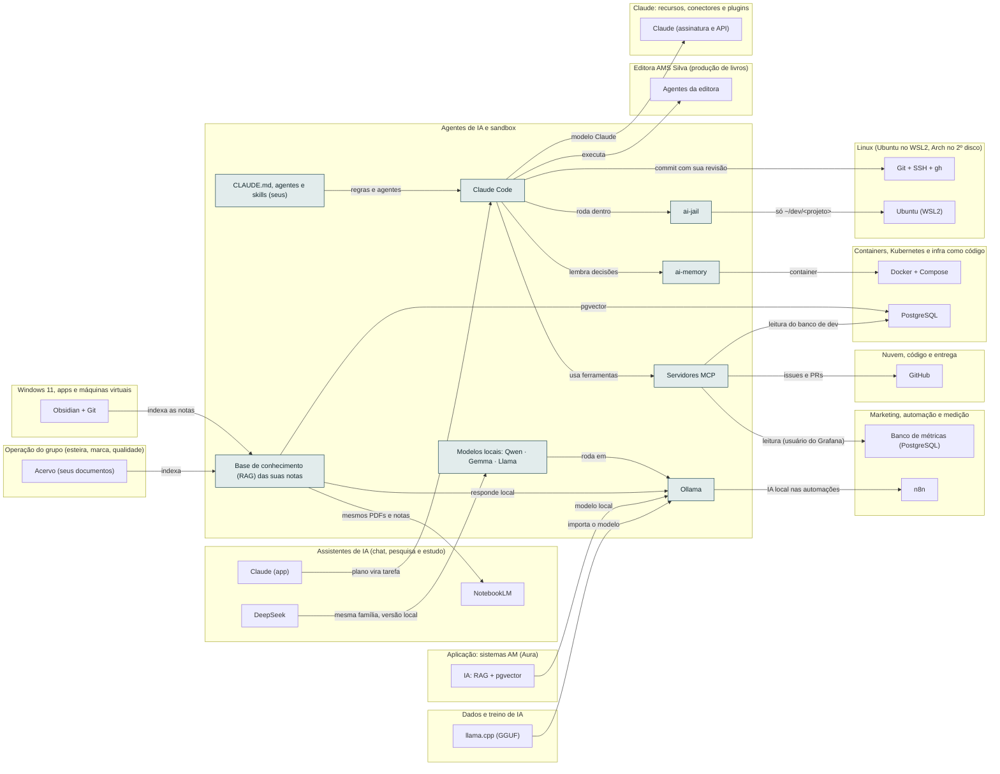

<!-- Arquivo GERADO por tools/gerar_docs.py a partir de data/. Edite os dados, não este arquivo. -->

# Camada 05 · Agentes de IA e sandbox

[← Arquitetura](../arquitetura.md) · [Índice da documentação](../README.md)

> **Ligação com a camada de baixo:** O agente roda dentro do ai-jail e só enxerga ~/dev/<projeto>.

**8 blocos** · 1 precisam de conta · 0 marcados como futuro

## Mapa de conexões

## Blocos

| Bloco | Tipo | O que faz | Quando entra |
|---|---|---|---|
| [Modelos locais: Qwen · Gemma · Llama](#lmods) | Local | Modelos abertos baixados pelo Ollama. De 3B a 4B cabem inteiros na GTX 1650. Um 8B (cerca de 4,9 GB em Q4) também roda: o Ollama põe parte na GPU e o resto nos 32 GB de RAM, mais devagar. Rodam offline, então servem para dados sensíveis. | passo 6.4 · Semana 2 · nov/2026; passo 21.5 · Pendrives, GPU e laboratório a partir da semana 2; Zoomcamp, dbt e Airflow junto do IA2 da Trilha de Dados e IA do vault (depois do Passo 8, ≈ 2028); dataset e treino do 8B junto do IA6 (≈ 2029) |
| [Base de conhecimento (RAG) das suas notas](#rag) | Local | Suas anotações, resumos com suas palavras, exercícios resolvidos e aulas que você mesmo gravou, indexados para a IA consultar. Roda com Ollama + pgvector (local) ou NotebookLM e Claude Projects. | passo 6.7 · Semana 2 · nov/2026; passo 8.6 · Semanas 3 e 4 · nov/2026 |
| [Claude Code](#cc) | Local · precisa de conta | Agente de programação no terminal. | passo 6.1 · Semana 2 · nov/2026 |
| [ai-jail](#jail) | Local | Sandbox do agente. | passo 6.2 · Semana 2 · nov/2026 |
| [ai-memory](#mem) | Local | Memória do agente entre sessões (container). | passo 6.6 · Semana 2 · nov/2026 |
| [Servidores MCP](#mcp) | Local | Agente acessa GitHub e banco de dev com permissão limitada. | passo 6.5 · Semana 2 · nov/2026 |
| [CLAUDE.md, agentes e skills (seus)](#kit) | Local | Revisor C#, /commit, /novo-sistema-aura e os demais que você vai criar. | passo 6.3 · Semana 2 · nov/2026 |
| [Ollama](#oll) | Local | IA local na GTX 1650; API em localhost:11434. Carrega os modelos prontos e os que você treinar, em GGUF. | passo 6.4 · Semana 2 · nov/2026; passo 21.5 · Pendrives, GPU e laboratório a partir da semana 2; Zoomcamp, dbt e Airflow junto do IA2 da Trilha de Dados e IA do vault (depois do Passo 8, ≈ 2028); dataset e treino do 8B junto do IA6 (≈ 2029); passo 21.12 · Pendrives, GPU e laboratório a partir da semana 2; Zoomcamp, dbt e Airflow junto do IA2 da Trilha de Dados e IA do vault (depois do Passo 8, ≈ 2028); dataset e treino do 8B junto do IA6 (≈ 2029) |

### Modelos locais: Qwen · Gemma · Llama

*Local*

Modelos abertos baixados pelo Ollama. De 3B a 4B cabem inteiros na GTX 1650. Um 8B (cerca de 4,9 GB em Q4) também roda: o Ollama põe parte na GPU e o resto nos 32 GB de RAM, mais devagar. Rodam offline, então servem para dados sensíveis.

**Quando entra:** passo 6.4 · Semana 2 · nov/2026; passo 21.5 · Pendrives, GPU e laboratório a partir da semana 2; Zoomcamp, dbt e Airflow junto do IA2 da Trilha de Dados e IA do vault (depois do Passo 8, ≈ 2028); dataset e treino do 8B junto do IA6 (≈ 2029) ([roteiro](../implantacao/roteiro.md))

| Direção | Bloco | Camada | O que passa |
|---|---|---|---|
| → envia para | [Ollama](05-ia.md#oll) | Agentes de IA e sandbox | roda em |
| ← recebe de | [DeepSeek](07-chat.md#ds) | Assistentes de IA (chat, pesquisa e estudo) | mesma família, versão local |

### Base de conhecimento (RAG) das suas notas

*Local*

Suas anotações, resumos com suas palavras, exercícios resolvidos e aulas que você mesmo gravou, indexados para a IA consultar. Roda com Ollama + pgvector (local) ou NotebookLM e Claude Projects.

**Quando entra:** passo 6.7 · Semana 2 · nov/2026; passo 8.6 · Semanas 3 e 4 · nov/2026 ([roteiro](../implantacao/roteiro.md))

| Direção | Bloco | Camada | O que passa |
|---|---|---|---|
| → envia para | [Ollama](05-ia.md#oll) | Agentes de IA e sandbox | responde local |
| → envia para | [PostgreSQL](09-cnt.md#pg) | Containers, Kubernetes e infra como código | pgvector |
| → envia para | [NotebookLM](07-chat.md#nblm) | Assistentes de IA (chat, pesquisa e estudo) | mesmos PDFs e notas |
| ← recebe de | [Obsidian + Git](03-win.md#obsd) | Windows 11, apps e máquinas virtuais | indexa as notas |
| ← recebe de | [Acervo (seus documentos)](23-oper.md#acv) | Operação do grupo (esteira, marca, qualidade) | indexa |

### Claude Code

*Local · precisa de conta*

Agente de programação no terminal.

**Quando entra:** passo 6.1 · Semana 2 · nov/2026 ([roteiro](../implantacao/roteiro.md))

| Direção | Bloco | Camada | O que passa |
|---|---|---|---|
| → envia para | [ai-jail](05-ia.md#jail) | Agentes de IA e sandbox | roda dentro |
| → envia para | [ai-memory](05-ia.md#mem) | Agentes de IA e sandbox | lembra decisões |
| → envia para | [Servidores MCP](05-ia.md#mcp) | Agentes de IA e sandbox | usa ferramentas |
| → envia para | [Claude (assinatura e API)](08-clc.md#anth) | Claude: recursos, conectores e plugins | modelo Claude |
| → envia para | [Agentes da editora](15-editora.md#bagentes) | Editora AMS Silva (produção de livros) | executa |
| → envia para | [Git + SSH + gh](04-lin.md#git) | Linux (Ubuntu no WSL2, Arch no 2º disco) | commit com sua revisão |
| ← recebe de | [CLAUDE.md, agentes e skills (seus)](05-ia.md#kit) | Agentes de IA e sandbox | regras e agentes |
| ← recebe de | [Claude (app)](07-chat.md#capp2) | Assistentes de IA (chat, pesquisa e estudo) | plano vira tarefa |

### ai-jail

*Local*

Sandbox do agente.

**Quando entra:** passo 6.2 · Semana 2 · nov/2026 ([roteiro](../implantacao/roteiro.md))

| Direção | Bloco | Camada | O que passa |
|---|---|---|---|
| → envia para | [Ubuntu (WSL2)](04-lin.md#wsl) | Linux (Ubuntu no WSL2, Arch no 2º disco) | só ~/dev/<projeto> |
| ← recebe de | [Claude Code](05-ia.md#cc) | Agentes de IA e sandbox | roda dentro |

### ai-memory

*Local*

Memória do agente entre sessões (container).

**Quando entra:** passo 6.6 · Semana 2 · nov/2026 ([roteiro](../implantacao/roteiro.md))

| Direção | Bloco | Camada | O que passa |
|---|---|---|---|
| → envia para | [Docker + Compose](09-cnt.md#docker) | Containers, Kubernetes e infra como código | container |
| ← recebe de | [Claude Code](05-ia.md#cc) | Agentes de IA e sandbox | lembra decisões |

### Servidores MCP

*Local*

Agente acessa GitHub e banco de dev com permissão limitada.

**Quando entra:** passo 6.5 · Semana 2 · nov/2026 ([roteiro](../implantacao/roteiro.md))

| Direção | Bloco | Camada | O que passa |
|---|---|---|---|
| → envia para | [GitHub](12-nuvem.md#gh) | Nuvem, código e entrega | issues e PRs |
| → envia para | [PostgreSQL](09-cnt.md#pg) | Containers, Kubernetes e infra como código | leitura do banco de dev |
| → envia para | [Banco de métricas (PostgreSQL)](21-mkt.md#metrics) | Marketing, automação e medição | leitura (usuário do Grafana) |
| ← recebe de | [Claude Code](05-ia.md#cc) | Agentes de IA e sandbox | usa ferramentas |

### CLAUDE.md, agentes e skills (seus)

*Local*

Revisor C#, /commit, /novo-sistema-aura e os demais que você vai criar.

**Quando entra:** passo 6.3 · Semana 2 · nov/2026 ([roteiro](../implantacao/roteiro.md))

| Direção | Bloco | Camada | O que passa |
|---|---|---|---|
| → envia para | [Claude Code](05-ia.md#cc) | Agentes de IA e sandbox | regras e agentes |

### Ollama

*Local*

IA local na GTX 1650; API em localhost:11434. Carrega os modelos prontos e os que você treinar, em GGUF.

**Quando entra:** passo 6.4 · Semana 2 · nov/2026; passo 21.5 · Pendrives, GPU e laboratório a partir da semana 2; Zoomcamp, dbt e Airflow junto do IA2 da Trilha de Dados e IA do vault (depois do Passo 8, ≈ 2028); dataset e treino do 8B junto do IA6 (≈ 2029); passo 21.12 · Pendrives, GPU e laboratório a partir da semana 2; Zoomcamp, dbt e Airflow junto do IA2 da Trilha de Dados e IA do vault (depois do Passo 8, ≈ 2028); dataset e treino do 8B junto do IA6 (≈ 2029) ([roteiro](../implantacao/roteiro.md))

| Direção | Bloco | Camada | O que passa |
|---|---|---|---|
| → envia para | [n8n](21-mkt.md#n8n) | Marketing, automação e medição | IA local nas automações |
| ← recebe de | [Modelos locais: Qwen · Gemma · Llama](05-ia.md#lmods) | Agentes de IA e sandbox | roda em |
| ← recebe de | [Base de conhecimento (RAG) das suas notas](05-ia.md#rag) | Agentes de IA e sandbox | responde local |
| ← recebe de | [IA: RAG + pgvector](11-app.md#ai) | Aplicação: sistemas AM (Aura) | modelo local |
| ← recebe de | [llama.cpp (GGUF)](06-dados.md#gguf) | Dados e treino de IA | importa o modelo |

---

[↑ Camada 06 · Dados e treino de IA](06-dados.md) · [↓ Camada 04 · Linux (Ubuntu no WSL2, Arch no 2º disco)](04-lin.md)
