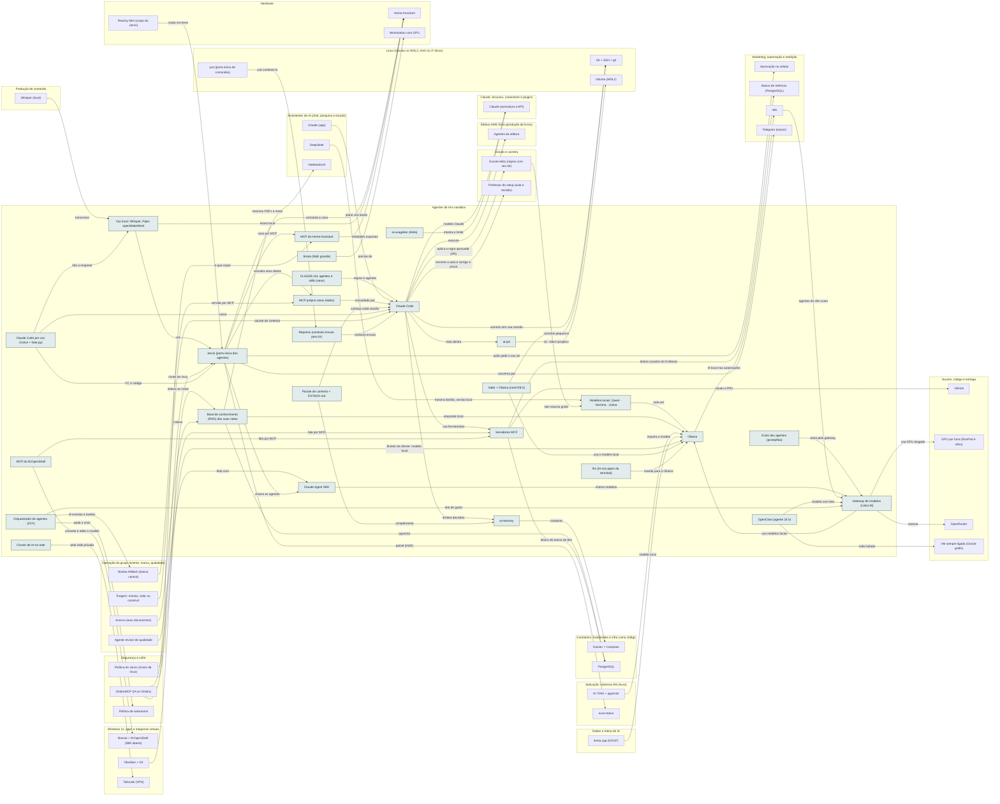

<!-- Arquivo GERADO por tools/gerar_docs.py a partir de data/. Edite os dados, não este arquivo. -->

# Camada 05 · Agentes de IA e sandbox

[← Arquitetura](../arquitetura.md) · [Índice da documentação](../README.md)

> **Ligação com a camada de baixo:** O agente roda dentro do ai-jail e só enxerga ~/dev/<projeto>.

**26 blocos** · 1 precisam de conta · 6 marcados como futuro

## Mapa de conexões

## Blocos

| Bloco | Tipo | O que faz | Quando entra |
|---|---|---|---|
| [Modelos locais: Qwen · Gemma · Llama](#lmods) | Local | Modelos abertos baixados pelo Ollama. De 3B a 4B cabem inteiros na GTX 1650. Um 8B (cerca de 4,9 GB em Q4) também roda: o Ollama põe parte na GPU e o resto nos 32 GB de RAM, mais devagar. Rodam offline, então servem para dados sensíveis. | passo 6.4 · Semana 2 · nov/2026; passo 26.4 · Nov/2026 em diante: a era da IA (191 posts) primeiro, os episódios do Akitando depois, o histórico por último; passo 27.4 · Semana 6 · nov/2026 a dez/2026; passo 44.5 · Pendrives, GPU e laboratório a partir da semana 2; Zoomcamp, dbt e Airflow junto do IA2 da Trilha de Dados e IA do vault (depois do Passo 8, ≈ 2028); dataset e treino do 8B junto do IA6 (≈ 2029) |
| [Base de conhecimento (RAG) das suas notas](#rag) | Local | Suas anotações, resumos com suas palavras, exercícios resolvidos e aulas que você mesmo gravou, indexados para a IA consultar. Roda com Ollama + pgvector (local) ou NotebookLM e Claude Projects. | passo 6.7 · Semana 2 · nov/2026; passo 8.6 · Semanas 3 e 4 · nov/2026; passo 31.7 · Dez/2026 a jan/2027 |
| [Claude Code](#cc) | Local · precisa de conta | Agente de programação no terminal. | passo 6.1 · Semana 2 · nov/2026; passo 21.4 · Semana 5 · nov/2026 (tudo grátis, em sessões curtas); o analisador lógico entra com a primeira compra de robótica; passo 22.8 · Nov/2026 a abr/2027, uma fase por vez, dentro das 7 h extras por semana; fases 0 e 1 primeiro, o garimpo logo depois; passo 25.4 · Todo dia, nas 3 h de estudo do plano do eixo; o currículo cresce a cada trimestre; passo 25.6 · Todo dia, nas 3 h de estudo do plano do eixo; o currículo cresce a cada trimestre; passo 25.9 · Todo dia, nas 3 h de estudo do plano do eixo; o currículo cresce a cada trimestre; passo 26.3 · Nov/2026 em diante: a era da IA (191 posts) primeiro, os episódios do Akitando depois, o histórico por último; passo 26.4 · Nov/2026 em diante: a era da IA (191 posts) primeiro, os episódios do Akitando depois, o histórico por último; passo 28.5 · Semana 6 · nov/2026 a dez/2026 |
| [ai-jail](#jail) | Local | Sandbox do agente. | passo 6.2 · Semana 2 · nov/2026; passo 21.6 · Semana 5 · nov/2026 (tudo grátis, em sessões curtas); o analisador lógico entra com a primeira compra de robótica |
| [ai-memory](#mem) | Local | Memória do agente entre sessões (container). | passo 6.6 · Semana 2 · nov/2026; passo 27.13 · Semana 6 · nov/2026 a dez/2026 |
| [Servidores MCP](#mcp) | Local | Agente acessa GitHub e banco de dev com permissão limitada. | passo 6.5 · Semana 2 · nov/2026; passo 27.6 · Semana 6 · nov/2026 a dez/2026 |
| [CLAUDE.md, agentes e skills (seus)](#kit) | Local | Revisor C#, /commit, /novo-sistema-aura e os demais que você vai criar. | passo 6.3 · Semana 2 · nov/2026; passo 21.6 · Semana 5 · nov/2026 (tudo grátis, em sessões curtas); o analisador lógico entra com a primeira compra de robótica; passo 27.10 · Semana 6 · nov/2026 a dez/2026 |
| [Ollama](#oll) | Local | IA local na GTX 1650; API em localhost:11434. Carrega os modelos prontos e os que você treinar, em GGUF. | passo 6.4 · Semana 2 · nov/2026; passo 27.4 · Semana 6 · nov/2026 a dez/2026; passo 44.5 · Pendrives, GPU e laboratório a partir da semana 2; Zoomcamp, dbt e Airflow junto do IA2 da Trilha de Dados e IA do vault (depois do Passo 8, ≈ 2028); dataset e treino do 8B junto do IA6 (≈ 2029); passo 44.12 · Pendrives, GPU e laboratório a partir da semana 2; Zoomcamp, dbt e Airflow junto do IA2 da Trilha de Dados e IA do vault (depois do Passo 8, ≈ 2028); dataset e treino do 8B junto do IA6 (≈ 2029) |
| [Gateway de modelos (LiteLLM)](#litellm) | Local | Um endereço para todos os modelos (local, API, GPU alugada), com nomes estáveis, fallback e teto de gasto. | passo 27.1 · Semana 6 · nov/2026 a dez/2026; passo 27.7 · Semana 6 · nov/2026 a dez/2026; passo 27.11 · Semana 6 · nov/2026 a dez/2026; passo 27.15 · Semana 6 · nov/2026 a dez/2026; passo 28.7 · Semana 6 · nov/2026 a dez/2026; passo 29.5 · 2027, depois do primeiro fine-tuning de 8B; passo 31.5 · Dez/2026 a jan/2027 |
| [Evals dos agentes (promptfoo)](#promptfoo) | Local | Casos de teste de cada agente; prompt ou modelo novo só entra se passar. | passo 27.2 · Semana 6 · nov/2026 a dez/2026; passo 27.7 · Semana 6 · nov/2026 a dez/2026; passo 29.3 · 2027, depois do primeiro fine-tuning de 8B; passo 31.7 · Dez/2026 a jan/2027 |
| [MCP próprio (seus dados)](#mcpproprio) | Local | Servidor MCP só de leitura com portfólio, softwares, roteiro e progresso, para qualquer agente consultar. | passo 27.6 · Semana 6 · nov/2026 a dez/2026 |
| [Claude Agent SDK](#agentsdk) | Local | Agentes próprios em código (revisor, analista, orçamentista) com as mesmas ferramentas do Claude Code. | passo 27.5 · Semana 6 · nov/2026 a dez/2026 |
| [Cluster de IA na rede](#iacluster) | Local | llama.cpp RPC ou exo: um modelo maior dividido entre os seus computadores. | passo 29.2 · 2027, depois do primeiro fine-tuning de 8B |
| [ai-usagebar (Akita)](#aiusage) | Local | Mostra no terminal quanto do limite de Claude, Codex, Z.AI e OpenRouter já foi usado. | passo 27.14 · Semana 6 · nov/2026 a dez/2026 |
| [Pacote de contexto + ESTADO.md](#sessao) | Local | Contexto curto para começar cada conversa nova e memória de 5 linhas por sessão: o limite dura. | passo 27.12 · Semana 6 · nov/2026 a dez/2026 |
| [Strata (MoE grande)](#strata) | Local · futuro | Motor aberto (MIT) que roda um MoE de 125B com 6B ativos em PC doméstico usando a VRAM como cache. Pede ~12 GB de GPU: entra com a workstation. | passo 29.6 · 2027, depois do primeiro fine-tuning de 8B |
| [OpenClaw (agente 24 h)](#oclaw) | Remoto · futuro | Agente auto-hospedado para tarefas noturnas que as rotinas e o n8n não cobrem. Histórico de segurança ruim em 2026: só na VM isolada, atrás do Tailscale, sem suas contas pessoais, sem skills de terceiros não revisadas e com chave de teto baixo no gateway. | passo 28.9 · Semana 6 · nov/2026 a dez/2026 |
| [Jarvis (porta única dos agentes)](#jarvis) | Local · futuro | Assistente de voz do Home Assistant com o Claude como agente: comando simples resolve local, o resto passa pela política do Jarvis; o PC e o código vão pelo Claude Code por voz. | passo 59.3 · Voz no PC e política em dez/2026; servidor da casa e cada aparelho conforme a compra (2027); orquestrador depois da Operação 24 horas |
| [Voz local: Whisper, Piper, openWakeWord](#jvoz) | Local · futuro | Protocolo Wyoming (infra/jarvis): Whisper na GPU do notebook, Piper em pt_BR e openWakeWord com o "hey jarvis"; reserva na CPU do servidor da casa. | passo 59.2 · Voz no PC e política em dez/2026; servidor da casa e cada aparelho conforme a compra (2027); orquestrador depois da Operação 24 horas |
| [MCP do Home Assistant](#hamcp) | Local · futuro | Integração Model Context Protocol Server: o Claude controla e consulta só as entidades expostas, com conta de administrador e OAuth. | passo 59.5 · Voz no PC e política em dez/2026; servidor da casa e cada aparelho conforme a compra (2027); orquestrador depois da Operação 24 horas |
| [Claude Code por voz (/voice + falar.py)](#ccvoz) | Local | Você fala com o /voice e ele responde em voz pelo hook tools/jarvis/falar.py (Piper local): pastas, arquivos, pesquisa, repositórios e PRs. | passo 59.1 · Voz no PC e política em dez/2026; servidor da casa e cada aparelho conforme a compra (2027); orquestrador depois da Operação 24 horas |
| [MCP do IfcOpenShell](#ifcmcp) | Local | O Claude consulta e edita o modelo IFC por MCP (ifcopenshell-mcp), seguindo as regras de construção. | passo 61.7 · Ferramentas grátis no estudo da manhã a partir de jan/2027; serviços e o AM Obra só depois das rendas de agora passarem no portão |
| [Repomix (contexto enxuto para IA)](#repomix) | Local | Empacota só a pasta pedida, com --compress (tree-sitter por dentro), para colar no Claude do app sem mandar o repositório inteiro. Roda por npx, sem instalar. | passo 21.5 · Semana 5 · nov/2026 (tudo grátis, em sessões curtas); o analisador lógico entra com a primeira compra de robótica |
| [Aider + Ollama (nível R$ 0)](#aider) | Local | Par de programação no Git com o modelo local (Qwen 2.5 Coder) e o repo map por tree-sitter: o nível 1 do roteamento, sem gastar token. O Claude Code segue como agente principal. | passo 21.14 · Semana 5 · nov/2026 (tudo grátis, em sessões curtas); o analisador lógico entra com a primeira compra de robótica; passo 22.8 · Nov/2026 a abr/2027, uma fase por vez, dentro das 7 h extras por semana; fases 0 e 1 primeiro, o garimpo logo depois |
| [llm (IA nos pipes do terminal)](#llmcli) | Local | git diff | llm "mensagem de commit": IA no meio de qualquer comando, com o plugin do Ollama (grátis) e os modelos do gateway. | passo 21.15 · Semana 5 · nov/2026 (tudo grátis, em sessões curtas); o analisador lógico entra com a primeira compra de robótica |
| [Orquestrador de agentes (24 h)](#orquestrador) | Remoto · futuro | Claude Agent SDK na VM: lê eventos e tarefas do núcleo e chama o agente certo (garimpeiro, arquiteto, revisor, deploy, atendente, cobrador, financeiro), dentro do teto do LiteLLM. | passo 22.11 · Nov/2026 a abr/2027, uma fase por vez, dentro das 7 h extras por semana; fases 0 e 1 primeiro, o garimpo logo depois |

### Modelos locais: Qwen · Gemma · Llama

*Local*

Modelos abertos baixados pelo Ollama. De 3B a 4B cabem inteiros na GTX 1650. Um 8B (cerca de 4,9 GB em Q4) também roda: o Ollama põe parte na GPU e o resto nos 32 GB de RAM, mais devagar. Rodam offline, então servem para dados sensíveis.

**Quando entra:** passo 6.4 · Semana 2 · nov/2026; passo 26.4 · Nov/2026 em diante: a era da IA (191 posts) primeiro, os episódios do Akitando depois, o histórico por último; passo 27.4 · Semana 6 · nov/2026 a dez/2026; passo 44.5 · Pendrives, GPU e laboratório a partir da semana 2; Zoomcamp, dbt e Airflow junto do IA2 da Trilha de Dados e IA do vault (depois do Passo 8, ≈ 2028); dataset e treino do 8B junto do IA6 (≈ 2029) ([roteiro](../implantacao/roteiro.md))

| Direção | Bloco | Camada | O que passa |
|---|---|---|---|
| → envia para | [Ollama](05-ia.md#oll) | Agentes de IA e sandbox | roda em |
| ← recebe de | [DeepSeek](07-chat.md#ds) | Assistentes de IA (chat, pesquisa e estudo) | mesma família, versão local |
| ← recebe de | [Escola Akita (regras com seu ok)](14-est.md#akita) | Estudo e carreira | lote noturno grátis |

### Base de conhecimento (RAG) das suas notas

*Local*

Suas anotações, resumos com suas palavras, exercícios resolvidos e aulas que você mesmo gravou, indexados para a IA consultar. Roda com Ollama + pgvector (local) ou NotebookLM e Claude Projects.

**Quando entra:** passo 6.7 · Semana 2 · nov/2026; passo 8.6 · Semanas 3 e 4 · nov/2026; passo 31.7 · Dez/2026 a jan/2027 ([roteiro](../implantacao/roteiro.md))

| Direção | Bloco | Camada | O que passa |
|---|---|---|---|
| → envia para | [Ollama](05-ia.md#oll) | Agentes de IA e sandbox | responde local |
| → envia para | [PostgreSQL](09-cnt.md#pg) | Containers, Kubernetes e infra como código | pgvector |
| → envia para | [NotebookLM](07-chat.md#nblm) | Assistentes de IA (chat, pesquisa e estudo) | mesmos PDFs e notas |
| ← recebe de | [Obsidian + Git](03-win.md#obsd) | Windows 11, apps e máquinas virtuais | indexa as notas |
| ← recebe de | [Acervo (seus documentos)](23-oper.md#acv) | Operação do grupo (esteira, marca, qualidade) | indexa |

### Claude Code

*Local · precisa de conta*

Agente de programação no terminal.

**Quando entra:** passo 6.1 · Semana 2 · nov/2026; passo 21.4 · Semana 5 · nov/2026 (tudo grátis, em sessões curtas); o analisador lógico entra com a primeira compra de robótica; passo 22.8 · Nov/2026 a abr/2027, uma fase por vez, dentro das 7 h extras por semana; fases 0 e 1 primeiro, o garimpo logo depois; passo 25.4 · Todo dia, nas 3 h de estudo do plano do eixo; o currículo cresce a cada trimestre; passo 25.6 · Todo dia, nas 3 h de estudo do plano do eixo; o currículo cresce a cada trimestre; passo 25.9 · Todo dia, nas 3 h de estudo do plano do eixo; o currículo cresce a cada trimestre; passo 26.3 · Nov/2026 em diante: a era da IA (191 posts) primeiro, os episódios do Akitando depois, o histórico por último; passo 26.4 · Nov/2026 em diante: a era da IA (191 posts) primeiro, os episódios do Akitando depois, o histórico por último; passo 28.5 · Semana 6 · nov/2026 a dez/2026 ([roteiro](../implantacao/roteiro.md))

| Direção | Bloco | Camada | O que passa |
|---|---|---|---|
| → envia para | [ai-jail](05-ia.md#jail) | Agentes de IA e sandbox | roda dentro |
| → envia para | [ai-memory](05-ia.md#mem) | Agentes de IA e sandbox | lembra decisões |
| → envia para | [Servidores MCP](05-ia.md#mcp) | Agentes de IA e sandbox | usa ferramentas |
| → envia para | [Claude (assinatura e API)](08-clc.md#anth) | Claude: recursos, conectores e plugins | modelo Claude |
| → envia para | [Agentes da editora](15-editora.md#bagentes) | Editora AMS Silva (produção de livros) | executa |
| → envia para | [Git + SSH + gh](04-lin.md#git) | Linux (Ubuntu no WSL2, Arch no 2º disco) | commit com sua revisão |
| → envia para | [Escola Akita (regras com seu ok)](14-est.md#akita) | Estudo e carreira | aplica a regra aprovada (PR) |
| → envia para | [Professor do setup (aula e revisão)](14-est.md#professor) | Estudo e carreira | escreve a aula e corrige a prova |
| ← recebe de | [CLAUDE.md, agentes e skills (seus)](05-ia.md#kit) | Agentes de IA e sandbox | regras e agentes |
| ← recebe de | [Claude (app)](07-chat.md#capp2) | Assistentes de IA (chat, pesquisa e estudo) | plano vira tarefa |
| ← recebe de | [MCP próprio (seus dados)](05-ia.md#mcpproprio) | Agentes de IA e sandbox | consultado por |
| ← recebe de | [Pacote de contexto + ESTADO.md](05-ia.md#sessao) | Agentes de IA e sandbox | começa cada sessão |
| ← recebe de | [Claude Code por voz (/voice + falar.py)](05-ia.md#ccvoz) | Agentes de IA e sandbox | /voice |
| ← recebe de | [Triagem: montar, colar ou construir](23-oper.md#triagem) | Operação do grupo (esteira, marca, qualidade) | pacote de contexto |
| ← recebe de | [Repomix (contexto enxuto para IA)](05-ia.md#repomix) | Agentes de IA e sandbox | contexto enxuto |

### ai-jail

*Local*

Sandbox do agente.

**Quando entra:** passo 6.2 · Semana 2 · nov/2026; passo 21.6 · Semana 5 · nov/2026 (tudo grátis, em sessões curtas); o analisador lógico entra com a primeira compra de robótica ([roteiro](../implantacao/roteiro.md))

| Direção | Bloco | Camada | O que passa |
|---|---|---|---|
| → envia para | [Ubuntu (WSL2)](04-lin.md#wsl) | Linux (Ubuntu no WSL2, Arch no 2º disco) | só ~/dev/<projeto> |
| ← recebe de | [Claude Code](05-ia.md#cc) | Agentes de IA e sandbox | roda dentro |

### ai-memory

*Local*

Memória do agente entre sessões (container).

**Quando entra:** passo 6.6 · Semana 2 · nov/2026; passo 27.13 · Semana 6 · nov/2026 a dez/2026 ([roteiro](../implantacao/roteiro.md))

| Direção | Bloco | Camada | O que passa |
|---|---|---|---|
| → envia para | [Docker + Compose](09-cnt.md#docker) | Containers, Kubernetes e infra como código | container |
| ← recebe de | [Claude Code](05-ia.md#cc) | Agentes de IA e sandbox | lembra decisões |
| ← recebe de | [Pacote de contexto + ESTADO.md](05-ia.md#sessao) | Agentes de IA e sandbox | complementa |

### Servidores MCP

*Local*

Agente acessa GitHub e banco de dev com permissão limitada.

**Quando entra:** passo 6.5 · Semana 2 · nov/2026; passo 27.6 · Semana 6 · nov/2026 a dez/2026 ([roteiro](../implantacao/roteiro.md))

| Direção | Bloco | Camada | O que passa |
|---|---|---|---|
| → envia para | [GitHub](12-nuvem.md#gh) | Nuvem, código e entrega | issues e PRs |
| → envia para | [PostgreSQL](09-cnt.md#pg) | Containers, Kubernetes e infra como código | leitura do banco de dev |
| → envia para | [Banco de métricas (PostgreSQL)](21-mkt.md#metrics) | Marketing, automação e medição | leitura (usuário do Grafana) |
| ← recebe de | [Claude Code](05-ia.md#cc) | Agentes de IA e sandbox | usa ferramentas |
| ← recebe de | [GhidraMCP (IA no Ghidra)](02-seg.md#ghidramcp) | Segurança e cofre | fala por MCP |
| ← recebe de | [MCP do IfcOpenShell](05-ia.md#ifcmcp) | Agentes de IA e sandbox | fala por MCP |

### CLAUDE.md, agentes e skills (seus)

*Local*

Revisor C#, /commit, /novo-sistema-aura e os demais que você vai criar.

**Quando entra:** passo 6.3 · Semana 2 · nov/2026; passo 21.6 · Semana 5 · nov/2026 (tudo grátis, em sessões curtas); o analisador lógico entra com a primeira compra de robótica; passo 27.10 · Semana 6 · nov/2026 a dez/2026 ([roteiro](../implantacao/roteiro.md))

| Direção | Bloco | Camada | O que passa |
|---|---|---|---|
| → envia para | [Claude Code](05-ia.md#cc) | Agentes de IA e sandbox | regras e agentes |

### Ollama

*Local*

IA local na GTX 1650; API em localhost:11434. Carrega os modelos prontos e os que você treinar, em GGUF.

**Quando entra:** passo 6.4 · Semana 2 · nov/2026; passo 27.4 · Semana 6 · nov/2026 a dez/2026; passo 44.5 · Pendrives, GPU e laboratório a partir da semana 2; Zoomcamp, dbt e Airflow junto do IA2 da Trilha de Dados e IA do vault (depois do Passo 8, ≈ 2028); dataset e treino do 8B junto do IA6 (≈ 2029); passo 44.12 · Pendrives, GPU e laboratório a partir da semana 2; Zoomcamp, dbt e Airflow junto do IA2 da Trilha de Dados e IA do vault (depois do Passo 8, ≈ 2028); dataset e treino do 8B junto do IA6 (≈ 2029) ([roteiro](../implantacao/roteiro.md))

| Direção | Bloco | Camada | O que passa |
|---|---|---|---|
| → envia para | [n8n](21-mkt.md#n8n) | Marketing, automação e medição | IA local nas automações |
| ← recebe de | [Modelos locais: Qwen · Gemma · Llama](05-ia.md#lmods) | Agentes de IA e sandbox | roda em |
| ← recebe de | [Base de conhecimento (RAG) das suas notas](05-ia.md#rag) | Agentes de IA e sandbox | responde local |
| ← recebe de | [IA: RAG + pgvector](11-app.md#ai) | Aplicação: sistemas AM (Aura) | modelo local |
| ← recebe de | [llama.cpp (GGUF)](06-dados.md#gguf) | Dados e treino de IA | importa o modelo |
| ← recebe de | [Gateway de modelos (LiteLLM)](05-ia.md#litellm) | Agentes de IA e sandbox | usa modelos locais |
| ← recebe de | [GhidraMCP (IA no Ghidra)](02-seg.md#ghidramcp) | Segurança e cofre | binário de cliente: modelo local |
| ← recebe de | [Aider + Ollama (nível R$ 0)](05-ia.md#aider) | Agentes de IA e sandbox | usa o modelo local |
| ← recebe de | [llm (IA nos pipes do terminal)](05-ia.md#llmcli) | Agentes de IA e sandbox | manda para o Ollama |

### Gateway de modelos (LiteLLM)

*Local*

Um endereço para todos os modelos (local, API, GPU alugada), com nomes estáveis, fallback e teto de gasto.

**Quando entra:** passo 27.1 · Semana 6 · nov/2026 a dez/2026; passo 27.7 · Semana 6 · nov/2026 a dez/2026; passo 27.11 · Semana 6 · nov/2026 a dez/2026; passo 27.15 · Semana 6 · nov/2026 a dez/2026; passo 28.7 · Semana 6 · nov/2026 a dez/2026; passo 29.5 · 2027, depois do primeiro fine-tuning de 8B; passo 31.5 · Dez/2026 a jan/2027 ([roteiro](../implantacao/roteiro.md))

| Direção | Bloco | Camada | O que passa |
|---|---|---|---|
| → envia para | [Ollama](05-ia.md#oll) | Agentes de IA e sandbox | usa modelos locais |
| → envia para | [GPU por hora (RunPod e afins)](12-nuvem.md#gpuh) | Nuvem, código e entrega | usa GPU alugada |
| → envia para | [OpenRouter](12-nuvem.md#openrouter) | Nuvem, código e entrega | reserva |
| ← recebe de | [Evals dos agentes (promptfoo)](05-ia.md#promptfoo) | Agentes de IA e sandbox | testa pelo gateway |
| ← recebe de | [Claude Agent SDK](05-ia.md#agentsdk) | Agentes de IA e sandbox | chama modelos |
| ← recebe de | [n8n](21-mkt.md#n8n) | Marketing, automação e medição | agentes do n8n usam |
| ← recebe de | [OpenClaw (agente 24 h)](05-ia.md#oclaw) | Agentes de IA e sandbox | modelo com teto |
| ← recebe de | [Orquestrador de agentes (24 h)](05-ia.md#orquestrador) | Agentes de IA e sandbox | teto de gasto |

### Evals dos agentes (promptfoo)

*Local*

Casos de teste de cada agente; prompt ou modelo novo só entra se passar.

**Quando entra:** passo 27.2 · Semana 6 · nov/2026 a dez/2026; passo 27.7 · Semana 6 · nov/2026 a dez/2026; passo 29.3 · 2027, depois do primeiro fine-tuning de 8B; passo 31.7 · Dez/2026 a jan/2027 ([roteiro](../implantacao/roteiro.md))

| Direção | Bloco | Camada | O que passa |
|---|---|---|---|
| → envia para | [Gateway de modelos (LiteLLM)](05-ia.md#litellm) | Agentes de IA e sandbox | testa pelo gateway |

### MCP próprio (seus dados)

*Local*

Servidor MCP só de leitura com portfólio, softwares, roteiro e progresso, para qualquer agente consultar.

**Quando entra:** passo 27.6 · Semana 6 · nov/2026 a dez/2026 ([roteiro](../implantacao/roteiro.md))

| Direção | Bloco | Camada | O que passa |
|---|---|---|---|
| → envia para | [Claude Code](05-ia.md#cc) | Agentes de IA e sandbox | consultado por |
| ← recebe de | [Jarvis (porta única dos agentes)](05-ia.md#jarvis) | Agentes de IA e sandbox | consulta seus dados |
| ← recebe de | [Núcleo AMtech (banco central)](23-oper.md#nucleo) | Operação do grupo (esteira, marca, qualidade) | servido por MCP |

### Claude Agent SDK

*Local*

Agentes próprios em código (revisor, analista, orçamentista) com as mesmas ferramentas do Claude Code.

**Quando entra:** passo 27.5 · Semana 6 · nov/2026 a dez/2026 ([roteiro](../implantacao/roteiro.md))

| Direção | Bloco | Camada | O que passa |
|---|---|---|---|
| → envia para | [Gateway de modelos (LiteLLM)](05-ia.md#litellm) | Agentes de IA e sandbox | chama modelos |
| ← recebe de | [Agente revisor de qualidade](23-oper.md#revisor) | Operação do grupo (esteira, marca, qualidade) | feito com |
| ← recebe de | [Jarvis (porta única dos agentes)](05-ia.md#jarvis) | Agentes de IA e sandbox | chama os agentes |

### Cluster de IA na rede

*Local*

llama.cpp RPC ou exo: um modelo maior dividido entre os seus computadores.

**Quando entra:** passo 29.2 · 2027, depois do primeiro fine-tuning de 8B ([roteiro](../implantacao/roteiro.md))

| Direção | Bloco | Camada | O que passa |
|---|---|---|---|
| → envia para | [Tailscale (VPN)](03-win.md#tail) | Windows 11, apps e máquinas virtuais | pela rede privada |

### ai-usagebar (Akita)

*Local*

Mostra no terminal quanto do limite de Claude, Codex, Z.AI e OpenRouter já foi usado.

**Quando entra:** passo 27.14 · Semana 6 · nov/2026 a dez/2026 ([roteiro](../implantacao/roteiro.md))

| Direção | Bloco | Camada | O que passa |
|---|---|---|---|
| → envia para | [Claude (assinatura e API)](08-clc.md#anth) | Claude: recursos, conectores e plugins | mostra o limite |

### Pacote de contexto + ESTADO.md

*Local*

Contexto curto para começar cada conversa nova e memória de 5 linhas por sessão: o limite dura.

**Quando entra:** passo 27.12 · Semana 6 · nov/2026 a dez/2026 ([roteiro](../implantacao/roteiro.md))

| Direção | Bloco | Camada | O que passa |
|---|---|---|---|
| → envia para | [Claude Code](05-ia.md#cc) | Agentes de IA e sandbox | começa cada sessão |
| → envia para | [ai-memory](05-ia.md#mem) | Agentes de IA e sandbox | complementa |

### Strata (MoE grande)

*Local · futuro*

Motor aberto (MIT) que roda um MoE de 125B com 6B ativos em PC doméstico usando a VRAM como cache. Pede ~12 GB de GPU: entra com a workstation.

**Quando entra:** passo 29.6 · 2027, depois do primeiro fine-tuning de 8B ([roteiro](../implantacao/roteiro.md))

| Direção | Bloco | Camada | O que passa |
|---|---|---|---|
| → envia para | [Workstation com GPU](01-hw.md#ws) | Hardware | precisa de |

### OpenClaw (agente 24 h)

*Remoto · futuro*

Agente auto-hospedado para tarefas noturnas que as rotinas e o n8n não cobrem. Histórico de segurança ruim em 2026: só na VM isolada, atrás do Tailscale, sem suas contas pessoais, sem skills de terceiros não revisadas e com chave de teto baixo no gateway.

**Quando entra:** passo 28.9 · Semana 6 · nov/2026 a dez/2026 ([roteiro](../implantacao/roteiro.md))

| Direção | Bloco | Camada | O que passa |
|---|---|---|---|
| → envia para | [VM sempre ligada (Oracle grátis)](12-nuvem.md#vm247) | Nuvem, código e entrega | roda isolado |
| → envia para | [Gateway de modelos (LiteLLM)](05-ia.md#litellm) | Agentes de IA e sandbox | modelo com teto |

### Jarvis (porta única dos agentes)

*Local · futuro*

Assistente de voz do Home Assistant com o Claude como agente: comando simples resolve local, o resto passa pela política do Jarvis; o PC e o código vão pelo Claude Code por voz.

**Quando entra:** passo 59.3 · Voz no PC e política em dez/2026; servidor da casa e cada aparelho conforme a compra (2027); orquestrador depois da Operação 24 horas ([roteiro](../implantacao/roteiro.md))

| Direção | Bloco | Camada | O que passa |
|---|---|---|---|
| → envia para | [Telegram (avisos)](21-mkt.md#tg) | Marketing, automação e medição | conversa por |
| → envia para | [MCP próprio (seus dados)](05-ia.md#mcpproprio) | Agentes de IA e sandbox | consulta seus dados |
| → envia para | [Claude Agent SDK](05-ia.md#agentsdk) | Agentes de IA e sandbox | chama os agentes |
| → envia para | [Home Assistant](01-hw.md#ha) | Hardware | comanda a casa |
| → envia para | [aura-status](11-app.md#status) | Aplicação: sistemas AM (Aura) | painel (HUD) |
| → envia para | [Aprovação no celular](21-mkt.md#aprov) | Marketing, automação e medição | ação pede o seu ok |
| → envia para | [MCP do Home Assistant](05-ia.md#hamcp) | Agentes de IA e sandbox | casa por MCP |
| ← recebe de | [Voz local: Whisper, Piper, openWakeWord](05-ia.md#jvoz) | Agentes de IA e sandbox | voz |
| ← recebe de | [Política do Jarvis (níveis de risco)](02-seg.md#politica) | Segurança e cofre | níveis de risco |
| ← recebe de | [Claude Code por voz (/voice + falar.py)](05-ia.md#ccvoz) | Agentes de IA e sandbox | PC e código |
| ← recebe de | [Reachy Mini (corpo do Jarvis)](01-hw.md#reachy) | Hardware | corpo na mesa |

### Voz local: Whisper, Piper, openWakeWord

*Local · futuro*

Protocolo Wyoming (infra/jarvis): Whisper na GPU do notebook, Piper em pt_BR e openWakeWord com o "hey jarvis"; reserva na CPU do servidor da casa.

**Quando entra:** passo 59.2 · Voz no PC e política em dez/2026; servidor da casa e cada aparelho conforme a compra (2027); orquestrador depois da Operação 24 horas ([roteiro](../implantacao/roteiro.md))

| Direção | Bloco | Camada | O que passa |
|---|---|---|---|
| → envia para | [Jarvis (porta única dos agentes)](05-ia.md#jarvis) | Agentes de IA e sandbox | voz |
| → envia para | [Home Assistant](01-hw.md#ha) | Hardware | Assist local |
| ← recebe de | [Whisper (local)](13-cont.md#whis) | Produção de conteúdo | transcreve |
| ← recebe de | [Claude Code por voz (/voice + falar.py)](05-ia.md#ccvoz) | Agentes de IA e sandbox | fala a resposta |

### MCP do Home Assistant

*Local · futuro*

Integração Model Context Protocol Server: o Claude controla e consulta só as entidades expostas, com conta de administrador e OAuth.

**Quando entra:** passo 59.5 · Voz no PC e política em dez/2026; servidor da casa e cada aparelho conforme a compra (2027); orquestrador depois da Operação 24 horas ([roteiro](../implantacao/roteiro.md))

| Direção | Bloco | Camada | O que passa |
|---|---|---|---|
| → envia para | [Home Assistant](01-hw.md#ha) | Hardware | entidades expostas |
| ← recebe de | [Jarvis (porta única dos agentes)](05-ia.md#jarvis) | Agentes de IA e sandbox | casa por MCP |
| ← recebe de | [Política do Jarvis (níveis de risco)](02-seg.md#politica) | Segurança e cofre | o que expor |

### Claude Code por voz (/voice + falar.py)

*Local*

Você fala com o /voice e ele responde em voz pelo hook tools/jarvis/falar.py (Piper local): pastas, arquivos, pesquisa, repositórios e PRs.

**Quando entra:** passo 59.1 · Voz no PC e política em dez/2026; servidor da casa e cada aparelho conforme a compra (2027); orquestrador depois da Operação 24 horas ([roteiro](../implantacao/roteiro.md))

| Direção | Bloco | Camada | O que passa |
|---|---|---|---|
| → envia para | [Jarvis (porta única dos agentes)](05-ia.md#jarvis) | Agentes de IA e sandbox | PC e código |
| → envia para | [Claude Code](05-ia.md#cc) | Agentes de IA e sandbox | /voice |
| → envia para | [Voz local: Whisper, Piper, openWakeWord](05-ia.md#jvoz) | Agentes de IA e sandbox | fala a resposta |

### MCP do IfcOpenShell

*Local*

O Claude consulta e edita o modelo IFC por MCP (ifcopenshell-mcp), seguindo as regras de construção.

**Quando entra:** passo 61.7 · Ferramentas grátis no estudo da manhã a partir de jan/2027; serviços e o AM Obra só depois das rendas de agora passarem no portão ([roteiro](../implantacao/roteiro.md))

| Direção | Bloco | Camada | O que passa |
|---|---|---|---|
| → envia para | [Bonsai + IfcOpenShell (BIM aberto)](03-win.md#bonsai) | Windows 11, apps e máquinas virtuais | consulta e edita o modelo |
| → envia para | [Servidores MCP](05-ia.md#mcp) | Agentes de IA e sandbox | fala por MCP |

### Repomix (contexto enxuto para IA)

*Local*

Empacota só a pasta pedida, com --compress (tree-sitter por dentro), para colar no Claude do app sem mandar o repositório inteiro. Roda por npx, sem instalar.

**Quando entra:** passo 21.5 · Semana 5 · nov/2026 (tudo grátis, em sessões curtas); o analisador lógico entra com a primeira compra de robótica ([roteiro](../implantacao/roteiro.md))

| Direção | Bloco | Camada | O que passa |
|---|---|---|---|
| → envia para | [Claude Code](05-ia.md#cc) | Agentes de IA e sandbox | contexto enxuto |
| ← recebe de | [just (porta única de comandos)](04-lin.md#just) | Linux (Ubuntu no WSL2, Arch no 2º disco) | just contexto-ia |

### Aider + Ollama (nível R$ 0)

*Local*

Par de programação no Git com o modelo local (Qwen 2.5 Coder) e o repo map por tree-sitter: o nível 1 do roteamento, sem gastar token. O Claude Code segue como agente principal.

**Quando entra:** passo 21.14 · Semana 5 · nov/2026 (tudo grátis, em sessões curtas); o analisador lógico entra com a primeira compra de robótica; passo 22.8 · Nov/2026 a abr/2027, uma fase por vez, dentro das 7 h extras por semana; fases 0 e 1 primeiro, o garimpo logo depois ([roteiro](../implantacao/roteiro.md))

| Direção | Bloco | Camada | O que passa |
|---|---|---|---|
| → envia para | [Ollama](05-ia.md#oll) | Agentes de IA e sandbox | usa o modelo local |
| → envia para | [Git + SSH + gh](04-lin.md#git) | Linux (Ubuntu no WSL2, Arch no 2º disco) | commits pequenos |

### llm (IA nos pipes do terminal)

*Local*

git diff | llm "mensagem de commit": IA no meio de qualquer comando, com o plugin do Ollama (grátis) e os modelos do gateway.

**Quando entra:** passo 21.15 · Semana 5 · nov/2026 (tudo grátis, em sessões curtas); o analisador lógico entra com a primeira compra de robótica ([roteiro](../implantacao/roteiro.md))

| Direção | Bloco | Camada | O que passa |
|---|---|---|---|
| → envia para | [Ollama](05-ia.md#oll) | Agentes de IA e sandbox | manda para o Ollama |

### Orquestrador de agentes (24 h)

*Remoto · futuro*

Claude Agent SDK na VM: lê eventos e tarefas do núcleo e chama o agente certo (garimpeiro, arquiteto, revisor, deploy, atendente, cobrador, financeiro), dentro do teto do LiteLLM.

**Quando entra:** passo 22.11 · Nov/2026 a abr/2027, uma fase por vez, dentro das 7 h extras por semana; fases 0 e 1 primeiro, o garimpo logo depois ([roteiro](../implantacao/roteiro.md))

| Direção | Bloco | Camada | O que passa |
|---|---|---|---|
| → envia para | [Núcleo AMtech (banco central)](23-oper.md#nucleo) | Operação do grupo (esteira, marca, qualidade) | lê eventos e tarefas |
| → envia para | [Política de autonomia](02-seg.md#politicaaut) | Segurança e cofre | pede o nível |
| → envia para | [Gateway de modelos (LiteLLM)](05-ia.md#litellm) | Agentes de IA e sandbox | teto de gasto |

---

[↑ Camada 06 · Dados e treino de IA](06-dados.md) · [↓ Camada 04 · Linux (Ubuntu no WSL2, Arch no 2º disco)](04-lin.md)
