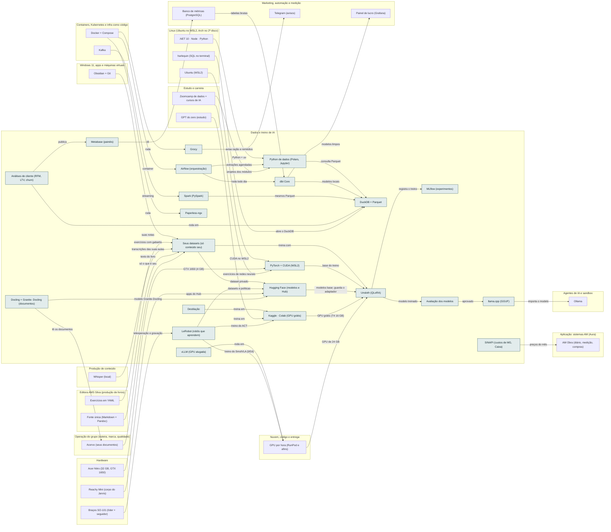

<!-- Arquivo GERADO por tools/gerar_docs.py a partir de data/. Edite os dados, não este arquivo. -->

# Camada 06 · Dados e treino de IA

[← Arquitetura](../arquitetura.md) · [Índice da documentação](../README.md)

> **Ligação com a camada de baixo:** Os seus dados viram tabelas limpas e datasets; o treino pesado roda numa GPU da nuvem e o modelo volta para o Ollama do notebook.

**22 blocos** · 2 precisam de conta · 0 marcados como futuro

## Mapa de conexões

## Blocos

| Bloco | Tipo | O que faz | Quando entra |
|---|---|---|---|
| [Python de dados (Polars, Jupyter)](#pyds) | Local | Polars, pandas e JupyterLab num projeto uv em ~/dev/lab-ia. A base de toda a trilha de dados e de IA. | passo 44.4 · Pendrives, GPU e laboratório a partir da semana 2; Zoomcamp, dbt e Airflow junto do IA2 da Trilha de Dados e IA do vault (depois do Passo 8, ≈ 2028); dataset e treino do 8B junto do IA6 (≈ 2029) |
| [DuckDB + Parquet](#duck) | Local | Banco analítico que roda dentro do Python e lê Parquet direto. Faz no notebook o que muita empresa faz num data warehouse. | passo 33.4 · Com a primeira página de venda no ar (jan/2027) e por etapas; passo 44.4 · Pendrives, GPU e laboratório a partir da semana 2; Zoomcamp, dbt e Airflow junto do IA2 da Trilha de Dados e IA do vault (depois do Passo 8, ≈ 2028); dataset e treino do 8B junto do IA6 (≈ 2029) |
| [dbt Core](#dbt) | Local | Transforma as tabelas brutas (vendas, gastos, publicações) em modelos limpos e testados, com SQL versionado no Git. | passo 44.7 · Pendrives, GPU e laboratório a partir da semana 2; Zoomcamp, dbt e Airflow junto do IA2 da Trilha de Dados e IA do vault (depois do Passo 8, ≈ 2028); dataset e treino do 8B junto do IA6 (≈ 2029) |
| [Airflow (orquestração)](#orq) | Local | Agenda e acompanha as rotinas de dados: extrair das plataformas, rodar o dbt, avisar se falhar. É o orquestrador mais pedido em vaga. Roda em Docker. | passo 44.8 · Pendrives, GPU e laboratório a partir da semana 2; Zoomcamp, dbt e Airflow junto do IA2 da Trilha de Dados e IA do vault (depois do Passo 8, ≈ 2028); dataset e treino do 8B junto do IA6 (≈ 2029) |
| [Spark (PySpark)](#spark) | Local | Processamento distribuído. No notebook roda em modo local, o suficiente para aprender a API que as empresas usam com volumes grandes. | passo 44.4 · Pendrives, GPU e laboratório a partir da semana 2; Zoomcamp, dbt e Airflow junto do IA2 da Trilha de Dados e IA do vault (depois do Passo 8, ≈ 2028); dataset e treino do 8B junto do IA6 (≈ 2029) |
| [Seus datasets (só conteúdo seu)](#dset) | Local | Pares de pergunta e resposta tirados das suas notas, exercícios, livro e aulas que você gravou. Nada de aulas da Udemy, DIO, Alura ou de terceiros; dados de alunos só com consentimento, e de menores só com autorização dos responsáveis. | passo 44.10 · Pendrives, GPU e laboratório a partir da semana 2; Zoomcamp, dbt e Airflow junto do IA2 da Trilha de Dados e IA do vault (depois do Passo 8, ≈ 2028); dataset e treino do 8B junto do IA6 (≈ 2029) |
| [PyTorch + CUDA (WSL2)](#torch) | Local | Base do treino de redes neurais. A GTX 1650 (Turing, 4 GB) tem suporte no CUDA do WSL2: serve para aprender, treinar modelos pequenos e testar código antes de pagar GPU. | passo 44.3 · Pendrives, GPU e laboratório a partir da semana 2; Zoomcamp, dbt e Airflow junto do IA2 da Trilha de Dados e IA do vault (depois do Passo 8, ≈ 2028); dataset e treino do 8B junto do IA6 (≈ 2029); passo 44.4 · Pendrives, GPU e laboratório a partir da semana 2; Zoomcamp, dbt e Airflow junto do IA2 da Trilha de Dados e IA do vault (depois do Passo 8, ≈ 2028); dataset e treino do 8B junto do IA6 (≈ 2029) |
| [Hugging Face (modelos e Hub)](#hf) | Remoto · precisa de conta | Transformers, PEFT, TRL e Datasets; no Hub ficam os modelos base e, em repositórios privados, os seus datasets e adaptadores. | passo 44.9 · Pendrives, GPU e laboratório a partir da semana 2; Zoomcamp, dbt e Airflow junto do IA2 da Trilha de Dados e IA do vault (depois do Passo 8, ≈ 2028); dataset e treino do 8B junto do IA6 (≈ 2029) |
| [Unsloth (QLoRA)](#unsl) | Local | Fine-tuning com pouca memória. Um 8B em QLoRA pede no mínimo 6 GB de VRAM: não cabe nos 4 GB da GTX 1650, então o treino do 8B roda no Kaggle ou numa GPU alugada. | passo 44.11 · Pendrives, GPU e laboratório a partir da semana 2; Zoomcamp, dbt e Airflow junto do IA2 da Trilha de Dados e IA do vault (depois do Passo 8, ≈ 2028); dataset e treino do 8B junto do IA6 (≈ 2029) |
| [Kaggle · Colab (GPU grátis)](#kgl) | Remoto · precisa de conta | Notebooks com GPU T4 de 16 GB sem pagar: o Kaggle dá 30 horas por semana, com sessões de até 9 horas. Suficiente para o primeiro fine-tuning de um 8B. | passo 29.1 · 2027, depois do primeiro fine-tuning de 8B; passo 29.3 · 2027, depois do primeiro fine-tuning de 8B; passo 44.9 · Pendrives, GPU e laboratório a partir da semana 2; Zoomcamp, dbt e Airflow junto do IA2 da Trilha de Dados e IA do vault (depois do Passo 8, ≈ 2028); dataset e treino do 8B junto do IA6 (≈ 2029); passo 44.11 · Pendrives, GPU e laboratório a partir da semana 2; Zoomcamp, dbt e Airflow junto do IA2 da Trilha de Dados e IA do vault (depois do Passo 8, ≈ 2028); dataset e treino do 8B junto do IA6 (≈ 2029) |
| [MLflow (experimentos)](#mlflow) | Local | Registra cada treino: dados usados, parâmetros, métricas e o modelo gerado. Sem isso você não sabe qual versão ficou melhor. | passo 44.4 · Pendrives, GPU e laboratório a partir da semana 2; Zoomcamp, dbt e Airflow junto do IA2 da Trilha de Dados e IA do vault (depois do Passo 8, ≈ 2028); dataset e treino do 8B junto do IA6 (≈ 2029) |
| [Avaliação dos modelos](#evals) | Local | Um conjunto de perguntas com respostas certas, separado do treino. O modelo novo só substitui o anterior se ganhar nele. | passo 44.10 · Pendrives, GPU e laboratório a partir da semana 2; Zoomcamp, dbt e Airflow junto do IA2 da Trilha de Dados e IA do vault (depois do Passo 8, ≈ 2028); dataset e treino do 8B junto do IA6 (≈ 2029); passo 44.12 · Pendrives, GPU e laboratório a partir da semana 2; Zoomcamp, dbt e Airflow junto do IA2 da Trilha de Dados e IA do vault (depois do Passo 8, ≈ 2028); dataset e treino do 8B junto do IA6 (≈ 2029) |
| [llama.cpp (GGUF)](#gguf) | Local | Converte e quantiza o modelo treinado para GGUF, o formato que o Ollama carrega no notebook. | passo 27.3 · Semana 6 · nov/2026 a dez/2026; passo 44.4 · Pendrives, GPU e laboratório a partir da semana 2; Zoomcamp, dbt e Airflow junto do IA2 da Trilha de Dados e IA do vault (depois do Passo 8, ≈ 2028); dataset e treino do 8B junto do IA6 (≈ 2029); passo 44.12 · Pendrives, GPU e laboratório a partir da semana 2; Zoomcamp, dbt e Airflow junto do IA2 da Trilha de Dados e IA do vault (depois do Passo 8, ≈ 2028); dataset e treino do 8B junto do IA6 (≈ 2029) |
| [Paperless-ngx](#paperless) | Local | Arquivo de documentos da casa e da escola com busca no texto (OCR em português). Local. | passo 19.1 · Dez/2026; passo 19.2 · Dez/2026 |
| [Grocy](#grocy) | Local | Estoque da casa, ração e remédios dos cães, validade e lista de compras. | passo 19.1 · Dez/2026; passo 19.3 · Dez/2026 |
| [vLLM (GPU alugada)](#vllm) | Local | Serve um modelo grande numa GPU por hora, ligado ao gateway, só enquanto precisa. | passo 29.4 · 2027, depois do primeiro fine-tuning de 8B; passo 29.5 · 2027, depois do primeiro fine-tuning de 8B |
| [Destilação](#destilacao) | Local | Modelo grande gera exemplos da sua tarefa; um modelo pequeno aprende a imitá-lo. | passo 29.3 · 2027, depois do primeiro fine-tuning de 8B |
| [Metabase (painéis)](#metabase) | Local | Painéis e perguntas sobre vendas, clientes e conteúdo sem programar, em cima do banco de métricas. Local. | passo 33.1 · Com a primeira página de venda no ar (jan/2027) e por etapas |
| [Análises de cliente (RFM, LTV, churn)](#analises) | Local | Quem compra mais, quem está sumindo, quanto vale cada cliente e previsão de receita, em Python/DuckDB. | passo 33.4 · Com a primeira página de venda no ar (jan/2027) e por etapas |
| [LeRobot (robôs que aprendem)](#lerobot) | Local | Biblioteca da Hugging Face para gravar demonstrações, treinar políticas (ACT, SmolVLA) e rodar no robô. | passo 60.7 · Modelos em dez/2026 (nada a comprar); SO-101 na primeira compra de robótica de 2027; Reachy Mini e LeKiwi depois do primeiro treino |
| [Docling + Granite- Docling (documentos)](#docling) | Local | Converte PDF, foto e NFC-e em Markdown e JSON com tabelas: Caixa da Casa, documentos da escola, ABNT e acervo. | passo 60.5 · Modelos em dez/2026 (nada a comprar); SO-101 na primeira compra de robótica de 2027; Reachy Mini e LeKiwi depois do primeiro treino |
| [SINAPI (custos de MG, Caixa)](#sinapi) | Remoto | Custos de referência da construção por estado, todo mês, em Excel: base das estimativas, sempre com mês e UF. | passo 61.8 · Ferramentas grátis no estudo da manhã a partir de jan/2027; serviços e o AM Obra só depois das rendas de agora passarem no portão |

### Python de dados (Polars, Jupyter)

*Local*

Polars, pandas e JupyterLab num projeto uv em ~/dev/lab-ia. A base de toda a trilha de dados e de IA.

**Quando entra:** passo 44.4 · Pendrives, GPU e laboratório a partir da semana 2; Zoomcamp, dbt e Airflow junto do IA2 da Trilha de Dados e IA do vault (depois do Passo 8, ≈ 2028); dataset e treino do 8B junto do IA6 (≈ 2029) ([roteiro](../implantacao/roteiro.md))

| Direção | Bloco | Camada | O que passa |
|---|---|---|---|
| → envia para | [DuckDB + Parquet](06-dados.md#duck) | Dados e treino de IA | consulta Parquet |
| ← recebe de | [.NET 10 · Node · Python](04-lin.md#rt) | Linux (Ubuntu no WSL2, Arch no 2º disco) | Python + uv |
| ← recebe de | [Airflow (orquestração)](06-dados.md#orq) | Dados e treino de IA | extrações agendadas |
| ← recebe de | [Zoomcamp de dados + cursos de IA](14-est.md#dez) | Estudo e carreira | projetos dos módulos |

### DuckDB + Parquet

*Local*

Banco analítico que roda dentro do Python e lê Parquet direto. Faz no notebook o que muita empresa faz num data warehouse.

**Quando entra:** passo 33.4 · Com a primeira página de venda no ar (jan/2027) e por etapas; passo 44.4 · Pendrives, GPU e laboratório a partir da semana 2; Zoomcamp, dbt e Airflow junto do IA2 da Trilha de Dados e IA do vault (depois do Passo 8, ≈ 2028); dataset e treino do 8B junto do IA6 (≈ 2029) ([roteiro](../implantacao/roteiro.md))

| Direção | Bloco | Camada | O que passa |
|---|---|---|---|
| ← recebe de | [Python de dados (Polars, Jupyter)](06-dados.md#pyds) | Dados e treino de IA | consulta Parquet |
| ← recebe de | [dbt Core](06-dados.md#dbt) | Dados e treino de IA | modelos locais |
| ← recebe de | [Spark (PySpark)](06-dados.md#spark) | Dados e treino de IA | mesmos Parquet |
| ← recebe de | [Análises de cliente (RFM, LTV, churn)](06-dados.md#analises) | Dados e treino de IA | roda em |
| ← recebe de | [harlequin (SQL no terminal)](04-lin.md#harlequin) | Linux (Ubuntu no WSL2, Arch no 2º disco) | abre o DuckDB |

### dbt Core

*Local*

Transforma as tabelas brutas (vendas, gastos, publicações) em modelos limpos e testados, com SQL versionado no Git.

**Quando entra:** passo 44.7 · Pendrives, GPU e laboratório a partir da semana 2; Zoomcamp, dbt e Airflow junto do IA2 da Trilha de Dados e IA do vault (depois do Passo 8, ≈ 2028); dataset e treino do 8B junto do IA6 (≈ 2029) ([roteiro](../implantacao/roteiro.md))

| Direção | Bloco | Camada | O que passa |
|---|---|---|---|
| → envia para | [DuckDB + Parquet](06-dados.md#duck) | Dados e treino de IA | modelos locais |
| → envia para | [Painel de lucro (Grafana)](21-mkt.md#painel) | Marketing, automação e medição | modelos limpos |
| ← recebe de | [Banco de métricas (PostgreSQL)](21-mkt.md#metrics) | Marketing, automação e medição | tabelas brutas |
| ← recebe de | [Airflow (orquestração)](06-dados.md#orq) | Dados e treino de IA | roda todo dia |

### Airflow (orquestração)

*Local*

Agenda e acompanha as rotinas de dados: extrair das plataformas, rodar o dbt, avisar se falhar. É o orquestrador mais pedido em vaga. Roda em Docker.

**Quando entra:** passo 44.8 · Pendrives, GPU e laboratório a partir da semana 2; Zoomcamp, dbt e Airflow junto do IA2 da Trilha de Dados e IA do vault (depois do Passo 8, ≈ 2028); dataset e treino do 8B junto do IA6 (≈ 2029) ([roteiro](../implantacao/roteiro.md))

| Direção | Bloco | Camada | O que passa |
|---|---|---|---|
| → envia para | [dbt Core](06-dados.md#dbt) | Dados e treino de IA | roda todo dia |
| → envia para | [Python de dados (Polars, Jupyter)](06-dados.md#pyds) | Dados e treino de IA | extrações agendadas |
| ← recebe de | [Docker + Compose](09-cnt.md#docker) | Containers, Kubernetes e infra como código | container |

### Spark (PySpark)

*Local*

Processamento distribuído. No notebook roda em modo local, o suficiente para aprender a API que as empresas usam com volumes grandes.

**Quando entra:** passo 44.4 · Pendrives, GPU e laboratório a partir da semana 2; Zoomcamp, dbt e Airflow junto do IA2 da Trilha de Dados e IA do vault (depois do Passo 8, ≈ 2028); dataset e treino do 8B junto do IA6 (≈ 2029) ([roteiro](../implantacao/roteiro.md))

| Direção | Bloco | Camada | O que passa |
|---|---|---|---|
| → envia para | [DuckDB + Parquet](06-dados.md#duck) | Dados e treino de IA | mesmos Parquet |
| ← recebe de | [Kafka](09-cnt.md#kafka) | Containers, Kubernetes e infra como código | streaming |

### Seus datasets (só conteúdo seu)

*Local*

Pares de pergunta e resposta tirados das suas notas, exercícios, livro e aulas que você gravou. Nada de aulas da Udemy, DIO, Alura ou de terceiros; dados de alunos só com consentimento, e de menores só com autorização dos responsáveis.

**Quando entra:** passo 44.10 · Pendrives, GPU e laboratório a partir da semana 2; Zoomcamp, dbt e Airflow junto do IA2 da Trilha de Dados e IA do vault (depois do Passo 8, ≈ 2028); dataset e treino do 8B junto do IA6 (≈ 2029) ([roteiro](../implantacao/roteiro.md))

| Direção | Bloco | Camada | O que passa |
|---|---|---|---|
| → envia para | [Unsloth (QLoRA)](06-dados.md#unsl) | Dados e treino de IA | treina com |
| → envia para | [Hugging Face (modelos e Hub)](06-dados.md#hf) | Dados e treino de IA | dataset privado |
| ← recebe de | [Obsidian + Git](03-win.md#obsd) | Windows 11, apps e máquinas virtuais | suas notas |
| ← recebe de | [Exercícios em YAML](15-editora.md#exyaml) | Editora AMS Silva (produção de livros) | exercícios com gabarito |
| ← recebe de | [Whisper (local)](13-cont.md#whis) | Produção de conteúdo | transcrições das suas aulas |
| ← recebe de | [Fonte única (Markdown + Pandoc)](15-editora.md#fonte) | Editora AMS Silva (produção de livros) | texto do livro |
| ← recebe de | [Acervo (seus documentos)](23-oper.md#acv) | Operação do grupo (esteira, marca, qualidade) | só o que é seu |

### PyTorch + CUDA (WSL2)

*Local*

Base do treino de redes neurais. A GTX 1650 (Turing, 4 GB) tem suporte no CUDA do WSL2: serve para aprender, treinar modelos pequenos e testar código antes de pagar GPU.

**Quando entra:** passo 44.3 · Pendrives, GPU e laboratório a partir da semana 2; Zoomcamp, dbt e Airflow junto do IA2 da Trilha de Dados e IA do vault (depois do Passo 8, ≈ 2028); dataset e treino do 8B junto do IA6 (≈ 2029); passo 44.4 · Pendrives, GPU e laboratório a partir da semana 2; Zoomcamp, dbt e Airflow junto do IA2 da Trilha de Dados e IA do vault (depois do Passo 8, ≈ 2028); dataset e treino do 8B junto do IA6 (≈ 2029) ([roteiro](../implantacao/roteiro.md))

| Direção | Bloco | Camada | O que passa |
|---|---|---|---|
| → envia para | [Unsloth (QLoRA)](06-dados.md#unsl) | Dados e treino de IA | base do treino |
| ← recebe de | [Ubuntu (WSL2)](04-lin.md#wsl) | Linux (Ubuntu no WSL2, Arch no 2º disco) | CUDA no WSL2 |
| ← recebe de | [Acer Nitro (32 GB, GTX 1650)](01-hw.md#nb) | Hardware | GTX 1650 (4 GB) |
| ← recebe de | [Zoomcamp de dados + cursos de IA](14-est.md#dez) | Estudo e carreira | exercícios de redes neurais |

### Hugging Face (modelos e Hub)

*Remoto · precisa de conta*

Transformers, PEFT, TRL e Datasets; no Hub ficam os modelos base e, em repositórios privados, os seus datasets e adaptadores.

**Quando entra:** passo 44.9 · Pendrives, GPU e laboratório a partir da semana 2; Zoomcamp, dbt e Airflow junto do IA2 da Trilha de Dados e IA do vault (depois do Passo 8, ≈ 2028); dataset e treino do 8B junto do IA6 (≈ 2029) ([roteiro](../implantacao/roteiro.md))

| Direção | Bloco | Camada | O que passa |
|---|---|---|---|
| → envia para | [Unsloth (QLoRA)](06-dados.md#unsl) | Dados e treino de IA | modelos base; guarda o adaptador |
| ← recebe de | [Seus datasets (só conteúdo seu)](06-dados.md#dset) | Dados e treino de IA | dataset privado |
| ← recebe de | [LeRobot (robôs que aprendem)](06-dados.md#lerobot) | Dados e treino de IA | datasets e políticas |
| ← recebe de | [Reachy Mini (corpo do Jarvis)](01-hw.md#reachy) | Hardware | apps do Hub |
| ← recebe de | [Docling + Granite- Docling (documentos)](06-dados.md#docling) | Dados e treino de IA | modelo Granite-Docling |

### Unsloth (QLoRA)

*Local*

Fine-tuning com pouca memória. Um 8B em QLoRA pede no mínimo 6 GB de VRAM: não cabe nos 4 GB da GTX 1650, então o treino do 8B roda no Kaggle ou numa GPU alugada.

**Quando entra:** passo 44.11 · Pendrives, GPU e laboratório a partir da semana 2; Zoomcamp, dbt e Airflow junto do IA2 da Trilha de Dados e IA do vault (depois do Passo 8, ≈ 2028); dataset e treino do 8B junto do IA6 (≈ 2029) ([roteiro](../implantacao/roteiro.md))

| Direção | Bloco | Camada | O que passa |
|---|---|---|---|
| → envia para | [MLflow (experimentos)](06-dados.md#mlflow) | Dados e treino de IA | registra o treino |
| → envia para | [Avaliação dos modelos](06-dados.md#evals) | Dados e treino de IA | modelo treinado |
| ← recebe de | [PyTorch + CUDA (WSL2)](06-dados.md#torch) | Dados e treino de IA | base do treino |
| ← recebe de | [Hugging Face (modelos e Hub)](06-dados.md#hf) | Dados e treino de IA | modelos base; guarda o adaptador |
| ← recebe de | [Seus datasets (só conteúdo seu)](06-dados.md#dset) | Dados e treino de IA | treina com |
| ← recebe de | [Kaggle · Colab (GPU grátis)](06-dados.md#kgl) | Dados e treino de IA | GPU grátis (T4 16 GB) |
| ← recebe de | [GPU por hora (RunPod e afins)](12-nuvem.md#gpuh) | Nuvem, código e entrega | GPU de 24 GB |

### Kaggle · Colab (GPU grátis)

*Remoto · precisa de conta*

Notebooks com GPU T4 de 16 GB sem pagar: o Kaggle dá 30 horas por semana, com sessões de até 9 horas. Suficiente para o primeiro fine-tuning de um 8B.

**Quando entra:** passo 29.1 · 2027, depois do primeiro fine-tuning de 8B; passo 29.3 · 2027, depois do primeiro fine-tuning de 8B; passo 44.9 · Pendrives, GPU e laboratório a partir da semana 2; Zoomcamp, dbt e Airflow junto do IA2 da Trilha de Dados e IA do vault (depois do Passo 8, ≈ 2028); dataset e treino do 8B junto do IA6 (≈ 2029); passo 44.11 · Pendrives, GPU e laboratório a partir da semana 2; Zoomcamp, dbt e Airflow junto do IA2 da Trilha de Dados e IA do vault (depois do Passo 8, ≈ 2028); dataset e treino do 8B junto do IA6 (≈ 2029) ([roteiro](../implantacao/roteiro.md))

| Direção | Bloco | Camada | O que passa |
|---|---|---|---|
| → envia para | [Unsloth (QLoRA)](06-dados.md#unsl) | Dados e treino de IA | GPU grátis (T4 16 GB) |
| ← recebe de | [Destilação](06-dados.md#destilacao) | Dados e treino de IA | treina em |
| ← recebe de | [GPT do zero (estudo)](14-est.md#gptzero) | Estudo e carreira | treina em |
| ← recebe de | [LeRobot (robôs que aprendem)](06-dados.md#lerobot) | Dados e treino de IA | treino do ACT |

### MLflow (experimentos)

*Local*

Registra cada treino: dados usados, parâmetros, métricas e o modelo gerado. Sem isso você não sabe qual versão ficou melhor.

**Quando entra:** passo 44.4 · Pendrives, GPU e laboratório a partir da semana 2; Zoomcamp, dbt e Airflow junto do IA2 da Trilha de Dados e IA do vault (depois do Passo 8, ≈ 2028); dataset e treino do 8B junto do IA6 (≈ 2029) ([roteiro](../implantacao/roteiro.md))

| Direção | Bloco | Camada | O que passa |
|---|---|---|---|
| ← recebe de | [Unsloth (QLoRA)](06-dados.md#unsl) | Dados e treino de IA | registra o treino |

### Avaliação dos modelos

*Local*

Um conjunto de perguntas com respostas certas, separado do treino. O modelo novo só substitui o anterior se ganhar nele.

**Quando entra:** passo 44.10 · Pendrives, GPU e laboratório a partir da semana 2; Zoomcamp, dbt e Airflow junto do IA2 da Trilha de Dados e IA do vault (depois do Passo 8, ≈ 2028); dataset e treino do 8B junto do IA6 (≈ 2029); passo 44.12 · Pendrives, GPU e laboratório a partir da semana 2; Zoomcamp, dbt e Airflow junto do IA2 da Trilha de Dados e IA do vault (depois do Passo 8, ≈ 2028); dataset e treino do 8B junto do IA6 (≈ 2029) ([roteiro](../implantacao/roteiro.md))

| Direção | Bloco | Camada | O que passa |
|---|---|---|---|
| → envia para | [llama.cpp (GGUF)](06-dados.md#gguf) | Dados e treino de IA | aprovado |
| ← recebe de | [Unsloth (QLoRA)](06-dados.md#unsl) | Dados e treino de IA | modelo treinado |

### llama.cpp (GGUF)

*Local*

Converte e quantiza o modelo treinado para GGUF, o formato que o Ollama carrega no notebook.

**Quando entra:** passo 27.3 · Semana 6 · nov/2026 a dez/2026; passo 44.4 · Pendrives, GPU e laboratório a partir da semana 2; Zoomcamp, dbt e Airflow junto do IA2 da Trilha de Dados e IA do vault (depois do Passo 8, ≈ 2028); dataset e treino do 8B junto do IA6 (≈ 2029); passo 44.12 · Pendrives, GPU e laboratório a partir da semana 2; Zoomcamp, dbt e Airflow junto do IA2 da Trilha de Dados e IA do vault (depois do Passo 8, ≈ 2028); dataset e treino do 8B junto do IA6 (≈ 2029) ([roteiro](../implantacao/roteiro.md))

| Direção | Bloco | Camada | O que passa |
|---|---|---|---|
| → envia para | [Ollama](05-ia.md#oll) | Agentes de IA e sandbox | importa o modelo |
| ← recebe de | [Avaliação dos modelos](06-dados.md#evals) | Dados e treino de IA | aprovado |

### Paperless-ngx

*Local*

Arquivo de documentos da casa e da escola com busca no texto (OCR em português). Local.

**Quando entra:** passo 19.1 · Dez/2026; passo 19.2 · Dez/2026 ([roteiro](../implantacao/roteiro.md))

| Direção | Bloco | Camada | O que passa |
|---|---|---|---|
| ← recebe de | [Docker + Compose](09-cnt.md#docker) | Containers, Kubernetes e infra como código | roda |

### Grocy

*Local*

Estoque da casa, ração e remédios dos cães, validade e lista de compras.

**Quando entra:** passo 19.1 · Dez/2026; passo 19.3 · Dez/2026 ([roteiro](../implantacao/roteiro.md))

| Direção | Bloco | Camada | O que passa |
|---|---|---|---|
| → envia para | [Telegram (avisos)](21-mkt.md#tg) | Marketing, automação e medição | avisa ração e remédios |
| ← recebe de | [Docker + Compose](09-cnt.md#docker) | Containers, Kubernetes e infra como código | roda |

### vLLM (GPU alugada)

*Local*

Serve um modelo grande numa GPU por hora, ligado ao gateway, só enquanto precisa.

**Quando entra:** passo 29.4 · 2027, depois do primeiro fine-tuning de 8B; passo 29.5 · 2027, depois do primeiro fine-tuning de 8B ([roteiro](../implantacao/roteiro.md))

| Direção | Bloco | Camada | O que passa |
|---|---|---|---|
| → envia para | [GPU por hora (RunPod e afins)](12-nuvem.md#gpuh) | Nuvem, código e entrega | roda em |

### Destilação

*Local*

Modelo grande gera exemplos da sua tarefa; um modelo pequeno aprende a imitá-lo.

**Quando entra:** passo 29.3 · 2027, depois do primeiro fine-tuning de 8B ([roteiro](../implantacao/roteiro.md))

| Direção | Bloco | Camada | O que passa |
|---|---|---|---|
| → envia para | [Kaggle · Colab (GPU grátis)](06-dados.md#kgl) | Dados e treino de IA | treina em |

### Metabase (painéis)

*Local*

Painéis e perguntas sobre vendas, clientes e conteúdo sem programar, em cima do banco de métricas. Local.

**Quando entra:** passo 33.1 · Com a primeira página de venda no ar (jan/2027) e por etapas ([roteiro](../implantacao/roteiro.md))

| Direção | Bloco | Camada | O que passa |
|---|---|---|---|
| → envia para | [Banco de métricas (PostgreSQL)](21-mkt.md#metrics) | Marketing, automação e medição | lê |
| ← recebe de | [Análises de cliente (RFM, LTV, churn)](06-dados.md#analises) | Dados e treino de IA | publica |

### Análises de cliente (RFM, LTV, churn)

*Local*

Quem compra mais, quem está sumindo, quanto vale cada cliente e previsão de receita, em Python/DuckDB.

**Quando entra:** passo 33.4 · Com a primeira página de venda no ar (jan/2027) e por etapas ([roteiro](../implantacao/roteiro.md))

| Direção | Bloco | Camada | O que passa |
|---|---|---|---|
| → envia para | [DuckDB + Parquet](06-dados.md#duck) | Dados e treino de IA | roda em |
| → envia para | [Metabase (painéis)](06-dados.md#metabase) | Dados e treino de IA | publica |

### LeRobot (robôs que aprendem)

*Local*

Biblioteca da Hugging Face para gravar demonstrações, treinar políticas (ACT, SmolVLA) e rodar no robô.

**Quando entra:** passo 60.7 · Modelos em dez/2026 (nada a comprar); SO-101 na primeira compra de robótica de 2027; Reachy Mini e LeKiwi depois do primeiro treino ([roteiro](../implantacao/roteiro.md))

| Direção | Bloco | Camada | O que passa |
|---|---|---|---|
| → envia para | [Hugging Face (modelos e Hub)](06-dados.md#hf) | Dados e treino de IA | datasets e políticas |
| → envia para | [Kaggle · Colab (GPU grátis)](06-dados.md#kgl) | Dados e treino de IA | treino do ACT |
| → envia para | [GPU por hora (RunPod e afins)](12-nuvem.md#gpuh) | Nuvem, código e entrega | treino do SmolVLA (bf16) |
| ← recebe de | [Braços SO-101 (líder + seguidor)](01-hw.md#so101) | Hardware | teleoperação e gravação |

### Docling + Granite- Docling (documentos)

*Local*

Converte PDF, foto e NFC-e em Markdown e JSON com tabelas: Caixa da Casa, documentos da escola, ABNT e acervo.

**Quando entra:** passo 60.5 · Modelos em dez/2026 (nada a comprar); SO-101 na primeira compra de robótica de 2027; Reachy Mini e LeKiwi depois do primeiro treino ([roteiro](../implantacao/roteiro.md))

| Direção | Bloco | Camada | O que passa |
|---|---|---|---|
| → envia para | [Hugging Face (modelos e Hub)](06-dados.md#hf) | Dados e treino de IA | modelo Granite-Docling |
| → envia para | [Acervo (seus documentos)](23-oper.md#acv) | Operação do grupo (esteira, marca, qualidade) | lê os documentos |

### SINAPI (custos de MG, Caixa)

*Remoto*

Custos de referência da construção por estado, todo mês, em Excel: base das estimativas, sempre com mês e UF.

**Quando entra:** passo 61.8 · Ferramentas grátis no estudo da manhã a partir de jan/2027; serviços e o AM Obra só depois das rendas de agora passarem no portão ([roteiro](../implantacao/roteiro.md))

| Direção | Bloco | Camada | O que passa |
|---|---|---|---|
| → envia para | [AM Obra (diário, medição, compras)](11-app.md#nobra) | Aplicação: sistemas AM (Aura) | preços do mês |

---

[↑ Camada 07 · Assistentes de IA (chat, pesquisa e estudo)](07-chat.md) · [↓ Camada 05 · Agentes de IA e sandbox](05-ia.md)
