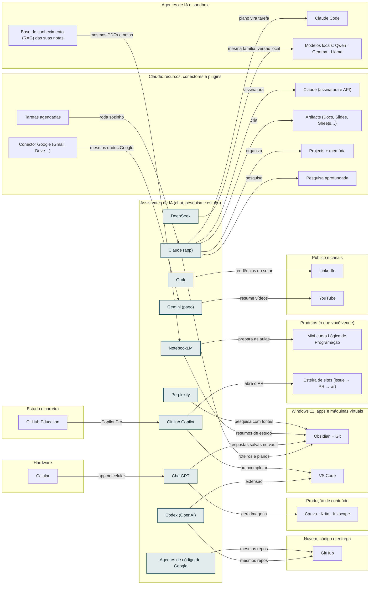

<!-- Arquivo GERADO por tools/gerar_docs.py a partir de data/. Edite os dados, não este arquivo. -->

# Camada 07 · Assistentes de IA (chat, pesquisa e estudo)

[← Arquitetura](../arquitetura.md) · [Índice da documentação](../README.md)

> **Ligação com a camada de baixo:** O que é código vai para o agente; o que é pesquisa e estudo fica nos assistentes e termina salvo no vault.

**10 blocos** · 10 precisam de conta · 0 marcados como futuro

## Mapa de conexões

## Blocos

| Bloco | Tipo | O que faz | Quando entra |
|---|---|---|---|
| [Claude (app)](#capp2) | Remoto · precisa de conta | Seu assistente principal (assinatura paga): planejamento, escrita longa, revisão e análise de documentos. | passo 9.1 · Semana 4 · nov/2026 |
| [ChatGPT](#gpt) | Remoto · precisa de conta | Assistente geral da OpenAI: segunda opinião em código e texto, imagens e conversa por voz. O plano grátis basta. | passo 9.4 · Semana 4 · nov/2026; passo 27.8 · Semana 6 · nov/2026 a dez/2026 |
| [Gemini (pago)](#gem) | Remoto · precisa de conta | Sua segunda assinatura paga. Ligado a Gmail, Drive, Docs e YouTube: pesquisa aprofundada, resumo de vídeos longos e limites maiores no NotebookLM. Use para tudo que vive no ecossistema Google. | passo 9.4 · Semana 4 · nov/2026; passo 27.8 · Semana 6 · nov/2026 a dez/2026 |
| [NotebookLM](#nblm) | Remoto · precisa de conta | Do Google: você envia PDFs (livro do VHSlins, apostilas, editais) e ele responde só com base neles, com citações. Ótimo para estudar e preparar aulas. | passo 6.7 · Semana 2 · nov/2026; passo 27.9 · Semana 6 · nov/2026 a dez/2026 |
| [Grok](#grok) | Remoto · precisa de conta | Assistente da xAI, ligado ao X. Útil para acompanhar notícias e tendências em tempo real. Use a versão grátis. | passo 9.4 · Semana 4 · nov/2026 |
| [DeepSeek](#ds) | Remoto · precisa de conta | Modelo chinês forte em raciocínio e código, com chat grátis. Os dados enviados ficam em servidores na China: nada de dados de clientes, alunos ou da empresa. Para uso sensível, rode a versão pequena no Ollama. | passo 9.4 · Semana 4 · nov/2026 |
| [Codex (OpenAI)](#codex) | Remoto · precisa de conta | Agente de código da OpenAI (terminal, VS Code e nuvem). Vem no ChatGPT Go com limite baixo: reserva e segunda opinião, lendo o mesmo AGENTS.md. O Sites do ChatGPT não serve para clientes (proíbe comércio). | passo 9.4 · Semana 4 · nov/2026 |
| [Agentes de código do Google](#gcode) | Remoto · precisa de conta | O Gemini CLI saiu do ar para contas pessoais sem licença paga em 18/06/2026; o substituto, Antigravity CLI, é fechado e tem acesso ampliado só no plano Pro. Nenhum fluxo do setup depende dele. | passo 9.4 · Semana 4 · nov/2026 |
| [Perplexity](#perp) | Remoto · precisa de conta | Busca com fontes citadas. Bom para pesquisa de mercado e para checar fatos antes de publicar. | passo 9.4 · Semana 4 · nov/2026 |
| [GitHub Copilot](#copi) | Remoto · precisa de conta | Autocompletar, chat e agente na nuvem: você atribui uma issue e ele abre um PR. Professores verificados no GitHub Education ganham o Pro grátis (1.500 créditos por mês). Motor da esteira de sites. | passo 28.1 · Semana 6 · nov/2026 a dez/2026; passo 28.3 · Semana 6 · nov/2026 a dez/2026 |

### Claude (app)

*Remoto · precisa de conta*

Seu assistente principal (assinatura paga): planejamento, escrita longa, revisão e análise de documentos.

**Quando entra:** passo 9.1 · Semana 4 · nov/2026 ([roteiro](../implantacao/roteiro.md))

| Direção | Bloco | Camada | O que passa |
|---|---|---|---|
| → envia para | [Claude (assinatura e API)](08-clc.md#anth) | Claude: recursos, conectores e plugins | assinatura |
| → envia para | [Obsidian + Git](03-win.md#obsd) | Windows 11, apps e máquinas virtuais | roteiros e planos |
| → envia para | [Claude Code](05-ia.md#cc) | Agentes de IA e sandbox | plano vira tarefa |
| → envia para | [Projects + memória](08-clc.md#proj) | Claude: recursos, conectores e plugins | organiza |
| → envia para | [Artifacts (Docs, Slides, Sheets…)](08-clc.md#arts) | Claude: recursos, conectores e plugins | cria |
| → envia para | [Pesquisa aprofundada](08-clc.md#resq) | Claude: recursos, conectores e plugins | pesquisa |
| ← recebe de | [Tarefas agendadas](08-clc.md#sched) | Claude: recursos, conectores e plugins | roda sozinho |

### ChatGPT

*Remoto · precisa de conta*

Assistente geral da OpenAI: segunda opinião em código e texto, imagens e conversa por voz. O plano grátis basta.

**Quando entra:** passo 9.4 · Semana 4 · nov/2026; passo 27.8 · Semana 6 · nov/2026 a dez/2026 ([roteiro](../implantacao/roteiro.md))

| Direção | Bloco | Camada | O que passa |
|---|---|---|---|
| → envia para | [Obsidian + Git](03-win.md#obsd) | Windows 11, apps e máquinas virtuais | respostas salvas no vault |
| → envia para | [Canva · Krita · Inkscape](13-cont.md#img) | Produção de conteúdo | gera imagens |
| ← recebe de | [Celular](01-hw.md#cel) | Hardware | app no celular |

### Gemini (pago)

*Remoto · precisa de conta*

Sua segunda assinatura paga. Ligado a Gmail, Drive, Docs e YouTube: pesquisa aprofundada, resumo de vídeos longos e limites maiores no NotebookLM. Use para tudo que vive no ecossistema Google.

**Quando entra:** passo 9.4 · Semana 4 · nov/2026; passo 27.8 · Semana 6 · nov/2026 a dez/2026 ([roteiro](../implantacao/roteiro.md))

| Direção | Bloco | Camada | O que passa |
|---|---|---|---|
| → envia para | [YouTube](22-pub.md#yt) | Público e canais | resume vídeos |
| ← recebe de | [Conector Google (Gmail, Drive…)](08-clc.md#cgws) | Claude: recursos, conectores e plugins | mesmos dados Google |

### NotebookLM

*Remoto · precisa de conta*

Do Google: você envia PDFs (livro do VHSlins, apostilas, editais) e ele responde só com base neles, com citações. Ótimo para estudar e preparar aulas.

**Quando entra:** passo 6.7 · Semana 2 · nov/2026; passo 27.9 · Semana 6 · nov/2026 a dez/2026 ([roteiro](../implantacao/roteiro.md))

| Direção | Bloco | Camada | O que passa |
|---|---|---|---|
| → envia para | [Obsidian + Git](03-win.md#obsd) | Windows 11, apps e máquinas virtuais | resumos de estudo |
| → envia para | [Mini-curso Lógica de Programação](17-prod.md#curso) | Produtos (o que você vende) | prepara as aulas |
| ← recebe de | [Base de conhecimento (RAG) das suas notas](05-ia.md#rag) | Agentes de IA e sandbox | mesmos PDFs e notas |

### Grok

*Remoto · precisa de conta*

Assistente da xAI, ligado ao X. Útil para acompanhar notícias e tendências em tempo real. Use a versão grátis.

**Quando entra:** passo 9.4 · Semana 4 · nov/2026 ([roteiro](../implantacao/roteiro.md))

| Direção | Bloco | Camada | O que passa |
|---|---|---|---|
| → envia para | [LinkedIn](22-pub.md#li) | Público e canais | tendências do setor |

### DeepSeek

*Remoto · precisa de conta*

Modelo chinês forte em raciocínio e código, com chat grátis. Os dados enviados ficam em servidores na China: nada de dados de clientes, alunos ou da empresa. Para uso sensível, rode a versão pequena no Ollama.

**Quando entra:** passo 9.4 · Semana 4 · nov/2026 ([roteiro](../implantacao/roteiro.md))

| Direção | Bloco | Camada | O que passa |
|---|---|---|---|
| → envia para | [Modelos locais: Qwen · Gemma · Llama](05-ia.md#lmods) | Agentes de IA e sandbox | mesma família, versão local |

### Codex (OpenAI)

*Remoto · precisa de conta*

Agente de código da OpenAI (terminal, VS Code e nuvem). Vem no ChatGPT Go com limite baixo: reserva e segunda opinião, lendo o mesmo AGENTS.md. O Sites do ChatGPT não serve para clientes (proíbe comércio).

**Quando entra:** passo 9.4 · Semana 4 · nov/2026 ([roteiro](../implantacao/roteiro.md))

| Direção | Bloco | Camada | O que passa |
|---|---|---|---|
| → envia para | [GitHub](12-nuvem.md#gh) | Nuvem, código e entrega | mesmos repos |
| → envia para | [VS Code](03-win.md#vsc) | Windows 11, apps e máquinas virtuais | extensão |

### Agentes de código do Google

*Remoto · precisa de conta*

O Gemini CLI saiu do ar para contas pessoais sem licença paga em 18/06/2026; o substituto, Antigravity CLI, é fechado e tem acesso ampliado só no plano Pro. Nenhum fluxo do setup depende dele.

**Quando entra:** passo 9.4 · Semana 4 · nov/2026 ([roteiro](../implantacao/roteiro.md))

| Direção | Bloco | Camada | O que passa |
|---|---|---|---|
| → envia para | [GitHub](12-nuvem.md#gh) | Nuvem, código e entrega | mesmos repos |

### Perplexity

*Remoto · precisa de conta*

Busca com fontes citadas. Bom para pesquisa de mercado e para checar fatos antes de publicar.

**Quando entra:** passo 9.4 · Semana 4 · nov/2026 ([roteiro](../implantacao/roteiro.md))

| Direção | Bloco | Camada | O que passa |
|---|---|---|---|
| → envia para | [Obsidian + Git](03-win.md#obsd) | Windows 11, apps e máquinas virtuais | pesquisa com fontes |

### GitHub Copilot

*Remoto · precisa de conta*

Autocompletar, chat e agente na nuvem: você atribui uma issue e ele abre um PR. Professores verificados no GitHub Education ganham o Pro grátis (1.500 créditos por mês). Motor da esteira de sites.

**Quando entra:** passo 28.1 · Semana 6 · nov/2026 a dez/2026; passo 28.3 · Semana 6 · nov/2026 a dez/2026 ([roteiro](../implantacao/roteiro.md))

| Direção | Bloco | Camada | O que passa |
|---|---|---|---|
| → envia para | [VS Code](03-win.md#vsc) | Windows 11, apps e máquinas virtuais | autocompletar |
| → envia para | [Esteira de sites (issue → PR → ar)](17-prod.md#esteira) | Produtos (o que você vende) | abre o PR |
| ← recebe de | [GitHub Education](14-est.md#ghed) | Estudo e carreira | Copilot Pro |

---

[↑ Camada 08 · Claude: recursos, conectores e plugins](08-clc.md) · [↓ Camada 06 · Dados e treino de IA](06-dados.md)
