<!-- Arquivo GERADO por tools/gerar_docs.py a partir de data/. Edite os dados, não este arquivo. -->

# Camada 08 · Claude: recursos, conectores e plugins

[← Arquitetura](../arquitetura.md) · [Índice da documentação](../README.md)

> **Ligação com a camada de baixo:** Os conectores dão ao Claude acesso às suas contas, com permissão que você aprova; os plugins trazem rotinas prontas.

**19 blocos** · 15 precisam de conta · 0 marcados como futuro

## Mapa de conexões

```mermaid
flowchart LR
  subgraph L_clc["Claude: recursos, conectores e plugins"]
    n_proj["Projects + memória"]
    n_arts["Artifacts (Docs, Slides, Sheets…)"]
    n_resq["Pesquisa aprofundada"]
    n_sched["Tarefas agendadas"]
    n_cchr["Claude in Chrome + uso do computador"]
    n_anth["Claude (assinatura e API)"]
    n_cgws["Conector Google (Gmail, Drive…)"]
    n_ccan["Conectores Canva + Figma"]
    n_cml["Conector MailerLite"]
    n_cdev["Vercel · AWS · Microsoft Learn"]
    n_cupw["Conector Upwork"]
    n_clov["Lovable + Supabase"]
    n_cdup["Notion · monday · GitBook · Stripe"]
    n_pbiz["Plugins: small- business + marketing"]
    n_peng["Plugins: engineering + design"]
    n_pfin["Plugins: finance + Fiscal.ai"]
    n_phst["Plugins: Hostinger · Adobe · Cloudinary"]
    n_ccf["Conector Cloudflare"]
    n_cvid["Conector vidIQ"]
  end
  subgraph L_oper["Operação do grupo (esteira, marca, qualidade)"]
    n_opipe["Pipeline de conteúdo"]
  end
  subgraph L_pub["Público e canais"]
    n_ig["Instagram"]
    n_yt["YouTube"]
  end
  subgraph L_mkt["Marketing, automação e medição"]
    n_mailer["MailerLite"]
    n_prosp["Prospecção de parceiros"]
  end
  subgraph L_venda["Plataformas de venda e recebimento"]
    n_hotm["Hotmart"]
  end
  subgraph L_emp["Pessoa física: impostos e finanças"]
    n_caixa["Caixa da Casa / AM Rendara"]
  end
  subgraph L_web["Vitrine web (sites e domínio)"]
    n_hostg["Hostinger (clientes WP)"]
    n_inst["Instituto AMS"]
  end
  subgraph L_prod["Produtos (o que você vende)"]
    n_sites["Sites para pequenas empresas"]
  end
  subgraph L_editora["Editora AMS Silva (produção de livros)"]
    n_refs["Quadro de referências"]
  end
  subgraph L_cont["Produção de conteúdo"]
    n_edit["DaVinci Resolve ou Kdenlive"]
    n_img["Canva · Krita · Inkscape"]
  end
  subgraph L_nuvem["Nuvem, código e entrega"]
    n_aws["AWS"]
    n_azure["Azure"]
    n_cf["Cloudflare (DNS, Pages, e-mail)"]
    n_gdrv["Google Drive (seus documentos)"]
    n_vercel["Vercel"]
  end
  subgraph L_app["Aplicação: sistemas AM (Aura)"]
    n_ai["IA: RAG + pgvector"]
    n_api["API TypeScript (Next/NestJS)"]
    n_front["Next.js + Aura Design System"]
  end
  subgraph L_chat["Assistentes de IA (chat, pesquisa e estudo)"]
    n_capp2["Claude (app)"]
    n_gem["Gemini (pago)"]
  end
  subgraph L_ia["Agentes de IA e sandbox"]
    n_aiusage["ai-usagebar (Akita)"]
    n_cc["Claude Code"]
  end
  subgraph L_win["Windows 11, apps e máquinas virtuais"]
    n_nav["Navegador + Claude in Chrome"]
    n_obsd["Obsidian + Git"]
    n_w11["Windows 11 Home"]
  end
  n_capp2 -->|"organiza"| n_proj
  n_arts -->|"app da família"| n_caixa
  n_capp2 -->|"cria"| n_arts
  n_capp2 -->|"pesquisa"| n_resq
  n_sched -->|"roda sozinho"| n_capp2
  n_cchr -->|"opera o navegador"| n_nav
  n_cchr -->|"opera apps"| n_w11
  n_capp2 -->|"assinatura"| n_anth
  n_cc -->|"modelo Claude"| n_anth
  n_ai -->|"modelos"| n_anth
  n_opipe -->|"API do Claude"| n_anth
  n_aiusage -->|"mostra o limite"| n_anth
  n_cgws -->|"mesmos dados Google"| n_gem
  n_cgws -->|"resumos de e-mail e agenda"| n_obsd
  n_cgws -->|"o Claude lê o Drive"| n_gdrv
  n_ccan -->|"posts e capas"| n_img
  n_ccan -->|"telas do Figma"| n_front
  n_ccan -->|"quadros e capas"| n_refs
  n_cml -->|"campanhas"| n_mailer
  n_cdev -->|"deploy e logs"| n_vercel
  n_cdev -->|"documentação"| n_aws
  n_cdev -->|"documentação"| n_azure
  n_cupw -->|"encontra clientes"| n_sites
  n_clov -->|"landing de validação"| n_inst
  n_cdup -->|"substituídos pelo Obsidian"| n_obsd
  n_pbiz -->|"conteúdo"| n_ig
  n_pbiz -->|"funil e lançamento"| n_hotm
  n_pbiz -->|"rascunho de propostas"| n_prosp
  n_peng -->|"revisão e arquitetura"| n_api
  n_pfin -->|"fechamento do mês"| n_caixa
  n_phst -->|"sites de clientes"| n_hostg
  n_phst -->|"imagem e vídeo"| n_edit
  n_ccf -->|"DNS e Pages"| n_cf
  n_cvid -->|"tendências"| n_yt
  n_cvid -->|"canais semelhantes"| n_prosp
  classDef desta fill:#e2ecec,stroke:#0e3a45,color:#13262b
  class n_proj,n_arts,n_resq,n_sched,n_cchr,n_anth,n_cgws,n_ccan,n_cml,n_cdev,n_cupw,n_clov,n_cdup,n_pbiz,n_peng,n_pfin,n_phst,n_ccf,n_cvid desta
```

## Blocos

| Bloco | Tipo | O que faz | Quando entra |
|---|---|---|---|
| [Projects + memória](#proj) | Remoto · precisa de conta | Um Project por frente (Aura, aulas, livro, infoprodutos) com arquivos e instruções fixas. A memória lembra o contexto entre conversas. | passo 9.1 · Semana 4 · nov/2026 |
| [Artifacts (Docs, Slides, Sheets…)](#arts) | Remoto · precisa de conta | Documentos, apresentações, planilhas e designs editáveis e compartilháveis. O Caixa da Casa e este diagrama são artifacts. | passo 9.1 · Semana 4 · nov/2026 |
| [Pesquisa aprofundada](#resq) | Remoto · precisa de conta | Relatório com dezenas de fontes: mercado de cursos, concorrentes, editais. | passo 9.1 · Semana 4 · nov/2026 |
| [Tarefas agendadas](#sched) | Remoto · precisa de conta | O Claude executa sozinho em horário marcado: resumo semanal dos repositórios, rascunho de post, revisão do plano de estudos. | passo 9.1 · Semana 4 · nov/2026; passo 31.8 · Dez/2026 a jan/2027 |
| [Claude in Chrome + uso do computador](#cchr) | Remoto · precisa de conta | O Claude opera o navegador e os apps do Windows por você, pedindo aprovação nas ações sensíveis. | passo 3.6 · Semana 1 · out/2026 |
| [Claude (assinatura e API)](#anth) | Remoto · precisa de conta | Assinatura usada pelo app e pelo Claude Code; API para as funções de IA dos sistemas. | passo 20.9 · Semana 5 · nov/2026; passo 27.9 · Semana 6 · nov/2026 a dez/2026; passo 28.2 · Semana 6 · nov/2026 a dez/2026; passo 34.2 · Semana 5 · nov/2026 |
| [Conector Google (Gmail, Drive…)](#cgws) | Remoto · precisa de conta | Já conectado. Lê e organiza e-mail, agenda de aulas, arquivos do Drive, Docs, Sheets e Slides. | passo 2.3 · Semana 1 · out/2026 (o e-mail e as críticas); o resto, 5 contas por semana até dez/2026; passo 9.2 · Semana 4 · nov/2026; passo 24.2 · Nov/2026 a out/2027, revisão no fim de cada trimestre |
| [Conectores Canva + Figma](#ccan) | Remoto · precisa de conta | Já conectados. Canva para posts e capas; Figma para as telas dos sistemas e do Instituto AMS. | passo 9.2 · Semana 4 · nov/2026; passo 35.4 · Semana 5 · dez/2026 |
| [Conector MailerLite](#cml) | Remoto · precisa de conta | Já conectado. O Claude monta grupos, formulários e campanhas da newsletter. | passo 9.2 · Semana 4 · nov/2026; passo 36.6 · Semanas 6 e 7 · dez/2026 |
| [Vercel · AWS · Microsoft Learn](#cdev) | Remoto · precisa de conta | Já conectados. Deploy e logs na Vercel; documentação oficial da AWS e da Microsoft (Azure, .NET) direto na conversa. | passo 9.2 · Semana 4 · nov/2026 |
| [Conector Upwork](#cupw) | Remoto · precisa de conta | Já conectado. Busca freelas e ajuda com propostas: renda extra com sites e sistemas. | passo 9.2 · Semana 4 · nov/2026 |
| [Lovable + Supabase](#clov) | Remoto · precisa de conta | Já conectados. Fora da sua stack, mas ótimos para validar antes de construir: uma landing ou protótipo em horas para testar se vende. | passo 9.2 · Semana 4 · nov/2026 |
| [Notion · monday · GitBook · Stripe](#cdup) | Remoto · precisa de conta | Conectados, mas fora do setup por decisão sua: repetem o Obsidian, o GitHub Projects, o MkDocs e as plataformas de curso. Desconecte para não confundir. | passo 9.2 · Semana 4 · nov/2026 |
| [Plugins: small- business + marketing](#pbiz) | Remoto | Rotinas prontas de conteúdo, funil, SEO, propostas, cobrança e fechamento do mês. | passo 9.3 · Semana 4 · nov/2026 |
| [Plugins: engineering + design](#peng) | Remoto | Revisão de código, arquitetura, ADR, testes, incidentes, crítica de design e acessibilidade. | passo 9.3 · Semana 4 · nov/2026 |
| [Plugins: finance + Fiscal.ai](#pfin) | Remoto | Demonstrativos e conciliação para a empresa; dados de empresas abertas para os seus estudos de investimento. | passo 9.3 · Semana 4 · nov/2026 |
| [Plugins: Hostinger · Adobe · Cloudinary](#phst) | Remoto | Hostinger para os sites de clientes; Adobe e Cloudinary para editar e otimizar imagens e vídeos. | passo 9.3 · Semana 4 · nov/2026 |
| [Conector Cloudflare](#ccf) | Remoto · precisa de conta | Conectado. Este conector avisa que está descontinuado; troque pelo Cloudflare API MCP (mcp.cloudflare.com/mcp), que cobre DNS, Pages e R2. | passo 9.2 · Semana 4 · nov/2026; passo 28.6 · Semana 6 · nov/2026 a dez/2026 |
| [Conector vidIQ](#cvid) | Remoto · precisa de conta | Conectado. Palavras-chave, tendências, títulos e thumbnails para YouTube e Instagram. | passo 9.2 · Semana 4 · nov/2026 |

### Projects + memória

*Remoto · precisa de conta*

Um Project por frente (Aura, aulas, livro, infoprodutos) com arquivos e instruções fixas. A memória lembra o contexto entre conversas.

**Quando entra:** passo 9.1 · Semana 4 · nov/2026 ([roteiro](../implantacao/roteiro.md))

| Direção | Bloco | Camada | O que passa |
|---|---|---|---|
| ← recebe de | [Claude (app)](07-chat.md#capp2) | Assistentes de IA (chat, pesquisa e estudo) | organiza |

### Artifacts (Docs, Slides, Sheets…)

*Remoto · precisa de conta*

Documentos, apresentações, planilhas e designs editáveis e compartilháveis. O Caixa da Casa e este diagrama são artifacts.

**Quando entra:** passo 9.1 · Semana 4 · nov/2026 ([roteiro](../implantacao/roteiro.md))

| Direção | Bloco | Camada | O que passa |
|---|---|---|---|
| → envia para | [Caixa da Casa / AM Rendara](19-emp.md#caixa) | Pessoa física: impostos e finanças | app da família |
| ← recebe de | [Claude (app)](07-chat.md#capp2) | Assistentes de IA (chat, pesquisa e estudo) | cria |

### Pesquisa aprofundada

*Remoto · precisa de conta*

Relatório com dezenas de fontes: mercado de cursos, concorrentes, editais.

**Quando entra:** passo 9.1 · Semana 4 · nov/2026 ([roteiro](../implantacao/roteiro.md))

| Direção | Bloco | Camada | O que passa |
|---|---|---|---|
| ← recebe de | [Claude (app)](07-chat.md#capp2) | Assistentes de IA (chat, pesquisa e estudo) | pesquisa |

### Tarefas agendadas

*Remoto · precisa de conta*

O Claude executa sozinho em horário marcado: resumo semanal dos repositórios, rascunho de post, revisão do plano de estudos.

**Quando entra:** passo 9.1 · Semana 4 · nov/2026; passo 31.8 · Dez/2026 a jan/2027 ([roteiro](../implantacao/roteiro.md))

| Direção | Bloco | Camada | O que passa |
|---|---|---|---|
| → envia para | [Claude (app)](07-chat.md#capp2) | Assistentes de IA (chat, pesquisa e estudo) | roda sozinho |

### Claude in Chrome + uso do computador

*Remoto · precisa de conta*

O Claude opera o navegador e os apps do Windows por você, pedindo aprovação nas ações sensíveis.

**Quando entra:** passo 3.6 · Semana 1 · out/2026 ([roteiro](../implantacao/roteiro.md))

| Direção | Bloco | Camada | O que passa |
|---|---|---|---|
| → envia para | [Navegador + Claude in Chrome](03-win.md#nav) | Windows 11, apps e máquinas virtuais | opera o navegador |
| → envia para | [Windows 11 Home](03-win.md#w11) | Windows 11, apps e máquinas virtuais | opera apps |

### Claude (assinatura e API)

*Remoto · precisa de conta*

Assinatura usada pelo app e pelo Claude Code; API para as funções de IA dos sistemas.

**Quando entra:** passo 20.9 · Semana 5 · nov/2026; passo 27.9 · Semana 6 · nov/2026 a dez/2026; passo 28.2 · Semana 6 · nov/2026 a dez/2026; passo 34.2 · Semana 5 · nov/2026 ([roteiro](../implantacao/roteiro.md))

| Direção | Bloco | Camada | O que passa |
|---|---|---|---|
| ← recebe de | [Claude (app)](07-chat.md#capp2) | Assistentes de IA (chat, pesquisa e estudo) | assinatura |
| ← recebe de | [Claude Code](05-ia.md#cc) | Agentes de IA e sandbox | modelo Claude |
| ← recebe de | [IA: RAG + pgvector](11-app.md#ai) | Aplicação: sistemas AM (Aura) | modelos |
| ← recebe de | [Pipeline de conteúdo](23-oper.md#opipe) | Operação do grupo (esteira, marca, qualidade) | API do Claude |
| ← recebe de | [ai-usagebar (Akita)](05-ia.md#aiusage) | Agentes de IA e sandbox | mostra o limite |

### Conector Google (Gmail, Drive…)

*Remoto · precisa de conta*

Já conectado. Lê e organiza e-mail, agenda de aulas, arquivos do Drive, Docs, Sheets e Slides.

**Quando entra:** passo 2.3 · Semana 1 · out/2026 (o e-mail e as críticas); o resto, 5 contas por semana até dez/2026; passo 9.2 · Semana 4 · nov/2026; passo 24.2 · Nov/2026 a out/2027, revisão no fim de cada trimestre ([roteiro](../implantacao/roteiro.md))

| Direção | Bloco | Camada | O que passa |
|---|---|---|---|
| → envia para | [Gemini (pago)](07-chat.md#gem) | Assistentes de IA (chat, pesquisa e estudo) | mesmos dados Google |
| → envia para | [Obsidian + Git](03-win.md#obsd) | Windows 11, apps e máquinas virtuais | resumos de e-mail e agenda |
| → envia para | [Google Drive (seus documentos)](12-nuvem.md#gdrv) | Nuvem, código e entrega | o Claude lê o Drive |

### Conectores Canva + Figma

*Remoto · precisa de conta*

Já conectados. Canva para posts e capas; Figma para as telas dos sistemas e do Instituto AMS.

**Quando entra:** passo 9.2 · Semana 4 · nov/2026; passo 35.4 · Semana 5 · dez/2026 ([roteiro](../implantacao/roteiro.md))

| Direção | Bloco | Camada | O que passa |
|---|---|---|---|
| → envia para | [Canva · Krita · Inkscape](13-cont.md#img) | Produção de conteúdo | posts e capas |
| → envia para | [Next.js + Aura Design System](11-app.md#front) | Aplicação: sistemas AM (Aura) | telas do Figma |
| → envia para | [Quadro de referências](15-editora.md#refs) | Editora AMS Silva (produção de livros) | quadros e capas |

### Conector MailerLite

*Remoto · precisa de conta*

Já conectado. O Claude monta grupos, formulários e campanhas da newsletter.

**Quando entra:** passo 9.2 · Semana 4 · nov/2026; passo 36.6 · Semanas 6 e 7 · dez/2026 ([roteiro](../implantacao/roteiro.md))

| Direção | Bloco | Camada | O que passa |
|---|---|---|---|
| → envia para | [MailerLite](21-mkt.md#mailer) | Marketing, automação e medição | campanhas |

### Vercel · AWS · Microsoft Learn

*Remoto · precisa de conta*

Já conectados. Deploy e logs na Vercel; documentação oficial da AWS e da Microsoft (Azure, .NET) direto na conversa.

**Quando entra:** passo 9.2 · Semana 4 · nov/2026 ([roteiro](../implantacao/roteiro.md))

| Direção | Bloco | Camada | O que passa |
|---|---|---|---|
| → envia para | [Vercel](12-nuvem.md#vercel) | Nuvem, código e entrega | deploy e logs |
| → envia para | [AWS](12-nuvem.md#aws) | Nuvem, código e entrega | documentação |
| → envia para | [Azure](12-nuvem.md#azure) | Nuvem, código e entrega | documentação |

### Conector Upwork

*Remoto · precisa de conta*

Já conectado. Busca freelas e ajuda com propostas: renda extra com sites e sistemas.

**Quando entra:** passo 9.2 · Semana 4 · nov/2026 ([roteiro](../implantacao/roteiro.md))

| Direção | Bloco | Camada | O que passa |
|---|---|---|---|
| → envia para | [Sites para pequenas empresas](17-prod.md#sites) | Produtos (o que você vende) | encontra clientes |

### Lovable + Supabase

*Remoto · precisa de conta*

Já conectados. Fora da sua stack, mas ótimos para validar antes de construir: uma landing ou protótipo em horas para testar se vende.

**Quando entra:** passo 9.2 · Semana 4 · nov/2026 ([roteiro](../implantacao/roteiro.md))

| Direção | Bloco | Camada | O que passa |
|---|---|---|---|
| → envia para | [Instituto AMS](18-web.md#inst) | Vitrine web (sites e domínio) | landing de validação |

### Notion · monday · GitBook · Stripe

*Remoto · precisa de conta*

Conectados, mas fora do setup por decisão sua: repetem o Obsidian, o GitHub Projects, o MkDocs e as plataformas de curso. Desconecte para não confundir.

**Quando entra:** passo 9.2 · Semana 4 · nov/2026 ([roteiro](../implantacao/roteiro.md))

| Direção | Bloco | Camada | O que passa |
|---|---|---|---|
| → envia para | [Obsidian + Git](03-win.md#obsd) | Windows 11, apps e máquinas virtuais | substituídos pelo Obsidian |

### Plugins: small- business + marketing

*Remoto*

Rotinas prontas de conteúdo, funil, SEO, propostas, cobrança e fechamento do mês.

**Quando entra:** passo 9.3 · Semana 4 · nov/2026 ([roteiro](../implantacao/roteiro.md))

| Direção | Bloco | Camada | O que passa |
|---|---|---|---|
| → envia para | [Instagram](22-pub.md#ig) | Público e canais | conteúdo |
| → envia para | [Hotmart](20-venda.md#hotm) | Plataformas de venda e recebimento | funil e lançamento |
| → envia para | [Prospecção de parceiros](21-mkt.md#prosp) | Marketing, automação e medição | rascunho de propostas |

### Plugins: engineering + design

*Remoto*

Revisão de código, arquitetura, ADR, testes, incidentes, crítica de design e acessibilidade.

**Quando entra:** passo 9.3 · Semana 4 · nov/2026 ([roteiro](../implantacao/roteiro.md))

| Direção | Bloco | Camada | O que passa |
|---|---|---|---|
| → envia para | [API TypeScript (Next/NestJS)](11-app.md#api) | Aplicação: sistemas AM (Aura) | revisão e arquitetura |

### Plugins: finance + Fiscal.ai

*Remoto*

Demonstrativos e conciliação para a empresa; dados de empresas abertas para os seus estudos de investimento.

**Quando entra:** passo 9.3 · Semana 4 · nov/2026 ([roteiro](../implantacao/roteiro.md))

| Direção | Bloco | Camada | O que passa |
|---|---|---|---|
| → envia para | [Caixa da Casa / AM Rendara](19-emp.md#caixa) | Pessoa física: impostos e finanças | fechamento do mês |

### Plugins: Hostinger · Adobe · Cloudinary

*Remoto*

Hostinger para os sites de clientes; Adobe e Cloudinary para editar e otimizar imagens e vídeos.

**Quando entra:** passo 9.3 · Semana 4 · nov/2026 ([roteiro](../implantacao/roteiro.md))

| Direção | Bloco | Camada | O que passa |
|---|---|---|---|
| → envia para | [Hostinger (clientes WP)](18-web.md#hostg) | Vitrine web (sites e domínio) | sites de clientes |
| → envia para | [DaVinci Resolve ou Kdenlive](13-cont.md#edit) | Produção de conteúdo | imagem e vídeo |

### Conector Cloudflare

*Remoto · precisa de conta*

Conectado. Este conector avisa que está descontinuado; troque pelo Cloudflare API MCP (mcp.cloudflare.com/mcp), que cobre DNS, Pages e R2.

**Quando entra:** passo 9.2 · Semana 4 · nov/2026; passo 28.6 · Semana 6 · nov/2026 a dez/2026 ([roteiro](../implantacao/roteiro.md))

| Direção | Bloco | Camada | O que passa |
|---|---|---|---|
| → envia para | [Cloudflare (DNS, Pages, e-mail)](12-nuvem.md#cf) | Nuvem, código e entrega | DNS e Pages |

### Conector vidIQ

*Remoto · precisa de conta*

Conectado. Palavras-chave, tendências, títulos e thumbnails para YouTube e Instagram.

**Quando entra:** passo 9.2 · Semana 4 · nov/2026 ([roteiro](../implantacao/roteiro.md))

| Direção | Bloco | Camada | O que passa |
|---|---|---|---|
| → envia para | [YouTube](22-pub.md#yt) | Público e canais | tendências |
| → envia para | [Prospecção de parceiros](21-mkt.md#prosp) | Marketing, automação e medição | canais semelhantes |

---

[↑ Camada 09 · Containers, Kubernetes e infra como código](09-cnt.md) · [↓ Camada 07 · Assistentes de IA (chat, pesquisa e estudo)](07-chat.md)
