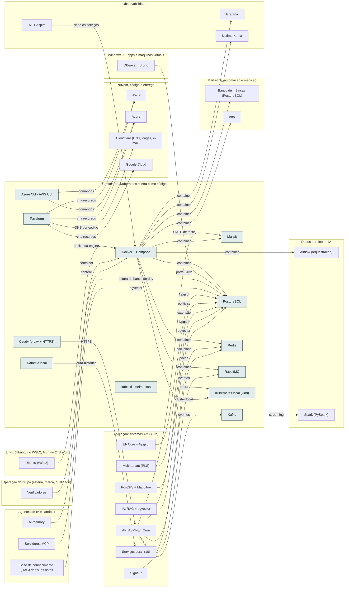

<!-- Arquivo GERADO por tools/gerar_docs.py a partir de data/. Edite os dados, não este arquivo. -->

# Camada 09 · Containers, Kubernetes e infra como código

[← Arquitetura](../arquitetura.md) · [Índice da documentação](../README.md)

> **Ligação com a camada de baixo:** A CLI docker e o kubectl no Ubuntu falam com a engine do Docker no WSL2.

**12 blocos** · 0 precisam de conta · 5 marcados como futuro

## Mapa de conexões

## Blocos

| Bloco | Tipo | O que faz | Quando entra |
|---|---|---|---|
| [Caddy (proxy + HTTPS)](#caddy) | Local | Fica na frente das APIs e emite o certificado HTTPS sozinho. Usado no servidor e no homelab. | passo 18.3 · Junto dos Passos 4 a 6 da trilha de estudo (≈ mar a jun/2027): o modelo nasce no Passo 4 (API e login) e ganha testes e qualidade no Passo 6 |
| [Mailpit](#mailp) | Local | Caixa de e-mail falsa para testar os e-mails dos sistemas sem enviar nada de verdade. | passo 18.3 · Junto dos Passos 4 a 6 da trilha de estudo (≈ mar a jun/2027): o modelo nasce no Passo 4 (API e login) e ganha testes e qualidade no Passo 6 |
| [Kafka](#kafka) | Local · futuro | Mensageria padrão em empresa grande. Depois do RabbitMQ. | passo 30.1 · 2028 |
| [kubectl · Helm · k9s](#k8st) | Local · futuro | Ferramentas para operar o Kubernetes: comandos, pacotes e painel no terminal. | passo 30.2 · 2028 |
| [Azure CLI · AWS CLI](#clis) | Local | Linha de comando das nuvens; usadas pelo Terraform. | passo 19.1 · Com o Passo 5 da trilha de estudo (≈ abr a jun/2027) para a conta e o deploy do sistema exemplo; o deploy de produção do AM Kaixara é o Passo 10 (≈ 2028) |
| [Datomic local](#datomic) | Local · futuro | Só quando o aura-historico existir (desvio intencional da stack). | passo 26.4 · 2027 (começa quando: o primeiro sistema AM pronto e testado com um cliente) |
| [Docker + Compose](#docker) | Local | Engine no WSL2; um compose por sistema. | passo 4.2 · Semana 2 · nov/2026; passo 10.2 · Semana 4 · nov/2026 |
| [PostgreSQL](#pg) | Local | Banco de todos os sistemas (com pgvector para IA). | passo 10.2 · Semana 4 · nov/2026; passo 18.1 · Junto dos Passos 4 a 6 da trilha de estudo (≈ mar a jun/2027): o modelo nasce no Passo 4 (API e login) e ganha testes e qualidade no Passo 6 |
| [Redis](#redis) | Local | Cache e backplane do SignalR. | passo 18.1 · Junto dos Passos 4 a 6 da trilha de estudo (≈ mar a jun/2027): o modelo nasce no Passo 4 (API e login) e ganha testes e qualidade no Passo 6 |
| [RabbitMQ](#rmq) | Local · futuro | Fila de eventos entre sistemas. | passo 30.1 · 2028 |
| [Kubernetes local (kind)](#kind) | Local · futuro | Treino de Kubernetes sem pagar nuvem. | passo 30.2 · 2028 |
| [Terraform](#tf) | Local | Cria Azure, AWS e Cloudflare por código. | passo 19.1 · Com o Passo 5 da trilha de estudo (≈ abr a jun/2027) para a conta e o deploy do sistema exemplo; o deploy de produção do AM Kaixara é o Passo 10 (≈ 2028); passo 19.3 · Com o Passo 5 da trilha de estudo (≈ abr a jun/2027) para a conta e o deploy do sistema exemplo; o deploy de produção do AM Kaixara é o Passo 10 (≈ 2028) |

### Caddy (proxy + HTTPS)

*Local*

Fica na frente das APIs e emite o certificado HTTPS sozinho. Usado no servidor e no homelab.

**Quando entra:** passo 18.3 · Junto dos Passos 4 a 6 da trilha de estudo (≈ mar a jun/2027): o modelo nasce no Passo 4 (API e login) e ganha testes e qualidade no Passo 6 ([roteiro](../implantacao/roteiro.md))

| Direção | Bloco | Camada | O que passa |
|---|---|---|---|
| → envia para | [API ASP.NET Core](11-app.md#api) | Aplicação: sistemas AM (Aura) | HTTPS |

### Mailpit

*Local*

Caixa de e-mail falsa para testar os e-mails dos sistemas sem enviar nada de verdade.

**Quando entra:** passo 18.3 · Junto dos Passos 4 a 6 da trilha de estudo (≈ mar a jun/2027): o modelo nasce no Passo 4 (API e login) e ganha testes e qualidade no Passo 6 ([roteiro](../implantacao/roteiro.md))

| Direção | Bloco | Camada | O que passa |
|---|---|---|---|
| ← recebe de | [API ASP.NET Core](11-app.md#api) | Aplicação: sistemas AM (Aura) | SMTP de teste |
| ← recebe de | [Docker + Compose](09-cnt.md#docker) | Containers, Kubernetes e infra como código | container |

### Kafka

*Local · futuro*

Mensageria padrão em empresa grande. Depois do RabbitMQ.

**Quando entra:** passo 30.1 · 2028 ([roteiro](../implantacao/roteiro.md))

| Direção | Bloco | Camada | O que passa |
|---|---|---|---|
| → envia para | [Spark (PySpark)](06-dados.md#spark) | Dados e treino de IA | streaming |
| ← recebe de | [API ASP.NET Core](11-app.md#api) | Aplicação: sistemas AM (Aura) | eventos |

### kubectl · Helm · k9s

*Local · futuro*

Ferramentas para operar o Kubernetes: comandos, pacotes e painel no terminal.

**Quando entra:** passo 30.2 · 2028 ([roteiro](../implantacao/roteiro.md))

| Direção | Bloco | Camada | O que passa |
|---|---|---|---|
| → envia para | [Kubernetes local (kind)](09-cnt.md#kind) | Containers, Kubernetes e infra como código | opera |

### Azure CLI · AWS CLI

*Local*

Linha de comando das nuvens; usadas pelo Terraform.

**Quando entra:** passo 19.1 · Com o Passo 5 da trilha de estudo (≈ abr a jun/2027) para a conta e o deploy do sistema exemplo; o deploy de produção do AM Kaixara é o Passo 10 (≈ 2028) ([roteiro](../implantacao/roteiro.md))

| Direção | Bloco | Camada | O que passa |
|---|---|---|---|
| → envia para | [Azure](12-nuvem.md#azure) | Nuvem, código e entrega | comandos |
| → envia para | [AWS](12-nuvem.md#aws) | Nuvem, código e entrega | comandos |

### Datomic local

*Local · futuro*

Só quando o aura-historico existir (desvio intencional da stack).

**Quando entra:** passo 26.4 · 2027 (começa quando: o primeiro sistema AM pronto e testado com um cliente) ([roteiro](../implantacao/roteiro.md))

| Direção | Bloco | Camada | O que passa |
|---|---|---|---|
| → envia para | [Serviços aura- (10)](11-app.md#shared) | Aplicação: sistemas AM (Aura) | aura-historico |

### Docker + Compose

*Local*

Engine no WSL2; um compose por sistema.

**Quando entra:** passo 4.2 · Semana 2 · nov/2026; passo 10.2 · Semana 4 · nov/2026 ([roteiro](../implantacao/roteiro.md))

| Direção | Bloco | Camada | O que passa |
|---|---|---|---|
| → envia para | [Mailpit](09-cnt.md#mailp) | Containers, Kubernetes e infra como código | container |
| → envia para | [PostgreSQL](09-cnt.md#pg) | Containers, Kubernetes e infra como código | container |
| → envia para | [Redis](09-cnt.md#redis) | Containers, Kubernetes e infra como código | container |
| → envia para | [RabbitMQ](09-cnt.md#rmq) | Containers, Kubernetes e infra como código | container |
| → envia para | [Kubernetes local (kind)](09-cnt.md#kind) | Containers, Kubernetes e infra como código | cluster local |
| → envia para | [n8n](21-mkt.md#n8n) | Marketing, automação e medição | container |
| → envia para | [Banco de métricas (PostgreSQL)](21-mkt.md#metrics) | Marketing, automação e medição | container |
| → envia para | [Grafana](10-obs.md#graf) | Observabilidade | container |
| → envia para | [Uptime Kuma](10-obs.md#kuma) | Observabilidade | container |
| → envia para | [Airflow (orquestração)](06-dados.md#orq) | Dados e treino de IA | container |
| ← recebe de | [Ubuntu (WSL2)](04-lin.md#wsl) | Linux (Ubuntu no WSL2, Arch no 2º disco) | socket da engine |
| ← recebe de | [ai-memory](05-ia.md#mem) | Agentes de IA e sandbox | container |
| ← recebe de | [.NET Aspire](10-obs.md#aspire) | Observabilidade | sobe os serviços |
| ← recebe de | [Verificadores](23-oper.md#overif) | Operação do grupo (esteira, marca, qualidade) | confere |

### PostgreSQL

*Local*

Banco de todos os sistemas (com pgvector para IA).

**Quando entra:** passo 10.2 · Semana 4 · nov/2026; passo 18.1 · Junto dos Passos 4 a 6 da trilha de estudo (≈ mar a jun/2027): o modelo nasce no Passo 4 (API e login) e ganha testes e qualidade no Passo 6 ([roteiro](../implantacao/roteiro.md))

| Direção | Bloco | Camada | O que passa |
|---|---|---|---|
| ← recebe de | [DBeaver · Bruno](03-win.md#dbv) | Windows 11, apps e máquinas virtuais | porta 5432 |
| ← recebe de | [Servidores MCP](05-ia.md#mcp) | Agentes de IA e sandbox | leitura do banco de dev |
| ← recebe de | [Base de conhecimento (RAG) das suas notas](05-ia.md#rag) | Agentes de IA e sandbox | pgvector |
| ← recebe de | [EF Core + Npgsql](11-app.md#ef) | Aplicação: sistemas AM (Aura) | Npgsql |
| ← recebe de | [Multi-tenant (RLS)](11-app.md#rls) | Aplicação: sistemas AM (Aura) | políticas |
| ← recebe de | [PostGIS + MapLibre](11-app.md#gis) | Aplicação: sistemas AM (Aura) | extensão |
| ← recebe de | [Docker + Compose](09-cnt.md#docker) | Containers, Kubernetes e infra como código | container |
| ← recebe de | [API ASP.NET Core](11-app.md#api) | Aplicação: sistemas AM (Aura) | Npgsql |
| ← recebe de | [IA: RAG + pgvector](11-app.md#ai) | Aplicação: sistemas AM (Aura) | pgvector |

### Redis

*Local*

Cache e backplane do SignalR.

**Quando entra:** passo 18.1 · Junto dos Passos 4 a 6 da trilha de estudo (≈ mar a jun/2027): o modelo nasce no Passo 4 (API e login) e ganha testes e qualidade no Passo 6 ([roteiro](../implantacao/roteiro.md))

| Direção | Bloco | Camada | O que passa |
|---|---|---|---|
| ← recebe de | [SignalR](11-app.md#sig) | Aplicação: sistemas AM (Aura) | backplane |
| ← recebe de | [Docker + Compose](09-cnt.md#docker) | Containers, Kubernetes e infra como código | container |
| ← recebe de | [API ASP.NET Core](11-app.md#api) | Aplicação: sistemas AM (Aura) | cache |

### RabbitMQ

*Local · futuro*

Fila de eventos entre sistemas.

**Quando entra:** passo 30.1 · 2028 ([roteiro](../implantacao/roteiro.md))

| Direção | Bloco | Camada | O que passa |
|---|---|---|---|
| ← recebe de | [Docker + Compose](09-cnt.md#docker) | Containers, Kubernetes e infra como código | container |
| ← recebe de | [API ASP.NET Core](11-app.md#api) | Aplicação: sistemas AM (Aura) | eventos |

### Kubernetes local (kind)

*Local · futuro*

Treino de Kubernetes sem pagar nuvem.

**Quando entra:** passo 30.2 · 2028 ([roteiro](../implantacao/roteiro.md))

| Direção | Bloco | Camada | O que passa |
|---|---|---|---|
| ← recebe de | [kubectl · Helm · k9s](09-cnt.md#k8st) | Containers, Kubernetes e infra como código | opera |
| ← recebe de | [Docker + Compose](09-cnt.md#docker) | Containers, Kubernetes e infra como código | cluster local |

### Terraform

*Local*

Cria Azure, AWS e Cloudflare por código.

**Quando entra:** passo 19.1 · Com o Passo 5 da trilha de estudo (≈ abr a jun/2027) para a conta e o deploy do sistema exemplo; o deploy de produção do AM Kaixara é o Passo 10 (≈ 2028); passo 19.3 · Com o Passo 5 da trilha de estudo (≈ abr a jun/2027) para a conta e o deploy do sistema exemplo; o deploy de produção do AM Kaixara é o Passo 10 (≈ 2028) ([roteiro](../implantacao/roteiro.md))

| Direção | Bloco | Camada | O que passa |
|---|---|---|---|
| → envia para | [Google Cloud](12-nuvem.md#gcp) | Nuvem, código e entrega | cria recursos |
| → envia para | [Azure](12-nuvem.md#azure) | Nuvem, código e entrega | cria recursos |
| → envia para | [AWS](12-nuvem.md#aws) | Nuvem, código e entrega | cria recursos |
| → envia para | [Cloudflare (DNS, Pages, e-mail)](12-nuvem.md#cf) | Nuvem, código e entrega | DNS por código |

---

[↑ Camada 10 · Observabilidade](10-obs.md) · [↓ Camada 08 · Claude: recursos, conectores e plugins](08-clc.md)
