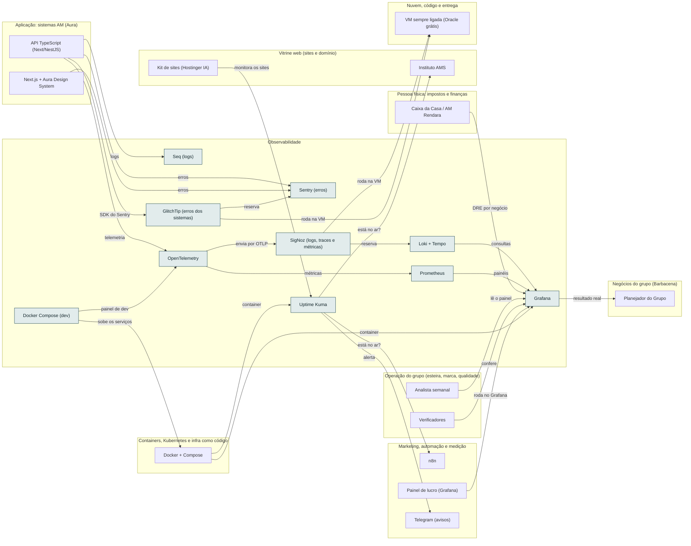

<!-- Arquivo GERADO por tools/gerar_docs.py a partir de data/. Edite os dados, não este arquivo. -->

# Camada 10 · Observabilidade

[← Arquitetura](../arquitetura.md) · [Índice da documentação](../README.md)

> **Ligação com a camada de baixo:** Coletor, Prometheus e Grafana rodam como containers.

**10 blocos** · 3 precisam de conta · 1 marcados como futuro

## Mapa de conexões

## Blocos

| Bloco | Tipo | O que faz | Quando entra |
|---|---|---|---|
| [Sentry (erros)](#sentry) | Remoto · precisa de conta | Reserva do GlitchTip (ADR 0008): avisa quando um erro acontece em produção, com o ponto exato no código. Plano grátis. | passo 41.4 · Trimestre 2 do eixo (fev a abr/2027): o modelo nasce no esqueleto do AM Rendara (módulo o-dotnet do Professor) e ganha testes e qualidade até o MVP |
| [Uptime Kuma](#kuma) | Local | Verifica a cada minuto se os sites e APIs estão no ar e avisa no celular. Open source. | passo 10.6 · Semana 4 · nov/2026; passo 31.5 · Dez/2026 a jan/2027; passo 45.1 · Recesso escolar de jan/2027 (14 dias seguidos, de dia; o restaurante segue à noite) (começa quando: o recesso começou e uma das 3 rendas de agora já passou no portão) |
| [Seq (logs)](#seq) | Local | Visualizador de logs simples para começar, antes da stack Grafana. | passo 41.3 · Trimestre 2 do eixo (fev a abr/2027): o modelo nasce no esqueleto do AM Rendara (módulo o-dotnet do Professor) e ganha testes e qualidade até o MVP |
| [Loki + Tempo](#loki) | Local · futuro | Reserva do SigNoz (ADR 0008): logs e rastreamento de requisições consultados no Grafana. | passo 55.3 · 2028 |
| [OpenTelemetry](#otel) | Local | Coleta logs, métricas e traces da API. | passo 24.7 · Nov/2026 a out/2027, revisão no fim de cada trimestre; passo 41.3 · Trimestre 2 do eixo (fev a abr/2027): o modelo nasce no esqueleto do AM Rendara (módulo o-dotnet do Professor) e ganha testes e qualidade até o MVP |
| [Prometheus](#prom) | Local | Guarda as métricas. | passo 41.3 · Trimestre 2 do eixo (fev a abr/2027): o modelo nasce no esqueleto do AM Rendara (módulo o-dotnet do Professor) e ganha testes e qualidade até o MVP |
| [Grafana](#graf) | Local | Painéis e alertas. | passo 10.4 · Semana 4 · nov/2026; passo 38.4 · Semana 11 · jan/2027 |
| [Docker Compose (dev)](#aspire) | Local | Sobe o sistema inteiro no dev com painel próprio. | passo 41.3 · Trimestre 2 do eixo (fev a abr/2027): o modelo nasce no esqueleto do AM Rendara (módulo o-dotnet do Professor) e ganha testes e qualidade até o MVP |
| [SigNoz (logs, traces e métricas)](#signoz) | Remoto · precisa de conta | Principal da observabilidade dos apps (ADR 0008): logs, traces e métricas numa tela, nativo de OpenTelemetry. O Grafana fica para o painel de lucro. | passo 32.3 · Dez/2026 a jan/2027 na VM grátis da Oracle, depois da Operação 24 horas; VPS e VM paga quando uma renda pagar |
| [GlitchTip (erros dos sistemas)](#glitchtip) | Remoto · precisa de conta | Principal dos erros (ADR 0008): o mesmo SDK do Sentry, auto-hospedado e sem cota. O Sentry SaaS fica de reserva. | passo 32.2 · Dez/2026 a jan/2027 na VM grátis da Oracle, depois da Operação 24 horas; VPS e VM paga quando uma renda pagar |

### Sentry (erros)

*Remoto · precisa de conta*

Reserva do GlitchTip (ADR 0008): avisa quando um erro acontece em produção, com o ponto exato no código. Plano grátis.

**Quando entra:** passo 41.4 · Trimestre 2 do eixo (fev a abr/2027): o modelo nasce no esqueleto do AM Rendara (módulo o-dotnet do Professor) e ganha testes e qualidade até o MVP ([roteiro](../implantacao/roteiro.md))

| Direção | Bloco | Camada | O que passa |
|---|---|---|---|
| ← recebe de | [API TypeScript (Next/NestJS)](11-app.md#api) | Aplicação: sistemas AM (Aura) | erros |
| ← recebe de | [Next.js + Aura Design System](11-app.md#front) | Aplicação: sistemas AM (Aura) | erros |
| ← recebe de | [GlitchTip (erros dos sistemas)](10-obs.md#glitchtip) | Observabilidade | reserva |

### Uptime Kuma

*Local*

Verifica a cada minuto se os sites e APIs estão no ar e avisa no celular. Open source.

**Quando entra:** passo 10.6 · Semana 4 · nov/2026; passo 31.5 · Dez/2026 a jan/2027; passo 45.1 · Recesso escolar de jan/2027 (14 dias seguidos, de dia; o restaurante segue à noite) (começa quando: o recesso começou e uma das 3 rendas de agora já passou no portão) ([roteiro](../implantacao/roteiro.md))

| Direção | Bloco | Camada | O que passa |
|---|---|---|---|
| → envia para | [Instituto AMS](18-web.md#inst) | Vitrine web (sites e domínio) | está no ar? |
| → envia para | [Telegram (avisos)](21-mkt.md#tg) | Marketing, automação e medição | alerta |
| → envia para | [n8n](21-mkt.md#n8n) | Marketing, automação e medição | está no ar? |
| ← recebe de | [Docker + Compose](09-cnt.md#docker) | Containers, Kubernetes e infra como código | container |
| ← recebe de | [Kit de sites (Hostinger IA)](18-web.md#kitsites) | Vitrine web (sites e domínio) | monitora os sites |

### Seq (logs)

*Local*

Visualizador de logs simples para começar, antes da stack Grafana.

**Quando entra:** passo 41.3 · Trimestre 2 do eixo (fev a abr/2027): o modelo nasce no esqueleto do AM Rendara (módulo o-dotnet do Professor) e ganha testes e qualidade até o MVP ([roteiro](../implantacao/roteiro.md))

| Direção | Bloco | Camada | O que passa |
|---|---|---|---|
| ← recebe de | [API TypeScript (Next/NestJS)](11-app.md#api) | Aplicação: sistemas AM (Aura) | logs |

### Loki + Tempo

*Local · futuro*

Reserva do SigNoz (ADR 0008): logs e rastreamento de requisições consultados no Grafana.

**Quando entra:** passo 55.3 · 2028 ([roteiro](../implantacao/roteiro.md))

| Direção | Bloco | Camada | O que passa |
|---|---|---|---|
| → envia para | [Grafana](10-obs.md#graf) | Observabilidade | consultas |
| ← recebe de | [SigNoz (logs, traces e métricas)](10-obs.md#signoz) | Observabilidade | reserva |

### OpenTelemetry

*Local*

Coleta logs, métricas e traces da API.

**Quando entra:** passo 24.7 · Nov/2026 a out/2027, revisão no fim de cada trimestre; passo 41.3 · Trimestre 2 do eixo (fev a abr/2027): o modelo nasce no esqueleto do AM Rendara (módulo o-dotnet do Professor) e ganha testes e qualidade até o MVP ([roteiro](../implantacao/roteiro.md))

| Direção | Bloco | Camada | O que passa |
|---|---|---|---|
| → envia para | [Prometheus](10-obs.md#prom) | Observabilidade | métricas |
| → envia para | [SigNoz (logs, traces e métricas)](10-obs.md#signoz) | Observabilidade | envia por OTLP |
| ← recebe de | [API TypeScript (Next/NestJS)](11-app.md#api) | Aplicação: sistemas AM (Aura) | telemetria |
| ← recebe de | [Docker Compose (dev)](10-obs.md#aspire) | Observabilidade | painel de dev |

### Prometheus

*Local*

Guarda as métricas.

**Quando entra:** passo 41.3 · Trimestre 2 do eixo (fev a abr/2027): o modelo nasce no esqueleto do AM Rendara (módulo o-dotnet do Professor) e ganha testes e qualidade até o MVP ([roteiro](../implantacao/roteiro.md))

| Direção | Bloco | Camada | O que passa |
|---|---|---|---|
| → envia para | [Grafana](10-obs.md#graf) | Observabilidade | painéis |
| ← recebe de | [OpenTelemetry](10-obs.md#otel) | Observabilidade | métricas |

### Grafana

*Local*

Painéis e alertas.

**Quando entra:** passo 10.4 · Semana 4 · nov/2026; passo 38.4 · Semana 11 · jan/2027 ([roteiro](../implantacao/roteiro.md))

| Direção | Bloco | Camada | O que passa |
|---|---|---|---|
| → envia para | [Planejador do Grupo](16-neg.md#nplan) | Negócios do grupo (Barbacena) | resultado real |
| ← recebe de | [Loki + Tempo](10-obs.md#loki) | Observabilidade | consultas |
| ← recebe de | [Prometheus](10-obs.md#prom) | Observabilidade | painéis |
| ← recebe de | [Caixa da Casa / AM Rendara](19-emp.md#caixa) | Pessoa física: impostos e finanças | DRE por negócio |
| ← recebe de | [Analista semanal](23-oper.md#oanal) | Operação do grupo (esteira, marca, qualidade) | lê o painel |
| ← recebe de | [Verificadores](23-oper.md#overif) | Operação do grupo (esteira, marca, qualidade) | confere |
| ← recebe de | [Painel de lucro (Grafana)](21-mkt.md#painel) | Marketing, automação e medição | roda no Grafana |
| ← recebe de | [Docker + Compose](09-cnt.md#docker) | Containers, Kubernetes e infra como código | container |

### Docker Compose (dev)

*Local*

Sobe o sistema inteiro no dev com painel próprio.

**Quando entra:** passo 41.3 · Trimestre 2 do eixo (fev a abr/2027): o modelo nasce no esqueleto do AM Rendara (módulo o-dotnet do Professor) e ganha testes e qualidade até o MVP ([roteiro](../implantacao/roteiro.md))

| Direção | Bloco | Camada | O que passa |
|---|---|---|---|
| → envia para | [OpenTelemetry](10-obs.md#otel) | Observabilidade | painel de dev |
| → envia para | [Docker + Compose](09-cnt.md#docker) | Containers, Kubernetes e infra como código | sobe os serviços |

### SigNoz (logs, traces e métricas)

*Remoto · precisa de conta*

Principal da observabilidade dos apps (ADR 0008): logs, traces e métricas numa tela, nativo de OpenTelemetry. O Grafana fica para o painel de lucro.

**Quando entra:** passo 32.3 · Dez/2026 a jan/2027 na VM grátis da Oracle, depois da Operação 24 horas; VPS e VM paga quando uma renda pagar ([roteiro](../implantacao/roteiro.md))

| Direção | Bloco | Camada | O que passa |
|---|---|---|---|
| → envia para | [VM sempre ligada (Oracle grátis)](12-nuvem.md#vm247) | Nuvem, código e entrega | roda na VM |
| → envia para | [Loki + Tempo](10-obs.md#loki) | Observabilidade | reserva |
| ← recebe de | [OpenTelemetry](10-obs.md#otel) | Observabilidade | envia por OTLP |

### GlitchTip (erros dos sistemas)

*Remoto · precisa de conta*

Principal dos erros (ADR 0008): o mesmo SDK do Sentry, auto-hospedado e sem cota. O Sentry SaaS fica de reserva.

**Quando entra:** passo 32.2 · Dez/2026 a jan/2027 na VM grátis da Oracle, depois da Operação 24 horas; VPS e VM paga quando uma renda pagar ([roteiro](../implantacao/roteiro.md))

| Direção | Bloco | Camada | O que passa |
|---|---|---|---|
| → envia para | [VM sempre ligada (Oracle grátis)](12-nuvem.md#vm247) | Nuvem, código e entrega | roda na VM |
| → envia para | [Sentry (erros)](10-obs.md#sentry) | Observabilidade | reserva |
| ← recebe de | [API TypeScript (Next/NestJS)](11-app.md#api) | Aplicação: sistemas AM (Aura) | SDK do Sentry |

---

[↑ Camada 11 · Aplicação: sistemas AM (Aura)](11-app.md) · [↓ Camada 09 · Containers, Kubernetes e infra como código](09-cnt.md)
