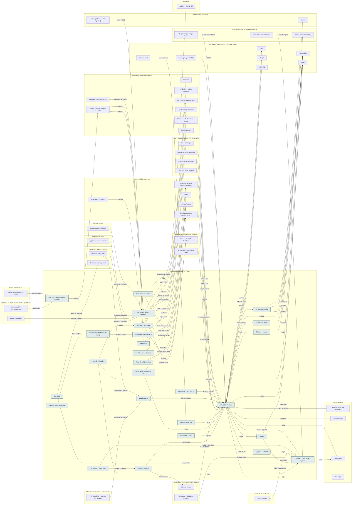

<!-- Arquivo GERADO por tools/gerar_docs.py a partir de data/. Edite os dados, não este arquivo. -->

# Camada 11 · Aplicação: sistemas AM (Aura)

[← Arquitetura](../arquitetura.md) · [Índice da documentação](../README.md)

> **Ligação com a camada de baixo:** A API envia logs, métricas e traces pelo OpenTelemetry.

**26 blocos** · 0 precisam de conta · 8 marcados como futuro

## Mapa de conexões

## Blocos

| Bloco | Tipo | O que faz | Quando entra |
|---|---|---|---|
| [OpenAPI + Scalar](#oapi) | Local | Documentação interativa da API. No .NET 9 em diante, o Swagger saiu do modelo padrão e o Scalar é a escolha comum. | passo 41.1 · Trimestre 2 do eixo (fev a abr/2027): o modelo nasce no esqueleto do AM Rendara (módulo o-dotnet do Professor) e ganha testes e qualidade até o MVP |
| [PostGIS + MapLibre](#gis) | Local · futuro | Mapas e geolocalização do AM Rotara. Lacuna já identificada nos cursos da Alura e da Rocketseat. | passo 50.3 · 2027 (começa quando: o primeiro sistema AM pronto e testado com um cliente) |
| [Storybook](#story) | Local | Vitrine dos componentes do aura-frontend-kit; vira demo pública e produto (template). | passo 41.1 · Trimestre 2 do eixo (fev a abr/2027): o modelo nasce no esqueleto do AM Rendara (módulo o-dotnet do Professor) e ganha testes e qualidade até o MVP |
| [Clean Arch + DDD](#clean) | Local | Domain, Application, Infrastructure e Api. O domínio não conhece banco nem web. | passo 41.1 · Trimestre 2 do eixo (fev a abr/2027): o modelo nasce no esqueleto do AM Rendara (módulo o-dotnet do Professor) e ganha testes e qualidade até o MVP |
| [EF Core + Npgsql](#ef) | Local | ORM do .NET para PostgreSQL, com migrations versionadas. | passo 41.1 · Trimestre 2 do eixo (fev a abr/2027): o modelo nasce no esqueleto do AM Rendara (módulo o-dotnet do Professor) e ganha testes e qualidade até o MVP |
| [SignalR](#sig) | Local | Tempo real: pedido mudou de status no AM Rotara, venda nova no AM Kaixara. | passo 41.1 · Trimestre 2 do eixo (fev a abr/2027): o modelo nasce no esqueleto do AM Rendara (módulo o-dotnet do Professor) e ganha testes e qualidade até o MVP |
| [Multi-tenant (RLS)](#rls) | Local | tenant_id + Row-Level Security: cada cliente só vê os próprios dados, garantido pelo banco. | passo 41.1 · Trimestre 2 do eixo (fev a abr/2027): o modelo nasce no esqueleto do AM Rendara (módulo o-dotnet do Professor) e ganha testes e qualidade até o MVP |
| [Testes: xUnit, Playwright, k6](#tests) | Local | Unidade, integração com banco real, testes de tela no navegador e teste de carga. | passo 24.4 · Nov/2026 a out/2027, revisão no fim de cada trimestre; passo 41.1 · Trimestre 2 do eixo (fev a abr/2027): o modelo nasce no esqueleto do AM Rendara (módulo o-dotnet do Professor) e ganha testes e qualidade até o MVP; passo 45.10 · Recesso escolar de jan/2027 (14 dias seguidos, de dia; o restaurante segue à noite) (começa quando: o recesso começou e uma das 3 rendas de agora já passou no portão) |
| [Serviços aura- (10)](#shared) | Local · futuro | aura-copilot, aura-historico (Clojure/Datomic), aura-analytics (Python/FastAPI) e os demais. Só nascem quando um sistema precisar. | passo 50.4 · 2027 (começa quando: o primeiro sistema AM pronto e testado com um cliente) |
| [Next.js + Aura Design System](#front) | Local | Telas dos sistemas e, no futuro, dos sites próprios. | passo 24.4 · Nov/2026 a out/2027, revisão no fim de cada trimestre; passo 41.1 · Trimestre 2 do eixo (fev a abr/2027): o modelo nasce no esqueleto do AM Rendara (módulo o-dotnet do Professor) e ganha testes e qualidade até o MVP; passo 46.17 · Fev a dez/2027, uma oferta por vez (começa quando: a primeira venda do mini-curso aconteceu) |
| [API ASP.NET Core](#api) | Local | Regras de negócio dos sistemas AM. | passo 24.4 · Nov/2026 a out/2027, revisão no fim de cada trimestre; passo 41.1 · Trimestre 2 do eixo (fev a abr/2027): o modelo nasce no esqueleto do AM Rendara (módulo o-dotnet do Professor) e ganha testes e qualidade até o MVP; passo 46.17 · Fev a dez/2027, uma oferta por vez (começa quando: a primeira venda do mini-curso aconteceu) |
| [Keycloak / Entra ID](#auth) | Local | Login e permissões (OAuth2/OIDC). | passo 41.2 · Trimestre 2 do eixo (fev a abr/2027): o modelo nasce no esqueleto do AM Rendara (módulo o-dotnet do Professor) e ganha testes e qualidade até o MVP |
| [IA: RAG + pgvector](#ai) | Local · futuro | Busca e assistente dentro dos sistemas (AM Projeta, aura-copilot). | passo 49.1 · Depois do trimestre 4 do eixo (ADR 0011, ≈ 2028), quando o AM Rendara já estiver em produção |
| [aura-licensing](#lic) | Local · futuro | Cobrança por módulo dos sistemas AM. | passo 50.1 · 2027 (começa quando: o primeiro sistema AM pronto e testado com um cliente) |
| [aura-status](#status) | Local | Seu painel de repos, backup e Dependabot. | passo 42.7 · Trimestre 2 do eixo (fev a abr/2027): conta, deploy com Kamal e rollback testado do AM Rendara (MVP com 1 usuário pagante) |
| [AM Kaixara (PDV e cardápio)](#nkaix) | Remoto · futuro | PDV, comandas, ordem de serviço, estoque, ficha técnica e engenharia de cardápio. Roda primeiro na loja e nos restaurantes do grupo. | passo 46.12 · Fev a dez/2027, uma oferta por vez (começa quando: a primeira venda do mini-curso aconteceu); passo 50.2 · 2027 (começa quando: o primeiro sistema AM pronto e testado com um cliente) |
| [AM Rotara (entregas)](#nrot) | Remoto · futuro | Pedidos, roteirização com PostGIS, app do entregador, prova de entrega e repasse semanal. Base da AM Entregas e do AM Delivery. | passo 50.3 · 2027 (começa quando: o primeiro sistema AM pronto e testado com um cliente); passo 50.5 · 2027 (começa quando: o primeiro sistema AM pronto e testado com um cliente) |
| [App mobile (.NET MAUI)](#mobile) | Local · futuro | App dos sistemas AM no celular, em C# como o resto do Aura. Entra em 2028; Kotlin, Swift e Flutter ficam fora para não abrir outra stack. | passo 54.6 · 2028 |
| [AM Obra (diário, medição, compras)](#nobra) | Remoto · futuro | Sistema AM para pequenas construtoras: diário de obra, medição, compras e estimativa pelo SINAPI, lendo o IFC. | passo 61.12 · Ferramentas grátis no estudo da manhã a partir de jan/2027; serviços e o AM Obra só depois das rendas de agora passarem no portão |
| [Zod · Biome · Vitest (front)](#zod) | Local | Zod valida no front tudo o que chega da API e dos formulários; Biome faz lint e formatação; Vitest testa as regras do front. O contrato do backend é o OpenAPI (ADR 0006). | passo 41.9 · Trimestre 2 do eixo (fev a abr/2027): o modelo nasce no esqueleto do AM Rendara (módulo o-dotnet do Professor) e ganha testes e qualidade até o MVP; passo 45.8 · Recesso escolar de jan/2027 (14 dias seguidos, de dia; o restaurante segue à noite) (começa quando: o recesso começou e uma das 3 rendas de agora já passou no portão) |
| [SvelteKit (apps pequenos)](#sveltekit) | Local | Apps pequenos e interativos e o front dos MVPs em PocketBase (ADR 0007). Sistemas AM seguem em Next.js. | passo 45.7 · Recesso escolar de jan/2027 (14 dias seguidos, de dia; o restaurante segue à noite) (começa quando: o recesso começou e uma das 3 rendas de agora já passou no portão) |
| [PocketBase (MVP antes do Aura)](#pocketbase) | Local | Banco, login, arquivos e tempo real num binário: valida a ideia antes de construir no Aura. Modelo em infra/pocketbase. | passo 45.7 · Recesso escolar de jan/2027 (14 dias seguidos, de dia; o restaurante segue à noite) (começa quando: o recesso começou e uma das 3 rendas de agora já passou no portão) |
| [Litestream (SQLite no R2)](#litestream) | Local | Copia o SQLite do PocketBase para o R2 a cada segundo e restaura sozinho se a VM for recriada. | passo 45.10 · Recesso escolar de jan/2027 (14 dias seguidos, de dia; o restaurante segue à noite) (começa quando: o recesso começou e uma das 3 rendas de agora já passou no portão) |
| [React Email (modelos)](#reactemail) | Local | Modelos de e-mail em componentes, os mesmos para o Resend e o Plunk. | passo 33.12 · Com a primeira página de venda no ar (jan/2027) e por etapas |
| [Go (CLIs com bubbletea)](#golang) | Local | CLIs do setup e produtos em binário único, com tela interativa (bubbletea) e release multiplataforma pelo GoReleaser. Modelo em infra/templates/go-cli. | passo 57.13 · Contínuo, desde a semana 2 |
| [Rust (firmware e CLIs)](#rust) | Local | Firmware (ESP32-C3/C6, STM32 com Embassy) e ferramentas que pedem desempenho, com release pelo cargo-dist. Modelo em infra/templates/rust-cli. | passo 57.14 · Contínuo, desde a semana 2 |

### OpenAPI + Scalar

*Local*

Documentação interativa da API. No .NET 9 em diante, o Swagger saiu do modelo padrão e o Scalar é a escolha comum.

**Quando entra:** passo 41.1 · Trimestre 2 do eixo (fev a abr/2027): o modelo nasce no esqueleto do AM Rendara (módulo o-dotnet do Professor) e ganha testes e qualidade até o MVP ([roteiro](../implantacao/roteiro.md))

| Direção | Bloco | Camada | O que passa |
|---|---|---|---|
| → envia para | [API ASP.NET Core](11-app.md#api) | Aplicação: sistemas AM (Aura) | documenta |
| → envia para | [DBeaver · Bruno](03-win.md#dbv) | Windows 11, apps e máquinas virtuais | Bruno importa |
| ← recebe de | [Zod · Biome · Vitest (front)](11-app.md#zod) | Aplicação: sistemas AM (Aura) | segue o contrato |

### PostGIS + MapLibre

*Local · futuro*

Mapas e geolocalização do AM Rotara. Lacuna já identificada nos cursos da Alura e da Rocketseat.

**Quando entra:** passo 50.3 · 2027 (começa quando: o primeiro sistema AM pronto e testado com um cliente) ([roteiro](../implantacao/roteiro.md))

| Direção | Bloco | Camada | O que passa |
|---|---|---|---|
| → envia para | [PostgreSQL](09-cnt.md#pg) | Containers, Kubernetes e infra como código | extensão |
| → envia para | [Next.js + Aura Design System](11-app.md#front) | Aplicação: sistemas AM (Aura) | mapa |
| → envia para | [AM Rotara (entregas)](11-app.md#nrot) | Aplicação: sistemas AM (Aura) | mapas |

### Storybook

*Local*

Vitrine dos componentes do aura-frontend-kit; vira demo pública e produto (template).

**Quando entra:** passo 41.1 · Trimestre 2 do eixo (fev a abr/2027): o modelo nasce no esqueleto do AM Rendara (módulo o-dotnet do Professor) e ganha testes e qualidade até o MVP ([roteiro](../implantacao/roteiro.md))

| Direção | Bloco | Camada | O que passa |
|---|---|---|---|
| → envia para | [Next.js + Aura Design System](11-app.md#front) | Aplicação: sistemas AM (Aura) | componentes |
| → envia para | [Templates e código-fonte](17-prod.md#tmpl) | Produtos (o que você vende) | demo do template |

### Clean Arch + DDD

*Local*

Domain, Application, Infrastructure e Api. O domínio não conhece banco nem web.

**Quando entra:** passo 41.1 · Trimestre 2 do eixo (fev a abr/2027): o modelo nasce no esqueleto do AM Rendara (módulo o-dotnet do Professor) e ganha testes e qualidade até o MVP ([roteiro](../implantacao/roteiro.md))

| Direção | Bloco | Camada | O que passa |
|---|---|---|---|
| → envia para | [API ASP.NET Core](11-app.md#api) | Aplicação: sistemas AM (Aura) | organiza |

### EF Core + Npgsql

*Local*

ORM do .NET para PostgreSQL, com migrations versionadas.

**Quando entra:** passo 41.1 · Trimestre 2 do eixo (fev a abr/2027): o modelo nasce no esqueleto do AM Rendara (módulo o-dotnet do Professor) e ganha testes e qualidade até o MVP ([roteiro](../implantacao/roteiro.md))

| Direção | Bloco | Camada | O que passa |
|---|---|---|---|
| → envia para | [PostgreSQL](09-cnt.md#pg) | Containers, Kubernetes e infra como código | Npgsql |
| ← recebe de | [API ASP.NET Core](11-app.md#api) | Aplicação: sistemas AM (Aura) | usa |

### SignalR

*Local*

Tempo real: pedido mudou de status no AM Rotara, venda nova no AM Kaixara.

**Quando entra:** passo 41.1 · Trimestre 2 do eixo (fev a abr/2027): o modelo nasce no esqueleto do AM Rendara (módulo o-dotnet do Professor) e ganha testes e qualidade até o MVP ([roteiro](../implantacao/roteiro.md))

| Direção | Bloco | Camada | O que passa |
|---|---|---|---|
| → envia para | [Next.js + Aura Design System](11-app.md#front) | Aplicação: sistemas AM (Aura) | WebSocket |
| → envia para | [Redis](09-cnt.md#redis) | Containers, Kubernetes e infra como código | backplane |
| ← recebe de | [API ASP.NET Core](11-app.md#api) | Aplicação: sistemas AM (Aura) | emite |

### Multi-tenant (RLS)

*Local*

tenant_id + Row-Level Security: cada cliente só vê os próprios dados, garantido pelo banco.

**Quando entra:** passo 41.1 · Trimestre 2 do eixo (fev a abr/2027): o modelo nasce no esqueleto do AM Rendara (módulo o-dotnet do Professor) e ganha testes e qualidade até o MVP ([roteiro](../implantacao/roteiro.md))

| Direção | Bloco | Camada | O que passa |
|---|---|---|---|
| → envia para | [PostgreSQL](09-cnt.md#pg) | Containers, Kubernetes e infra como código | políticas |
| ← recebe de | [API ASP.NET Core](11-app.md#api) | Aplicação: sistemas AM (Aura) | define o tenant |

### Testes: xUnit, Playwright, k6

*Local*

Unidade, integração com banco real, testes de tela no navegador e teste de carga.

**Quando entra:** passo 24.4 · Nov/2026 a out/2027, revisão no fim de cada trimestre; passo 41.1 · Trimestre 2 do eixo (fev a abr/2027): o modelo nasce no esqueleto do AM Rendara (módulo o-dotnet do Professor) e ganha testes e qualidade até o MVP; passo 45.10 · Recesso escolar de jan/2027 (14 dias seguidos, de dia; o restaurante segue à noite) (começa quando: o recesso começou e uma das 3 rendas de agora já passou no portão) ([roteiro](../implantacao/roteiro.md))

| Direção | Bloco | Camada | O que passa |
|---|---|---|---|
| → envia para | [API ASP.NET Core](11-app.md#api) | Aplicação: sistemas AM (Aura) | testa |
| → envia para | [GitHub Actions](12-nuvem.md#gha) | Nuvem, código e entrega | roda no CI |

### Serviços aura- (10)

*Local · futuro*

aura-copilot, aura-historico (Clojure/Datomic), aura-analytics (Python/FastAPI) e os demais. Só nascem quando um sistema precisar.

**Quando entra:** passo 50.4 · 2027 (começa quando: o primeiro sistema AM pronto e testado com um cliente) ([roteiro](../implantacao/roteiro.md))

| Direção | Bloco | Camada | O que passa |
|---|---|---|---|
| → envia para | [API ASP.NET Core](11-app.md#api) | Aplicação: sistemas AM (Aura) | HTTP |
| ← recebe de | [Datomic local](09-cnt.md#datomic) | Containers, Kubernetes e infra como código | aura-historico |

### Next.js + Aura Design System

*Local*

Telas dos sistemas e, no futuro, dos sites próprios.

**Quando entra:** passo 24.4 · Nov/2026 a out/2027, revisão no fim de cada trimestre; passo 41.1 · Trimestre 2 do eixo (fev a abr/2027): o modelo nasce no esqueleto do AM Rendara (módulo o-dotnet do Professor) e ganha testes e qualidade até o MVP; passo 46.17 · Fev a dez/2027, uma oferta por vez (começa quando: a primeira venda do mini-curso aconteceu) ([roteiro](../implantacao/roteiro.md))

| Direção | Bloco | Camada | O que passa |
|---|---|---|---|
| → envia para | [Sentry (erros)](10-obs.md#sentry) | Observabilidade | erros |
| → envia para | [API ASP.NET Core](11-app.md#api) | Aplicação: sistemas AM (Aura) | HTTP + SignalR |
| ← recebe de | [Navegador + Claude in Chrome](03-win.md#nav) | Windows 11, apps e máquinas virtuais | localhost:3000 |
| ← recebe de | [SignalR](11-app.md#sig) | Aplicação: sistemas AM (Aura) | WebSocket |
| ← recebe de | [PostGIS + MapLibre](11-app.md#gis) | Aplicação: sistemas AM (Aura) | mapa |
| ← recebe de | [Storybook](11-app.md#story) | Aplicação: sistemas AM (Aura) | componentes |
| ← recebe de | [Conectores Canva + Figma](08-clc.md#ccan) | Claude: recursos, conectores e plugins | telas do Figma |
| ← recebe de | [Keycloak / Entra ID](11-app.md#auth) | Aplicação: sistemas AM (Aura) | login |
| ← recebe de | [Penpot (design)](13-cont.md#penpot) | Produção de conteúdo | telas dos sistemas |
| ← recebe de | [Zod · Biome · Vitest (front)](11-app.md#zod) | Aplicação: sistemas AM (Aura) | valida o que chega |

### API ASP.NET Core

*Local*

Regras de negócio dos sistemas AM.

**Quando entra:** passo 24.4 · Nov/2026 a out/2027, revisão no fim de cada trimestre; passo 41.1 · Trimestre 2 do eixo (fev a abr/2027): o modelo nasce no esqueleto do AM Rendara (módulo o-dotnet do Professor) e ganha testes e qualidade até o MVP; passo 46.17 · Fev a dez/2027, uma oferta por vez (começa quando: a primeira venda do mini-curso aconteceu) ([roteiro](../implantacao/roteiro.md))

| Direção | Bloco | Camada | O que passa |
|---|---|---|---|
| → envia para | [EF Core + Npgsql](11-app.md#ef) | Aplicação: sistemas AM (Aura) | usa |
| → envia para | [SignalR](11-app.md#sig) | Aplicação: sistemas AM (Aura) | emite |
| → envia para | [Multi-tenant (RLS)](11-app.md#rls) | Aplicação: sistemas AM (Aura) | define o tenant |
| → envia para | [Seq (logs)](10-obs.md#seq) | Observabilidade | logs |
| → envia para | [Mailpit](09-cnt.md#mailp) | Containers, Kubernetes e infra como código | SMTP de teste |
| → envia para | [Kafka](09-cnt.md#kafka) | Containers, Kubernetes e infra como código | eventos |
| → envia para | [Sentry (erros)](10-obs.md#sentry) | Observabilidade | erros |
| → envia para | [OpenTelemetry](10-obs.md#otel) | Observabilidade | telemetria |
| → envia para | [PostgreSQL](09-cnt.md#pg) | Containers, Kubernetes e infra como código | Npgsql |
| → envia para | [Redis](09-cnt.md#redis) | Containers, Kubernetes e infra como código | cache |
| → envia para | [RabbitMQ](09-cnt.md#rmq) | Containers, Kubernetes e infra como código | eventos |
| → envia para | [Keycloak / Entra ID](11-app.md#auth) | Aplicação: sistemas AM (Aura) | valida JWT |
| → envia para | [IA: RAG + pgvector](11-app.md#ai) | Aplicação: sistemas AM (Aura) | usa |
| → envia para | [GlitchTip (erros dos sistemas)](10-obs.md#glitchtip) | Observabilidade | SDK do Sentry |
| ← recebe de | [DBeaver · Bruno](03-win.md#dbv) | Windows 11, apps e máquinas virtuais | HTTP (Bruno) |
| ← recebe de | [Clean Arch + DDD](11-app.md#clean) | Aplicação: sistemas AM (Aura) | organiza |
| ← recebe de | [Testes: xUnit, Playwright, k6](11-app.md#tests) | Aplicação: sistemas AM (Aura) | testa |
| ← recebe de | [Serviços aura- (10)](11-app.md#shared) | Aplicação: sistemas AM (Aura) | HTTP |
| ← recebe de | [API de NFS-e (ex.: Focus NFe)](19-emp.md#nfapi) | Pessoa física: impostos e finanças | IEmissorFiscal |
| ← recebe de | [E-mail transacional (Resend, SES…)](12-nuvem.md#tmail) | Nuvem, código e entrega | e-mails do sistema |
| ← recebe de | [Armazenamento de arquivos (Blob/R2)](12-nuvem.md#blob) | Nuvem, código e entrega | arquivos |
| ← recebe de | [OpenAPI + Scalar](11-app.md#oapi) | Aplicação: sistemas AM (Aura) | documenta |
| ← recebe de | [Caddy (proxy + HTTPS)](09-cnt.md#caddy) | Containers, Kubernetes e infra como código | HTTPS |
| ← recebe de | [Plugins: engineering + design](08-clc.md#peng) | Claude: recursos, conectores e plugins | revisão e arquitetura |
| ← recebe de | [Next.js + Aura Design System](11-app.md#front) | Aplicação: sistemas AM (Aura) | HTTP + SignalR |
| ← recebe de | [aura-licensing](11-app.md#lic) | Aplicação: sistemas AM (Aura) | libera módulos |
| ← recebe de | [.NET 10 · Node · Python](04-lin.md#rt) | Linux (Ubuntu no WSL2, Arch no 2º disco) | compila e roda |
| ← recebe de | [App mobile (.NET MAUI)](11-app.md#mobile) | Aplicação: sistemas AM (Aura) | HTTP + SignalR |
| ← recebe de | [posting (API no terminal)](04-lin.md#posting) | Linux (Ubuntu no WSL2, Arch no 2º disco) | testa a API |
| ← recebe de | [vegeta (carga em taxa fixa)](04-lin.md#vegeta) | Linux (Ubuntu no WSL2, Arch no 2º disco) | acha o teto |

### Keycloak / Entra ID

*Local*

Login e permissões (OAuth2/OIDC).

**Quando entra:** passo 41.2 · Trimestre 2 do eixo (fev a abr/2027): o modelo nasce no esqueleto do AM Rendara (módulo o-dotnet do Professor) e ganha testes e qualidade até o MVP ([roteiro](../implantacao/roteiro.md))

| Direção | Bloco | Camada | O que passa |
|---|---|---|---|
| → envia para | [Next.js + Aura Design System](11-app.md#front) | Aplicação: sistemas AM (Aura) | login |
| ← recebe de | [API ASP.NET Core](11-app.md#api) | Aplicação: sistemas AM (Aura) | valida JWT |

### IA: RAG + pgvector

*Local · futuro*

Busca e assistente dentro dos sistemas (AM Projeta, aura-copilot).

**Quando entra:** passo 49.1 · Depois do trimestre 4 do eixo (ADR 0011, ≈ 2028), quando o AM Rendara já estiver em produção ([roteiro](../implantacao/roteiro.md))

| Direção | Bloco | Camada | O que passa |
|---|---|---|---|
| → envia para | [PostgreSQL](09-cnt.md#pg) | Containers, Kubernetes e infra como código | pgvector |
| → envia para | [Claude (assinatura e API)](08-clc.md#anth) | Claude: recursos, conectores e plugins | modelos |
| → envia para | [Ollama](05-ia.md#oll) | Agentes de IA e sandbox | modelo local |
| ← recebe de | [API ASP.NET Core](11-app.md#api) | Aplicação: sistemas AM (Aura) | usa |

### aura-licensing

*Local · futuro*

Cobrança por módulo dos sistemas AM.

**Quando entra:** passo 50.1 · 2027 (começa quando: o primeiro sistema AM pronto e testado com um cliente) ([roteiro](../implantacao/roteiro.md))

| Direção | Bloco | Camada | O que passa |
|---|---|---|---|
| → envia para | [API ASP.NET Core](11-app.md#api) | Aplicação: sistemas AM (Aura) | libera módulos |
| ← recebe de | [Pix Automático + gateway (ex.: Asaas)](20-venda.md#pixa) | Plataformas de venda e recebimento | cobrança recorrente |
| ← recebe de | [Sistemas AM (SaaS)](17-prod.md#saas) | Produtos (o que você vende) | cobrança por módulo |

### aura-status

*Local*

Seu painel de repos, backup e Dependabot.

**Quando entra:** passo 42.7 · Trimestre 2 do eixo (fev a abr/2027): conta, deploy com Kamal e rollback testado do AM Rendara (MVP com 1 usuário pagante) ([roteiro](../implantacao/roteiro.md))

| Direção | Bloco | Camada | O que passa |
|---|---|---|---|
| → envia para | [GitHub](12-nuvem.md#gh) | Nuvem, código e entrega | Dependabot e repos |
| → envia para | [Git + SSH + gh](04-lin.md#git) | Linux (Ubuntu no WSL2, Arch no 2º disco) | git status |
| ← recebe de | [Dependabot + CodeQL](12-nuvem.md#dbot) | Nuvem, código e entrega | alertas |
| ← recebe de | [Jarvis (porta única dos agentes)](05-ia.md#jarvis) | Agentes de IA e sandbox | painel (HUD) |

### AM Kaixara (PDV e cardápio)

*Remoto · futuro*

PDV, comandas, ordem de serviço, estoque, ficha técnica e engenharia de cardápio. Roda primeiro na loja e nos restaurantes do grupo.

**Quando entra:** passo 46.12 · Fev a dez/2027, uma oferta por vez (começa quando: a primeira venda do mini-curso aconteceu); passo 50.2 · 2027 (começa quando: o primeiro sistema AM pronto e testado com um cliente) ([roteiro](../implantacao/roteiro.md))

| Direção | Bloco | Camada | O que passa |
|---|---|---|---|
| → envia para | [Loja AMtech (assistência)](16-neg.md#nloja) | Negócios do grupo (Barbacena) | ordens de serviço |
| → envia para | [Sushi (delivery)](16-neg.md#nsushi) | Negócios do grupo (Barbacena) | PDV e ficha técnica |
| → envia para | [Cafeteria](16-neg.md#ncafe) | Negócios do grupo (Barbacena) | PDV |
| → envia para | [Padaria + café da manhã + almoço](16-neg.md#npad) | Negócios do grupo (Barbacena) | PDV e previsão |
| → envia para | [Caixa da Casa / AM Rendara](19-emp.md#caixa) | Pessoa física: impostos e finanças | vendas do dia |
| ← recebe de | [AMtech Software (projetos e SaaS)](16-neg.md#nsoft) | Negócios do grupo (Barbacena) | constrói |
| ← recebe de | [Sistemas AM (SaaS)](17-prod.md#saas) | Produtos (o que você vende) | vende por assinatura |
| ← recebe de | [Agente comprador](23-oper.md#ocomp) | Operação do grupo (esteira, marca, qualidade) | estoque mínimo |
| ← recebe de | [AppSec nos seus sistemas](02-seg.md#appsec) | Segurança e cofre | ameaças do Kaixara |
| ← recebe de | [Repositórios de referência](14-est.md#refarq) | Estudo e carreira | comparar arquitetura |
| ← recebe de | [ERPNext (negócios físicos)](16-neg.md#erpnext) | Negócios do grupo (Barbacena) | referência do Kaixara |

### AM Rotara (entregas)

*Remoto · futuro*

Pedidos, roteirização com PostGIS, app do entregador, prova de entrega e repasse semanal. Base da AM Entregas e do AM Delivery.

**Quando entra:** passo 50.3 · 2027 (começa quando: o primeiro sistema AM pronto e testado com um cliente); passo 50.5 · 2027 (começa quando: o primeiro sistema AM pronto e testado com um cliente) ([roteiro](../implantacao/roteiro.md))

| Direção | Bloco | Camada | O que passa |
|---|---|---|---|
| → envia para | [AM Entregas (moto e carro)](16-neg.md#nentr) | Negócios do grupo (Barbacena) | roteiriza |
| → envia para | [AM Delivery (várias empresas)](16-neg.md#ndeliv) | Negócios do grupo (Barbacena) | app e painel |
| → envia para | [Caixa da Casa / AM Rendara](19-emp.md#caixa) | Pessoa física: impostos e finanças | repasses |
| ← recebe de | [AMtech Software (projetos e SaaS)](16-neg.md#nsoft) | Negócios do grupo (Barbacena) | constrói |
| ← recebe de | [PostGIS + MapLibre](11-app.md#gis) | Aplicação: sistemas AM (Aura) | mapas |

### App mobile (.NET MAUI)

*Local · futuro*

App dos sistemas AM no celular, em C# como o resto do Aura. Entra em 2028; Kotlin, Swift e Flutter ficam fora para não abrir outra stack.

**Quando entra:** passo 54.6 · 2028 ([roteiro](../implantacao/roteiro.md))

| Direção | Bloco | Camada | O que passa |
|---|---|---|---|
| → envia para | [API ASP.NET Core](11-app.md#api) | Aplicação: sistemas AM (Aura) | HTTP + SignalR |

### AM Obra (diário, medição, compras)

*Remoto · futuro*

Sistema AM para pequenas construtoras: diário de obra, medição, compras e estimativa pelo SINAPI, lendo o IFC.

**Quando entra:** passo 61.12 · Ferramentas grátis no estudo da manhã a partir de jan/2027; serviços e o AM Obra só depois das rendas de agora passarem no portão ([roteiro](../implantacao/roteiro.md))

| Direção | Bloco | Camada | O que passa |
|---|---|---|---|
| → envia para | [AMtech Software (projetos e SaaS)](16-neg.md#nsoft) | Negócios do grupo (Barbacena) | produto |
| ← recebe de | [Resumo de IFC (ifc_resumo.py)](23-oper.md#ifcresumo) | Operação do grupo (esteira, marca, qualidade) | quantidades |
| ← recebe de | [SINAPI (custos de MG, Caixa)](06-dados.md#sinapi) | Dados e treino de IA | preços do mês |

### Zod · Biome · Vitest (front)

*Local*

Zod valida no front tudo o que chega da API e dos formulários; Biome faz lint e formatação; Vitest testa as regras do front. O contrato do backend é o OpenAPI (ADR 0006).

**Quando entra:** passo 41.9 · Trimestre 2 do eixo (fev a abr/2027): o modelo nasce no esqueleto do AM Rendara (módulo o-dotnet do Professor) e ganha testes e qualidade até o MVP; passo 45.8 · Recesso escolar de jan/2027 (14 dias seguidos, de dia; o restaurante segue à noite) (começa quando: o recesso começou e uma das 3 rendas de agora já passou no portão) ([roteiro](../implantacao/roteiro.md))

| Direção | Bloco | Camada | O que passa |
|---|---|---|---|
| → envia para | [Next.js + Aura Design System](11-app.md#front) | Aplicação: sistemas AM (Aura) | valida o que chega |
| → envia para | [OpenAPI + Scalar](11-app.md#oapi) | Aplicação: sistemas AM (Aura) | segue o contrato |

### SvelteKit (apps pequenos)

*Local*

Apps pequenos e interativos e o front dos MVPs em PocketBase (ADR 0007). Sistemas AM seguem em Next.js.

**Quando entra:** passo 45.7 · Recesso escolar de jan/2027 (14 dias seguidos, de dia; o restaurante segue à noite) (começa quando: o recesso começou e uma das 3 rendas de agora já passou no portão) ([roteiro](../implantacao/roteiro.md))

| Direção | Bloco | Camada | O que passa |
|---|---|---|---|
| → envia para | [PocketBase (MVP antes do Aura)](11-app.md#pocketbase) | Aplicação: sistemas AM (Aura) | front do MVP |

### PocketBase (MVP antes do Aura)

*Local*

Banco, login, arquivos e tempo real num binário: valida a ideia antes de construir no Aura. Modelo em infra/pocketbase.

**Quando entra:** passo 45.7 · Recesso escolar de jan/2027 (14 dias seguidos, de dia; o restaurante segue à noite) (começa quando: o recesso começou e uma das 3 rendas de agora já passou no portão) ([roteiro](../implantacao/roteiro.md))

| Direção | Bloco | Camada | O que passa |
|---|---|---|---|
| → envia para | [Litestream (SQLite no R2)](11-app.md#litestream) | Aplicação: sistemas AM (Aura) | replica o banco |
| ← recebe de | [SvelteKit (apps pequenos)](11-app.md#sveltekit) | Aplicação: sistemas AM (Aura) | front do MVP |

### Litestream (SQLite no R2)

*Local*

Copia o SQLite do PocketBase para o R2 a cada segundo e restaura sozinho se a VM for recriada.

**Quando entra:** passo 45.10 · Recesso escolar de jan/2027 (14 dias seguidos, de dia; o restaurante segue à noite) (começa quando: o recesso começou e uma das 3 rendas de agora já passou no portão) ([roteiro](../implantacao/roteiro.md))

| Direção | Bloco | Camada | O que passa |
|---|---|---|---|
| → envia para | [Armazenamento de arquivos (Blob/R2)](12-nuvem.md#blob) | Nuvem, código e entrega | cópia no R2 |
| ← recebe de | [PocketBase (MVP antes do Aura)](11-app.md#pocketbase) | Aplicação: sistemas AM (Aura) | replica o banco |

### React Email (modelos)

*Local*

Modelos de e-mail em componentes, os mesmos para o Resend e o Plunk.

**Quando entra:** passo 33.12 · Com a primeira página de venda no ar (jan/2027) e por etapas ([roteiro](../implantacao/roteiro.md))

| Direção | Bloco | Camada | O que passa |
|---|---|---|---|
| → envia para | [E-mail transacional (Resend, SES…)](12-nuvem.md#tmail) | Nuvem, código e entrega | modelos dos e-mails |

### Go (CLIs com bubbletea)

*Local*

CLIs do setup e produtos em binário único, com tela interativa (bubbletea) e release multiplataforma pelo GoReleaser. Modelo em infra/templates/go-cli.

**Quando entra:** passo 57.13 · Contínuo, desde a semana 2 ([roteiro](../implantacao/roteiro.md))

| Direção | Bloco | Camada | O que passa |
|---|---|---|---|
| → envia para | [GitHub Actions](12-nuvem.md#gha) | Nuvem, código e entrega | GoReleaser na tag |

### Rust (firmware e CLIs)

*Local*

Firmware (ESP32-C3/C6, STM32 com Embassy) e ferramentas que pedem desempenho, com release pelo cargo-dist. Modelo em infra/templates/rust-cli.

**Quando entra:** passo 57.14 · Contínuo, desde a semana 2 ([roteiro](../implantacao/roteiro.md))

| Direção | Bloco | Camada | O que passa |
|---|---|---|---|
| → envia para | [Arduino · ESP32 · Pi](01-hw.md#rob) | Hardware | firmware das placas |
| → envia para | [GitHub Actions](12-nuvem.md#gha) | Nuvem, código e entrega | cargo-dist na tag |

---

[↑ Camada 12 · Nuvem, código e entrega](12-nuvem.md) · [↓ Camada 10 · Observabilidade](10-obs.md)
