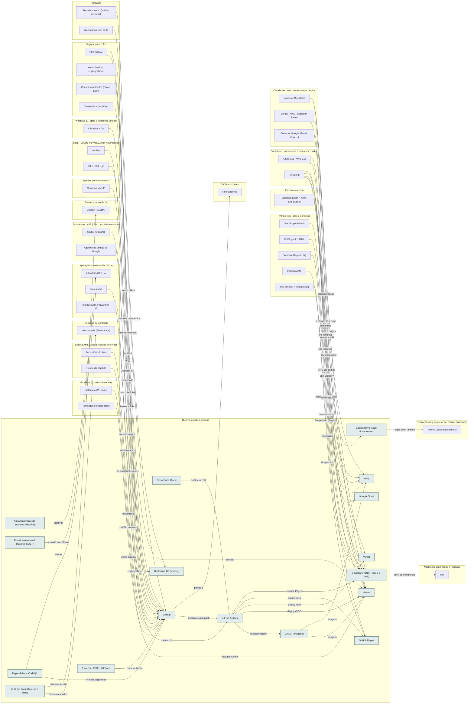

<!-- Arquivo GERADO por tools/gerar_docs.py a partir de data/. Edite os dados, não este arquivo. -->

# Camada 12 · Nuvem, código e entrega

[← Arquitetura](../arquitetura.md) · [Índice da documentação](../README.md)

> **Ligação com a camada de baixo:** git push via SSH leva o código ao GitHub; o Actions testa e publica.

**17 blocos** · 12 precisam de conta · 3 marcados como futuro

## Mapa de conexões

## Blocos

| Bloco | Tipo | O que faz | Quando entra |
|---|---|---|---|
| [Armazenamento de arquivos (Blob/R2)](#blob) | Remoto · precisa de conta | Fotos de produtos, anexos e PDFs dos sistemas AM fora do banco de dados. | passo 19.4 · Com o Passo 5 da trilha de estudo (≈ abr a jun/2027) para a conta e o deploy do sistema exemplo; o deploy de produção do AM Kaixara é o Passo 10 (≈ 2028) |
| [E-mail transacional (Resend, SES…)](#tmail) | Remoto · precisa de conta | E-mails automáticos dos sistemas: confirmação de conta, senha, recibo. | passo 19.5 · Com o Passo 5 da trilha de estudo (≈ abr a jun/2027) para a conta e o deploy do sistema exemplo; o deploy de produção do AM Kaixara é o Passo 10 (≈ 2028) |
| [SonarQube Cloud](#sonar) | Remoto · precisa de conta | Nota de qualidade e segurança do código a cada PR. Grátis para repositório público; recrutador vê o selo. | passo 18.5 · Junto dos Passos 4 a 6 da trilha de estudo (≈ mar a jun/2027): o modelo nasce no Passo 4 (API e login) e ganha testes e qualidade no Passo 6 |
| [Projects · ADRs · MkDocs](#ghproj) | Remoto | GitHub Projects espelhando o EPIC-01, decisões de arquitetura registradas e documentação publicada no Pages. | passo 5.5 · Semana 2 · nov/2026 |
| [Dependabot + CodeQL](#dbot) | Remoto | Dependabot atualiza pacotes vulneráveis; CodeQL procura falhas no seu código. Grátis em repositório público. | passo 5.3 · Semana 2 · nov/2026 |
| [Google Cloud](#gcp) | Remoto · precisa de conta · futuro | Terceira nuvem: só o básico, quando um projeto de IA ou dados pedir. | passo 30.5 · 2028 |
| [GitHub](#gh) | Remoto · precisa de conta | Código, vault, ensino-ti e a org grupo-amtech-digital. É também o seu portfólio. | passo 2.6 · Semana 1 · out/2026 (o e-mail e as críticas); o resto, 5 contas por semana até dez/2026; passo 5.1 · Semana 2 · nov/2026; passo 5.4 · Semana 2 · nov/2026 |
| [GitHub Actions](#gha) | Remoto | CI/CD: build, testes, segurança e deploy. | passo 5.2 · Semana 2 · nov/2026; passo 16.1 · Semana 11 · jan/2027 |
| [GHCR (imagens)](#ghcr) | Remoto | Registro das imagens Docker das APIs. | passo 18.6 · Junto dos Passos 4 a 6 da trilha de estudo (≈ mar a jun/2027): o modelo nasce no Passo 4 (API e login) e ganha testes e qualidade no Passo 6 |
| [GitHub Pages](#ghp) | Remoto | Hospeda site pessoal, blog e Catálogo do HTML. | passo 13.7 · Semanas 6 e 7 · dez/2026 |
| [Cloudflare (DNS, Pages, e-mail)](#cf) | Remoto · precisa de conta | DNS, HTTPS, proteção, hospedagem estática dos sites comerciais e redirecionamento de e-mail do domínio. O Cloudflare Tunnel leva os webhooks de venda até o n8n sem abrir portas em casa. | passo 13.3 · Semanas 6 e 7 · dez/2026; passo 13.8 · Semanas 6 e 7 · dez/2026; passo 15.1 · Semana 11 · jan/2027; passo 19.6 · Com o Passo 5 da trilha de estudo (≈ abr a jun/2027) para a conta e o deploy do sistema exemplo; o deploy de produção do AM Kaixara é o Passo 10 (≈ 2028) |
| [Vercel](#vercel) | Remoto · precisa de conta | Frontends Next.js. O plano grátis é para uso pessoal e não comercial; confira os termos antes de pôr venda nele. | passo 19.6 · Com o Passo 5 da trilha de estudo (≈ abr a jun/2027) para a conta e o deploy do sistema exemplo; o deploy de produção do AM Kaixara é o Passo 10 (≈ 2028) |
| [Azure](#azure) | Remoto · precisa de conta | Primeira nuvem para as APIs AM: App Service/Container Apps, PostgreSQL, Key Vault. | passo 19.2 · Com o Passo 5 da trilha de estudo (≈ abr a jun/2027) para a conta e o deploy do sistema exemplo; o deploy de produção do AM Kaixara é o Passo 10 (≈ 2028); passo 19.3 · Com o Passo 5 da trilha de estudo (≈ abr a jun/2027) para a conta e o deploy do sistema exemplo; o deploy de produção do AM Kaixara é o Passo 10 (≈ 2028); passo 19.6 · Com o Passo 5 da trilha de estudo (≈ abr a jun/2027) para a conta e o deploy do sistema exemplo; o deploy de produção do AM Kaixara é o Passo 10 (≈ 2028) |
| [AWS](#aws) | Remoto · precisa de conta · futuro | Segunda nuvem, para o mercado maior. | passo 30.4 · 2028 |
| [Backblaze B2 (backup)](#b2) | Remoto · precisa de conta · futuro | Cópia fora de casa do backup, criptografada pelo restic. US$ 6,95 por TB/mês. | passo 7.2 · Semana 3 · nov/2026 |
| [GPU por hora (RunPod e afins)](#gpuh) | Remoto · precisa de conta | Quando o Kaggle não bastar: GPU de 24 GB a partir de cerca de US$ 0,27 a 0,90 por hora no RunPod (out/2026). Um fine-tuning QLoRA de 8B costuma levar poucas horas. Use crédito pré-pago, sem cartão em débito automático. | passo 21.9 · Pendrives, GPU e laboratório a partir da semana 2; Zoomcamp, dbt e Airflow junto do IA2 da Trilha de Dados e IA do vault (depois do Passo 8, ≈ 2028); dataset e treino do 8B junto do IA6 (≈ 2029) |
| [Google Drive (seus documentos)](#gdrv) | Remoto · precisa de conta | Onde estão hoje as suas aulas, apostilas, provas, especificações e planos, misturados com cópias repetidas e documentos pessoais. O Google Takeout tira uma cópia completa para o acervo. | passo 0.5 · Antes de tudo · semana 1 (out/2026); passo 8.1 · Semanas 3 e 4 · nov/2026 |

### Armazenamento de arquivos (Blob/R2)

*Remoto · precisa de conta*

Fotos de produtos, anexos e PDFs dos sistemas AM fora do banco de dados.

**Quando entra:** passo 19.4 · Com o Passo 5 da trilha de estudo (≈ abr a jun/2027) para a conta e o deploy do sistema exemplo; o deploy de produção do AM Kaixara é o Passo 10 (≈ 2028) ([roteiro](../implantacao/roteiro.md))

| Direção | Bloco | Camada | O que passa |
|---|---|---|---|
| → envia para | [API ASP.NET Core](11-app.md#api) | Aplicação: sistemas AM (Aura) | arquivos |

### E-mail transacional (Resend, SES…)

*Remoto · precisa de conta*

E-mails automáticos dos sistemas: confirmação de conta, senha, recibo.

**Quando entra:** passo 19.5 · Com o Passo 5 da trilha de estudo (≈ abr a jun/2027) para a conta e o deploy do sistema exemplo; o deploy de produção do AM Kaixara é o Passo 10 (≈ 2028) ([roteiro](../implantacao/roteiro.md))

| Direção | Bloco | Camada | O que passa |
|---|---|---|---|
| → envia para | [API ASP.NET Core](11-app.md#api) | Aplicação: sistemas AM (Aura) | e-mails do sistema |

### SonarQube Cloud

*Remoto · precisa de conta*

Nota de qualidade e segurança do código a cada PR. Grátis para repositório público; recrutador vê o selo.

**Quando entra:** passo 18.5 · Junto dos Passos 4 a 6 da trilha de estudo (≈ mar a jun/2027): o modelo nasce no Passo 4 (API e login) e ganha testes e qualidade no Passo 6 ([roteiro](../implantacao/roteiro.md))

| Direção | Bloco | Camada | O que passa |
|---|---|---|---|
| → envia para | [GitHub Actions](12-nuvem.md#gha) | Nuvem, código e entrega | análise no PR |

### Projects · ADRs · MkDocs

*Remoto*

GitHub Projects espelhando o EPIC-01, decisões de arquitetura registradas e documentação publicada no Pages.

**Quando entra:** passo 5.5 · Semana 2 · nov/2026 ([roteiro](../implantacao/roteiro.md))

| Direção | Bloco | Camada | O que passa |
|---|---|---|---|
| → envia para | [GitHub](12-nuvem.md#gh) | Nuvem, código e entrega | issues e board |

### Dependabot + CodeQL

*Remoto*

Dependabot atualiza pacotes vulneráveis; CodeQL procura falhas no seu código. Grátis em repositório público.

**Quando entra:** passo 5.3 · Semana 2 · nov/2026 ([roteiro](../implantacao/roteiro.md))

| Direção | Bloco | Camada | O que passa |
|---|---|---|---|
| → envia para | [GitHub](12-nuvem.md#gh) | Nuvem, código e entrega | PRs de segurança |
| → envia para | [aura-status](11-app.md#status) | Aplicação: sistemas AM (Aura) | alertas |

### Google Cloud

*Remoto · precisa de conta · futuro*

Terceira nuvem: só o básico, quando um projeto de IA ou dados pedir.

**Quando entra:** passo 30.5 · 2028 ([roteiro](../implantacao/roteiro.md))

| Direção | Bloco | Camada | O que passa |
|---|---|---|---|
| ← recebe de | [Terraform](09-cnt.md#tf) | Containers, Kubernetes e infra como código | cria recursos |

### GitHub

*Remoto · precisa de conta*

Código, vault, ensino-ti e a org grupo-amtech-digital. É também o seu portfólio.

**Quando entra:** passo 2.6 · Semana 1 · out/2026 (o e-mail e as críticas); o resto, 5 contas por semana até dez/2026; passo 5.1 · Semana 2 · nov/2026; passo 5.4 · Semana 2 · nov/2026 ([roteiro](../implantacao/roteiro.md))

| Direção | Bloco | Camada | O que passa |
|---|---|---|---|
| → envia para | [GitHub Actions](12-nuvem.md#gha) | Nuvem, código e entrega | dispara a cada push |
| → envia para | [Recrutadores](22-pub.md#recr) | Público e canais | portfólio |
| ← recebe de | [KeePassXC](02-seg.md#kee) | Segurança e cofre | senhas e tokens |
| ← recebe de | [Obsidian + Git](03-win.md#obsd) | Windows 11, apps e máquinas virtuais | Obsidian Git |
| ← recebe de | [Git + SSH + gh](04-lin.md#git) | Linux (Ubuntu no WSL2, Arch no 2º disco) | push via SSH |
| ← recebe de | [dotfiles](04-lin.md#dot) | Linux (Ubuntu no WSL2, Arch no 2º disco) | versionado |
| ← recebe de | [Servidores MCP](05-ia.md#mcp) | Agentes de IA e sandbox | issues e PRs |
| ← recebe de | [Projects · ADRs · MkDocs](12-nuvem.md#ghproj) | Nuvem, código e entrega | issues e board |
| ← recebe de | [Dependabot + CodeQL](12-nuvem.md#dbot) | Nuvem, código e entrega | PRs de segurança |
| ← recebe de | [Commits assinados (chave SSH)](02-seg.md#sign) | Segurança e cofre | Verified |
| ← recebe de | [Chave física (YubiKey)](02-seg.md#ykey) | Segurança e cofre | 2FA |
| ← recebe de | [Codex (OpenAI)](07-chat.md#codex) | Assistentes de IA (chat, pesquisa e estudo) | mesmos repos |
| ← recebe de | [Agentes de código do Google](07-chat.md#gcode) | Assistentes de IA (chat, pesquisa e estudo) | mesmos repos |
| ← recebe de | [aura-status](11-app.md#status) | Aplicação: sistemas AM (Aura) | Dependabot e repos |
| ← recebe de | [Templates e código-fonte](17-prod.md#tmpl) | Produtos (o que você vende) | demo pública |
| ← recebe de | [Workstation com GPU](01-hw.md#ws) | Hardware | mesmos repositórios |
| ← recebe de | [Repositório do livro](15-editora.md#brepo) | Editora AMS Silva (produção de livros) | hospedado |
| ← recebe de | [Projeto do capítulo](15-editora.md#projcap) | Editora AMS Silva (produção de livros) | portfólio do aluno |

### GitHub Actions

*Remoto*

CI/CD: build, testes, segurança e deploy.

**Quando entra:** passo 5.2 · Semana 2 · nov/2026; passo 16.1 · Semana 11 · jan/2027 ([roteiro](../implantacao/roteiro.md))

| Direção | Bloco | Camada | O que passa |
|---|---|---|---|
| → envia para | [GHCR (imagens)](12-nuvem.md#ghcr) | Nuvem, código e entrega | publica imagem |
| → envia para | [Azure](12-nuvem.md#azure) | Nuvem, código e entrega | deploy OIDC |
| → envia para | [Vercel](12-nuvem.md#vercel) | Nuvem, código e entrega | deploy front |
| → envia para | [GitHub Pages](12-nuvem.md#ghp) | Nuvem, código e entrega | publica sites |
| → envia para | [Cloudflare (DNS, Pages, e-mail)](12-nuvem.md#cf) | Nuvem, código e entrega | publica Pages |
| ← recebe de | [Testes: xUnit, Playwright, k6](11-app.md#tests) | Aplicação: sistemas AM (Aura) | roda no CI |
| ← recebe de | [SonarQube Cloud](12-nuvem.md#sonar) | Nuvem, código e entrega | análise no PR |
| ← recebe de | [GitHub](12-nuvem.md#gh) | Nuvem, código e entrega | dispara a cada push |

### GHCR (imagens)

*Remoto*

Registro das imagens Docker das APIs.

**Quando entra:** passo 18.6 · Junto dos Passos 4 a 6 da trilha de estudo (≈ mar a jun/2027): o modelo nasce no Passo 4 (API e login) e ganha testes e qualidade no Passo 6 ([roteiro](../implantacao/roteiro.md))

| Direção | Bloco | Camada | O que passa |
|---|---|---|---|
| → envia para | [Azure](12-nuvem.md#azure) | Nuvem, código e entrega | imagem |
| → envia para | [AWS](12-nuvem.md#aws) | Nuvem, código e entrega | imagem |
| ← recebe de | [GitHub Actions](12-nuvem.md#gha) | Nuvem, código e entrega | publica imagem |

### GitHub Pages

*Remoto*

Hospeda site pessoal, blog e Catálogo do HTML.

**Quando entra:** passo 13.7 · Semanas 6 e 7 · dez/2026 ([roteiro](../implantacao/roteiro.md))

| Direção | Bloco | Camada | O que passa |
|---|---|---|---|
| ← recebe de | [GitHub Actions](12-nuvem.md#gha) | Nuvem, código e entrega | publica sites |
| ← recebe de | [Site pessoal + blog (Jekyll)](18-web.md#site) | Vitrine web (sites e domínio) | hospedado |
| ← recebe de | [Catálogo do HTML](18-web.md#catal) | Vitrine web (sites e domínio) | hospedado |

### Cloudflare (DNS, Pages, e-mail)

*Remoto · precisa de conta*

DNS, HTTPS, proteção, hospedagem estática dos sites comerciais e redirecionamento de e-mail do domínio. O Cloudflare Tunnel leva os webhooks de venda até o n8n sem abrir portas em casa.

**Quando entra:** passo 13.3 · Semanas 6 e 7 · dez/2026; passo 13.8 · Semanas 6 e 7 · dez/2026; passo 15.1 · Semana 11 · jan/2027; passo 19.6 · Com o Passo 5 da trilha de estudo (≈ abr a jun/2027) para a conta e o deploy do sistema exemplo; o deploy de produção do AM Kaixara é o Passo 10 (≈ 2028) ([roteiro](../implantacao/roteiro.md))

| Direção | Bloco | Camada | O que passa |
|---|---|---|---|
| → envia para | [n8n](21-mkt.md#n8n) | Marketing, automação e medição | túnel dos webhooks |
| ← recebe de | [Conector Cloudflare](08-clc.md#ccf) | Claude: recursos, conectores e plugins | DNS e Pages |
| ← recebe de | [Terraform](09-cnt.md#tf) | Containers, Kubernetes e infra como código | DNS por código |
| ← recebe de | [GitHub Actions](12-nuvem.md#gha) | Nuvem, código e entrega | publica Pages |
| ← recebe de | [Domínio (Registro.br)](18-web.md#dom) | Vitrine web (sites e domínio) | nameservers |
| ← recebe de | [Instituto AMS](18-web.md#inst) | Vitrine web (sites e domínio) | hospedado (Pages) |
| ← recebe de | [Site Grupo AMtech](18-web.md#amsite) | Vitrine web (sites e domínio) | hospedado (Pages) |

### Vercel

*Remoto · precisa de conta*

Frontends Next.js. O plano grátis é para uso pessoal e não comercial; confira os termos antes de pôr venda nele.

**Quando entra:** passo 19.6 · Com o Passo 5 da trilha de estudo (≈ abr a jun/2027) para a conta e o deploy do sistema exemplo; o deploy de produção do AM Kaixara é o Passo 10 (≈ 2028) ([roteiro](../implantacao/roteiro.md))

| Direção | Bloco | Camada | O que passa |
|---|---|---|---|
| ← recebe de | [Vercel · AWS · Microsoft Learn](08-clc.md#cdev) | Claude: recursos, conectores e plugins | deploy e logs |
| ← recebe de | [GitHub Actions](12-nuvem.md#gha) | Nuvem, código e entrega | deploy front |

### Azure

*Remoto · precisa de conta*

Primeira nuvem para as APIs AM: App Service/Container Apps, PostgreSQL, Key Vault.

**Quando entra:** passo 19.2 · Com o Passo 5 da trilha de estudo (≈ abr a jun/2027) para a conta e o deploy do sistema exemplo; o deploy de produção do AM Kaixara é o Passo 10 (≈ 2028); passo 19.3 · Com o Passo 5 da trilha de estudo (≈ abr a jun/2027) para a conta e o deploy do sistema exemplo; o deploy de produção do AM Kaixara é o Passo 10 (≈ 2028); passo 19.6 · Com o Passo 5 da trilha de estudo (≈ abr a jun/2027) para a conta e o deploy do sistema exemplo; o deploy de produção do AM Kaixara é o Passo 10 (≈ 2028) ([roteiro](../implantacao/roteiro.md))

| Direção | Bloco | Camada | O que passa |
|---|---|---|---|
| ← recebe de | [KeePassXC](02-seg.md#kee) | Segurança e cofre | senhas |
| ← recebe de | [Azure CLI · AWS CLI](09-cnt.md#clis) | Containers, Kubernetes e infra como código | comandos |
| ← recebe de | [Microsoft Learn + AWS Skill Builder](14-est.md#learn) | Estudo e carreira | certificação |
| ← recebe de | [Vercel · AWS · Microsoft Learn](08-clc.md#cdev) | Claude: recursos, conectores e plugins | documentação |
| ← recebe de | [Terraform](09-cnt.md#tf) | Containers, Kubernetes e infra como código | cria recursos |
| ← recebe de | [GitHub Actions](12-nuvem.md#gha) | Nuvem, código e entrega | deploy OIDC |
| ← recebe de | [GHCR (imagens)](12-nuvem.md#ghcr) | Nuvem, código e entrega | imagem |
| ← recebe de | [Sistemas AM (SaaS)](17-prod.md#saas) | Produtos (o que você vende) | roda na nuvem |

### AWS

*Remoto · precisa de conta · futuro*

Segunda nuvem, para o mercado maior.

**Quando entra:** passo 30.4 · 2028 ([roteiro](../implantacao/roteiro.md))

| Direção | Bloco | Camada | O que passa |
|---|---|---|---|
| ← recebe de | [Azure CLI · AWS CLI](09-cnt.md#clis) | Containers, Kubernetes e infra como código | comandos |
| ← recebe de | [Vercel · AWS · Microsoft Learn](08-clc.md#cdev) | Claude: recursos, conectores e plugins | documentação |
| ← recebe de | [Terraform](09-cnt.md#tf) | Containers, Kubernetes e infra como código | cria recursos |
| ← recebe de | [GHCR (imagens)](12-nuvem.md#ghcr) | Nuvem, código e entrega | imagem |
| ← recebe de | [Microsoft Learn + AWS Skill Builder](14-est.md#learn) | Estudo e carreira | Skill Builder |

### Backblaze B2 (backup)

*Remoto · precisa de conta · futuro*

Cópia fora de casa do backup, criptografada pelo restic. US$ 6,95 por TB/mês.

**Quando entra:** passo 7.2 · Semana 3 · nov/2026 ([roteiro](../implantacao/roteiro.md))

| Direção | Bloco | Camada | O que passa |
|---|---|---|---|
| ← recebe de | [Servidor caseiro (NAS + serviços)](01-hw.md#nas) | Hardware | restic diário |
| ← recebe de | [restic (backup criptografado)](02-seg.md#restic) | Segurança e cofre | criptografado |

### GPU por hora (RunPod e afins)

*Remoto · precisa de conta*

Quando o Kaggle não bastar: GPU de 24 GB a partir de cerca de US$ 0,27 a 0,90 por hora no RunPod (out/2026). Um fine-tuning QLoRA de 8B costuma levar poucas horas. Use crédito pré-pago, sem cartão em débito automático.

**Quando entra:** passo 21.9 · Pendrives, GPU e laboratório a partir da semana 2; Zoomcamp, dbt e Airflow junto do IA2 da Trilha de Dados e IA do vault (depois do Passo 8, ≈ 2028); dataset e treino do 8B junto do IA6 (≈ 2029) ([roteiro](../implantacao/roteiro.md))

| Direção | Bloco | Camada | O que passa |
|---|---|---|---|
| → envia para | [Voz clonada (ElevenLabs)](13-cont.md#voz) | Produção de conteúdo | modelos abertos |
| → envia para | [Unsloth (QLoRA)](06-dados.md#unsl) | Dados e treino de IA | GPU de 24 GB |

### Google Drive (seus documentos)

*Remoto · precisa de conta*

Onde estão hoje as suas aulas, apostilas, provas, especificações e planos, misturados com cópias repetidas e documentos pessoais. O Google Takeout tira uma cópia completa para o acervo.

**Quando entra:** passo 0.5 · Antes de tudo · semana 1 (out/2026); passo 8.1 · Semanas 3 e 4 · nov/2026 ([roteiro](../implantacao/roteiro.md))

| Direção | Bloco | Camada | O que passa |
|---|---|---|---|
| → envia para | [Acervo (seus documentos)](23-oper.md#acv) | Operação do grupo (esteira, marca, qualidade) | cópia pelo Takeout |
| ← recebe de | [Conector Google (Gmail, Drive…)](08-clc.md#cgws) | Claude: recursos, conectores e plugins | o Claude lê o Drive |

---

[↑ Camada 13 · Produção de conteúdo](13-cont.md) · [↓ Camada 11 · Aplicação: sistemas AM (Aura)](11-app.md)
