<!-- Arquivo GERADO por tools/gerar_docs.py a partir de data/. Edite os dados, não este arquivo. -->

# Camada 12 · Nuvem, código e entrega

[← Arquitetura](../arquitetura.md) · [Índice da documentação](../README.md)

> **Ligação com a camada de baixo:** git push via SSH leva o código ao GitHub; o Actions testa e publica.

**32 blocos** · 21 precisam de conta · 5 marcados como futuro

## Mapa de conexões

```mermaid
flowchart LR
  subgraph L_nuvem["Nuvem, código e entrega"]
    n_blob["Armazenamento de arquivos (Blob/R2)"]
    n_tmail["E-mail transacional (Resend, SES…)"]
    n_sonar["SonarQube Cloud"]
    n_ghproj["Projects · ADRs · MkDocs"]
    n_dbot["Dependabot + CodeQL"]
    n_gcp["Google Cloud"]
    n_gh["GitHub"]
    n_gha["GitHub Actions"]
    n_ghcr["GHCR (imagens)"]
    n_ghp["GitHub Pages"]
    n_cf["Cloudflare (DNS, Pages, e-mail)"]
    n_vercel["Vercel"]
    n_azure["Azure"]
    n_aws["AWS"]
    n_b2["Backblaze B2 (backup)"]
    n_gpuh["GPU por hora (RunPod e afins)"]
    n_gdrv["Google Drive (seus documentos)"]
    n_repopadrao["Repositório padrão"]
    n_vigia["Vigia semanal (GitHub Actions)"]
    n_vm247["VM sempre ligada (Oracle grátis)"]
    n_openrouter["OpenRouter"]
    n_speckle["Speckle (modelos na web)"]
    n_act["act (CI do Actions na sua máquina)"]
    n_kamal["Kamal (deploy em VM por SSH)"]
    n_bore["bore (túnel TCP próprio)"]
    n_headscale["Headscale (rede própria)"]
    n_forgejo["Forgejo (espelho dos repositórios)"]
    n_softserve["Soft Serve (Git por SSH em casa)"]
    n_coolify["Coolify (apps de cliente em VPS)"]
    n_dokploy["Dokploy (reserva do Coolify)"]
    n_plunk["Plunk (e-mail próprio no SES)"]
    n_stripecli["Stripe CLI (testar pagamentos)"]
  end
  subgraph L_oper["Operação do grupo (esteira, marca, qualidade)"]
    n_acv["Acervo (seus documentos)"]
    n_garimpo["Garimpo de código (GitHub)"]
    n_triagem["Triagem: montar, colar ou construir"]
  end
  subgraph L_pub["Público e canais"]
    n_recr["Recrutadores"]
  end
  subgraph L_mkt["Marketing, automação e medição"]
    n_hooks["Webhooks de venda"]
    n_n8n["n8n"]
  end
  subgraph L_web["Vitrine web (sites e domínio)"]
    n_amsite["Site Grupo AMtech"]
    n_astro["Astro (sites de conteúdo)"]
    n_bookstack["BookStack (manuais dos clientes)"]
    n_catal["Catálogo do HTML"]
    n_dom["Domínio (Registro.br)"]
    n_inst["Instituto AMS"]
    n_kitsites["Kit de sites (Hostinger IA)"]
    n_site["Site pessoal + blog (Jekyll)"]
  end
  subgraph L_prod["Produtos (o que você vende)"]
    n_saas["Sistemas AM (SaaS)"]
    n_tmpl["Templates e código-fonte"]
  end
  subgraph L_editora["Editora AMS Silva (produção de livros)"]
    n_brepo["Repositório do livro"]
    n_projcap["Projeto do capítulo"]
  end
  subgraph L_est["Estudo e carreira"]
    n_learn["Microsoft Learn + AWS Skill Builder"]
    n_refarq["Repositórios de referência"]
  end
  subgraph L_cont["Produção de conteúdo"]
    n_voz["Voz clonada (ElevenLabs)"]
  end
  subgraph L_app["Aplicação: sistemas AM (Aura)"]
    n_api["API ASP.NET Core"]
    n_golang["Go (CLIs com bubbletea)"]
    n_litestream["Litestream (SQLite no R2)"]
    n_reactemail["React Email (modelos)"]
    n_rust["Rust (firmware e CLIs)"]
    n_status["aura-status"]
    n_tests["Testes: xUnit, Playwright, k6"]
  end
  subgraph L_obs["Observabilidade"]
    n_glitchtip["GlitchTip (erros dos sistemas)"]
    n_signoz["SigNoz (logs, traces e métricas)"]
  end
  subgraph L_cnt["Containers, Kubernetes e infra como código"]
    n_clis["Azure CLI · AWS CLI"]
    n_docker["Docker + Compose"]
    n_tf["Terraform"]
  end
  subgraph L_clc["Claude: recursos, conectores e plugins"]
    n_ccf["Conector Cloudflare"]
    n_cdev["Vercel · AWS · Microsoft Learn"]
    n_cgws["Conector Google (Gmail, Drive…)"]
  end
  subgraph L_chat["Assistentes de IA (chat, pesquisa e estudo)"]
    n_codex["Codex (OpenAI)"]
    n_gcode["Agentes de código do Google"]
  end
  subgraph L_dados["Dados e treino de IA"]
    n_lerobot["LeRobot (robôs que aprendem)"]
    n_unsl["Unsloth (QLoRA)"]
    n_vllm["vLLM (GPU alugada)"]
  end
  subgraph L_ia["Agentes de IA e sandbox"]
    n_litellm["Gateway de modelos (LiteLLM)"]
    n_mcp["Servidores MCP"]
    n_oclaw["OpenClaw (agente 24 h)"]
  end
  subgraph L_lin["Linux (Ubuntu no WSL2, Arch no 2º disco)"]
    n_bpftrace["bpftrace (kernel em produção)"]
    n_d2["D2 (diagramas como texto)"]
    n_dot["dotfiles"]
    n_git["Git + SSH + gh"]
    n_gitlfs["Git LFS (arquivos grandes)"]
    n_just["just (porta única de comandos)"]
    n_sec["gitleaks · Trivy"]
  end
  subgraph L_win["Windows 11, apps e máquinas virtuais"]
    n_bonsai["Bonsai + IfcOpenShell (BIM aberto)"]
    n_obsd["Obsidian + Git"]
    n_tail["Tailscale (VPN)"]
  end
  subgraph L_seg["Segurança e cofre"]
    n_age["age · sops (arquivos cifrados)"]
    n_appsec["AppSec nos seus sistemas"]
    n_kee["KeePassXC"]
    n_restic["restic (backup criptografado)"]
    n_segredos["Segredos do cofre (keepassxc-cli)"]
    n_sign["Commits assinados (chave SSH)"]
    n_ykey["Chave física (YubiKey)"]
  end
  subgraph L_hw["Hardware"]
    n_nas["Servidor caseiro (NAS + serviços)"]
    n_srvcasa["Servidor da casa (N100 ou Pi 5)"]
    n_ws["Workstation com GPU"]
  end
  n_blob -->|"arquivos"| n_api
  n_litestream -->|"cópia no R2"| n_blob
  n_tmail -->|"e-mails do sistema"| n_api
  n_plunk -->|"reserva própria do Resend"| n_tmail
  n_reactemail -->|"modelos dos e-mails"| n_tmail
  n_sonar -->|"análise no PR"| n_gha
  n_ghproj -->|"issues e board"| n_gh
  n_refarq -->|"vira ADR"| n_ghproj
  n_triagem -->|"rascunha o ADR"| n_ghproj
  n_d2 -->|"diagramas no repositório"| n_ghproj
  n_dbot -->|"PRs de segurança"| n_gh
  n_dbot -->|"alertas"| n_status
  n_appsec -->|"CodeQL"| n_dbot
  n_tf -->|"cria recursos"| n_gcp
  n_gh -->|"dispara a cada push"| n_gha
  n_gh -->|"portfólio"| n_recr
  n_kee -->|"senhas e tokens"| n_gh
  n_obsd -->|"Obsidian Git"| n_gh
  n_git -->|"push via SSH"| n_gh
  n_dot -->|"versionado"| n_gh
  n_mcp -->|"issues e PRs"| n_gh
  n_sign -->|"Verified"| n_gh
  n_ykey -->|"2FA"| n_gh
  n_codex -->|"mesmos repos"| n_gh
  n_gcode -->|"mesmos repos"| n_gh
  n_status -->|"Dependabot e repos"| n_gh
  n_tmpl -->|"demo pública"| n_gh
  n_ws -->|"mesmos repositórios"| n_gh
  n_brepo -->|"hospedado"| n_gh
  n_projcap -->|"portfólio do aluno"| n_gh
  n_forgejo -->|"espelha o GitHub"| n_gh
  n_garimpo -->|"abre o PR"| n_gh
  n_gha -->|"publica imagem"| n_ghcr
  n_gha -->|"deploy OIDC"| n_azure
  n_gha -->|"deploy front"| n_vercel
  n_gha -->|"publica sites"| n_ghp
  n_gha -->|"publica Pages"| n_cf
  n_tests -->|"roda no CI"| n_gha
  n_just -->|"o mesmo portão do CI"| n_gha
  n_act -->|"roda o workflow local"| n_gha
  n_golang -->|"GoReleaser na tag"| n_gha
  n_rust -->|"cargo-dist na tag"| n_gha
  n_ghcr -->|"imagem"| n_azure
  n_ghcr -->|"imagem"| n_aws
  n_kamal -->|"puxa a imagem"| n_ghcr
  n_site -->|"hospedado"| n_ghp
  n_catal -->|"hospedado"| n_ghp
  n_cf -->|"túnel dos webhooks"| n_n8n
  n_ccf -->|"DNS e Pages"| n_cf
  n_tf -->|"DNS por código"| n_cf
  n_dom -->|"nameservers"| n_cf
  n_inst -->|"hospedado (Pages)"| n_cf
  n_amsite -->|"hospedado (Pages)"| n_cf
  n_astro -->|"publica no Pages"| n_cf
  n_cdev -->|"deploy e logs"| n_vercel
  n_kee -->|"senhas"| n_azure
  n_clis -->|"comandos"| n_azure
  n_learn -->|"certificação"| n_azure
  n_cdev -->|"documentação"| n_azure
  n_tf -->|"cria recursos"| n_azure
  n_saas -->|"roda na nuvem"| n_azure
  n_kamal -->|"VM paga quando a renda pagar"| n_azure
  n_clis -->|"comandos"| n_aws
  n_cdev -->|"documentação"| n_aws
  n_tf -->|"cria recursos"| n_aws
  n_learn -->|"Skill Builder"| n_aws
  n_plunk -->|"envia pelo SES"| n_aws
  n_kamal -->|"VM paga quando a renda pagar"| n_aws
  n_nas -->|"restic diário"| n_b2
  n_restic -->|"criptografado"| n_b2
  n_gpuh -->|"modelos abertos"| n_voz
  n_gpuh -->|"GPU de 24 GB"| n_unsl
  n_litellm -->|"usa GPU alugada"| n_gpuh
  n_vllm -->|"roda em"| n_gpuh
  n_lerobot -->|"treino do SmolVLA (bf16)"| n_gpuh
  n_gdrv -->|"cópia pelo Takeout"| n_acv
  n_cgws -->|"o Claude lê o Drive"| n_gdrv
  n_age -->|"cifra antes de subir"| n_gdrv
  n_repopadrao -->|"inclui"| n_sec
  n_appsec -->|"soma ao CI"| n_repopadrao
  n_vigia -->|"usa o conferir"| n_kitsites
  n_vm247 -->|"roda 24 h"| n_n8n
  n_vm247 -->|"pela rede privada"| n_tail
  n_oclaw -->|"roda isolado"| n_vm247
  n_kamal -->|"deploy por SSH"| n_vm247
  n_bpftrace -->|"latência na VM"| n_vm247
  n_bore -->|"servidor na VM"| n_vm247
  n_headscale -->|"roda na VM"| n_vm247
  n_forgejo -->|"roda na VM"| n_vm247
  n_bookstack -->|"roda na VM"| n_vm247
  n_signoz -->|"roda na VM"| n_vm247
  n_glitchtip -->|"roda na VM"| n_vm247
  n_litellm -->|"reserva"| n_openrouter
  n_bonsai -->|"publica na web"| n_speckle
  n_act -->|"usa o Docker"| n_docker
  n_kamal -->|"lê os segredos"| n_segredos
  n_headscale -->|"reserva do Tailscale"| n_tail
  n_forgejo -->|"serve o LFS"| n_gitlfs
  n_softserve -->|"roda no servidor da casa"| n_srvcasa
  n_coolify -->|"sobe containers"| n_docker
  n_dokploy -->|"reserva leve"| n_coolify
  n_stripecli -->|"simula webhooks"| n_hooks
  classDef desta fill:#e2ecec,stroke:#0e3a45,color:#13262b
  class n_blob,n_tmail,n_sonar,n_ghproj,n_dbot,n_gcp,n_gh,n_gha,n_ghcr,n_ghp,n_cf,n_vercel,n_azure,n_aws,n_b2,n_gpuh,n_gdrv,n_repopadrao,n_vigia,n_vm247,n_openrouter,n_speckle,n_act,n_kamal,n_bore,n_headscale,n_forgejo,n_softserve,n_coolify,n_dokploy,n_plunk,n_stripecli desta
```

## Blocos

| Bloco | Tipo | O que faz | Quando entra |
|---|---|---|---|
| [Armazenamento de arquivos (Blob/R2)](#blob) | Remoto · precisa de conta | Fotos de produtos, anexos e PDFs dos sistemas AM fora do banco de dados. | passo 42.4 · Trimestre 2 do eixo (fev a abr/2027): conta, deploy com Kamal e rollback testado do AM Rendara (MVP com 1 usuário pagante) |
| [E-mail transacional (Resend, SES…)](#tmail) | Remoto · precisa de conta | E-mails automáticos dos sistemas: confirmação de conta, senha, recibo. | passo 42.5 · Trimestre 2 do eixo (fev a abr/2027): conta, deploy com Kamal e rollback testado do AM Rendara (MVP com 1 usuário pagante); passo 45.2 · Recesso escolar de jan/2027 (14 dias seguidos, de dia; o restaurante segue à noite) (começa quando: o recesso começou e uma das 3 rendas de agora já passou no portão) |
| [SonarQube Cloud](#sonar) | Remoto · precisa de conta | Nota de qualidade e segurança do código a cada PR. Grátis para repositório público; recrutador vê o selo. | passo 41.5 · Trimestre 2 do eixo (fev a abr/2027): o modelo nasce no esqueleto do AM Rendara (módulo o-dotnet do Professor) e ganha testes e qualidade até o MVP |
| [Projects · ADRs · MkDocs](#ghproj) | Remoto | GitHub Projects espelhando o EPIC-01, decisões de arquitetura registradas e documentação publicada no Pages. | passo 5.5 · Semana 2 · nov/2026 |
| [Dependabot + CodeQL](#dbot) | Remoto | Dependabot atualiza pacotes vulneráveis; CodeQL procura falhas no seu código. Grátis em repositório público. | passo 5.3 · Semana 2 · nov/2026 |
| [Google Cloud](#gcp) | Remoto · precisa de conta · futuro | Terceira nuvem: só o básico, quando um projeto de IA ou dados pedir. | passo 54.5 · 2028 |
| [GitHub](#gh) | Remoto · precisa de conta | Código, vault, ensino-ti e a org grupo-amtech-digital. É também o seu portfólio. | passo 2.7 · Semana 1 · out/2026 (o e-mail e as críticas); o resto, 5 contas por semana até dez/2026; passo 5.1 · Semana 2 · nov/2026; passo 5.4 · Semana 2 · nov/2026; passo 24.6 · Nov/2026 a out/2027, revisão no fim de cada trimestre |
| [GitHub Actions](#gha) | Remoto | CI/CD: build, testes, segurança e deploy. | passo 5.2 · Semana 2 · nov/2026; passo 39.1 · Semana 11 · jan/2027 |
| [GHCR (imagens)](#ghcr) | Remoto | Registro das imagens Docker das APIs. | passo 41.6 · Trimestre 2 do eixo (fev a abr/2027): o modelo nasce no esqueleto do AM Rendara (módulo o-dotnet do Professor) e ganha testes e qualidade até o MVP |
| [GitHub Pages](#ghp) | Remoto | Hospeda site pessoal, blog e Catálogo do HTML. | passo 36.7 · Semanas 6 e 7 · dez/2026 |
| [Cloudflare (DNS, Pages, e-mail)](#cf) | Remoto · precisa de conta | DNS, HTTPS, proteção, hospedagem estática dos sites comerciais e redirecionamento de e-mail do domínio. O Cloudflare Tunnel leva os webhooks de venda até o n8n sem abrir portas em casa. | passo 28.4 · Semana 6 · nov/2026 a dez/2026; passo 28.6 · Semana 6 · nov/2026 a dez/2026; passo 28.7 · Semana 6 · nov/2026 a dez/2026; passo 36.3 · Semanas 6 e 7 · dez/2026; passo 36.8 · Semanas 6 e 7 · dez/2026; passo 38.1 · Semana 11 · jan/2027; passo 42.6 · Trimestre 2 do eixo (fev a abr/2027): conta, deploy com Kamal e rollback testado do AM Rendara (MVP com 1 usuário pagante) |
| [Vercel](#vercel) | Remoto · precisa de conta | Frontends Next.js. O plano grátis é para uso pessoal e não comercial; confira os termos antes de pôr venda nele. | passo 42.6 · Trimestre 2 do eixo (fev a abr/2027): conta, deploy com Kamal e rollback testado do AM Rendara (MVP com 1 usuário pagante) |
| [Azure](#azure) | Remoto · precisa de conta | Primeira nuvem para as APIs AM: App Service/Container Apps, PostgreSQL, Key Vault. | passo 32.13 · Dez/2026 a jan/2027 na VM grátis da Oracle, depois da Operação 24 horas; VPS e VM paga quando uma renda pagar; passo 42.2 · Trimestre 2 do eixo (fev a abr/2027): conta, deploy com Kamal e rollback testado do AM Rendara (MVP com 1 usuário pagante); passo 42.3 · Trimestre 2 do eixo (fev a abr/2027): conta, deploy com Kamal e rollback testado do AM Rendara (MVP com 1 usuário pagante); passo 42.6 · Trimestre 2 do eixo (fev a abr/2027): conta, deploy com Kamal e rollback testado do AM Rendara (MVP com 1 usuário pagante) |
| [AWS](#aws) | Remoto · precisa de conta · futuro | Segunda nuvem, para o mercado maior. | passo 32.13 · Dez/2026 a jan/2027 na VM grátis da Oracle, depois da Operação 24 horas; VPS e VM paga quando uma renda pagar; passo 54.4 · 2028 |
| [Backblaze B2 (backup)](#b2) | Remoto · precisa de conta · futuro | Cópia fora de casa do backup, criptografada pelo restic. US$ 6,95 por TB/mês. | passo 7.2 · Semana 3 · nov/2026 |
| [GPU por hora (RunPod e afins)](#gpuh) | Remoto · precisa de conta | Quando o Kaggle não bastar: GPU de 24 GB a partir de cerca de US$ 0,27 a 0,90 por hora no RunPod (out/2026). Um fine-tuning QLoRA de 8B costuma levar poucas horas. Use crédito pré-pago, sem cartão em débito automático. | passo 29.4 · 2027, depois do primeiro fine-tuning de 8B; passo 44.9 · Pendrives e laboratório podem começar já; dados (Zoomcamp, dbt, Airflow) e treino de IA ficam pausados até o fim do trimestre 4 do eixo (ADR 0011, ≈ 2028) |
| [Google Drive (seus documentos)](#gdrv) | Remoto · precisa de conta | Onde estão hoje as suas aulas, apostilas, provas, especificações e planos, misturados com cópias repetidas e documentos pessoais. O Google Takeout tira uma cópia completa para o acervo. | passo 0.5 · Antes de tudo · semana 1 (out/2026); passo 8.1 · Semanas 3 e 4 · nov/2026; passo 27.8 · Semana 6 · nov/2026 a dez/2026 |
| [Repositório padrão](#repopadrao) | Local | Modelo com pre-commit, CI de qualidade, Definition of Done, ADRs e CHANGELOG para todo repositório. | passo 20.1 · Semana 5 · nov/2026; passo 20.2 · Semana 5 · nov/2026 |
| [Vigia semanal (GitHub Actions)](#vigia) | Remoto | Roda no GitHub sem o notebook ligado: confere os sites dos clientes e procura segredos. | passo 31.1 · Dez/2026 a jan/2027; passo 31.2 · Dez/2026 a jan/2027 |
| [VM sempre ligada (Oracle grátis)](#vm247) | Remoto · precisa de conta | 2 núcleos e 12 GB grátis para n8n, bot, Uptime Kuma e gateway rodarem 24 horas. | passo 28.9 · Semana 6 · nov/2026 a dez/2026; passo 31.1 · Dez/2026 a jan/2027; passo 31.4 · Dez/2026 a jan/2027; passo 31.5 · Dez/2026 a jan/2027; passo 45.1 · Recesso escolar de jan/2027 (14 dias seguidos, de dia; o restaurante segue à noite) (começa quando: o recesso começou e uma das 3 rendas de agora já passou no portão) |
| [OpenRouter](#openrouter) | Remoto · precisa de conta | Uma chave para dezenas de modelos, alguns grátis com limite; reserva no gateway. | passo 27.15 · Semana 6 · nov/2026 a dez/2026 |
| [Speckle (modelos na web)](#speckle) | Remoto · precisa de conta · futuro | Plataforma aberta para levar modelos à web com versões e API. | passo 61.10 · Ferramentas grátis no estudo da manhã a partir de jan/2027; serviços e o AM Obra só depois das rendas de agora passarem no portão |
| [act (CI do Actions na sua máquina)](#act) | Local | Roda os workflows do GitHub Actions no Docker local (gh act). Acha o erro do CI antes do push, sem gastar minuto de Actions. | passo 21.7 · Semana 5 · nov/2026 (tudo grátis, em sessões curtas); o analisador lógico entra com a primeira compra de robótica |
| [Kamal (deploy em VM por SSH)](#kamal) | Local | Deploy sem queda dos sistemas AM numa VM (a da Oracle primeiro), com HTTPS e rollback por versão. Roda pela imagem Docker oficial; segredos pelo keepassxc-cli. ADR 0005; modelo em infra/templates/kamal. | passo 23.5 · Nov/2026 a jan/2027 (no CPF); o CNPJ quando a renda de software passar do ponto de virada; passo 32.13 · Dez/2026 a jan/2027 na VM grátis da Oracle, depois da Operação 24 horas; VPS e VM paga quando uma renda pagar; passo 42.8 · Trimestre 2 do eixo (fev a abr/2027): conta, deploy com Kamal e rollback testado do AM Rendara (MVP com 1 usuário pagante); passo 45.1 · Recesso escolar de jan/2027 (14 dias seguidos, de dia; o restaurante segue à noite) (começa quando: o recesso começou e uma das 3 rendas de agora já passou no portão); passo 45.10 · Recesso escolar de jan/2027 (14 dias seguidos, de dia; o restaurante segue à noite) (começa quando: o recesso começou e uma das 3 rendas de agora já passou no portão) |
| [bore (túnel TCP próprio)](#bore) | Remoto · precisa de conta | Túnel TCP com servidor próprio na VM, para expor uma porta que não é web (demonstração, MQTT, SSH) sem passar por serviço de terceiro. Webhooks seguem no cloudflared. | passo 32.7 · Dez/2026 a jan/2027 na VM grátis da Oracle, depois da Operação 24 horas; VPS e VM paga quando uma renda pagar |
| [Headscale (rede própria)](#headscale) | Remoto · precisa de conta | Servidor de controle próprio da rede WireGuard: reserva do Tailscale e rede privada dos clientes (AMtech Campo, lojas). | passo 32.4 · Dez/2026 a jan/2027 na VM grátis da Oracle, depois da Operação 24 horas; VPS e VM paga quando uma renda pagar |
| [Forgejo (espelho dos repositórios)](#forgejo) | Remoto · precisa de conta | Espelho de todos os repositórios do GitHub, com Git LFS, na VM: o código continua seu se a conta for bloqueada. O GitHub segue principal pelo Actions, Copilot e Education. | passo 32.1 · Dez/2026 a jan/2027 na VM grátis da Oracle, depois da Operação 24 horas; VPS e VM paga quando uma renda pagar |
| [Soft Serve (Git por SSH em casa)](#softserve) | Local · futuro | Servidor Git só por SSH, leve, no servidor da casa: firmware, placas e projetos que não precisam sair da rede. | passo 32.9 · Dez/2026 a jan/2027 na VM grátis da Oracle, depois da Operação 24 horas; VPS e VM paga quando uma renda pagar |
| [Coolify (apps de cliente em VPS)](#coolify) | Remoto · precisa de conta | Painel para subir apps de um clique (WordPress, n8n, Chatwoot) na VPS de um cliente que quer mexer sozinho. Os sistemas AM seguem no Kamal. | passo 23.5 · Nov/2026 a jan/2027 (no CPF); o CNPJ quando a renda de software passar do ponto de virada; passo 32.10 · Dez/2026 a jan/2027 na VM grátis da Oracle, depois da Operação 24 horas; VPS e VM paga quando uma renda pagar |
| [Dokploy (reserva do Coolify)](#dokploy) | Remoto · precisa de conta | Mesmo papel do Coolify, mais leve: para VPS pequena de cliente. | passo 32.11 · Dez/2026 a jan/2027 na VM grátis da Oracle, depois da Operação 24 horas; VPS e VM paga quando uma renda pagar |
| [Plunk (e-mail próprio no SES)](#plunk) | Remoto · precisa de conta | E-mail transacional e campanhas auto-hospedados sobre o Amazon SES, quando o volume passar do plano grátis do Resend (que segue principal). | passo 32.12 · Dez/2026 a jan/2027 na VM grátis da Oracle, depois da Operação 24 horas; VPS e VM paga quando uma renda pagar |
| [Stripe CLI (testar pagamentos)](#stripecli) | Local | Simula pagamentos e encaminha webhooks para a máquina (stripe listen) quando o Stripe ou o Polar entrarem nas vendas. | passo 33.13 · Com a primeira página de venda no ar (jan/2027) e por etapas |

### Armazenamento de arquivos (Blob/R2)

*Remoto · precisa de conta*

Fotos de produtos, anexos e PDFs dos sistemas AM fora do banco de dados.

**Quando entra:** passo 42.4 · Trimestre 2 do eixo (fev a abr/2027): conta, deploy com Kamal e rollback testado do AM Rendara (MVP com 1 usuário pagante) ([roteiro](../implantacao/roteiro.md))

| Direção | Bloco | Camada | O que passa |
|---|---|---|---|
| → envia para | [API ASP.NET Core](11-app.md#api) | Aplicação: sistemas AM (Aura) | arquivos |
| ← recebe de | [Litestream (SQLite no R2)](11-app.md#litestream) | Aplicação: sistemas AM (Aura) | cópia no R2 |

### E-mail transacional (Resend, SES…)

*Remoto · precisa de conta*

E-mails automáticos dos sistemas: confirmação de conta, senha, recibo.

**Quando entra:** passo 42.5 · Trimestre 2 do eixo (fev a abr/2027): conta, deploy com Kamal e rollback testado do AM Rendara (MVP com 1 usuário pagante); passo 45.2 · Recesso escolar de jan/2027 (14 dias seguidos, de dia; o restaurante segue à noite) (começa quando: o recesso começou e uma das 3 rendas de agora já passou no portão) ([roteiro](../implantacao/roteiro.md))

| Direção | Bloco | Camada | O que passa |
|---|---|---|---|
| → envia para | [API ASP.NET Core](11-app.md#api) | Aplicação: sistemas AM (Aura) | e-mails do sistema |
| ← recebe de | [Plunk (e-mail próprio no SES)](12-nuvem.md#plunk) | Nuvem, código e entrega | reserva própria do Resend |
| ← recebe de | [React Email (modelos)](11-app.md#reactemail) | Aplicação: sistemas AM (Aura) | modelos dos e-mails |

### SonarQube Cloud

*Remoto · precisa de conta*

Nota de qualidade e segurança do código a cada PR. Grátis para repositório público; recrutador vê o selo.

**Quando entra:** passo 41.5 · Trimestre 2 do eixo (fev a abr/2027): o modelo nasce no esqueleto do AM Rendara (módulo o-dotnet do Professor) e ganha testes e qualidade até o MVP ([roteiro](../implantacao/roteiro.md))

| Direção | Bloco | Camada | O que passa |
|---|---|---|---|
| → envia para | [GitHub Actions](12-nuvem.md#gha) | Nuvem, código e entrega | análise no PR |

### Projects · ADRs · MkDocs

*Remoto*

GitHub Projects espelhando o EPIC-01, decisões de arquitetura registradas e documentação publicada no Pages.

**Quando entra:** passo 5.5 · Semana 2 · nov/2026 ([roteiro](../implantacao/roteiro.md))

| Direção | Bloco | Camada | O que passa |
|---|---|---|---|
| → envia para | [GitHub](12-nuvem.md#gh) | Nuvem, código e entrega | issues e board |
| ← recebe de | [Repositórios de referência](14-est.md#refarq) | Estudo e carreira | vira ADR |
| ← recebe de | [Triagem: montar, colar ou construir](23-oper.md#triagem) | Operação do grupo (esteira, marca, qualidade) | rascunha o ADR |
| ← recebe de | [D2 (diagramas como texto)](04-lin.md#d2) | Linux (Ubuntu no WSL2, Arch no 2º disco) | diagramas no repositório |

### Dependabot + CodeQL

*Remoto*

Dependabot atualiza pacotes vulneráveis; CodeQL procura falhas no seu código. Grátis em repositório público.

**Quando entra:** passo 5.3 · Semana 2 · nov/2026 ([roteiro](../implantacao/roteiro.md))

| Direção | Bloco | Camada | O que passa |
|---|---|---|---|
| → envia para | [GitHub](12-nuvem.md#gh) | Nuvem, código e entrega | PRs de segurança |
| → envia para | [aura-status](11-app.md#status) | Aplicação: sistemas AM (Aura) | alertas |
| ← recebe de | [AppSec nos seus sistemas](02-seg.md#appsec) | Segurança e cofre | CodeQL |

### Google Cloud

*Remoto · precisa de conta · futuro*

Terceira nuvem: só o básico, quando um projeto de IA ou dados pedir.

**Quando entra:** passo 54.5 · 2028 ([roteiro](../implantacao/roteiro.md))

| Direção | Bloco | Camada | O que passa |
|---|---|---|---|
| ← recebe de | [Terraform](09-cnt.md#tf) | Containers, Kubernetes e infra como código | cria recursos |

### GitHub

*Remoto · precisa de conta*

Código, vault, ensino-ti e a org grupo-amtech-digital. É também o seu portfólio.

**Quando entra:** passo 2.7 · Semana 1 · out/2026 (o e-mail e as críticas); o resto, 5 contas por semana até dez/2026; passo 5.1 · Semana 2 · nov/2026; passo 5.4 · Semana 2 · nov/2026; passo 24.6 · Nov/2026 a out/2027, revisão no fim de cada trimestre ([roteiro](../implantacao/roteiro.md))

| Direção | Bloco | Camada | O que passa |
|---|---|---|---|
| → envia para | [GitHub Actions](12-nuvem.md#gha) | Nuvem, código e entrega | dispara a cada push |
| → envia para | [Recrutadores](22-pub.md#recr) | Público e canais | portfólio |
| ← recebe de | [KeePassXC](02-seg.md#kee) | Segurança e cofre | senhas e tokens |
| ← recebe de | [Obsidian + Git](03-win.md#obsd) | Windows 11, apps e máquinas virtuais | Obsidian Git |
| ← recebe de | [Git + SSH + gh](04-lin.md#git) | Linux (Ubuntu no WSL2, Arch no 2º disco) | push via SSH |
| ← recebe de | [dotfiles](04-lin.md#dot) | Linux (Ubuntu no WSL2, Arch no 2º disco) | versionado |
| ← recebe de | [Servidores MCP](05-ia.md#mcp) | Agentes de IA e sandbox | issues e PRs |
| ← recebe de | [Projects · ADRs · MkDocs](12-nuvem.md#ghproj) | Nuvem, código e entrega | issues e board |
| ← recebe de | [Dependabot + CodeQL](12-nuvem.md#dbot) | Nuvem, código e entrega | PRs de segurança |
| ← recebe de | [Commits assinados (chave SSH)](02-seg.md#sign) | Segurança e cofre | Verified |
| ← recebe de | [Chave física (YubiKey)](02-seg.md#ykey) | Segurança e cofre | 2FA |
| ← recebe de | [Codex (OpenAI)](07-chat.md#codex) | Assistentes de IA (chat, pesquisa e estudo) | mesmos repos |
| ← recebe de | [Agentes de código do Google](07-chat.md#gcode) | Assistentes de IA (chat, pesquisa e estudo) | mesmos repos |
| ← recebe de | [aura-status](11-app.md#status) | Aplicação: sistemas AM (Aura) | Dependabot e repos |
| ← recebe de | [Templates e código-fonte](17-prod.md#tmpl) | Produtos (o que você vende) | demo pública |
| ← recebe de | [Workstation com GPU](01-hw.md#ws) | Hardware | mesmos repositórios |
| ← recebe de | [Repositório do livro](15-editora.md#brepo) | Editora AMS Silva (produção de livros) | hospedado |
| ← recebe de | [Projeto do capítulo](15-editora.md#projcap) | Editora AMS Silva (produção de livros) | portfólio do aluno |
| ← recebe de | [Forgejo (espelho dos repositórios)](12-nuvem.md#forgejo) | Nuvem, código e entrega | espelha o GitHub |
| ← recebe de | [Garimpo de código (GitHub)](23-oper.md#garimpo) | Operação do grupo (esteira, marca, qualidade) | abre o PR |

### GitHub Actions

*Remoto*

CI/CD: build, testes, segurança e deploy.

**Quando entra:** passo 5.2 · Semana 2 · nov/2026; passo 39.1 · Semana 11 · jan/2027 ([roteiro](../implantacao/roteiro.md))

| Direção | Bloco | Camada | O que passa |
|---|---|---|---|
| → envia para | [GHCR (imagens)](12-nuvem.md#ghcr) | Nuvem, código e entrega | publica imagem |
| → envia para | [Azure](12-nuvem.md#azure) | Nuvem, código e entrega | deploy OIDC |
| → envia para | [Vercel](12-nuvem.md#vercel) | Nuvem, código e entrega | deploy front |
| → envia para | [GitHub Pages](12-nuvem.md#ghp) | Nuvem, código e entrega | publica sites |
| → envia para | [Cloudflare (DNS, Pages, e-mail)](12-nuvem.md#cf) | Nuvem, código e entrega | publica Pages |
| ← recebe de | [Testes: xUnit, Playwright, k6](11-app.md#tests) | Aplicação: sistemas AM (Aura) | roda no CI |
| ← recebe de | [SonarQube Cloud](12-nuvem.md#sonar) | Nuvem, código e entrega | análise no PR |
| ← recebe de | [GitHub](12-nuvem.md#gh) | Nuvem, código e entrega | dispara a cada push |
| ← recebe de | [just (porta única de comandos)](04-lin.md#just) | Linux (Ubuntu no WSL2, Arch no 2º disco) | o mesmo portão do CI |
| ← recebe de | [act (CI do Actions na sua máquina)](12-nuvem.md#act) | Nuvem, código e entrega | roda o workflow local |
| ← recebe de | [Go (CLIs com bubbletea)](11-app.md#golang) | Aplicação: sistemas AM (Aura) | GoReleaser na tag |
| ← recebe de | [Rust (firmware e CLIs)](11-app.md#rust) | Aplicação: sistemas AM (Aura) | cargo-dist na tag |

### GHCR (imagens)

*Remoto*

Registro das imagens Docker das APIs.

**Quando entra:** passo 41.6 · Trimestre 2 do eixo (fev a abr/2027): o modelo nasce no esqueleto do AM Rendara (módulo o-dotnet do Professor) e ganha testes e qualidade até o MVP ([roteiro](../implantacao/roteiro.md))

| Direção | Bloco | Camada | O que passa |
|---|---|---|---|
| → envia para | [Azure](12-nuvem.md#azure) | Nuvem, código e entrega | imagem |
| → envia para | [AWS](12-nuvem.md#aws) | Nuvem, código e entrega | imagem |
| ← recebe de | [GitHub Actions](12-nuvem.md#gha) | Nuvem, código e entrega | publica imagem |
| ← recebe de | [Kamal (deploy em VM por SSH)](12-nuvem.md#kamal) | Nuvem, código e entrega | puxa a imagem |

### GitHub Pages

*Remoto*

Hospeda site pessoal, blog e Catálogo do HTML.

**Quando entra:** passo 36.7 · Semanas 6 e 7 · dez/2026 ([roteiro](../implantacao/roteiro.md))

| Direção | Bloco | Camada | O que passa |
|---|---|---|---|
| ← recebe de | [GitHub Actions](12-nuvem.md#gha) | Nuvem, código e entrega | publica sites |
| ← recebe de | [Site pessoal + blog (Jekyll)](18-web.md#site) | Vitrine web (sites e domínio) | hospedado |
| ← recebe de | [Catálogo do HTML](18-web.md#catal) | Vitrine web (sites e domínio) | hospedado |

### Cloudflare (DNS, Pages, e-mail)

*Remoto · precisa de conta*

DNS, HTTPS, proteção, hospedagem estática dos sites comerciais e redirecionamento de e-mail do domínio. O Cloudflare Tunnel leva os webhooks de venda até o n8n sem abrir portas em casa.

**Quando entra:** passo 28.4 · Semana 6 · nov/2026 a dez/2026; passo 28.6 · Semana 6 · nov/2026 a dez/2026; passo 28.7 · Semana 6 · nov/2026 a dez/2026; passo 36.3 · Semanas 6 e 7 · dez/2026; passo 36.8 · Semanas 6 e 7 · dez/2026; passo 38.1 · Semana 11 · jan/2027; passo 42.6 · Trimestre 2 do eixo (fev a abr/2027): conta, deploy com Kamal e rollback testado do AM Rendara (MVP com 1 usuário pagante) ([roteiro](../implantacao/roteiro.md))

| Direção | Bloco | Camada | O que passa |
|---|---|---|---|
| → envia para | [n8n](21-mkt.md#n8n) | Marketing, automação e medição | túnel dos webhooks |
| ← recebe de | [Conector Cloudflare](08-clc.md#ccf) | Claude: recursos, conectores e plugins | DNS e Pages |
| ← recebe de | [Terraform](09-cnt.md#tf) | Containers, Kubernetes e infra como código | DNS por código |
| ← recebe de | [GitHub Actions](12-nuvem.md#gha) | Nuvem, código e entrega | publica Pages |
| ← recebe de | [Domínio (Registro.br)](18-web.md#dom) | Vitrine web (sites e domínio) | nameservers |
| ← recebe de | [Instituto AMS](18-web.md#inst) | Vitrine web (sites e domínio) | hospedado (Pages) |
| ← recebe de | [Site Grupo AMtech](18-web.md#amsite) | Vitrine web (sites e domínio) | hospedado (Pages) |
| ← recebe de | [Astro (sites de conteúdo)](18-web.md#astro) | Vitrine web (sites e domínio) | publica no Pages |

### Vercel

*Remoto · precisa de conta*

Frontends Next.js. O plano grátis é para uso pessoal e não comercial; confira os termos antes de pôr venda nele.

**Quando entra:** passo 42.6 · Trimestre 2 do eixo (fev a abr/2027): conta, deploy com Kamal e rollback testado do AM Rendara (MVP com 1 usuário pagante) ([roteiro](../implantacao/roteiro.md))

| Direção | Bloco | Camada | O que passa |
|---|---|---|---|
| ← recebe de | [Vercel · AWS · Microsoft Learn](08-clc.md#cdev) | Claude: recursos, conectores e plugins | deploy e logs |
| ← recebe de | [GitHub Actions](12-nuvem.md#gha) | Nuvem, código e entrega | deploy front |

### Azure

*Remoto · precisa de conta*

Primeira nuvem para as APIs AM: App Service/Container Apps, PostgreSQL, Key Vault.

**Quando entra:** passo 32.13 · Dez/2026 a jan/2027 na VM grátis da Oracle, depois da Operação 24 horas; VPS e VM paga quando uma renda pagar; passo 42.2 · Trimestre 2 do eixo (fev a abr/2027): conta, deploy com Kamal e rollback testado do AM Rendara (MVP com 1 usuário pagante); passo 42.3 · Trimestre 2 do eixo (fev a abr/2027): conta, deploy com Kamal e rollback testado do AM Rendara (MVP com 1 usuário pagante); passo 42.6 · Trimestre 2 do eixo (fev a abr/2027): conta, deploy com Kamal e rollback testado do AM Rendara (MVP com 1 usuário pagante) ([roteiro](../implantacao/roteiro.md))

| Direção | Bloco | Camada | O que passa |
|---|---|---|---|
| ← recebe de | [KeePassXC](02-seg.md#kee) | Segurança e cofre | senhas |
| ← recebe de | [Azure CLI · AWS CLI](09-cnt.md#clis) | Containers, Kubernetes e infra como código | comandos |
| ← recebe de | [Microsoft Learn + AWS Skill Builder](14-est.md#learn) | Estudo e carreira | certificação |
| ← recebe de | [Vercel · AWS · Microsoft Learn](08-clc.md#cdev) | Claude: recursos, conectores e plugins | documentação |
| ← recebe de | [Terraform](09-cnt.md#tf) | Containers, Kubernetes e infra como código | cria recursos |
| ← recebe de | [GitHub Actions](12-nuvem.md#gha) | Nuvem, código e entrega | deploy OIDC |
| ← recebe de | [GHCR (imagens)](12-nuvem.md#ghcr) | Nuvem, código e entrega | imagem |
| ← recebe de | [Sistemas AM (SaaS)](17-prod.md#saas) | Produtos (o que você vende) | roda na nuvem |
| ← recebe de | [Kamal (deploy em VM por SSH)](12-nuvem.md#kamal) | Nuvem, código e entrega | VM paga quando a renda pagar |

### AWS

*Remoto · precisa de conta · futuro*

Segunda nuvem, para o mercado maior.

**Quando entra:** passo 32.13 · Dez/2026 a jan/2027 na VM grátis da Oracle, depois da Operação 24 horas; VPS e VM paga quando uma renda pagar; passo 54.4 · 2028 ([roteiro](../implantacao/roteiro.md))

| Direção | Bloco | Camada | O que passa |
|---|---|---|---|
| ← recebe de | [Azure CLI · AWS CLI](09-cnt.md#clis) | Containers, Kubernetes e infra como código | comandos |
| ← recebe de | [Vercel · AWS · Microsoft Learn](08-clc.md#cdev) | Claude: recursos, conectores e plugins | documentação |
| ← recebe de | [Terraform](09-cnt.md#tf) | Containers, Kubernetes e infra como código | cria recursos |
| ← recebe de | [GHCR (imagens)](12-nuvem.md#ghcr) | Nuvem, código e entrega | imagem |
| ← recebe de | [Microsoft Learn + AWS Skill Builder](14-est.md#learn) | Estudo e carreira | Skill Builder |
| ← recebe de | [Plunk (e-mail próprio no SES)](12-nuvem.md#plunk) | Nuvem, código e entrega | envia pelo SES |
| ← recebe de | [Kamal (deploy em VM por SSH)](12-nuvem.md#kamal) | Nuvem, código e entrega | VM paga quando a renda pagar |

### Backblaze B2 (backup)

*Remoto · precisa de conta · futuro*

Cópia fora de casa do backup, criptografada pelo restic. US$ 6,95 por TB/mês.

**Quando entra:** passo 7.2 · Semana 3 · nov/2026 ([roteiro](../implantacao/roteiro.md))

| Direção | Bloco | Camada | O que passa |
|---|---|---|---|
| ← recebe de | [Servidor caseiro (NAS + serviços)](01-hw.md#nas) | Hardware | restic diário |
| ← recebe de | [restic (backup criptografado)](02-seg.md#restic) | Segurança e cofre | criptografado |

### GPU por hora (RunPod e afins)

*Remoto · precisa de conta*

Quando o Kaggle não bastar: GPU de 24 GB a partir de cerca de US$ 0,27 a 0,90 por hora no RunPod (out/2026). Um fine-tuning QLoRA de 8B costuma levar poucas horas. Use crédito pré-pago, sem cartão em débito automático.

**Quando entra:** passo 29.4 · 2027, depois do primeiro fine-tuning de 8B; passo 44.9 · Pendrives e laboratório podem começar já; dados (Zoomcamp, dbt, Airflow) e treino de IA ficam pausados até o fim do trimestre 4 do eixo (ADR 0011, ≈ 2028) ([roteiro](../implantacao/roteiro.md))

| Direção | Bloco | Camada | O que passa |
|---|---|---|---|
| → envia para | [Voz clonada (ElevenLabs)](13-cont.md#voz) | Produção de conteúdo | modelos abertos |
| → envia para | [Unsloth (QLoRA)](06-dados.md#unsl) | Dados e treino de IA | GPU de 24 GB |
| ← recebe de | [Gateway de modelos (LiteLLM)](05-ia.md#litellm) | Agentes de IA e sandbox | usa GPU alugada |
| ← recebe de | [vLLM (GPU alugada)](06-dados.md#vllm) | Dados e treino de IA | roda em |
| ← recebe de | [LeRobot (robôs que aprendem)](06-dados.md#lerobot) | Dados e treino de IA | treino do SmolVLA (bf16) |

### Google Drive (seus documentos)

*Remoto · precisa de conta*

Onde estão hoje as suas aulas, apostilas, provas, especificações e planos, misturados com cópias repetidas e documentos pessoais. O Google Takeout tira uma cópia completa para o acervo.

**Quando entra:** passo 0.5 · Antes de tudo · semana 1 (out/2026); passo 8.1 · Semanas 3 e 4 · nov/2026; passo 27.8 · Semana 6 · nov/2026 a dez/2026 ([roteiro](../implantacao/roteiro.md))

| Direção | Bloco | Camada | O que passa |
|---|---|---|---|
| → envia para | [Acervo (seus documentos)](23-oper.md#acv) | Operação do grupo (esteira, marca, qualidade) | cópia pelo Takeout |
| ← recebe de | [Conector Google (Gmail, Drive…)](08-clc.md#cgws) | Claude: recursos, conectores e plugins | o Claude lê o Drive |
| ← recebe de | [age · sops (arquivos cifrados)](02-seg.md#age) | Segurança e cofre | cifra antes de subir |

### Repositório padrão

*Local*

Modelo com pre-commit, CI de qualidade, Definition of Done, ADRs e CHANGELOG para todo repositório.

**Quando entra:** passo 20.1 · Semana 5 · nov/2026; passo 20.2 · Semana 5 · nov/2026 ([roteiro](../implantacao/roteiro.md))

| Direção | Bloco | Camada | O que passa |
|---|---|---|---|
| → envia para | [gitleaks · Trivy](04-lin.md#sec) | Linux (Ubuntu no WSL2, Arch no 2º disco) | inclui |
| ← recebe de | [AppSec nos seus sistemas](02-seg.md#appsec) | Segurança e cofre | soma ao CI |

### Vigia semanal (GitHub Actions)

*Remoto*

Roda no GitHub sem o notebook ligado: confere os sites dos clientes e procura segredos.

**Quando entra:** passo 31.1 · Dez/2026 a jan/2027; passo 31.2 · Dez/2026 a jan/2027 ([roteiro](../implantacao/roteiro.md))

| Direção | Bloco | Camada | O que passa |
|---|---|---|---|
| → envia para | [Kit de sites (Hostinger IA)](18-web.md#kitsites) | Vitrine web (sites e domínio) | usa o conferir |

### VM sempre ligada (Oracle grátis)

*Remoto · precisa de conta*

2 núcleos e 12 GB grátis para n8n, bot, Uptime Kuma e gateway rodarem 24 horas.

**Quando entra:** passo 28.9 · Semana 6 · nov/2026 a dez/2026; passo 31.1 · Dez/2026 a jan/2027; passo 31.4 · Dez/2026 a jan/2027; passo 31.5 · Dez/2026 a jan/2027; passo 45.1 · Recesso escolar de jan/2027 (14 dias seguidos, de dia; o restaurante segue à noite) (começa quando: o recesso começou e uma das 3 rendas de agora já passou no portão) ([roteiro](../implantacao/roteiro.md))

| Direção | Bloco | Camada | O que passa |
|---|---|---|---|
| → envia para | [n8n](21-mkt.md#n8n) | Marketing, automação e medição | roda 24 h |
| → envia para | [Tailscale (VPN)](03-win.md#tail) | Windows 11, apps e máquinas virtuais | pela rede privada |
| ← recebe de | [OpenClaw (agente 24 h)](05-ia.md#oclaw) | Agentes de IA e sandbox | roda isolado |
| ← recebe de | [Kamal (deploy em VM por SSH)](12-nuvem.md#kamal) | Nuvem, código e entrega | deploy por SSH |
| ← recebe de | [bpftrace (kernel em produção)](04-lin.md#bpftrace) | Linux (Ubuntu no WSL2, Arch no 2º disco) | latência na VM |
| ← recebe de | [bore (túnel TCP próprio)](12-nuvem.md#bore) | Nuvem, código e entrega | servidor na VM |
| ← recebe de | [Headscale (rede própria)](12-nuvem.md#headscale) | Nuvem, código e entrega | roda na VM |
| ← recebe de | [Forgejo (espelho dos repositórios)](12-nuvem.md#forgejo) | Nuvem, código e entrega | roda na VM |
| ← recebe de | [BookStack (manuais dos clientes)](18-web.md#bookstack) | Vitrine web (sites e domínio) | roda na VM |
| ← recebe de | [SigNoz (logs, traces e métricas)](10-obs.md#signoz) | Observabilidade | roda na VM |
| ← recebe de | [GlitchTip (erros dos sistemas)](10-obs.md#glitchtip) | Observabilidade | roda na VM |

### OpenRouter

*Remoto · precisa de conta*

Uma chave para dezenas de modelos, alguns grátis com limite; reserva no gateway.

**Quando entra:** passo 27.15 · Semana 6 · nov/2026 a dez/2026 ([roteiro](../implantacao/roteiro.md))

| Direção | Bloco | Camada | O que passa |
|---|---|---|---|
| ← recebe de | [Gateway de modelos (LiteLLM)](05-ia.md#litellm) | Agentes de IA e sandbox | reserva |

### Speckle (modelos na web)

*Remoto · precisa de conta · futuro*

Plataforma aberta para levar modelos à web com versões e API.

**Quando entra:** passo 61.10 · Ferramentas grátis no estudo da manhã a partir de jan/2027; serviços e o AM Obra só depois das rendas de agora passarem no portão ([roteiro](../implantacao/roteiro.md))

| Direção | Bloco | Camada | O que passa |
|---|---|---|---|
| ← recebe de | [Bonsai + IfcOpenShell (BIM aberto)](03-win.md#bonsai) | Windows 11, apps e máquinas virtuais | publica na web |

### act (CI do Actions na sua máquina)

*Local*

Roda os workflows do GitHub Actions no Docker local (gh act). Acha o erro do CI antes do push, sem gastar minuto de Actions.

**Quando entra:** passo 21.7 · Semana 5 · nov/2026 (tudo grátis, em sessões curtas); o analisador lógico entra com a primeira compra de robótica ([roteiro](../implantacao/roteiro.md))

| Direção | Bloco | Camada | O que passa |
|---|---|---|---|
| → envia para | [GitHub Actions](12-nuvem.md#gha) | Nuvem, código e entrega | roda o workflow local |
| → envia para | [Docker + Compose](09-cnt.md#docker) | Containers, Kubernetes e infra como código | usa o Docker |

### Kamal (deploy em VM por SSH)

*Local*

Deploy sem queda dos sistemas AM numa VM (a da Oracle primeiro), com HTTPS e rollback por versão. Roda pela imagem Docker oficial; segredos pelo keepassxc-cli. ADR 0005; modelo em infra/templates/kamal.

**Quando entra:** passo 23.5 · Nov/2026 a jan/2027 (no CPF); o CNPJ quando a renda de software passar do ponto de virada; passo 32.13 · Dez/2026 a jan/2027 na VM grátis da Oracle, depois da Operação 24 horas; VPS e VM paga quando uma renda pagar; passo 42.8 · Trimestre 2 do eixo (fev a abr/2027): conta, deploy com Kamal e rollback testado do AM Rendara (MVP com 1 usuário pagante); passo 45.1 · Recesso escolar de jan/2027 (14 dias seguidos, de dia; o restaurante segue à noite) (começa quando: o recesso começou e uma das 3 rendas de agora já passou no portão); passo 45.10 · Recesso escolar de jan/2027 (14 dias seguidos, de dia; o restaurante segue à noite) (começa quando: o recesso começou e uma das 3 rendas de agora já passou no portão) ([roteiro](../implantacao/roteiro.md))

| Direção | Bloco | Camada | O que passa |
|---|---|---|---|
| → envia para | [VM sempre ligada (Oracle grátis)](12-nuvem.md#vm247) | Nuvem, código e entrega | deploy por SSH |
| → envia para | [GHCR (imagens)](12-nuvem.md#ghcr) | Nuvem, código e entrega | puxa a imagem |
| → envia para | [Segredos do cofre (keepassxc-cli)](02-seg.md#segredos) | Segurança e cofre | lê os segredos |
| → envia para | [AWS](12-nuvem.md#aws) | Nuvem, código e entrega | VM paga quando a renda pagar |
| → envia para | [Azure](12-nuvem.md#azure) | Nuvem, código e entrega | VM paga quando a renda pagar |

### bore (túnel TCP próprio)

*Remoto · precisa de conta*

Túnel TCP com servidor próprio na VM, para expor uma porta que não é web (demonstração, MQTT, SSH) sem passar por serviço de terceiro. Webhooks seguem no cloudflared.

**Quando entra:** passo 32.7 · Dez/2026 a jan/2027 na VM grátis da Oracle, depois da Operação 24 horas; VPS e VM paga quando uma renda pagar ([roteiro](../implantacao/roteiro.md))

| Direção | Bloco | Camada | O que passa |
|---|---|---|---|
| → envia para | [VM sempre ligada (Oracle grátis)](12-nuvem.md#vm247) | Nuvem, código e entrega | servidor na VM |

### Headscale (rede própria)

*Remoto · precisa de conta*

Servidor de controle próprio da rede WireGuard: reserva do Tailscale e rede privada dos clientes (AMtech Campo, lojas).

**Quando entra:** passo 32.4 · Dez/2026 a jan/2027 na VM grátis da Oracle, depois da Operação 24 horas; VPS e VM paga quando uma renda pagar ([roteiro](../implantacao/roteiro.md))

| Direção | Bloco | Camada | O que passa |
|---|---|---|---|
| → envia para | [Tailscale (VPN)](03-win.md#tail) | Windows 11, apps e máquinas virtuais | reserva do Tailscale |
| → envia para | [VM sempre ligada (Oracle grátis)](12-nuvem.md#vm247) | Nuvem, código e entrega | roda na VM |

### Forgejo (espelho dos repositórios)

*Remoto · precisa de conta*

Espelho de todos os repositórios do GitHub, com Git LFS, na VM: o código continua seu se a conta for bloqueada. O GitHub segue principal pelo Actions, Copilot e Education.

**Quando entra:** passo 32.1 · Dez/2026 a jan/2027 na VM grátis da Oracle, depois da Operação 24 horas; VPS e VM paga quando uma renda pagar ([roteiro](../implantacao/roteiro.md))

| Direção | Bloco | Camada | O que passa |
|---|---|---|---|
| → envia para | [GitHub](12-nuvem.md#gh) | Nuvem, código e entrega | espelha o GitHub |
| → envia para | [VM sempre ligada (Oracle grátis)](12-nuvem.md#vm247) | Nuvem, código e entrega | roda na VM |
| → envia para | [Git LFS (arquivos grandes)](04-lin.md#gitlfs) | Linux (Ubuntu no WSL2, Arch no 2º disco) | serve o LFS |

### Soft Serve (Git por SSH em casa)

*Local · futuro*

Servidor Git só por SSH, leve, no servidor da casa: firmware, placas e projetos que não precisam sair da rede.

**Quando entra:** passo 32.9 · Dez/2026 a jan/2027 na VM grátis da Oracle, depois da Operação 24 horas; VPS e VM paga quando uma renda pagar ([roteiro](../implantacao/roteiro.md))

| Direção | Bloco | Camada | O que passa |
|---|---|---|---|
| → envia para | [Servidor da casa (N100 ou Pi 5)](01-hw.md#srvcasa) | Hardware | roda no servidor da casa |

### Coolify (apps de cliente em VPS)

*Remoto · precisa de conta*

Painel para subir apps de um clique (WordPress, n8n, Chatwoot) na VPS de um cliente que quer mexer sozinho. Os sistemas AM seguem no Kamal.

**Quando entra:** passo 23.5 · Nov/2026 a jan/2027 (no CPF); o CNPJ quando a renda de software passar do ponto de virada; passo 32.10 · Dez/2026 a jan/2027 na VM grátis da Oracle, depois da Operação 24 horas; VPS e VM paga quando uma renda pagar ([roteiro](../implantacao/roteiro.md))

| Direção | Bloco | Camada | O que passa |
|---|---|---|---|
| → envia para | [Docker + Compose](09-cnt.md#docker) | Containers, Kubernetes e infra como código | sobe containers |
| ← recebe de | [Dokploy (reserva do Coolify)](12-nuvem.md#dokploy) | Nuvem, código e entrega | reserva leve |

### Dokploy (reserva do Coolify)

*Remoto · precisa de conta*

Mesmo papel do Coolify, mais leve: para VPS pequena de cliente.

**Quando entra:** passo 32.11 · Dez/2026 a jan/2027 na VM grátis da Oracle, depois da Operação 24 horas; VPS e VM paga quando uma renda pagar ([roteiro](../implantacao/roteiro.md))

| Direção | Bloco | Camada | O que passa |
|---|---|---|---|
| → envia para | [Coolify (apps de cliente em VPS)](12-nuvem.md#coolify) | Nuvem, código e entrega | reserva leve |

### Plunk (e-mail próprio no SES)

*Remoto · precisa de conta*

E-mail transacional e campanhas auto-hospedados sobre o Amazon SES, quando o volume passar do plano grátis do Resend (que segue principal).

**Quando entra:** passo 32.12 · Dez/2026 a jan/2027 na VM grátis da Oracle, depois da Operação 24 horas; VPS e VM paga quando uma renda pagar ([roteiro](../implantacao/roteiro.md))

| Direção | Bloco | Camada | O que passa |
|---|---|---|---|
| → envia para | [E-mail transacional (Resend, SES…)](12-nuvem.md#tmail) | Nuvem, código e entrega | reserva própria do Resend |
| → envia para | [AWS](12-nuvem.md#aws) | Nuvem, código e entrega | envia pelo SES |

### Stripe CLI (testar pagamentos)

*Local*

Simula pagamentos e encaminha webhooks para a máquina (stripe listen) quando o Stripe ou o Polar entrarem nas vendas.

**Quando entra:** passo 33.13 · Com a primeira página de venda no ar (jan/2027) e por etapas ([roteiro](../implantacao/roteiro.md))

| Direção | Bloco | Camada | O que passa |
|---|---|---|---|
| → envia para | [Webhooks de venda](21-mkt.md#hooks) | Marketing, automação e medição | simula webhooks |

---

[↑ Camada 13 · Produção de conteúdo](13-cont.md) · [↓ Camada 11 · Aplicação: sistemas AM (Aura)](11-app.md)
