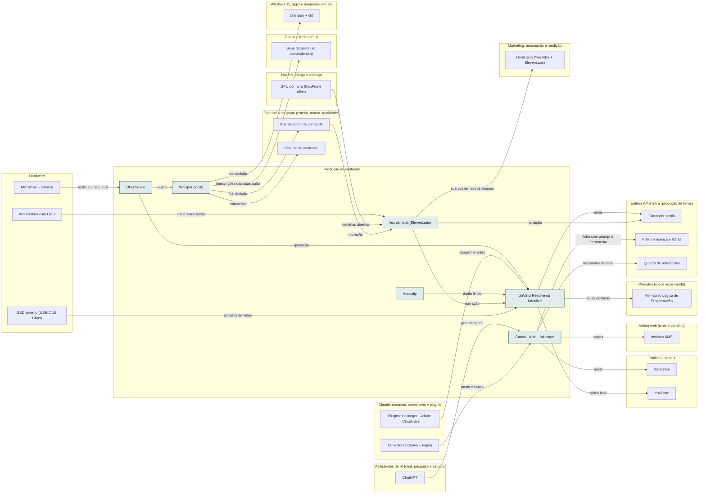

<!-- Arquivo GERADO por tools/gerar_docs.py a partir de data/. Edite os dados, não este arquivo. -->

# Camada 13 · Produção de conteúdo

[← Arquitetura](../arquitetura.md) · [Índice da documentação](../README.md)

> **Ligação com a camada de baixo:** Gravação e edição rodam no notebook; os arquivos finais sobem para as plataformas.

**6 blocos** · 2 precisam de conta · 0 marcados como futuro

## Mapa de conexões

## Blocos

| Bloco | Tipo | O que faz | Quando entra |
|---|---|---|---|
| [OBS Studio](#obss) | Local | Grava tela, câmera e áudio das aulas e vídeos. | passo 3.2 · Semana 1 · out/2026; passo 12.1 · Semana 5 · dez/2026; passo 17.2 · Semanas 12 a 15 · jan a fev/2027 |
| [DaVinci Resolve ou Kdenlive](#edit) | Local | Edição de vídeo. Os dois têm versão grátis. | passo 3.7 · Semana 1 · out/2026; passo 12.3 · Semana 5 · dez/2026; passo 17.2 · Semanas 12 a 15 · jan a fev/2027 |
| [Audacity](#aud) | Local | Limpa ruído e ajusta o áudio. | passo 3.2 · Semana 1 · out/2026; passo 12.2 · Semana 5 · dez/2026 |
| [Canva · Krita · Inkscape](#img) | Local · precisa de conta | Capas, posts e thumbnails. Canva precisa de conta; Krita e Inkscape são open source. | passo 3.2 · Semana 1 · out/2026; passo 12.4 · Semana 5 · dez/2026 |
| [Whisper (local)](#whis) | Local | Transcreve as aulas para legenda, artigo e capítulo. | passo 4.4 · Semana 2 · nov/2026; passo 11.6 · Semana 5 · nov/2026 |
| [Voz clonada (ElevenLabs)](#voz) | Remoto · precisa de conta | Clonagem profissional da sua própria voz (plano Creator em diante, uso comercial nos planos pagos). Treino com 30 minutos ou mais de áudio limpo. Avise o público que a voz é gerada por IA. | passo 12.5 · Semana 5 · dez/2026 |

### OBS Studio

*Local*

Grava tela, câmera e áudio das aulas e vídeos.

**Quando entra:** passo 3.2 · Semana 1 · out/2026; passo 12.1 · Semana 5 · dez/2026; passo 17.2 · Semanas 12 a 15 · jan a fev/2027 ([roteiro](../implantacao/roteiro.md))

| Direção | Bloco | Camada | O que passa |
|---|---|---|---|
| → envia para | [DaVinci Resolve ou Kdenlive](13-cont.md#edit) | Produção de conteúdo | gravação |
| → envia para | [Whisper (local)](13-cont.md#whis) | Produção de conteúdo | áudio |
| ← recebe de | [Microfone + câmera](01-hw.md#mic) | Hardware | áudio e vídeo USB |

### DaVinci Resolve ou Kdenlive

*Local*

Edição de vídeo. Os dois têm versão grátis.

**Quando entra:** passo 3.7 · Semana 1 · out/2026; passo 12.3 · Semana 5 · dez/2026; passo 17.2 · Semanas 12 a 15 · jan a fev/2027 ([roteiro](../implantacao/roteiro.md))

| Direção | Bloco | Camada | O que passa |
|---|---|---|---|
| → envia para | [YouTube](22-pub.md#yt) | Público e canais | vídeo final |
| → envia para | [Mini-curso Lógica de Programação](17-prod.md#curso) | Produtos (o que você vende) | aulas editadas |
| → envia para | [Curso por seção](15-editora.md#bcurso) | Editora AMS Silva (produção de livros) | aulas |
| ← recebe de | [Plugins: Hostinger · Adobe · Cloudinary](08-clc.md#phst) | Claude: recursos, conectores e plugins | imagem e vídeo |
| ← recebe de | [OBS Studio](13-cont.md#obss) | Produção de conteúdo | gravação |
| ← recebe de | [Audacity](13-cont.md#aud) | Produção de conteúdo | áudio limpo |
| ← recebe de | [Voz clonada (ElevenLabs)](13-cont.md#voz) | Produção de conteúdo | narração |
| ← recebe de | [SSD externo (USB-C 10 Gbps)](01-hw.md#ssdext) | Hardware | projetos de vídeo |

### Audacity

*Local*

Limpa ruído e ajusta o áudio.

**Quando entra:** passo 3.2 · Semana 1 · out/2026; passo 12.2 · Semana 5 · dez/2026 ([roteiro](../implantacao/roteiro.md))

| Direção | Bloco | Camada | O que passa |
|---|---|---|---|
| → envia para | [DaVinci Resolve ou Kdenlive](13-cont.md#edit) | Produção de conteúdo | áudio limpo |

### Canva · Krita · Inkscape

*Local · precisa de conta*

Capas, posts e thumbnails. Canva precisa de conta; Krita e Inkscape são open source.

**Quando entra:** passo 3.2 · Semana 1 · out/2026; passo 12.4 · Semana 5 · dez/2026 ([roteiro](../implantacao/roteiro.md))

| Direção | Bloco | Camada | O que passa |
|---|---|---|---|
| → envia para | [Instagram](22-pub.md#ig) | Público e canais | posts |
| → envia para | [Instituto AMS](18-web.md#inst) | Vitrine web (sites e domínio) | capas |
| → envia para | [Quadro de referências](15-editora.md#refs) | Editora AMS Silva (produção de livros) | rascunhos de ideia |
| → envia para | [Filtro de licença e fichas](15-editora.md#licenca) | Editora AMS Silva (produção de livros) | ficha com prompt e ferramenta |
| ← recebe de | [ChatGPT](07-chat.md#gpt) | Assistentes de IA (chat, pesquisa e estudo) | gera imagens |
| ← recebe de | [Conectores Canva + Figma](08-clc.md#ccan) | Claude: recursos, conectores e plugins | posts e capas |

### Whisper (local)

*Local*

Transcreve as aulas para legenda, artigo e capítulo.

**Quando entra:** passo 4.4 · Semana 2 · nov/2026; passo 11.6 · Semana 5 · nov/2026 ([roteiro](../implantacao/roteiro.md))

| Direção | Bloco | Camada | O que passa |
|---|---|---|---|
| → envia para | [Obsidian + Git](03-win.md#obsd) | Windows 11, apps e máquinas virtuais | transcrição |
| → envia para | [Agente editor de conteúdo](23-oper.md#oedit) | Operação do grupo (esteira, marca, qualidade) | transcrição |
| → envia para | [Pipeline de conteúdo](23-oper.md#opipe) | Operação do grupo (esteira, marca, qualidade) | transcreve |
| → envia para | [Seus datasets (só conteúdo seu)](06-dados.md#dset) | Dados e treino de IA | transcrições das suas aulas |
| ← recebe de | [OBS Studio](13-cont.md#obss) | Produção de conteúdo | áudio |

### Voz clonada (ElevenLabs)

*Remoto · precisa de conta*

Clonagem profissional da sua própria voz (plano Creator em diante, uso comercial nos planos pagos). Treino com 30 minutos ou mais de áudio limpo. Avise o público que a voz é gerada por IA.

**Quando entra:** passo 12.5 · Semana 5 · dez/2026 ([roteiro](../implantacao/roteiro.md))

| Direção | Bloco | Camada | O que passa |
|---|---|---|---|
| → envia para | [DaVinci Resolve ou Kdenlive](13-cont.md#edit) | Produção de conteúdo | narração |
| → envia para | [Dublagem (YouTube + ElevenLabs)](21-mkt.md#dub) | Marketing, automação e medição | sua voz em outros idiomas |
| → envia para | [Curso por seção](15-editora.md#bcurso) | Editora AMS Silva (produção de livros) | narração |
| ← recebe de | [Workstation com GPU](01-hw.md#ws) | Hardware | voz e vídeo locais |
| ← recebe de | [GPU por hora (RunPod e afins)](12-nuvem.md#gpuh) | Nuvem, código e entrega | modelos abertos |
| ← recebe de | [Agente editor de conteúdo](23-oper.md#oedit) | Operação do grupo (esteira, marca, qualidade) | narração |

---

[↑ Camada 14 · Estudo e carreira](14-est.md) · [↓ Camada 12 · Nuvem, código e entrega](12-nuvem.md)
