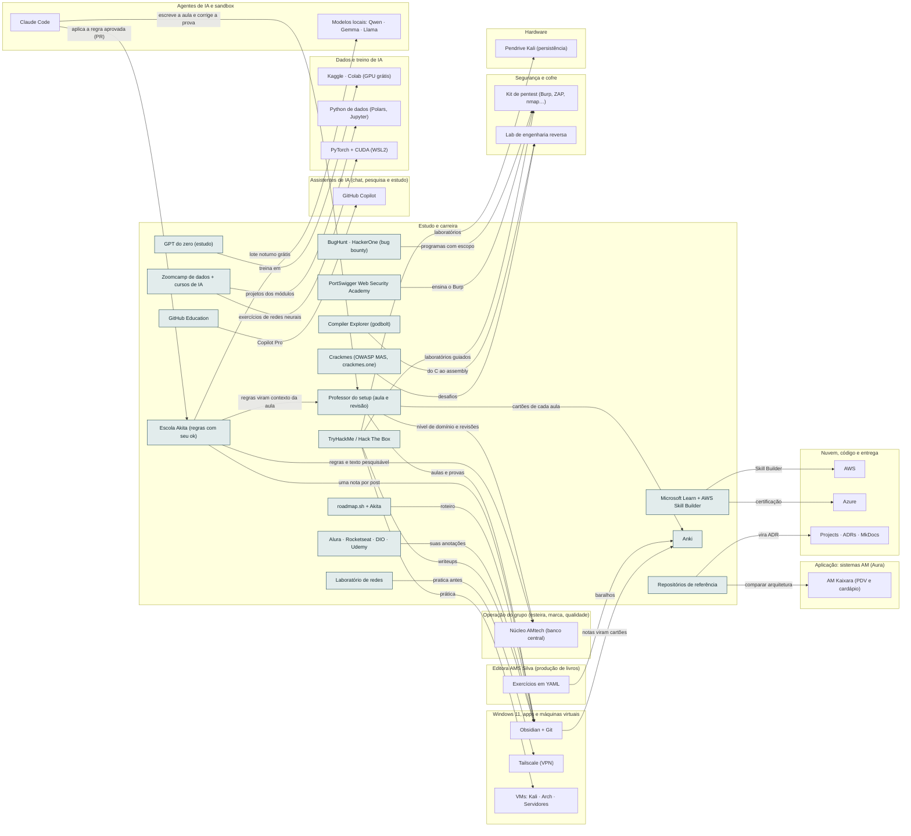

<!-- Arquivo GERADO por tools/gerar_docs.py a partir de data/. Edite os dados, não este arquivo. -->

# Camada 14 · Estudo e carreira

[← Arquitetura](../arquitetura.md) · [Índice da documentação](../README.md)

> **Ligação com a camada de baixo:** O que você estuda vira produto, aula, post e linha no currículo.

**16 blocos** · 7 precisam de conta · 0 marcados como futuro

## Mapa de conexões

## Blocos

| Bloco | Tipo | O que faz | Quando entra |
|---|---|---|---|
| [Microsoft Learn + AWS Skill Builder](#learn) | Remoto · precisa de conta | Trilhas oficiais e gratuitas para AZ-900, AI-200 (substituto do AZ-204) e AWS. | passo 24.8 · Nov/2026 a out/2027, revisão no fim de cada trimestre; passo 58.1 · Contínuo, desde a semana 2 |
| [TryHackMe / Hack The Box](#thm) | Remoto · precisa de conta | Laboratórios guiados de segurança para Security+, eJPT e OSCP. | passo 58.1 · Contínuo, desde a semana 2 |
| [Alura · Rocketseat · DIO · Udemy](#plat) | Remoto · precisa de conta | Contas de aluno. A licença é para você assistir e estudar; baixar, copiar ou extrair as aulas para alimentar IA não é permitido. O que vai para a IA são as suas anotações e os seus projetos. | passo 58.2 · Contínuo, desde a semana 2 |
| [Anki](#anki) | Local · precisa de conta | Repetição espaçada para comandos, conceitos, certificações e concurso. Open source. A conta grátis do AnkiWeb sincroniza notebook e celular. | passo 3.2 · Semana 1 · out/2026; passo 25.5 · Todo dia, nas 3 h de estudo do plano do eixo; o currículo cresce a cada trimestre; passo 46.7 · Fev a dez/2027, uma oferta por vez (começa quando: a primeira venda do mini-curso aconteceu); passo 58.3 · Contínuo, desde a semana 2 |
| [roadmap.sh + Akita](#road) | Remoto | Roteiros de estudo e referência da trilha Linux. | passo 58.1 · Contínuo, desde a semana 2 |
| [GitHub Education](#ghed) | Remoto · precisa de conta | Pacote para professores: Copilot Pro e outros benefícios. Peça a verificação. | passo 28.1 · Semana 6 · nov/2026 a dez/2026 |
| [Zoomcamp de dados + cursos de IA](#dez) | Remoto | Data Engineering Zoomcamp (DataTalksClub, grátis, 10 semanas), curso de LLM da Hugging Face, fast.ai e Neural Networks: Zero to Hero. Para a IA vão só as suas anotações e os seus projetos. | passo 44.6 · Pendrives, laboratório, dados (Zoomcamp, dbt, Airflow) e treino de IA podem começar já, na ordem do roteiro (ADR 0015) |
| [GPT do zero (estudo)](#gptzero) | Local | Tokenizador, atenção e treino de um GPT pequeno no Kaggle, para dominar a arquitetura. | passo 29.1 · 2027, depois do primeiro fine-tuning de 8B |
| [Laboratório de redes](#labrede) | Local | Packet Tracer e containerlab para VLAN, roteamento e firewall (Network+ e CCNA). | passo 30.5 · Semana 6 · nov/2026 |
| [PortSwigger Web Security Academy](#portsw) | Remoto · precisa de conta | A melhor trilha grátis de segurança web, com laboratórios no navegador; prepara a certificação BSCP. | passo 59.9 · Dez/2026 em diante: 1 bloco de 1 h por semana dentro do estudo da manhã; serviços pagos só depois dos portões (eJPT, ensaio, OSCP) |
| [Crackmes (OWASP MAS, crackmes.one)](#crackmes) | Remoto | Desafios de engenharia reversa feitos para serem quebrados: o treino legal do laboratório. | passo 59.2 · Dez/2026 em diante: 1 bloco de 1 h por semana dentro do estudo da manhã; serviços pagos só depois dos portões (eJPT, ensaio, OSCP) |
| [BugHunt · HackerOne (bug bounty)](#bbplat) | Remoto · precisa de conta | Programas públicos de bug bounty com escopo e regras escritas: o primeiro histórico e a primeira renda de segurança. | passo 59.15 · Dez/2026 em diante: 1 bloco de 1 h por semana dentro do estudo da manhã; serviços pagos só depois dos portões (eJPT, ensaio, OSCP) |
| [Compiler Explorer (godbolt)](#godbolt) | Remoto | C de um lado, assembly do outro, no navegador: a aula de Arquitetura de Computadores sem instalar nada. | passo 59.2 · Dez/2026 em diante: 1 bloco de 1 h por semana dentro do estudo da manhã; serviços pagos só depois dos portões (eJPT, ensaio, OSCP) |
| [Repositórios de referência](#refarq) | Remoto | dotnet/eShop, modular-monolith-with-ddd, Clean Architecture, bitwarden/server e system-design-primer: comparar com o AM Kaixara e registrar em ADR. | passo 59.12 · Dez/2026 em diante: 1 bloco de 1 h por semana dentro do estudo da manhã; serviços pagos só depois dos portões (eJPT, ensaio, OSCP) |
| [Escola Akita (regras com seu ok)](#akita) | Local | O blog e os episódios do Akitando (transcrições no próprio blog) viram notas no Obsidian e regras com outras palavras e link da fonte. O texto original fica só na sua máquina; regra só muda o setup depois do seu ok, por PR. | passo 26.1 · Nov/2026 em diante: a era da IA (191 posts) primeiro, os episódios do Akitando depois, o histórico por último; passo 26.2 · Nov/2026 em diante: a era da IA (191 posts) primeiro, os episódios do Akitando depois, o histórico por último; passo 26.3 · Nov/2026 em diante: a era da IA (191 posts) primeiro, os episódios do Akitando depois, o histórico por último; passo 26.4 · Nov/2026 em diante: a era da IA (191 posts) primeiro, os episódios do Akitando depois, o histórico por último; passo 26.5 · Nov/2026 em diante: a era da IA (191 posts) primeiro, os episódios do Akitando depois, o histórico por último; passo 26.6 · Nov/2026 em diante: a era da IA (191 posts) primeiro, os episódios do Akitando depois, o histórico por último |
| [Professor do setup (aula e revisão)](#professor) | Local | Currículo do eixo e do próprio setup: aula estruturada em blocos de 25 min, prática no setup, prova corrigida com rubrica, revisão espaçada e cartões para o Anki. Aulas geradas uma vez e guardadas no Obsidian. | passo 25.1 · Todo dia, nas 3 h de estudo do plano do eixo; o currículo cresce a cada trimestre; passo 25.2 · Todo dia, nas 3 h de estudo do plano do eixo; o currículo cresce a cada trimestre; passo 25.3 · Todo dia, nas 3 h de estudo do plano do eixo; o currículo cresce a cada trimestre; passo 25.4 · Todo dia, nas 3 h de estudo do plano do eixo; o currículo cresce a cada trimestre; passo 25.5 · Todo dia, nas 3 h de estudo do plano do eixo; o currículo cresce a cada trimestre; passo 25.6 · Todo dia, nas 3 h de estudo do plano do eixo; o currículo cresce a cada trimestre; passo 25.7 · Todo dia, nas 3 h de estudo do plano do eixo; o currículo cresce a cada trimestre; passo 25.8 · Todo dia, nas 3 h de estudo do plano do eixo; o currículo cresce a cada trimestre; passo 25.9 · Todo dia, nas 3 h de estudo do plano do eixo; o currículo cresce a cada trimestre |

### Microsoft Learn + AWS Skill Builder

*Remoto · precisa de conta*

Trilhas oficiais e gratuitas para AZ-900, AI-200 (substituto do AZ-204) e AWS.

**Quando entra:** passo 24.8 · Nov/2026 a out/2027, revisão no fim de cada trimestre; passo 58.1 · Contínuo, desde a semana 2 ([roteiro](../implantacao/roteiro.md))

| Direção | Bloco | Camada | O que passa |
|---|---|---|---|
| → envia para | [Azure](12-nuvem.md#azure) | Nuvem, código e entrega | certificação |
| → envia para | [AWS](12-nuvem.md#aws) | Nuvem, código e entrega | Skill Builder |

### TryHackMe / Hack The Box

*Remoto · precisa de conta*

Laboratórios guiados de segurança para Security+, eJPT e OSCP.

**Quando entra:** passo 58.1 · Contínuo, desde a semana 2 ([roteiro](../implantacao/roteiro.md))

| Direção | Bloco | Camada | O que passa |
|---|---|---|---|
| → envia para | [VMs: Kali · Arch · Servidores](03-win.md#vms) | Windows 11, apps e máquinas virtuais | prática |
| → envia para | [Obsidian + Git](03-win.md#obsd) | Windows 11, apps e máquinas virtuais | writeups |
| → envia para | [Pendrive Kali (persistência)](01-hw.md#pkali) | Hardware | laboratórios |
| → envia para | [Kit de pentest (Burp, ZAP, nmap…)](02-seg.md#kitpent) | Segurança e cofre | laboratórios guiados |

### Alura · Rocketseat · DIO · Udemy

*Remoto · precisa de conta*

Contas de aluno. A licença é para você assistir e estudar; baixar, copiar ou extrair as aulas para alimentar IA não é permitido. O que vai para a IA são as suas anotações e os seus projetos.

**Quando entra:** passo 58.2 · Contínuo, desde a semana 2 ([roteiro](../implantacao/roteiro.md))

| Direção | Bloco | Camada | O que passa |
|---|---|---|---|
| → envia para | [Obsidian + Git](03-win.md#obsd) | Windows 11, apps e máquinas virtuais | suas anotações |

### Anki

*Local · precisa de conta*

Repetição espaçada para comandos, conceitos, certificações e concurso. Open source. A conta grátis do AnkiWeb sincroniza notebook e celular.

**Quando entra:** passo 3.2 · Semana 1 · out/2026; passo 25.5 · Todo dia, nas 3 h de estudo do plano do eixo; o currículo cresce a cada trimestre; passo 46.7 · Fev a dez/2027, uma oferta por vez (começa quando: a primeira venda do mini-curso aconteceu); passo 58.3 · Contínuo, desde a semana 2 ([roteiro](../implantacao/roteiro.md))

| Direção | Bloco | Camada | O que passa |
|---|---|---|---|
| ← recebe de | [Obsidian + Git](03-win.md#obsd) | Windows 11, apps e máquinas virtuais | notas viram cartões |
| ← recebe de | [Exercícios em YAML](15-editora.md#exyaml) | Editora AMS Silva (produção de livros) | baralhos |
| ← recebe de | [Professor do setup (aula e revisão)](14-est.md#professor) | Estudo e carreira | cartões de cada aula |

### roadmap.sh + Akita

*Remoto*

Roteiros de estudo e referência da trilha Linux.

**Quando entra:** passo 58.1 · Contínuo, desde a semana 2 ([roteiro](../implantacao/roteiro.md))

| Direção | Bloco | Camada | O que passa |
|---|---|---|---|
| → envia para | [Obsidian + Git](03-win.md#obsd) | Windows 11, apps e máquinas virtuais | roteiro |

### GitHub Education

*Remoto · precisa de conta*

Pacote para professores: Copilot Pro e outros benefícios. Peça a verificação.

**Quando entra:** passo 28.1 · Semana 6 · nov/2026 a dez/2026 ([roteiro](../implantacao/roteiro.md))

| Direção | Bloco | Camada | O que passa |
|---|---|---|---|
| → envia para | [GitHub Copilot](07-chat.md#copi) | Assistentes de IA (chat, pesquisa e estudo) | Copilot Pro |

### Zoomcamp de dados + cursos de IA

*Remoto*

Data Engineering Zoomcamp (DataTalksClub, grátis, 10 semanas), curso de LLM da Hugging Face, fast.ai e Neural Networks: Zero to Hero. Para a IA vão só as suas anotações e os seus projetos.

**Quando entra:** passo 44.6 · Pendrives, laboratório, dados (Zoomcamp, dbt, Airflow) e treino de IA podem começar já, na ordem do roteiro (ADR 0015) ([roteiro](../implantacao/roteiro.md))

| Direção | Bloco | Camada | O que passa |
|---|---|---|---|
| → envia para | [Python de dados (Polars, Jupyter)](06-dados.md#pyds) | Dados e treino de IA | projetos dos módulos |
| → envia para | [PyTorch + CUDA (WSL2)](06-dados.md#torch) | Dados e treino de IA | exercícios de redes neurais |

### GPT do zero (estudo)

*Local*

Tokenizador, atenção e treino de um GPT pequeno no Kaggle, para dominar a arquitetura.

**Quando entra:** passo 29.1 · 2027, depois do primeiro fine-tuning de 8B ([roteiro](../implantacao/roteiro.md))

| Direção | Bloco | Camada | O que passa |
|---|---|---|---|
| → envia para | [Kaggle · Colab (GPU grátis)](06-dados.md#kgl) | Dados e treino de IA | treina em |

### Laboratório de redes

*Local*

Packet Tracer e containerlab para VLAN, roteamento e firewall (Network+ e CCNA).

**Quando entra:** passo 30.5 · Semana 6 · nov/2026 ([roteiro](../implantacao/roteiro.md))

| Direção | Bloco | Camada | O que passa |
|---|---|---|---|
| → envia para | [Tailscale (VPN)](03-win.md#tail) | Windows 11, apps e máquinas virtuais | pratica antes |

### PortSwigger Web Security Academy

*Remoto · precisa de conta*

A melhor trilha grátis de segurança web, com laboratórios no navegador; prepara a certificação BSCP.

**Quando entra:** passo 59.9 · Dez/2026 em diante: 1 bloco de 1 h por semana dentro do estudo da manhã; serviços pagos só depois dos portões (eJPT, ensaio, OSCP) ([roteiro](../implantacao/roteiro.md))

| Direção | Bloco | Camada | O que passa |
|---|---|---|---|
| → envia para | [Kit de pentest (Burp, ZAP, nmap…)](02-seg.md#kitpent) | Segurança e cofre | ensina o Burp |

### Crackmes (OWASP MAS, crackmes.one)

*Remoto*

Desafios de engenharia reversa feitos para serem quebrados: o treino legal do laboratório.

**Quando entra:** passo 59.2 · Dez/2026 em diante: 1 bloco de 1 h por semana dentro do estudo da manhã; serviços pagos só depois dos portões (eJPT, ensaio, OSCP) ([roteiro](../implantacao/roteiro.md))

| Direção | Bloco | Camada | O que passa |
|---|---|---|---|
| → envia para | [Lab de engenharia reversa](02-seg.md#relab) | Segurança e cofre | desafios |

### BugHunt · HackerOne (bug bounty)

*Remoto · precisa de conta*

Programas públicos de bug bounty com escopo e regras escritas: o primeiro histórico e a primeira renda de segurança.

**Quando entra:** passo 59.15 · Dez/2026 em diante: 1 bloco de 1 h por semana dentro do estudo da manhã; serviços pagos só depois dos portões (eJPT, ensaio, OSCP) ([roteiro](../implantacao/roteiro.md))

| Direção | Bloco | Camada | O que passa |
|---|---|---|---|
| → envia para | [Kit de pentest (Burp, ZAP, nmap…)](02-seg.md#kitpent) | Segurança e cofre | programas com escopo |

### Compiler Explorer (godbolt)

*Remoto*

C de um lado, assembly do outro, no navegador: a aula de Arquitetura de Computadores sem instalar nada.

**Quando entra:** passo 59.2 · Dez/2026 em diante: 1 bloco de 1 h por semana dentro do estudo da manhã; serviços pagos só depois dos portões (eJPT, ensaio, OSCP) ([roteiro](../implantacao/roteiro.md))

| Direção | Bloco | Camada | O que passa |
|---|---|---|---|
| → envia para | [Lab de engenharia reversa](02-seg.md#relab) | Segurança e cofre | do C ao assembly |

### Repositórios de referência

*Remoto*

dotnet/eShop, modular-monolith-with-ddd, Clean Architecture, bitwarden/server e system-design-primer: comparar com o AM Kaixara e registrar em ADR.

**Quando entra:** passo 59.12 · Dez/2026 em diante: 1 bloco de 1 h por semana dentro do estudo da manhã; serviços pagos só depois dos portões (eJPT, ensaio, OSCP) ([roteiro](../implantacao/roteiro.md))

| Direção | Bloco | Camada | O que passa |
|---|---|---|---|
| → envia para | [AM Kaixara (PDV e cardápio)](11-app.md#nkaix) | Aplicação: sistemas AM (Aura) | comparar arquitetura |
| → envia para | [Projects · ADRs · MkDocs](12-nuvem.md#ghproj) | Nuvem, código e entrega | vira ADR |

### Escola Akita (regras com seu ok)

*Local*

O blog e os episódios do Akitando (transcrições no próprio blog) viram notas no Obsidian e regras com outras palavras e link da fonte. O texto original fica só na sua máquina; regra só muda o setup depois do seu ok, por PR.

**Quando entra:** passo 26.1 · Nov/2026 em diante: a era da IA (191 posts) primeiro, os episódios do Akitando depois, o histórico por último; passo 26.2 · Nov/2026 em diante: a era da IA (191 posts) primeiro, os episódios do Akitando depois, o histórico por último; passo 26.3 · Nov/2026 em diante: a era da IA (191 posts) primeiro, os episódios do Akitando depois, o histórico por último; passo 26.4 · Nov/2026 em diante: a era da IA (191 posts) primeiro, os episódios do Akitando depois, o histórico por último; passo 26.5 · Nov/2026 em diante: a era da IA (191 posts) primeiro, os episódios do Akitando depois, o histórico por último; passo 26.6 · Nov/2026 em diante: a era da IA (191 posts) primeiro, os episódios do Akitando depois, o histórico por último ([roteiro](../implantacao/roteiro.md))

| Direção | Bloco | Camada | O que passa |
|---|---|---|---|
| → envia para | [Núcleo AMtech (banco central)](23-oper.md#nucleo) | Operação do grupo (esteira, marca, qualidade) | regras e texto pesquisável |
| → envia para | [Obsidian + Git](03-win.md#obsd) | Windows 11, apps e máquinas virtuais | uma nota por post |
| → envia para | [Modelos locais: Qwen · Gemma · Llama](05-ia.md#lmods) | Agentes de IA e sandbox | lote noturno grátis |
| → envia para | [Professor do setup (aula e revisão)](14-est.md#professor) | Estudo e carreira | regras viram contexto da aula |
| ← recebe de | [Claude Code](05-ia.md#cc) | Agentes de IA e sandbox | aplica a regra aprovada (PR) |

### Professor do setup (aula e revisão)

*Local*

Currículo do eixo e do próprio setup: aula estruturada em blocos de 25 min, prática no setup, prova corrigida com rubrica, revisão espaçada e cartões para o Anki. Aulas geradas uma vez e guardadas no Obsidian.

**Quando entra:** passo 25.1 · Todo dia, nas 3 h de estudo do plano do eixo; o currículo cresce a cada trimestre; passo 25.2 · Todo dia, nas 3 h de estudo do plano do eixo; o currículo cresce a cada trimestre; passo 25.3 · Todo dia, nas 3 h de estudo do plano do eixo; o currículo cresce a cada trimestre; passo 25.4 · Todo dia, nas 3 h de estudo do plano do eixo; o currículo cresce a cada trimestre; passo 25.5 · Todo dia, nas 3 h de estudo do plano do eixo; o currículo cresce a cada trimestre; passo 25.6 · Todo dia, nas 3 h de estudo do plano do eixo; o currículo cresce a cada trimestre; passo 25.7 · Todo dia, nas 3 h de estudo do plano do eixo; o currículo cresce a cada trimestre; passo 25.8 · Todo dia, nas 3 h de estudo do plano do eixo; o currículo cresce a cada trimestre; passo 25.9 · Todo dia, nas 3 h de estudo do plano do eixo; o currículo cresce a cada trimestre ([roteiro](../implantacao/roteiro.md))

| Direção | Bloco | Camada | O que passa |
|---|---|---|---|
| → envia para | [Núcleo AMtech (banco central)](23-oper.md#nucleo) | Operação do grupo (esteira, marca, qualidade) | nível de domínio e revisões |
| → envia para | [Anki](14-est.md#anki) | Estudo e carreira | cartões de cada aula |
| → envia para | [Obsidian + Git](03-win.md#obsd) | Windows 11, apps e máquinas virtuais | aulas e provas |
| ← recebe de | [Escola Akita (regras com seu ok)](14-est.md#akita) | Estudo e carreira | regras viram contexto da aula |
| ← recebe de | [Claude Code](05-ia.md#cc) | Agentes de IA e sandbox | escreve a aula e corrige a prova |

---

[↑ Camada 15 · Editora AMS Silva (produção de livros)](15-editora.md) · [↓ Camada 13 · Produção de conteúdo](13-cont.md)
