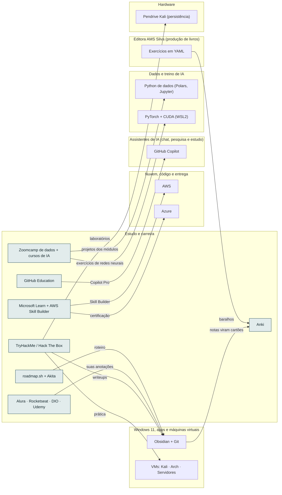

<!-- Arquivo GERADO por tools/gerar_docs.py a partir de data/. Edite os dados, não este arquivo. -->

# Camada 14 · Estudo e carreira

[← Arquitetura](../arquitetura.md) · [Índice da documentação](../README.md)

> **Ligação com a camada de baixo:** O que você estuda vira produto, aula, post e linha no currículo.

**7 blocos** · 5 precisam de conta · 0 marcados como futuro

## Mapa de conexões

## Blocos

| Bloco | Tipo | O que faz | Quando entra |
|---|---|---|---|
| [Microsoft Learn + AWS Skill Builder](#learn) | Remoto · precisa de conta | Trilhas oficiais e gratuitas para AZ-900, AZ-204 e AWS. | passo 33.2 · Contínuo, desde a semana 2 |
| [TryHackMe / Hack The Box](#thm) | Remoto · precisa de conta | Laboratórios guiados de segurança para Security+, eJPT e OSCP. | passo 33.2 · Contínuo, desde a semana 2 |
| [Alura · Rocketseat · DIO · Udemy](#plat) | Remoto · precisa de conta | Contas de aluno. A licença é para você assistir e estudar; baixar, copiar ou extrair as aulas para alimentar IA não é permitido. O que vai para a IA são as suas anotações e os seus projetos. | passo 33.3 · Contínuo, desde a semana 2 |
| [Anki](#anki) | Local · precisa de conta | Repetição espaçada para comandos, conceitos, certificações e concurso. Open source. A conta grátis do AnkiWeb sincroniza notebook e celular. | passo 3.2 · Semana 1 · out/2026; passo 22.7 · Fev a dez/2027, uma oferta por vez (começa quando: a primeira venda do mini-curso aconteceu); passo 33.4 · Contínuo, desde a semana 2 |
| [roadmap.sh + Akita](#road) | Remoto | Roteiros de estudo e referência da trilha Linux. | passo 33.2 · Contínuo, desde a semana 2 |
| [GitHub Education](#ghed) | Remoto · precisa de conta | Pacote para professores: Copilot Pro e outros benefícios. Peça a verificação. | passo 33.1 · Contínuo, desde a semana 2 |
| [Zoomcamp de dados + cursos de IA](#dez) | Remoto | Data Engineering Zoomcamp (DataTalksClub, grátis, 10 semanas), curso de LLM da Hugging Face, fast.ai e Neural Networks: Zero to Hero. Para a IA vão só as suas anotações e os seus projetos. | passo 21.6 · Pendrives, GPU e laboratório a partir da semana 2; Zoomcamp, dbt e Airflow junto do IA2 da Trilha de Dados e IA do vault (depois do Passo 8, ≈ 2028); dataset e treino do 8B junto do IA6 (≈ 2029) |

### Microsoft Learn + AWS Skill Builder

*Remoto · precisa de conta*

Trilhas oficiais e gratuitas para AZ-900, AZ-204 e AWS.

**Quando entra:** passo 33.2 · Contínuo, desde a semana 2 ([roteiro](../implantacao/roteiro.md))

| Direção | Bloco | Camada | O que passa |
|---|---|---|---|
| → envia para | [Azure](12-nuvem.md#azure) | Nuvem, código e entrega | certificação |
| → envia para | [AWS](12-nuvem.md#aws) | Nuvem, código e entrega | Skill Builder |

### TryHackMe / Hack The Box

*Remoto · precisa de conta*

Laboratórios guiados de segurança para Security+, eJPT e OSCP.

**Quando entra:** passo 33.2 · Contínuo, desde a semana 2 ([roteiro](../implantacao/roteiro.md))

| Direção | Bloco | Camada | O que passa |
|---|---|---|---|
| → envia para | [VMs: Kali · Arch · Servidores](03-win.md#vms) | Windows 11, apps e máquinas virtuais | prática |
| → envia para | [Obsidian + Git](03-win.md#obsd) | Windows 11, apps e máquinas virtuais | writeups |
| → envia para | [Pendrive Kali (persistência)](01-hw.md#pkali) | Hardware | laboratórios |

### Alura · Rocketseat · DIO · Udemy

*Remoto · precisa de conta*

Contas de aluno. A licença é para você assistir e estudar; baixar, copiar ou extrair as aulas para alimentar IA não é permitido. O que vai para a IA são as suas anotações e os seus projetos.

**Quando entra:** passo 33.3 · Contínuo, desde a semana 2 ([roteiro](../implantacao/roteiro.md))

| Direção | Bloco | Camada | O que passa |
|---|---|---|---|
| → envia para | [Obsidian + Git](03-win.md#obsd) | Windows 11, apps e máquinas virtuais | suas anotações |

### Anki

*Local · precisa de conta*

Repetição espaçada para comandos, conceitos, certificações e concurso. Open source. A conta grátis do AnkiWeb sincroniza notebook e celular.

**Quando entra:** passo 3.2 · Semana 1 · out/2026; passo 22.7 · Fev a dez/2027, uma oferta por vez (começa quando: a primeira venda do mini-curso aconteceu); passo 33.4 · Contínuo, desde a semana 2 ([roteiro](../implantacao/roteiro.md))

| Direção | Bloco | Camada | O que passa |
|---|---|---|---|
| ← recebe de | [Obsidian + Git](03-win.md#obsd) | Windows 11, apps e máquinas virtuais | notas viram cartões |
| ← recebe de | [Exercícios em YAML](15-editora.md#exyaml) | Editora AMS Silva (produção de livros) | baralhos |

### roadmap.sh + Akita

*Remoto*

Roteiros de estudo e referência da trilha Linux.

**Quando entra:** passo 33.2 · Contínuo, desde a semana 2 ([roteiro](../implantacao/roteiro.md))

| Direção | Bloco | Camada | O que passa |
|---|---|---|---|
| → envia para | [Obsidian + Git](03-win.md#obsd) | Windows 11, apps e máquinas virtuais | roteiro |

### GitHub Education

*Remoto · precisa de conta*

Pacote para professores: Copilot Pro e outros benefícios. Peça a verificação.

**Quando entra:** passo 33.1 · Contínuo, desde a semana 2 ([roteiro](../implantacao/roteiro.md))

| Direção | Bloco | Camada | O que passa |
|---|---|---|---|
| → envia para | [GitHub Copilot](07-chat.md#copi) | Assistentes de IA (chat, pesquisa e estudo) | Copilot Pro |

### Zoomcamp de dados + cursos de IA

*Remoto*

Data Engineering Zoomcamp (DataTalksClub, grátis, 10 semanas), curso de LLM da Hugging Face, fast.ai e Neural Networks: Zero to Hero. Para a IA vão só as suas anotações e os seus projetos.

**Quando entra:** passo 21.6 · Pendrives, GPU e laboratório a partir da semana 2; Zoomcamp, dbt e Airflow junto do IA2 da Trilha de Dados e IA do vault (depois do Passo 8, ≈ 2028); dataset e treino do 8B junto do IA6 (≈ 2029) ([roteiro](../implantacao/roteiro.md))

| Direção | Bloco | Camada | O que passa |
|---|---|---|---|
| → envia para | [Python de dados (Polars, Jupyter)](06-dados.md#pyds) | Dados e treino de IA | projetos dos módulos |
| → envia para | [PyTorch + CUDA (WSL2)](06-dados.md#torch) | Dados e treino de IA | exercícios de redes neurais |

---

[↑ Camada 15 · Editora AMS Silva (produção de livros)](15-editora.md) · [↓ Camada 13 · Produção de conteúdo](13-cont.md)
