<!-- Arquivo GERADO por tools/gerar_docs.py a partir de data/. Edite os dados, não este arquivo. -->

# Camada 15 · Editora AMS Silva (produção de livros)

[← Arquitetura](../arquitetura.md) · [Índice da documentação](../README.md)

> **Ligação com a camada de baixo:** Cada livro sai do pipeline como produto pronto para as plataformas e para a gráfica.

**36 blocos** · 4 precisam de conta · 6 marcados como futuro

## Mapa de conexões

```mermaid
flowchart LR
  subgraph L_editora["Editora AMS Silva (produção de livros)"]
    n_selo["Selo Editora AMS Silva"]
    n_brepo["Repositório do livro"]
    n_modelo["Seu modelo de criação"]
    n_fonte["Fonte única (Markdown + Pandoc)"]
    n_exyaml["Exercícios em YAML"]
    n_tikz["Pranchas TikZ e SVG"]
    n_bcls["Classe LaTeX do livro"]
    n_bci["Pipeline do livro (CI)"]
    n_lint["Revisão automática (LanguageTool, Vale)"]
    n_bagentes["Agentes da editora"]
    n_beta["Leitores beta e revisão técnica"]
    n_errata["Errata e edições"]
    n_isbn["ISBN + código de barras (CBL)"]
    n_ficha["Ficha catalográfica"]
    n_deplegal["Depósito legal"]
    n_kdp["Amazon KDP"]
    n_pod["Gráfica sob demanda (Brasil)"]
    n_bkit["Kit edição especial"]
    n_bcurso["Curso por seção"]
    n_prof["Edição do professor"]
    n_trad["Traduções (espanhol, inglês)"]
    n_refs["Quadro de referências"]
    n_editais["Matriz de editais"]
    n_projcap["Projeto do capítulo"]
    n_prereq["Mapa de pré-requisitos"]
    n_metodo["Seu método (metodo.yaml)"]
    n_acervos["Acervos de imagens (APIs)"]
    n_buscaimg["Busca automática de imagens"]
    n_licenca["Filtro de licença e fichas"]
    n_contato["Folha de contato (artefato)"]
    n_creditos["Créditos e legendas"]
    n_figcod["Figuras por código (Matplotlib…)"]
    n_circ["CircuiTikZ"]
    n_gerad["Geradores de tabelas"]
    n_manim["Manim (animações)"]
    n_alt["Texto alternativo"]
  end
  subgraph L_mkt["Marketing, automação e medição"]
    n_calc["Lucro por Venda (calculadora)"]
    n_dub["Dublagem (YouTube + ElevenLabs)"]
  end
  subgraph L_venda["Plataformas de venda e recebimento"]
    n_hotm["Hotmart"]
  end
  subgraph L_emp["Pessoa física: impostos e finanças"]
    n_inpi["Registro de marca (INPI)"]
    n_nfse["Carnê-leão (Receita Federal)"]
  end
  subgraph L_prod["Produtos (o que você vende)"]
    n_livro["Livro Lógica e Máquina"]
  end
  subgraph L_est["Estudo e carreira"]
    n_anki["Anki"]
  end
  subgraph L_cont["Produção de conteúdo"]
    n_edit["DaVinci Resolve ou Kdenlive"]
    n_img["Canva · Krita · Inkscape"]
    n_voz["Voz clonada (ElevenLabs)"]
  end
  subgraph L_nuvem["Nuvem, código e entrega"]
    n_gh["GitHub"]
  end
  subgraph L_clc["Claude: recursos, conectores e plugins"]
    n_ccan["Conectores Canva + Figma"]
  end
  subgraph L_dados["Dados e treino de IA"]
    n_dset["Seus datasets (só conteúdo seu)"]
  end
  subgraph L_ia["Agentes de IA e sandbox"]
    n_cc["Claude Code"]
  end
  subgraph L_lin["Linux (Ubuntu no WSL2, Arch no 2º disco)"]
    n_tex["TeX Live"]
  end
  subgraph L_win["Windows 11, apps e máquinas virtuais"]
    n_obsd["Obsidian + Git"]
  end
  n_selo -->|"registro de marca"| n_inpi
  n_selo -->|"editora no ISBN"| n_isbn
  n_brepo -->|"hospedado"| n_gh
  n_brepo -->|"dispara"| n_bci
  n_fonte -->|"versionado"| n_brepo
  n_exyaml -->|"versionado"| n_brepo
  n_tikz -->|"versionado"| n_brepo
  n_bagentes -->|"apontam problemas"| n_brepo
  n_errata -->|"correções"| n_brepo
  n_projcap -->|"versionado"| n_brepo
  n_creditos -->|"fichas versionadas"| n_brepo
  n_modelo -->|"template de capítulo"| n_fonte
  n_modelo -->|"regras conferidas"| n_bci
  n_metodo -->|"etapas do capítulo"| n_modelo
  n_fonte -->|"conceitos marcados"| n_prereq
  n_fonte -->|"figuras.yaml"| n_buscaimg
  n_fonte -->|"texto do livro"| n_dset
  n_obsd -->|"rascunho"| n_fonte
  n_exyaml -->|"baralhos"| n_anki
  n_exyaml -->|"exercícios das aulas"| n_bcurso
  n_exyaml -->|"exercícios com gabarito"| n_dset
  n_editais -->|"questões de banca"| n_exyaml
  n_tikz -->|"pranchas animadas"| n_manim
  n_bcls -->|"identidade visual"| n_bci
  n_bcls -->|"cores e fontes"| n_figcod
  n_isbn -->|"vai na capa e na ficha"| n_bcls
  n_ficha -->|"verso da folha de rosto"| n_bcls
  n_refs -->|"referências visuais"| n_bcls
  n_bci -->|"PDF, EPUB e impressão"| n_livro
  n_bci -->|"PDF de prévia"| n_beta
  n_tex -->|"compila o PDF"| n_bci
  n_lint -->|"revisão"| n_bci
  n_editais -->|"cobertura conferida"| n_bci
  n_prereq -->|"nada usado antes de ensinado"| n_bci
  n_metodo -->|"etapas conferidas"| n_bci
  n_creditos -->|"bloqueia sem ficha"| n_bci
  n_figcod -->|"gerado a cada build"| n_bci
  n_circ -->|"gerado a cada build"| n_bci
  n_gerad -->|"gerado e conferido"| n_bci
  n_alt -->|"EPUB acessível"| n_bci
  n_cc -->|"executa"| n_bagentes
  n_beta -->|"erros encontrados"| n_errata
  n_errata -->|"nova edição"| n_livro
  n_livro -->|"1 exemplar"| n_deplegal
  n_kdp -->|"carnê-leão (exterior)"| n_nfse
  n_livro -->|"ebook e impresso"| n_kdp
  n_pod -->|"carnê-leão"| n_nfse
  n_livro -->|"impresso"| n_pod
  n_livro -->|"tiragem especial"| n_bkit
  n_calc -->|"preço e margem"| n_bkit
  n_bcurso -->|"venda"| n_hotm
  n_voz -->|"narração"| n_bcurso
  n_edit -->|"aulas"| n_bcurso
  n_calc -->|"preço e margem"| n_bcurso
  n_projcap -->|"projeto das aulas"| n_bcurso
  n_manim -->|"animações"| n_bcurso
  n_prof -->|"licença para escolas"| n_hotm
  n_livro -->|"material do professor"| n_prof
  n_trad -->|"voz em outros idiomas"| n_dub
  n_livro -->|"outras línguas"| n_trad
  n_img -->|"rascunhos de ideia"| n_refs
  n_ccan -->|"quadros e capas"| n_refs
  n_projcap -->|"portfólio do aluno"| n_gh
  n_acervos -->|"candidatos e licenças"| n_licenca
  n_buscaimg -->|"consulta as APIs"| n_acervos
  n_buscaimg -->|"candidatos"| n_licenca
  n_licenca -->|"só o permitido"| n_contato
  n_img -->|"ficha com prompt e ferramenta"| n_licenca
  n_contato -->|"sua escolha"| n_creditos
  n_figcod -->|"mesmo código"| n_manim
  classDef desta fill:#e2ecec,stroke:#0e3a45,color:#13262b
  class n_selo,n_brepo,n_modelo,n_fonte,n_exyaml,n_tikz,n_bcls,n_bci,n_lint,n_bagentes,n_beta,n_errata,n_isbn,n_ficha,n_deplegal,n_kdp,n_pod,n_bkit,n_bcurso,n_prof,n_trad,n_refs,n_editais,n_projcap,n_prereq,n_metodo,n_acervos,n_buscaimg,n_licenca,n_contato,n_creditos,n_figcod,n_circ,n_gerad,n_manim,n_alt desta
```

## Blocos

| Bloco | Tipo | O que faz | Quando entra |
|---|---|---|---|
| [Selo Editora AMS Silva](#selo) | Local | Marca da editora usada nos livros, no seu CPF por enquanto. Vira empresa quando a renda justificar. | passo 43.7 · Quando o capítulo 1 estiver pronto (começa quando: o capítulo 1 e o seu modelo de criação prontos); passo 43.8 · Quando o capítulo 1 estiver pronto (começa quando: o capítulo 1 e o seu modelo de criação prontos) |
| [Repositório do livro](#brepo) | Remoto | Um repositório por livro: texto, exercícios, figuras, código, estilo, errata e changelog. | passo 43.2 · Quando o capítulo 1 estiver pronto (começa quando: o capítulo 1 e o seu modelo de criação prontos) |
| [Seu modelo de criação](#modelo) | Local | Template de capítulo e regras que o pipeline confere. Aguardando o seu modelo. | passo 43.1 · Quando o capítulo 1 estiver pronto (começa quando: o capítulo 1 e o seu modelo de criação prontos) |
| [Fonte única (Markdown + Pandoc)](#fonte) | Local | O texto escrito uma vez e convertido em LaTeX, EPUB e HTML. | passo 43.2 · Quando o capítulo 1 estiver pronto (começa quando: o capítulo 1 e o seu modelo de criação prontos) |
| [Exercícios em YAML](#exyaml) | Local | Enunciado, nível, fonte, gabarito e solução. Gera a lista do capítulo, o gabarito, o site am-mentor e o Anki. | passo 43.2 · Quando o capítulo 1 estiver pronto (começa quando: o capítulo 1 e o seu modelo de criação prontos); passo 46.6 · Fev a dez/2027, uma oferta por vez (começa quando: a primeira venda do mini-curso aconteceu); passo 46.7 · Fev a dez/2027, uma oferta por vez (começa quando: a primeira venda do mini-curso aconteceu); passo 46.13 · Fev a dez/2027, uma oferta por vez (começa quando: a primeira venda do mini-curso aconteceu) |
| [Pranchas TikZ e SVG](#tikz) | Local | Diagramas técnicos vetoriais versionados como código. | passo 4.4 · Semana 2 · nov/2026 |
| [Classe LaTeX do livro](#bcls) | Local | A identidade visual (papel creme, verdigris, latão, Garamond) aplicada a toda página. | passo 43.2 · Quando o capítulo 1 estiver pronto (começa quando: o capítulo 1 e o seu modelo de criação prontos) |
| [Pipeline do livro (CI)](#bci) | Remoto | A cada mudança: compila e testa o código, confere gabaritos, revisa texto e links, gera PDF, EPUB e arquivo de impressão. | passo 43.2 · Quando o capítulo 1 estiver pronto (começa quando: o capítulo 1 e o seu modelo de criação prontos) |
| [Revisão automática (LanguageTool, Vale)](#lint) | Local | Ortografia e regras de estilo da editora. | passo 43.2 · Quando o capítulo 1 estiver pronto (começa quando: o capítulo 1 e o seu modelo de criação prontos) |
| [Agentes da editora](#bagentes) | Local | Revisor técnico, gerador de testes, verificador de gabarito, leitor iniciante e consistência entre capítulos. | passo 43.5 · Quando o capítulo 1 estiver pronto (começa quando: o capítulo 1 e o seu modelo de criação prontos) |
| [Leitores beta e revisão técnica](#beta) | Físico | 3 a 5 leitores do público e uma segunda pessoa da área antes de cada edição. | passo 43.10 · Quando o capítulo 1 estiver pronto (começa quando: o capítulo 1 e o seu modelo de criação prontos) |
| [Errata e edições](#errata) | Remoto | Correções públicas e número de edição; o leitor reporta erros por formulário. | passo 43.2 · Quando o capítulo 1 estiver pronto (começa quando: o capítulo 1 e o seu modelo de criação prontos) |
| [ISBN + código de barras (CBL)](#isbn) | Remoto · precisa de conta | Um ISBN por formato (impresso e ebook), pela plataforma da Câmara Brasileira do Livro. | passo 43.9 · Quando o capítulo 1 estiver pronto (começa quando: o capítulo 1 e o seu modelo de criação prontos) |
| [Ficha catalográfica](#ficha) | Remoto | Feita pela CBL ou por bibliotecário com CRB; vai no verso da folha de rosto. | passo 43.9 · Quando o capítulo 1 estiver pronto (começa quando: o capítulo 1 e o seu modelo de criação prontos) |
| [Depósito legal](#deplegal) | Físico | Pelo menos 1 exemplar à Biblioteca Nacional até 30 dias após publicar (Lei 10.994/2004). | passo 43.12 · Quando o capítulo 1 estiver pronto (começa quando: o capítulo 1 e o seu modelo de criação prontos) |
| [Amazon KDP](#kdp) | Remoto · precisa de conta | Ebook com royalty de 35% ou 70% (no Brasil, 70% entre R$ 5,99 e R$ 31,99, com KDP Select) e impressão sob demanda. | passo 43.11 · Quando o capítulo 1 estiver pronto (começa quando: o capítulo 1 e o seu modelo de criação prontos) |
| [Gráfica sob demanda (Brasil)](#pod) | Remoto · precisa de conta · futuro | Livro impresso sem estoque; compare custo, prazo e cópia de prova. | passo 53.1 · Depois do primeiro livro (começa quando: o primeiro livro publicado) |
| [Kit edição especial](#bkit) | Físico · futuro | Tiragem limitada com capa dura, marcador e pôster, no modelo do VHSlins. | passo 53.2 · Depois do primeiro livro (começa quando: o primeiro livro publicado) |
| [Curso por seção](#bcurso) | Remoto · futuro | Uma aula por seção na ordem do sumário, com voz clonada e tela. | passo 53.3 · Depois do primeiro livro (começa quando: o primeiro livro publicado) |
| [Edição do professor](#prof) | Local · futuro | Slides, planos de aula, avaliações e gabaritos; licença para escolas. | passo 53.4 · Depois do primeiro livro (começa quando: o primeiro livro publicado) |
| [Traduções (espanhol, inglês)](#trad) | Remoto · futuro | Tradução revisada por nativo; ebook e curso dublados. | passo 53.5 · Depois do primeiro livro (começa quando: o primeiro livro publicado) |
| [Quadro de referências](#refs) | Remoto | Referências de design, pranchas, caixas e paletas testadas em impressão. | passo 43.6 · Quando o capítulo 1 estiver pronto (começa quando: o capítulo 1 e o seu modelo de criação prontos) |
| [Matriz de editais](#editais) | Local | Cada tópico dos editais de PF, PRF e Forças Armadas ligado ao capítulo que o ensina; o pipeline mostra a cobertura e aponta lacunas. | passo 43.6 · Quando o capítulo 1 estiver pronto (começa quando: o capítulo 1 e o seu modelo de criação prontos) |
| [Projeto do capítulo](#projcap) | Local | Cada capítulo termina com um projeto que só se resolve dominando o assunto, no estilo da École 42. | passo 43.1 · Quando o capítulo 1 estiver pronto (começa quando: o capítulo 1 e o seu modelo de criação prontos) |
| [Mapa de pré-requisitos](#prereq) | Local | Cada conceito tem identificador; o pipeline avisa quando algo é usado antes de ser ensinado ou exige outro livro. | passo 43.1 · Quando o capítulo 1 estiver pronto (começa quando: o capítulo 1 e o seu modelo de criação prontos) |
| [Seu método (metodo.yaml)](#metodo) | Local | O passo a passo de criação que você vai implementar: cada etapa com entrada, saída e critério de conclusão, conferido pelo pipeline. | passo 43.1 · Quando o capítulo 1 estiver pronto (começa quando: o capítulo 1 e o seu modelo de criação prontos) |
| [Acervos de imagens (APIs)](#acervos) | Remoto · precisa de conta | Openverse, Wikimedia Commons, Smithsonian, The Met, Europeana, Library of Congress, NASA, Internet Archive, Biblioteca Nacional Digital, Unsplash e Pexels. | passo 43.3 · Quando o capítulo 1 estiver pronto (começa quando: o capítulo 1 e o seu modelo de criação prontos) |
| [Busca automática de imagens](#buscaimg) | Local | Script que consulta os acervos a partir do figuras.yaml de cada capítulo e traz candidatos com licença e resolução. | passo 43.3 · Quando o capítulo 1 estiver pronto (começa quando: o capítulo 1 e o seu modelo de criação prontos) |
| [Filtro de licença e fichas](#licenca) | Local | Só passa domínio público, CC0, CC BY, CC BY-SA (com cuidado) e licenças de banco com uso comercial. Cada imagem ganha uma ficha com autor, fonte, licença e link. | passo 43.3 · Quando o capítulo 1 estiver pronto (começa quando: o capítulo 1 e o seu modelo de criação prontos) |
| [Folha de contato (artefato)](#contato) | Remoto | Página com os candidatos lado a lado para você escolher. | passo 43.3 · Quando o capítulo 1 estiver pronto (começa quando: o capítulo 1 e o seu modelo de criação prontos) |
| [Créditos e legendas](#creditos) | Local | Gerados das fichas: legenda de cada imagem e página de créditos. O build falha se faltar ficha. | passo 43.3 · Quando o capítulo 1 estiver pronto (começa quando: o capítulo 1 e o seu modelo de criação prontos) |
| [Figuras por código (Matplotlib…)](#figcod) | Local | Gráficos e grafos gerados de dados e definições a cada build, no estilo do livro. | passo 43.4 · Quando o capítulo 1 estiver pronto (começa quando: o capítulo 1 e o seu modelo de criação prontos) |
| [CircuiTikZ](#circ) | Local | Circuitos e portas lógicas para a física e a eletrônica do livro. | passo 4.4 · Semana 2 · nov/2026 |
| [Geradores de tabelas](#gerad) | Local | Tabelas-verdade, conversões de base e tabelas de operações geradas e conferidas por script. Exemplo testado em tools/editora. | passo 43.4 · Quando o capítulo 1 estiver pronto (começa quando: o capítulo 1 e o seu modelo de criação prontos) |
| [Manim (animações)](#manim) | Local · futuro | O mesmo código da figura vira animação para as aulas do curso. | passo 53.3 · Depois do primeiro livro (começa quando: o primeiro livro publicado) |
| [Texto alternativo](#alt) | Local | Descrição de cada figura para o EPUB acessível; rascunho por IA, revisão sua. | passo 43.4 · Quando o capítulo 1 estiver pronto (começa quando: o capítulo 1 e o seu modelo de criação prontos) |

### Selo Editora AMS Silva

*Local*

Marca da editora usada nos livros, no seu CPF por enquanto. Vira empresa quando a renda justificar.

**Quando entra:** passo 43.7 · Quando o capítulo 1 estiver pronto (começa quando: o capítulo 1 e o seu modelo de criação prontos); passo 43.8 · Quando o capítulo 1 estiver pronto (começa quando: o capítulo 1 e o seu modelo de criação prontos) ([roteiro](../implantacao/roteiro.md))

| Direção | Bloco | Camada | O que passa |
|---|---|---|---|
| → envia para | [Registro de marca (INPI)](19-emp.md#inpi) | Pessoa física: impostos e finanças | registro de marca |
| → envia para | [ISBN + código de barras (CBL)](15-editora.md#isbn) | Editora AMS Silva (produção de livros) | editora no ISBN |

### Repositório do livro

*Remoto*

Um repositório por livro: texto, exercícios, figuras, código, estilo, errata e changelog.

**Quando entra:** passo 43.2 · Quando o capítulo 1 estiver pronto (começa quando: o capítulo 1 e o seu modelo de criação prontos) ([roteiro](../implantacao/roteiro.md))

| Direção | Bloco | Camada | O que passa |
|---|---|---|---|
| → envia para | [GitHub](12-nuvem.md#gh) | Nuvem, código e entrega | hospedado |
| → envia para | [Pipeline do livro (CI)](15-editora.md#bci) | Editora AMS Silva (produção de livros) | dispara |
| ← recebe de | [Fonte única (Markdown + Pandoc)](15-editora.md#fonte) | Editora AMS Silva (produção de livros) | versionado |
| ← recebe de | [Exercícios em YAML](15-editora.md#exyaml) | Editora AMS Silva (produção de livros) | versionado |
| ← recebe de | [Pranchas TikZ e SVG](15-editora.md#tikz) | Editora AMS Silva (produção de livros) | versionado |
| ← recebe de | [Agentes da editora](15-editora.md#bagentes) | Editora AMS Silva (produção de livros) | apontam problemas |
| ← recebe de | [Errata e edições](15-editora.md#errata) | Editora AMS Silva (produção de livros) | correções |
| ← recebe de | [Projeto do capítulo](15-editora.md#projcap) | Editora AMS Silva (produção de livros) | versionado |
| ← recebe de | [Créditos e legendas](15-editora.md#creditos) | Editora AMS Silva (produção de livros) | fichas versionadas |

### Seu modelo de criação

*Local*

Template de capítulo e regras que o pipeline confere. Aguardando o seu modelo.

**Quando entra:** passo 43.1 · Quando o capítulo 1 estiver pronto (começa quando: o capítulo 1 e o seu modelo de criação prontos) ([roteiro](../implantacao/roteiro.md))

| Direção | Bloco | Camada | O que passa |
|---|---|---|---|
| → envia para | [Fonte única (Markdown + Pandoc)](15-editora.md#fonte) | Editora AMS Silva (produção de livros) | template de capítulo |
| → envia para | [Pipeline do livro (CI)](15-editora.md#bci) | Editora AMS Silva (produção de livros) | regras conferidas |
| ← recebe de | [Seu método (metodo.yaml)](15-editora.md#metodo) | Editora AMS Silva (produção de livros) | etapas do capítulo |

### Fonte única (Markdown + Pandoc)

*Local*

O texto escrito uma vez e convertido em LaTeX, EPUB e HTML.

**Quando entra:** passo 43.2 · Quando o capítulo 1 estiver pronto (começa quando: o capítulo 1 e o seu modelo de criação prontos) ([roteiro](../implantacao/roteiro.md))

| Direção | Bloco | Camada | O que passa |
|---|---|---|---|
| → envia para | [Repositório do livro](15-editora.md#brepo) | Editora AMS Silva (produção de livros) | versionado |
| → envia para | [Mapa de pré-requisitos](15-editora.md#prereq) | Editora AMS Silva (produção de livros) | conceitos marcados |
| → envia para | [Busca automática de imagens](15-editora.md#buscaimg) | Editora AMS Silva (produção de livros) | figuras.yaml |
| → envia para | [Seus datasets (só conteúdo seu)](06-dados.md#dset) | Dados e treino de IA | texto do livro |
| ← recebe de | [Seu modelo de criação](15-editora.md#modelo) | Editora AMS Silva (produção de livros) | template de capítulo |
| ← recebe de | [Obsidian + Git](03-win.md#obsd) | Windows 11, apps e máquinas virtuais | rascunho |

### Exercícios em YAML

*Local*

Enunciado, nível, fonte, gabarito e solução. Gera a lista do capítulo, o gabarito, o site am-mentor e o Anki.

**Quando entra:** passo 43.2 · Quando o capítulo 1 estiver pronto (começa quando: o capítulo 1 e o seu modelo de criação prontos); passo 46.6 · Fev a dez/2027, uma oferta por vez (começa quando: a primeira venda do mini-curso aconteceu); passo 46.7 · Fev a dez/2027, uma oferta por vez (começa quando: a primeira venda do mini-curso aconteceu); passo 46.13 · Fev a dez/2027, uma oferta por vez (começa quando: a primeira venda do mini-curso aconteceu) ([roteiro](../implantacao/roteiro.md))

| Direção | Bloco | Camada | O que passa |
|---|---|---|---|
| → envia para | [Repositório do livro](15-editora.md#brepo) | Editora AMS Silva (produção de livros) | versionado |
| → envia para | [Anki](14-est.md#anki) | Estudo e carreira | baralhos |
| → envia para | [Curso por seção](15-editora.md#bcurso) | Editora AMS Silva (produção de livros) | exercícios das aulas |
| → envia para | [Seus datasets (só conteúdo seu)](06-dados.md#dset) | Dados e treino de IA | exercícios com gabarito |
| ← recebe de | [Matriz de editais](15-editora.md#editais) | Editora AMS Silva (produção de livros) | questões de banca |

### Pranchas TikZ e SVG

*Local*

Diagramas técnicos vetoriais versionados como código.

**Quando entra:** passo 4.4 · Semana 2 · nov/2026 ([roteiro](../implantacao/roteiro.md))

| Direção | Bloco | Camada | O que passa |
|---|---|---|---|
| → envia para | [Repositório do livro](15-editora.md#brepo) | Editora AMS Silva (produção de livros) | versionado |
| → envia para | [Manim (animações)](15-editora.md#manim) | Editora AMS Silva (produção de livros) | pranchas animadas |

### Classe LaTeX do livro

*Local*

A identidade visual (papel creme, verdigris, latão, Garamond) aplicada a toda página.

**Quando entra:** passo 43.2 · Quando o capítulo 1 estiver pronto (começa quando: o capítulo 1 e o seu modelo de criação prontos) ([roteiro](../implantacao/roteiro.md))

| Direção | Bloco | Camada | O que passa |
|---|---|---|---|
| → envia para | [Pipeline do livro (CI)](15-editora.md#bci) | Editora AMS Silva (produção de livros) | identidade visual |
| → envia para | [Figuras por código (Matplotlib…)](15-editora.md#figcod) | Editora AMS Silva (produção de livros) | cores e fontes |
| ← recebe de | [ISBN + código de barras (CBL)](15-editora.md#isbn) | Editora AMS Silva (produção de livros) | vai na capa e na ficha |
| ← recebe de | [Ficha catalográfica](15-editora.md#ficha) | Editora AMS Silva (produção de livros) | verso da folha de rosto |
| ← recebe de | [Quadro de referências](15-editora.md#refs) | Editora AMS Silva (produção de livros) | referências visuais |

### Pipeline do livro (CI)

*Remoto*

A cada mudança: compila e testa o código, confere gabaritos, revisa texto e links, gera PDF, EPUB e arquivo de impressão.

**Quando entra:** passo 43.2 · Quando o capítulo 1 estiver pronto (começa quando: o capítulo 1 e o seu modelo de criação prontos) ([roteiro](../implantacao/roteiro.md))

| Direção | Bloco | Camada | O que passa |
|---|---|---|---|
| → envia para | [Livro Lógica e Máquina](17-prod.md#livro) | Produtos (o que você vende) | PDF, EPUB e impressão |
| → envia para | [Leitores beta e revisão técnica](15-editora.md#beta) | Editora AMS Silva (produção de livros) | PDF de prévia |
| ← recebe de | [Seu modelo de criação](15-editora.md#modelo) | Editora AMS Silva (produção de livros) | regras conferidas |
| ← recebe de | [Repositório do livro](15-editora.md#brepo) | Editora AMS Silva (produção de livros) | dispara |
| ← recebe de | [Classe LaTeX do livro](15-editora.md#bcls) | Editora AMS Silva (produção de livros) | identidade visual |
| ← recebe de | [TeX Live](04-lin.md#tex) | Linux (Ubuntu no WSL2, Arch no 2º disco) | compila o PDF |
| ← recebe de | [Revisão automática (LanguageTool, Vale)](15-editora.md#lint) | Editora AMS Silva (produção de livros) | revisão |
| ← recebe de | [Matriz de editais](15-editora.md#editais) | Editora AMS Silva (produção de livros) | cobertura conferida |
| ← recebe de | [Mapa de pré-requisitos](15-editora.md#prereq) | Editora AMS Silva (produção de livros) | nada usado antes de ensinado |
| ← recebe de | [Seu método (metodo.yaml)](15-editora.md#metodo) | Editora AMS Silva (produção de livros) | etapas conferidas |
| ← recebe de | [Créditos e legendas](15-editora.md#creditos) | Editora AMS Silva (produção de livros) | bloqueia sem ficha |
| ← recebe de | [Figuras por código (Matplotlib…)](15-editora.md#figcod) | Editora AMS Silva (produção de livros) | gerado a cada build |
| ← recebe de | [CircuiTikZ](15-editora.md#circ) | Editora AMS Silva (produção de livros) | gerado a cada build |
| ← recebe de | [Geradores de tabelas](15-editora.md#gerad) | Editora AMS Silva (produção de livros) | gerado e conferido |
| ← recebe de | [Texto alternativo](15-editora.md#alt) | Editora AMS Silva (produção de livros) | EPUB acessível |

### Revisão automática (LanguageTool, Vale)

*Local*

Ortografia e regras de estilo da editora.

**Quando entra:** passo 43.2 · Quando o capítulo 1 estiver pronto (começa quando: o capítulo 1 e o seu modelo de criação prontos) ([roteiro](../implantacao/roteiro.md))

| Direção | Bloco | Camada | O que passa |
|---|---|---|---|
| → envia para | [Pipeline do livro (CI)](15-editora.md#bci) | Editora AMS Silva (produção de livros) | revisão |

### Agentes da editora

*Local*

Revisor técnico, gerador de testes, verificador de gabarito, leitor iniciante e consistência entre capítulos.

**Quando entra:** passo 43.5 · Quando o capítulo 1 estiver pronto (começa quando: o capítulo 1 e o seu modelo de criação prontos) ([roteiro](../implantacao/roteiro.md))

| Direção | Bloco | Camada | O que passa |
|---|---|---|---|
| → envia para | [Repositório do livro](15-editora.md#brepo) | Editora AMS Silva (produção de livros) | apontam problemas |
| ← recebe de | [Claude Code](05-ia.md#cc) | Agentes de IA e sandbox | executa |

### Leitores beta e revisão técnica

*Físico*

3 a 5 leitores do público e uma segunda pessoa da área antes de cada edição.

**Quando entra:** passo 43.10 · Quando o capítulo 1 estiver pronto (começa quando: o capítulo 1 e o seu modelo de criação prontos) ([roteiro](../implantacao/roteiro.md))

| Direção | Bloco | Camada | O que passa |
|---|---|---|---|
| → envia para | [Errata e edições](15-editora.md#errata) | Editora AMS Silva (produção de livros) | erros encontrados |
| ← recebe de | [Pipeline do livro (CI)](15-editora.md#bci) | Editora AMS Silva (produção de livros) | PDF de prévia |

### Errata e edições

*Remoto*

Correções públicas e número de edição; o leitor reporta erros por formulário.

**Quando entra:** passo 43.2 · Quando o capítulo 1 estiver pronto (começa quando: o capítulo 1 e o seu modelo de criação prontos) ([roteiro](../implantacao/roteiro.md))

| Direção | Bloco | Camada | O que passa |
|---|---|---|---|
| → envia para | [Repositório do livro](15-editora.md#brepo) | Editora AMS Silva (produção de livros) | correções |
| → envia para | [Livro Lógica e Máquina](17-prod.md#livro) | Produtos (o que você vende) | nova edição |
| ← recebe de | [Leitores beta e revisão técnica](15-editora.md#beta) | Editora AMS Silva (produção de livros) | erros encontrados |

### ISBN + código de barras (CBL)

*Remoto · precisa de conta*

Um ISBN por formato (impresso e ebook), pela plataforma da Câmara Brasileira do Livro.

**Quando entra:** passo 43.9 · Quando o capítulo 1 estiver pronto (começa quando: o capítulo 1 e o seu modelo de criação prontos) ([roteiro](../implantacao/roteiro.md))

| Direção | Bloco | Camada | O que passa |
|---|---|---|---|
| → envia para | [Classe LaTeX do livro](15-editora.md#bcls) | Editora AMS Silva (produção de livros) | vai na capa e na ficha |
| ← recebe de | [Selo Editora AMS Silva](15-editora.md#selo) | Editora AMS Silva (produção de livros) | editora no ISBN |

### Ficha catalográfica

*Remoto*

Feita pela CBL ou por bibliotecário com CRB; vai no verso da folha de rosto.

**Quando entra:** passo 43.9 · Quando o capítulo 1 estiver pronto (começa quando: o capítulo 1 e o seu modelo de criação prontos) ([roteiro](../implantacao/roteiro.md))

| Direção | Bloco | Camada | O que passa |
|---|---|---|---|
| → envia para | [Classe LaTeX do livro](15-editora.md#bcls) | Editora AMS Silva (produção de livros) | verso da folha de rosto |

### Depósito legal

*Físico*

Pelo menos 1 exemplar à Biblioteca Nacional até 30 dias após publicar (Lei 10.994/2004).

**Quando entra:** passo 43.12 · Quando o capítulo 1 estiver pronto (começa quando: o capítulo 1 e o seu modelo de criação prontos) ([roteiro](../implantacao/roteiro.md))

| Direção | Bloco | Camada | O que passa |
|---|---|---|---|
| ← recebe de | [Livro Lógica e Máquina](17-prod.md#livro) | Produtos (o que você vende) | 1 exemplar |

### Amazon KDP

*Remoto · precisa de conta*

Ebook com royalty de 35% ou 70% (no Brasil, 70% entre R$ 5,99 e R$ 31,99, com KDP Select) e impressão sob demanda.

**Quando entra:** passo 43.11 · Quando o capítulo 1 estiver pronto (começa quando: o capítulo 1 e o seu modelo de criação prontos) ([roteiro](../implantacao/roteiro.md))

| Direção | Bloco | Camada | O que passa |
|---|---|---|---|
| → envia para | [Carnê-leão (Receita Federal)](19-emp.md#nfse) | Pessoa física: impostos e finanças | carnê-leão (exterior) |
| ← recebe de | [Livro Lógica e Máquina](17-prod.md#livro) | Produtos (o que você vende) | ebook e impresso |

### Gráfica sob demanda (Brasil)

*Remoto · precisa de conta · futuro*

Livro impresso sem estoque; compare custo, prazo e cópia de prova.

**Quando entra:** passo 53.1 · Depois do primeiro livro (começa quando: o primeiro livro publicado) ([roteiro](../implantacao/roteiro.md))

| Direção | Bloco | Camada | O que passa |
|---|---|---|---|
| → envia para | [Carnê-leão (Receita Federal)](19-emp.md#nfse) | Pessoa física: impostos e finanças | carnê-leão |
| ← recebe de | [Livro Lógica e Máquina](17-prod.md#livro) | Produtos (o que você vende) | impresso |

### Kit edição especial

*Físico · futuro*

Tiragem limitada com capa dura, marcador e pôster, no modelo do VHSlins.

**Quando entra:** passo 53.2 · Depois do primeiro livro (começa quando: o primeiro livro publicado) ([roteiro](../implantacao/roteiro.md))

| Direção | Bloco | Camada | O que passa |
|---|---|---|---|
| ← recebe de | [Livro Lógica e Máquina](17-prod.md#livro) | Produtos (o que você vende) | tiragem especial |
| ← recebe de | [Lucro por Venda (calculadora)](21-mkt.md#calc) | Marketing, automação e medição | preço e margem |

### Curso por seção

*Remoto · futuro*

Uma aula por seção na ordem do sumário, com voz clonada e tela.

**Quando entra:** passo 53.3 · Depois do primeiro livro (começa quando: o primeiro livro publicado) ([roteiro](../implantacao/roteiro.md))

| Direção | Bloco | Camada | O que passa |
|---|---|---|---|
| → envia para | [Hotmart](20-venda.md#hotm) | Plataformas de venda e recebimento | venda |
| ← recebe de | [Exercícios em YAML](15-editora.md#exyaml) | Editora AMS Silva (produção de livros) | exercícios das aulas |
| ← recebe de | [Voz clonada (ElevenLabs)](13-cont.md#voz) | Produção de conteúdo | narração |
| ← recebe de | [DaVinci Resolve ou Kdenlive](13-cont.md#edit) | Produção de conteúdo | aulas |
| ← recebe de | [Lucro por Venda (calculadora)](21-mkt.md#calc) | Marketing, automação e medição | preço e margem |
| ← recebe de | [Projeto do capítulo](15-editora.md#projcap) | Editora AMS Silva (produção de livros) | projeto das aulas |
| ← recebe de | [Manim (animações)](15-editora.md#manim) | Editora AMS Silva (produção de livros) | animações |

### Edição do professor

*Local · futuro*

Slides, planos de aula, avaliações e gabaritos; licença para escolas.

**Quando entra:** passo 53.4 · Depois do primeiro livro (começa quando: o primeiro livro publicado) ([roteiro](../implantacao/roteiro.md))

| Direção | Bloco | Camada | O que passa |
|---|---|---|---|
| → envia para | [Hotmart](20-venda.md#hotm) | Plataformas de venda e recebimento | licença para escolas |
| ← recebe de | [Livro Lógica e Máquina](17-prod.md#livro) | Produtos (o que você vende) | material do professor |

### Traduções (espanhol, inglês)

*Remoto · futuro*

Tradução revisada por nativo; ebook e curso dublados.

**Quando entra:** passo 53.5 · Depois do primeiro livro (começa quando: o primeiro livro publicado) ([roteiro](../implantacao/roteiro.md))

| Direção | Bloco | Camada | O que passa |
|---|---|---|---|
| → envia para | [Dublagem (YouTube + ElevenLabs)](21-mkt.md#dub) | Marketing, automação e medição | voz em outros idiomas |
| ← recebe de | [Livro Lógica e Máquina](17-prod.md#livro) | Produtos (o que você vende) | outras línguas |

### Quadro de referências

*Remoto*

Referências de design, pranchas, caixas e paletas testadas em impressão.

**Quando entra:** passo 43.6 · Quando o capítulo 1 estiver pronto (começa quando: o capítulo 1 e o seu modelo de criação prontos) ([roteiro](../implantacao/roteiro.md))

| Direção | Bloco | Camada | O que passa |
|---|---|---|---|
| → envia para | [Classe LaTeX do livro](15-editora.md#bcls) | Editora AMS Silva (produção de livros) | referências visuais |
| ← recebe de | [Canva · Krita · Inkscape](13-cont.md#img) | Produção de conteúdo | rascunhos de ideia |
| ← recebe de | [Conectores Canva + Figma](08-clc.md#ccan) | Claude: recursos, conectores e plugins | quadros e capas |

### Matriz de editais

*Local*

Cada tópico dos editais de PF, PRF e Forças Armadas ligado ao capítulo que o ensina; o pipeline mostra a cobertura e aponta lacunas.

**Quando entra:** passo 43.6 · Quando o capítulo 1 estiver pronto (começa quando: o capítulo 1 e o seu modelo de criação prontos) ([roteiro](../implantacao/roteiro.md))

| Direção | Bloco | Camada | O que passa |
|---|---|---|---|
| → envia para | [Pipeline do livro (CI)](15-editora.md#bci) | Editora AMS Silva (produção de livros) | cobertura conferida |
| → envia para | [Exercícios em YAML](15-editora.md#exyaml) | Editora AMS Silva (produção de livros) | questões de banca |

### Projeto do capítulo

*Local*

Cada capítulo termina com um projeto que só se resolve dominando o assunto, no estilo da École 42.

**Quando entra:** passo 43.1 · Quando o capítulo 1 estiver pronto (começa quando: o capítulo 1 e o seu modelo de criação prontos) ([roteiro](../implantacao/roteiro.md))

| Direção | Bloco | Camada | O que passa |
|---|---|---|---|
| → envia para | [Repositório do livro](15-editora.md#brepo) | Editora AMS Silva (produção de livros) | versionado |
| → envia para | [Curso por seção](15-editora.md#bcurso) | Editora AMS Silva (produção de livros) | projeto das aulas |
| → envia para | [GitHub](12-nuvem.md#gh) | Nuvem, código e entrega | portfólio do aluno |

### Mapa de pré-requisitos

*Local*

Cada conceito tem identificador; o pipeline avisa quando algo é usado antes de ser ensinado ou exige outro livro.

**Quando entra:** passo 43.1 · Quando o capítulo 1 estiver pronto (começa quando: o capítulo 1 e o seu modelo de criação prontos) ([roteiro](../implantacao/roteiro.md))

| Direção | Bloco | Camada | O que passa |
|---|---|---|---|
| → envia para | [Pipeline do livro (CI)](15-editora.md#bci) | Editora AMS Silva (produção de livros) | nada usado antes de ensinado |
| ← recebe de | [Fonte única (Markdown + Pandoc)](15-editora.md#fonte) | Editora AMS Silva (produção de livros) | conceitos marcados |

### Seu método (metodo.yaml)

*Local*

O passo a passo de criação que você vai implementar: cada etapa com entrada, saída e critério de conclusão, conferido pelo pipeline.

**Quando entra:** passo 43.1 · Quando o capítulo 1 estiver pronto (começa quando: o capítulo 1 e o seu modelo de criação prontos) ([roteiro](../implantacao/roteiro.md))

| Direção | Bloco | Camada | O que passa |
|---|---|---|---|
| → envia para | [Seu modelo de criação](15-editora.md#modelo) | Editora AMS Silva (produção de livros) | etapas do capítulo |
| → envia para | [Pipeline do livro (CI)](15-editora.md#bci) | Editora AMS Silva (produção de livros) | etapas conferidas |

### Acervos de imagens (APIs)

*Remoto · precisa de conta*

Openverse, Wikimedia Commons, Smithsonian, The Met, Europeana, Library of Congress, NASA, Internet Archive, Biblioteca Nacional Digital, Unsplash e Pexels.

**Quando entra:** passo 43.3 · Quando o capítulo 1 estiver pronto (começa quando: o capítulo 1 e o seu modelo de criação prontos) ([roteiro](../implantacao/roteiro.md))

| Direção | Bloco | Camada | O que passa |
|---|---|---|---|
| → envia para | [Filtro de licença e fichas](15-editora.md#licenca) | Editora AMS Silva (produção de livros) | candidatos e licenças |
| ← recebe de | [Busca automática de imagens](15-editora.md#buscaimg) | Editora AMS Silva (produção de livros) | consulta as APIs |

### Busca automática de imagens

*Local*

Script que consulta os acervos a partir do figuras.yaml de cada capítulo e traz candidatos com licença e resolução.

**Quando entra:** passo 43.3 · Quando o capítulo 1 estiver pronto (começa quando: o capítulo 1 e o seu modelo de criação prontos) ([roteiro](../implantacao/roteiro.md))

| Direção | Bloco | Camada | O que passa |
|---|---|---|---|
| → envia para | [Acervos de imagens (APIs)](15-editora.md#acervos) | Editora AMS Silva (produção de livros) | consulta as APIs |
| → envia para | [Filtro de licença e fichas](15-editora.md#licenca) | Editora AMS Silva (produção de livros) | candidatos |
| ← recebe de | [Fonte única (Markdown + Pandoc)](15-editora.md#fonte) | Editora AMS Silva (produção de livros) | figuras.yaml |

### Filtro de licença e fichas

*Local*

Só passa domínio público, CC0, CC BY, CC BY-SA (com cuidado) e licenças de banco com uso comercial. Cada imagem ganha uma ficha com autor, fonte, licença e link.

**Quando entra:** passo 43.3 · Quando o capítulo 1 estiver pronto (começa quando: o capítulo 1 e o seu modelo de criação prontos) ([roteiro](../implantacao/roteiro.md))

| Direção | Bloco | Camada | O que passa |
|---|---|---|---|
| → envia para | [Folha de contato (artefato)](15-editora.md#contato) | Editora AMS Silva (produção de livros) | só o permitido |
| ← recebe de | [Busca automática de imagens](15-editora.md#buscaimg) | Editora AMS Silva (produção de livros) | candidatos |
| ← recebe de | [Canva · Krita · Inkscape](13-cont.md#img) | Produção de conteúdo | ficha com prompt e ferramenta |
| ← recebe de | [Acervos de imagens (APIs)](15-editora.md#acervos) | Editora AMS Silva (produção de livros) | candidatos e licenças |

### Folha de contato (artefato)

*Remoto*

Página com os candidatos lado a lado para você escolher.

**Quando entra:** passo 43.3 · Quando o capítulo 1 estiver pronto (começa quando: o capítulo 1 e o seu modelo de criação prontos) ([roteiro](../implantacao/roteiro.md))

| Direção | Bloco | Camada | O que passa |
|---|---|---|---|
| → envia para | [Créditos e legendas](15-editora.md#creditos) | Editora AMS Silva (produção de livros) | sua escolha |
| ← recebe de | [Filtro de licença e fichas](15-editora.md#licenca) | Editora AMS Silva (produção de livros) | só o permitido |

### Créditos e legendas

*Local*

Gerados das fichas: legenda de cada imagem e página de créditos. O build falha se faltar ficha.

**Quando entra:** passo 43.3 · Quando o capítulo 1 estiver pronto (começa quando: o capítulo 1 e o seu modelo de criação prontos) ([roteiro](../implantacao/roteiro.md))

| Direção | Bloco | Camada | O que passa |
|---|---|---|---|
| → envia para | [Pipeline do livro (CI)](15-editora.md#bci) | Editora AMS Silva (produção de livros) | bloqueia sem ficha |
| → envia para | [Repositório do livro](15-editora.md#brepo) | Editora AMS Silva (produção de livros) | fichas versionadas |
| ← recebe de | [Folha de contato (artefato)](15-editora.md#contato) | Editora AMS Silva (produção de livros) | sua escolha |

### Figuras por código (Matplotlib…)

*Local*

Gráficos e grafos gerados de dados e definições a cada build, no estilo do livro.

**Quando entra:** passo 43.4 · Quando o capítulo 1 estiver pronto (começa quando: o capítulo 1 e o seu modelo de criação prontos) ([roteiro](../implantacao/roteiro.md))

| Direção | Bloco | Camada | O que passa |
|---|---|---|---|
| → envia para | [Pipeline do livro (CI)](15-editora.md#bci) | Editora AMS Silva (produção de livros) | gerado a cada build |
| → envia para | [Manim (animações)](15-editora.md#manim) | Editora AMS Silva (produção de livros) | mesmo código |
| ← recebe de | [Classe LaTeX do livro](15-editora.md#bcls) | Editora AMS Silva (produção de livros) | cores e fontes |

### CircuiTikZ

*Local*

Circuitos e portas lógicas para a física e a eletrônica do livro.

**Quando entra:** passo 4.4 · Semana 2 · nov/2026 ([roteiro](../implantacao/roteiro.md))

| Direção | Bloco | Camada | O que passa |
|---|---|---|---|
| → envia para | [Pipeline do livro (CI)](15-editora.md#bci) | Editora AMS Silva (produção de livros) | gerado a cada build |

### Geradores de tabelas

*Local*

Tabelas-verdade, conversões de base e tabelas de operações geradas e conferidas por script. Exemplo testado em tools/editora.

**Quando entra:** passo 43.4 · Quando o capítulo 1 estiver pronto (começa quando: o capítulo 1 e o seu modelo de criação prontos) ([roteiro](../implantacao/roteiro.md))

| Direção | Bloco | Camada | O que passa |
|---|---|---|---|
| → envia para | [Pipeline do livro (CI)](15-editora.md#bci) | Editora AMS Silva (produção de livros) | gerado e conferido |

### Manim (animações)

*Local · futuro*

O mesmo código da figura vira animação para as aulas do curso.

**Quando entra:** passo 53.3 · Depois do primeiro livro (começa quando: o primeiro livro publicado) ([roteiro](../implantacao/roteiro.md))

| Direção | Bloco | Camada | O que passa |
|---|---|---|---|
| → envia para | [Curso por seção](15-editora.md#bcurso) | Editora AMS Silva (produção de livros) | animações |
| ← recebe de | [Figuras por código (Matplotlib…)](15-editora.md#figcod) | Editora AMS Silva (produção de livros) | mesmo código |
| ← recebe de | [Pranchas TikZ e SVG](15-editora.md#tikz) | Editora AMS Silva (produção de livros) | pranchas animadas |

### Texto alternativo

*Local*

Descrição de cada figura para o EPUB acessível; rascunho por IA, revisão sua.

**Quando entra:** passo 43.4 · Quando o capítulo 1 estiver pronto (começa quando: o capítulo 1 e o seu modelo de criação prontos) ([roteiro](../implantacao/roteiro.md))

| Direção | Bloco | Camada | O que passa |
|---|---|---|---|
| → envia para | [Pipeline do livro (CI)](15-editora.md#bci) | Editora AMS Silva (produção de livros) | EPUB acessível |

---

[↑ Camada 16 · Negócios do grupo (Barbacena)](16-neg.md) · [↓ Camada 14 · Estudo e carreira](14-est.md)
