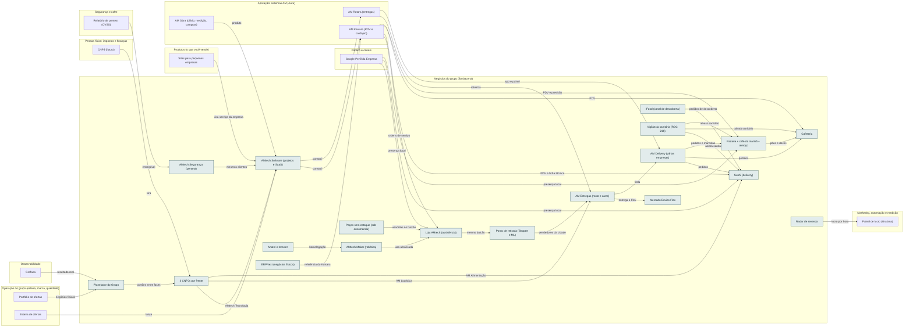

<!-- Arquivo GERADO por tools/gerar_docs.py a partir de data/. Edite os dados, não este arquivo. -->

# Camada 16 · Negócios do grupo (Barbacena)

[← Arquitetura](../arquitetura.md) · [Índice da documentação](../README.md)

> **Ligação com a camada de baixo:** Os nove negócios físicos e de serviço usam os sistemas AM, a frota de entregas e o mesmo caixa de medição.

**19 blocos** · 7 precisam de conta · 17 marcados como futuro

## Mapa de conexões

## Blocos

| Bloco | Tipo | O que faz | Quando entra |
|---|---|---|---|
| [AMtech Software (projetos e SaaS)](#nsoft) | Remoto · futuro | Software sob encomenda, sites, manutenção e SaaS AM. Primeiro CNPJ do grupo (ME no Simples, Anexo III pelo Fator R). Ver docs/negocios/01. | passo 56.2 · Fase A: 12 a 18 meses; B: mais 12 a 18; C: a partir do 3º ou 4º ano (começa quando: os 5 portões do planejador: negócio anterior se pagando há 3 meses, capital em caixa, alguém de confiança tocando, sistema AM rodando e a sua reserva intacta) |
| [Loja AMtech (assistência)](#nloja) | Físico · futuro | Loja de 30 a 50 m² com bancada técnica, mostruário e balcão de pacotes. Une assistência, peças e ponto de retirada em um aluguel só. | passo 56.3 · Fase A: 12 a 18 meses; B: mais 12 a 18; C: a partir do 3º ou 4º ano (começa quando: os 5 portões do planejador: negócio anterior se pagando há 3 meses, capital em caixa, alguém de confiança tocando, sistema AM rodando e a sua reserva intacta) |
| [Peças sem estoque (sob encomenda)](#npecas) | Físico · futuro | Peças e acessórios comprados só depois do sinal do cliente ou enviados pelo fornecedor. A margem está no serviço, não na peça. | passo 56.3 · Fase A: 12 a 18 meses; B: mais 12 a 18; C: a partir do 3º ou 4º ano (começa quando: os 5 portões do planejador: negócio anterior se pagando há 3 meses, capital em caixa, alguém de confiança tocando, sistema AM rodando e a sua reserva intacta) |
| [Ponto de retirada (Shopee e ML)](#nponto) | Físico · precisa de conta · futuro | Agência Shopee (R$ 0,70 a 0,60 por pacote nas primeiras faixas) e Agência Mercado Livre (valor na proposta). Rende pouco sozinho; o valor é o movimento na loja. | passo 56.3 · Fase A: 12 a 18 meses; B: mais 12 a 18; C: a partir do 3º ou 4º ano (começa quando: os 5 portões do planejador: negócio anterior se pagando há 3 meses, capital em caixa, alguém de confiança tocando, sistema AM rodando e a sua reserva intacta) |
| [AMtech Maker (robótica)](#nmaker) | Físico · futuro | Automação residencial, empresarial, rural e virtual, e kits de robótica educacional. Começa por serviço com aparelhos homologados; produto com rádio só depois da Anatel. | passo 56.3 · Fase A: 12 a 18 meses; B: mais 12 a 18; C: a partir do 3º ou 4º ano (começa quando: os 5 portões do planejador: negócio anterior se pagando há 3 meses, capital em caixa, alguém de confiança tocando, sistema AM rodando e a sua reserva intacta) |
| [AM Entregas (moto e carro)](#nentr) | Físico · futuro | Última milha em Barbacena: entregas para empresas, Flex dos vendedores locais, coleta para as agências e rotas fixas. Motofretistas pela Lei 12.009/2009. | passo 56.4 · Fase A: 12 a 18 meses; B: mais 12 a 18; C: a partir do 3º ou 4º ano (começa quando: os 5 portões do planejador: negócio anterior se pagando há 3 meses, capital em caixa, alguém de confiança tocando, sistema AM rodando e a sua reserva intacta) |
| [Mercado Envios Flex](#nflex) | Remoto · precisa de conta · futuro | Entrega no mesmo dia dos vendedores do Mercado Livre da cidade, terceirizada para a AM Entregas e cobrada por pacote. | passo 56.4 · Fase A: 12 a 18 meses; B: mais 12 a 18; C: a partir do 3º ou 4º ano (começa quando: os 5 portões do planejador: negócio anterior se pagando há 3 meses, capital em caixa, alguém de confiança tocando, sistema AM rodando e a sua reserva intacta) |
| [AM Delivery (várias empresas)](#ndeliv) | Remoto · futuro | App de pedidos de restaurantes e lojas da cidade com comissão de 8% e entrega pela AM Entregas. O lucro está na comissão, não na taxa de entrega. | passo 56.5 · Fase A: 12 a 18 meses; B: mais 12 a 18; C: a partir do 3º ou 4º ano (começa quando: os 5 portões do planejador: negócio anterior se pagando há 3 meses, capital em caixa, alguém de confiança tocando, sistema AM rodando e a sua reserva intacta) |
| [Sushi (delivery)](#nsushi) | Físico · futuro | Delivery e retirada de quarta a domingo à noite, cardápio em torno do salmão com destino para filé, aparas e pele. Primeiro restaurante do grupo. | passo 56.6 · Fase A: 12 a 18 meses; B: mais 12 a 18; C: a partir do 3º ou 4º ano (começa quando: os 5 portões do planejador: negócio anterior se pagando há 3 meses, capital em caixa, alguém de confiança tocando, sistema AM rodando e a sua reserva intacta) |
| [Cafeteria](#ncafe) | Físico · futuro | Cafés especiais de Minas, pão de queijo assado na hora e doces caseiros. Melhor dentro da padaria, onde o investimento cai para cerca de R$ 30 mil. | passo 56.8 · Fase A: 12 a 18 meses; B: mais 12 a 18; C: a partir do 3º ou 4º ano (começa quando: os 5 portões do planejador: negócio anterior se pagando há 3 meses, capital em caixa, alguém de confiança tocando, sistema AM rodando e a sua reserva intacta) |
| [Padaria + café da manhã + almoço](#npad) | Físico · futuro | Padaria de finalização com massa congelada, café da manhã mineiro, almoço por quilo, prato executivo do dia, marmitas e encomendas. Maior receita e maior capital do grupo. | passo 56.7 · Fase A: 12 a 18 meses; B: mais 12 a 18; C: a partir do 3º ou 4º ano (começa quando: os 5 portões do planejador: negócio anterior se pagando há 3 meses, capital em caixa, alguém de confiança tocando, sistema AM rodando e a sua reserva intacta) |
| [3 CNPJs por frente](#ncnpj) | Remoto · precisa de conta · futuro | AMtech Tecnologia, AM Logística e AM Alimentação, cada um com os seus CNAEs, conta e caixa. Holding só quando houver patrimônio. | passo 51.1 · Quando a renda pedir (começa quando: a renda passou do valor de virada definido com o contador) |
| [Planejador do Grupo](#nplan) | Remoto · futuro | Artefato e motor tools/negocios/financas.py: investimento, ponto de equilíbrio, rampa, retorno e capital mínimo de cada negócio, com o mesmo cálculo. | passo 56.1 · Fase A: 12 a 18 meses; B: mais 12 a 18; C: a partir do 3º ou 4º ano (começa quando: os 5 portões do planejador: negócio anterior se pagando há 3 meses, capital em caixa, alguém de confiança tocando, sistema AM rodando e a sua reserva intacta) |
| [iFood (canal de descoberta)](#nifood) | Remoto · precisa de conta · futuro | Usado para ser encontrado, não como canal principal: o plano Entrega cobra 23% + 3,2%. O canal próprio deixa o dobro de margem. | passo 56.6 · Fase A: 12 a 18 meses; B: mais 12 a 18; C: a partir do 3º ou 4º ano (começa quando: os 5 portões do planejador: negócio anterior se pagando há 3 meses, capital em caixa, alguém de confiança tocando, sistema AM rodando e a sua reserva intacta) |
| [Vigilância sanitária (RDC 216)](#nvisa) | Remoto · precisa de conta · futuro | Alvará sanitário, Manual de Boas Práticas, POPs, curso dos manipuladores e controle de pragas. Em MG, o nível de risco define se há inspeção antes de abrir. | passo 56.6 · Fase A: 12 a 18 meses; B: mais 12 a 18; C: a partir do 3º ou 4º ano (começa quando: os 5 portões do planejador: negócio anterior se pagando há 3 meses, capital em caixa, alguém de confiança tocando, sistema AM rodando e a sua reserva intacta) |
| [Anatel e Inmetro](#nanatel) | Remoto · precisa de conta · futuro | Homologação de produto próprio com Wi-Fi ou Bluetooth e, se o kit for brinquedo, certificação do Inmetro. | passo 56.3 · Fase A: 12 a 18 meses; B: mais 12 a 18; C: a partir do 3º ou 4º ano (começa quando: os 5 portões do planejador: negócio anterior se pagando há 3 meses, capital em caixa, alguém de confiança tocando, sistema AM rodando e a sua reserva intacta) |
| [Radar de revenda](#radar) | Local | Lê os alertas de busca salvos (OLX, Mercado Livre, Facebook, Estante Virtual) que chegam ao Gmail, compara com o preço de referência e avisa no Telegram só o que passa da hora mínima. Nunca compra nem fala com vendedor. | passo 11.5 · Semana 4 · nov/2026 |
| [AMtech Segurança (pentest)](#nseg) | Remoto · futuro | Testes de segurança para empresas: laudo dos sites primeiro, pentest completo depois da OSCP, com contrato revisado, seguro e reteste. | passo 58.19 · Dez/2026 em diante: 1 bloco de 1 h por semana dentro do estudo da manhã; serviços pagos só depois dos portões (eJPT, ensaio, OSCP) |
| [ERPNext (negócios físicos)](#erpnext) | Remoto · precisa de conta | ERP aberto para os negócios físicos até o Aura cobrir e referência de mercado ao desenhar o AM Kaixara. | passo 56.11 · Fase A: 12 a 18 meses; B: mais 12 a 18; C: a partir do 3º ou 4º ano (começa quando: os 5 portões do planejador: negócio anterior se pagando há 3 meses, capital em caixa, alguém de confiança tocando, sistema AM rodando e a sua reserva intacta) |

### AMtech Software (projetos e SaaS)

*Remoto · futuro*

Software sob encomenda, sites, manutenção e SaaS AM. Primeiro CNPJ do grupo (ME no Simples, Anexo III pelo Fator R). Ver docs/negocios/01.

**Quando entra:** passo 56.2 · Fase A: 12 a 18 meses; B: mais 12 a 18; C: a partir do 3º ou 4º ano (começa quando: os 5 portões do planejador: negócio anterior se pagando há 3 meses, capital em caixa, alguém de confiança tocando, sistema AM rodando e a sua reserva intacta) ([roteiro](../implantacao/roteiro.md))

| Direção | Bloco | Camada | O que passa |
|---|---|---|---|
| → envia para | [AM Kaixara (PDV e cardápio)](11-app.md#nkaix) | Aplicação: sistemas AM (Aura) | constrói |
| → envia para | [AM Rotara (entregas)](11-app.md#nrot) | Aplicação: sistemas AM (Aura) | constrói |
| ← recebe de | [Sites para pequenas empresas](17-prod.md#sites) | Produtos (o que você vende) | vira serviço da empresa |
| ← recebe de | [3 CNPJs por frente](16-neg.md#ncnpj) | Negócios do grupo (Barbacena) | AMtech Tecnologia |
| ← recebe de | [Esteira de ofertas](23-oper.md#oesteira) | Operação do grupo (esteira, marca, qualidade) | lança |
| ← recebe de | [AMtech Segurança (pentest)](16-neg.md#nseg) | Negócios do grupo (Barbacena) | mesmos clientes |
| ← recebe de | [AM Obra (diário, medição, compras)](11-app.md#nobra) | Aplicação: sistemas AM (Aura) | produto |

### Loja AMtech (assistência)

*Físico · futuro*

Loja de 30 a 50 m² com bancada técnica, mostruário e balcão de pacotes. Une assistência, peças e ponto de retirada em um aluguel só.

**Quando entra:** passo 56.3 · Fase A: 12 a 18 meses; B: mais 12 a 18; C: a partir do 3º ou 4º ano (começa quando: os 5 portões do planejador: negócio anterior se pagando há 3 meses, capital em caixa, alguém de confiança tocando, sistema AM rodando e a sua reserva intacta) ([roteiro](../implantacao/roteiro.md))

| Direção | Bloco | Camada | O que passa |
|---|---|---|---|
| → envia para | [Ponto de retirada (Shopee e ML)](16-neg.md#nponto) | Negócios do grupo (Barbacena) | mesmo balcão |
| ← recebe de | [Peças sem estoque (sob encomenda)](16-neg.md#npecas) | Negócios do grupo (Barbacena) | vendidas no balcão |
| ← recebe de | [AMtech Maker (robótica)](16-neg.md#nmaker) | Negócios do grupo (Barbacena) | usa a bancada |
| ← recebe de | [AM Kaixara (PDV e cardápio)](11-app.md#nkaix) | Aplicação: sistemas AM (Aura) | ordens de serviço |
| ← recebe de | [Google Perfil da Empresa](22-pub.md#ogbp) | Público e canais | presença local |

### Peças sem estoque (sob encomenda)

*Físico · futuro*

Peças e acessórios comprados só depois do sinal do cliente ou enviados pelo fornecedor. A margem está no serviço, não na peça.

**Quando entra:** passo 56.3 · Fase A: 12 a 18 meses; B: mais 12 a 18; C: a partir do 3º ou 4º ano (começa quando: os 5 portões do planejador: negócio anterior se pagando há 3 meses, capital em caixa, alguém de confiança tocando, sistema AM rodando e a sua reserva intacta) ([roteiro](../implantacao/roteiro.md))

| Direção | Bloco | Camada | O que passa |
|---|---|---|---|
| → envia para | [Loja AMtech (assistência)](16-neg.md#nloja) | Negócios do grupo (Barbacena) | vendidas no balcão |

### Ponto de retirada (Shopee e ML)

*Físico · precisa de conta · futuro*

Agência Shopee (R$ 0,70 a 0,60 por pacote nas primeiras faixas) e Agência Mercado Livre (valor na proposta). Rende pouco sozinho; o valor é o movimento na loja.

**Quando entra:** passo 56.3 · Fase A: 12 a 18 meses; B: mais 12 a 18; C: a partir do 3º ou 4º ano (começa quando: os 5 portões do planejador: negócio anterior se pagando há 3 meses, capital em caixa, alguém de confiança tocando, sistema AM rodando e a sua reserva intacta) ([roteiro](../implantacao/roteiro.md))

| Direção | Bloco | Camada | O que passa |
|---|---|---|---|
| → envia para | [AM Entregas (moto e carro)](16-neg.md#nentr) | Negócios do grupo (Barbacena) | vendedores da cidade |
| ← recebe de | [Loja AMtech (assistência)](16-neg.md#nloja) | Negócios do grupo (Barbacena) | mesmo balcão |

### AMtech Maker (robótica)

*Físico · futuro*

Automação residencial, empresarial, rural e virtual, e kits de robótica educacional. Começa por serviço com aparelhos homologados; produto com rádio só depois da Anatel.

**Quando entra:** passo 56.3 · Fase A: 12 a 18 meses; B: mais 12 a 18; C: a partir do 3º ou 4º ano (começa quando: os 5 portões do planejador: negócio anterior se pagando há 3 meses, capital em caixa, alguém de confiança tocando, sistema AM rodando e a sua reserva intacta) ([roteiro](../implantacao/roteiro.md))

| Direção | Bloco | Camada | O que passa |
|---|---|---|---|
| → envia para | [Loja AMtech (assistência)](16-neg.md#nloja) | Negócios do grupo (Barbacena) | usa a bancada |
| ← recebe de | [Anatel e Inmetro](16-neg.md#nanatel) | Negócios do grupo (Barbacena) | homologação |

### AM Entregas (moto e carro)

*Físico · futuro*

Última milha em Barbacena: entregas para empresas, Flex dos vendedores locais, coleta para as agências e rotas fixas. Motofretistas pela Lei 12.009/2009.

**Quando entra:** passo 56.4 · Fase A: 12 a 18 meses; B: mais 12 a 18; C: a partir do 3º ou 4º ano (começa quando: os 5 portões do planejador: negócio anterior se pagando há 3 meses, capital em caixa, alguém de confiança tocando, sistema AM rodando e a sua reserva intacta) ([roteiro](../implantacao/roteiro.md))

| Direção | Bloco | Camada | O que passa |
|---|---|---|---|
| → envia para | [Mercado Envios Flex](16-neg.md#nflex) | Negócios do grupo (Barbacena) | entrega o Flex |
| → envia para | [AM Delivery (várias empresas)](16-neg.md#ndeliv) | Negócios do grupo (Barbacena) | frota |
| ← recebe de | [Ponto de retirada (Shopee e ML)](16-neg.md#nponto) | Negócios do grupo (Barbacena) | vendedores da cidade |
| ← recebe de | [AM Rotara (entregas)](11-app.md#nrot) | Aplicação: sistemas AM (Aura) | roteiriza |
| ← recebe de | [3 CNPJs por frente](16-neg.md#ncnpj) | Negócios do grupo (Barbacena) | AM Logística |

### Mercado Envios Flex

*Remoto · precisa de conta · futuro*

Entrega no mesmo dia dos vendedores do Mercado Livre da cidade, terceirizada para a AM Entregas e cobrada por pacote.

**Quando entra:** passo 56.4 · Fase A: 12 a 18 meses; B: mais 12 a 18; C: a partir do 3º ou 4º ano (começa quando: os 5 portões do planejador: negócio anterior se pagando há 3 meses, capital em caixa, alguém de confiança tocando, sistema AM rodando e a sua reserva intacta) ([roteiro](../implantacao/roteiro.md))

| Direção | Bloco | Camada | O que passa |
|---|---|---|---|
| ← recebe de | [AM Entregas (moto e carro)](16-neg.md#nentr) | Negócios do grupo (Barbacena) | entrega o Flex |

### AM Delivery (várias empresas)

*Remoto · futuro*

App de pedidos de restaurantes e lojas da cidade com comissão de 8% e entrega pela AM Entregas. O lucro está na comissão, não na taxa de entrega.

**Quando entra:** passo 56.5 · Fase A: 12 a 18 meses; B: mais 12 a 18; C: a partir do 3º ou 4º ano (começa quando: os 5 portões do planejador: negócio anterior se pagando há 3 meses, capital em caixa, alguém de confiança tocando, sistema AM rodando e a sua reserva intacta) ([roteiro](../implantacao/roteiro.md))

| Direção | Bloco | Camada | O que passa |
|---|---|---|---|
| → envia para | [Sushi (delivery)](16-neg.md#nsushi) | Negócios do grupo (Barbacena) | pedidos |
| → envia para | [Cafeteria](16-neg.md#ncafe) | Negócios do grupo (Barbacena) | pedidos |
| → envia para | [Padaria + café da manhã + almoço](16-neg.md#npad) | Negócios do grupo (Barbacena) | pedidos e marmitas |
| ← recebe de | [AM Entregas (moto e carro)](16-neg.md#nentr) | Negócios do grupo (Barbacena) | frota |
| ← recebe de | [AM Rotara (entregas)](11-app.md#nrot) | Aplicação: sistemas AM (Aura) | app e painel |

### Sushi (delivery)

*Físico · futuro*

Delivery e retirada de quarta a domingo à noite, cardápio em torno do salmão com destino para filé, aparas e pele. Primeiro restaurante do grupo.

**Quando entra:** passo 56.6 · Fase A: 12 a 18 meses; B: mais 12 a 18; C: a partir do 3º ou 4º ano (começa quando: os 5 portões do planejador: negócio anterior se pagando há 3 meses, capital em caixa, alguém de confiança tocando, sistema AM rodando e a sua reserva intacta) ([roteiro](../implantacao/roteiro.md))

| Direção | Bloco | Camada | O que passa |
|---|---|---|---|
| ← recebe de | [AM Delivery (várias empresas)](16-neg.md#ndeliv) | Negócios do grupo (Barbacena) | pedidos |
| ← recebe de | [iFood (canal de descoberta)](16-neg.md#nifood) | Negócios do grupo (Barbacena) | pedidos de descoberta |
| ← recebe de | [AM Kaixara (PDV e cardápio)](11-app.md#nkaix) | Aplicação: sistemas AM (Aura) | PDV e ficha técnica |
| ← recebe de | [Vigilância sanitária (RDC 216)](16-neg.md#nvisa) | Negócios do grupo (Barbacena) | alvará sanitário |
| ← recebe de | [3 CNPJs por frente](16-neg.md#ncnpj) | Negócios do grupo (Barbacena) | AM Alimentação |
| ← recebe de | [Google Perfil da Empresa](22-pub.md#ogbp) | Público e canais | presença local |

### Cafeteria

*Físico · futuro*

Cafés especiais de Minas, pão de queijo assado na hora e doces caseiros. Melhor dentro da padaria, onde o investimento cai para cerca de R$ 30 mil.

**Quando entra:** passo 56.8 · Fase A: 12 a 18 meses; B: mais 12 a 18; C: a partir do 3º ou 4º ano (começa quando: os 5 portões do planejador: negócio anterior se pagando há 3 meses, capital em caixa, alguém de confiança tocando, sistema AM rodando e a sua reserva intacta) ([roteiro](../implantacao/roteiro.md))

| Direção | Bloco | Camada | O que passa |
|---|---|---|---|
| ← recebe de | [AM Delivery (várias empresas)](16-neg.md#ndeliv) | Negócios do grupo (Barbacena) | pedidos |
| ← recebe de | [Padaria + café da manhã + almoço](16-neg.md#npad) | Negócios do grupo (Barbacena) | pães e doces |
| ← recebe de | [AM Kaixara (PDV e cardápio)](11-app.md#nkaix) | Aplicação: sistemas AM (Aura) | PDV |
| ← recebe de | [Vigilância sanitária (RDC 216)](16-neg.md#nvisa) | Negócios do grupo (Barbacena) | alvará sanitário |

### Padaria + café da manhã + almoço

*Físico · futuro*

Padaria de finalização com massa congelada, café da manhã mineiro, almoço por quilo, prato executivo do dia, marmitas e encomendas. Maior receita e maior capital do grupo.

**Quando entra:** passo 56.7 · Fase A: 12 a 18 meses; B: mais 12 a 18; C: a partir do 3º ou 4º ano (começa quando: os 5 portões do planejador: negócio anterior se pagando há 3 meses, capital em caixa, alguém de confiança tocando, sistema AM rodando e a sua reserva intacta) ([roteiro](../implantacao/roteiro.md))

| Direção | Bloco | Camada | O que passa |
|---|---|---|---|
| → envia para | [Cafeteria](16-neg.md#ncafe) | Negócios do grupo (Barbacena) | pães e doces |
| ← recebe de | [AM Delivery (várias empresas)](16-neg.md#ndeliv) | Negócios do grupo (Barbacena) | pedidos e marmitas |
| ← recebe de | [AM Kaixara (PDV e cardápio)](11-app.md#nkaix) | Aplicação: sistemas AM (Aura) | PDV e previsão |
| ← recebe de | [Vigilância sanitária (RDC 216)](16-neg.md#nvisa) | Negócios do grupo (Barbacena) | alvará sanitário |
| ← recebe de | [Google Perfil da Empresa](22-pub.md#ogbp) | Público e canais | presença local |

### 3 CNPJs por frente

*Remoto · precisa de conta · futuro*

AMtech Tecnologia, AM Logística e AM Alimentação, cada um com os seus CNAEs, conta e caixa. Holding só quando houver patrimônio.

**Quando entra:** passo 51.1 · Quando a renda pedir (começa quando: a renda passou do valor de virada definido com o contador) ([roteiro](../implantacao/roteiro.md))

| Direção | Bloco | Camada | O que passa |
|---|---|---|---|
| → envia para | [AMtech Software (projetos e SaaS)](16-neg.md#nsoft) | Negócios do grupo (Barbacena) | AMtech Tecnologia |
| → envia para | [AM Entregas (moto e carro)](16-neg.md#nentr) | Negócios do grupo (Barbacena) | AM Logística |
| → envia para | [Sushi (delivery)](16-neg.md#nsushi) | Negócios do grupo (Barbacena) | AM Alimentação |
| ← recebe de | [CNPJ (futuro)](19-emp.md#cnpj) | Pessoa física: impostos e finanças | vira |
| ← recebe de | [Planejador do Grupo](16-neg.md#nplan) | Negócios do grupo (Barbacena) | portões entre fases |

### Planejador do Grupo

*Remoto · futuro*

Artefato e motor tools/negocios/financas.py: investimento, ponto de equilíbrio, rampa, retorno e capital mínimo de cada negócio, com o mesmo cálculo.

**Quando entra:** passo 56.1 · Fase A: 12 a 18 meses; B: mais 12 a 18; C: a partir do 3º ou 4º ano (começa quando: os 5 portões do planejador: negócio anterior se pagando há 3 meses, capital em caixa, alguém de confiança tocando, sistema AM rodando e a sua reserva intacta) ([roteiro](../implantacao/roteiro.md))

| Direção | Bloco | Camada | O que passa |
|---|---|---|---|
| → envia para | [3 CNPJs por frente](16-neg.md#ncnpj) | Negócios do grupo (Barbacena) | portões entre fases |
| ← recebe de | [Portfólio de ofertas](23-oper.md#ocatal) | Operação do grupo (esteira, marca, qualidade) | negócios físicos |
| ← recebe de | [Grafana](10-obs.md#graf) | Observabilidade | resultado real |

### iFood (canal de descoberta)

*Remoto · precisa de conta · futuro*

Usado para ser encontrado, não como canal principal: o plano Entrega cobra 23% + 3,2%. O canal próprio deixa o dobro de margem.

**Quando entra:** passo 56.6 · Fase A: 12 a 18 meses; B: mais 12 a 18; C: a partir do 3º ou 4º ano (começa quando: os 5 portões do planejador: negócio anterior se pagando há 3 meses, capital em caixa, alguém de confiança tocando, sistema AM rodando e a sua reserva intacta) ([roteiro](../implantacao/roteiro.md))

| Direção | Bloco | Camada | O que passa |
|---|---|---|---|
| → envia para | [Sushi (delivery)](16-neg.md#nsushi) | Negócios do grupo (Barbacena) | pedidos de descoberta |

### Vigilância sanitária (RDC 216)

*Remoto · precisa de conta · futuro*

Alvará sanitário, Manual de Boas Práticas, POPs, curso dos manipuladores e controle de pragas. Em MG, o nível de risco define se há inspeção antes de abrir.

**Quando entra:** passo 56.6 · Fase A: 12 a 18 meses; B: mais 12 a 18; C: a partir do 3º ou 4º ano (começa quando: os 5 portões do planejador: negócio anterior se pagando há 3 meses, capital em caixa, alguém de confiança tocando, sistema AM rodando e a sua reserva intacta) ([roteiro](../implantacao/roteiro.md))

| Direção | Bloco | Camada | O que passa |
|---|---|---|---|
| → envia para | [Sushi (delivery)](16-neg.md#nsushi) | Negócios do grupo (Barbacena) | alvará sanitário |
| → envia para | [Cafeteria](16-neg.md#ncafe) | Negócios do grupo (Barbacena) | alvará sanitário |
| → envia para | [Padaria + café da manhã + almoço](16-neg.md#npad) | Negócios do grupo (Barbacena) | alvará sanitário |

### Anatel e Inmetro

*Remoto · precisa de conta · futuro*

Homologação de produto próprio com Wi-Fi ou Bluetooth e, se o kit for brinquedo, certificação do Inmetro.

**Quando entra:** passo 56.3 · Fase A: 12 a 18 meses; B: mais 12 a 18; C: a partir do 3º ou 4º ano (começa quando: os 5 portões do planejador: negócio anterior se pagando há 3 meses, capital em caixa, alguém de confiança tocando, sistema AM rodando e a sua reserva intacta) ([roteiro](../implantacao/roteiro.md))

| Direção | Bloco | Camada | O que passa |
|---|---|---|---|
| → envia para | [AMtech Maker (robótica)](16-neg.md#nmaker) | Negócios do grupo (Barbacena) | homologação |

### Radar de revenda

*Local*

Lê os alertas de busca salvos (OLX, Mercado Livre, Facebook, Estante Virtual) que chegam ao Gmail, compara com o preço de referência e avisa no Telegram só o que passa da hora mínima. Nunca compra nem fala com vendedor.

**Quando entra:** passo 11.5 · Semana 4 · nov/2026 ([roteiro](../implantacao/roteiro.md))

| Direção | Bloco | Camada | O que passa |
|---|---|---|---|
| → envia para | [Painel de lucro (Grafana)](21-mkt.md#painel) | Marketing, automação e medição | lucro por hora |

### AMtech Segurança (pentest)

*Remoto · futuro*

Testes de segurança para empresas: laudo dos sites primeiro, pentest completo depois da OSCP, com contrato revisado, seguro e reteste.

**Quando entra:** passo 58.19 · Dez/2026 em diante: 1 bloco de 1 h por semana dentro do estudo da manhã; serviços pagos só depois dos portões (eJPT, ensaio, OSCP) ([roteiro](../implantacao/roteiro.md))

| Direção | Bloco | Camada | O que passa |
|---|---|---|---|
| → envia para | [AMtech Software (projetos e SaaS)](16-neg.md#nsoft) | Negócios do grupo (Barbacena) | mesmos clientes |
| ← recebe de | [Relatório de pentest (CVSS)](02-seg.md#relpent) | Segurança e cofre | entregável |

### ERPNext (negócios físicos)

*Remoto · precisa de conta*

ERP aberto para os negócios físicos até o Aura cobrir e referência de mercado ao desenhar o AM Kaixara.

**Quando entra:** passo 56.11 · Fase A: 12 a 18 meses; B: mais 12 a 18; C: a partir do 3º ou 4º ano (começa quando: os 5 portões do planejador: negócio anterior se pagando há 3 meses, capital em caixa, alguém de confiança tocando, sistema AM rodando e a sua reserva intacta) ([roteiro](../implantacao/roteiro.md))

| Direção | Bloco | Camada | O que passa |
|---|---|---|---|
| → envia para | [AM Kaixara (PDV e cardápio)](11-app.md#nkaix) | Aplicação: sistemas AM (Aura) | referência do Kaixara |

---

[↑ Camada 17 · Produtos (o que você vende)](17-prod.md) · [↓ Camada 15 · Editora AMS Silva (produção de livros)](15-editora.md)
