<!-- Arquivo GERADO por tools/gerar_docs.py a partir de data/. Edite os dados, não este arquivo. -->

# Camada 17 · Produtos (o que você vende)

[← Arquitetura](../arquitetura.md) · [Índice da documentação](../README.md)

> **Ligação com a camada de baixo:** Cada produto nasce do conteúdo gravado, escrito ou programado.

**7 blocos** · 0 precisam de conta · 2 marcados como futuro

## Mapa de conexões

```mermaid
flowchart LR
  subgraph L_prod["Produtos (o que você vende)"]
    n_curso["Mini-curso Lógica de Programação"]
    n_form["Formações (TI, Matemática, Finanças)"]
    n_tmpl["Templates e código-fonte"]
    n_livro["Livro Lógica e Máquina"]
    n_aulas["Aulas particulares"]
    n_sites["Sites para pequenas empresas"]
    n_saas["Sistemas AM (SaaS)"]
  end
  subgraph L_oper["Operação do grupo (esteira, marca, qualidade)"]
    n_oesteira["Esteira de ofertas"]
    n_oorc["Agente orçamentista"]
  end
  subgraph L_pub["Público e canais"]
    n_comu["Comunidade (Discord ou grupo)"]
    n_wa["WhatsApp Business"]
  end
  subgraph L_mkt["Marketing, automação e medição"]
    n_isca["Isca grátis + sequência de e-mails"]
  end
  subgraph L_venda["Plataformas de venda e recebimento"]
    n_agenda["Agenda online (Cal.com)"]
    n_crm["CRM simples (planilha)"]
    n_dio["DIO (parceria)"]
    n_eduzz["Eduzz"]
    n_hotm["Hotmart"]
    n_kiwi["Kiwify"]
    n_mp["Mercado Pago"]
    n_udemy["Udemy"]
  end
  subgraph L_emp["Pessoa física: impostos e finanças"]
    n_legal["Termos, privacidade (LGPD) e contratos"]
  end
  subgraph L_web["Vitrine web (sites e domínio)"]
    n_hostg["Hostinger (clientes WP)"]
  end
  subgraph L_neg["Negócios do grupo (Barbacena)"]
    n_nsoft["AMtech Software (projetos e SaaS)"]
  end
  subgraph L_editora["Editora AMS Silva (produção de livros)"]
    n_bci["Pipeline do livro (CI)"]
    n_bkit["Kit edição especial"]
    n_deplegal["Depósito legal"]
    n_errata["Errata e edições"]
    n_kdp["Amazon KDP"]
    n_pod["Gráfica sob demanda (Brasil)"]
    n_prof["Edição do professor"]
    n_trad["Traduções (espanhol, inglês)"]
  end
  subgraph L_cont["Produção de conteúdo"]
    n_edit["DaVinci Resolve ou Kdenlive"]
  end
  subgraph L_nuvem["Nuvem, código e entrega"]
    n_azure["Azure"]
    n_gh["GitHub"]
  end
  subgraph L_app["Aplicação: sistemas AM (Aura)"]
    n_lic["aura-licensing"]
    n_nkaix["AM Kaixara (PDV e cardápio)"]
    n_story["Storybook"]
  end
  subgraph L_clc["Claude: recursos, conectores e plugins"]
    n_cupw["Conector Upwork"]
  end
  subgraph L_chat["Assistentes de IA (chat, pesquisa e estudo)"]
    n_nblm["NotebookLM"]
  end
  subgraph L_win["Windows 11, apps e máquinas virtuais"]
    n_obsd["Obsidian + Git"]
    n_office["LibreOffice"]
    n_pdf["SumatraPDF"]
    n_sharex["ShareX"]
    n_zip["7-Zip"]
  end
  n_curso -->|"produto"| n_kiwi
  n_curso -->|"versão para o marketplace"| n_udemy
  n_curso -->|"produto"| n_eduzz
  n_curso -->|"produto cadastrado"| n_hotm
  n_nblm -->|"prepara as aulas"| n_curso
  n_sharex -->|"demonstrações"| n_curso
  n_comu -->|"suporte aos alunos"| n_curso
  n_edit -->|"aulas editadas"| n_curso
  n_obsd -->|"roteiro"| n_curso
  n_oesteira -->|"lança"| n_curso
  n_form -->|"proposta de parceria"| n_dio
  n_form -->|"produto"| n_hotm
  n_tmpl -->|"download"| n_hotm
  n_tmpl -->|"demo pública"| n_gh
  n_zip -->|"empacota o download"| n_tmpl
  n_story -->|"demo do template"| n_tmpl
  n_livro -->|"PDF"| n_hotm
  n_livro -->|"1 exemplar"| n_deplegal
  n_livro -->|"ebook e impresso"| n_kdp
  n_livro -->|"impresso"| n_pod
  n_livro -->|"tiragem especial"| n_bkit
  n_livro -->|"material do professor"| n_prof
  n_livro -->|"outras línguas"| n_trad
  n_livro -->|"capítulo grátis"| n_isca
  n_pdf -->|"revisão do PDF"| n_livro
  n_bci -->|"PDF, EPUB e impressão"| n_livro
  n_oesteira -->|"lança"| n_livro
  n_errata -->|"nova edição"| n_livro
  n_aulas -->|"cobrança"| n_mp
  n_agenda -->|"horários"| n_aulas
  n_wa -->|"agenda"| n_aulas
  n_sites -->|"cobrança"| n_mp
  n_sites -->|"hospedagem do cliente"| n_hostg
  n_sites -->|"vira serviço da empresa"| n_nsoft
  n_office -->|"documentos de clientes"| n_sites
  n_crm -->|"propostas"| n_sites
  n_legal -->|"contrato"| n_sites
  n_cupw -->|"encontra clientes"| n_sites
  n_oorc -->|"propostas"| n_sites
  n_wa -->|"pedido de orçamento"| n_sites
  n_saas -->|"roda na nuvem"| n_azure
  n_saas -->|"cobrança por módulo"| n_lic
  n_saas -->|"vende por assinatura"| n_nkaix
  classDef desta fill:#e2ecec,stroke:#0e3a45,color:#13262b
  class n_curso,n_form,n_tmpl,n_livro,n_aulas,n_sites,n_saas desta
```

## Blocos

| Bloco | Tipo | O que faz | Quando entra |
|---|---|---|---|
| [Mini-curso Lógica de Programação](#curso) | Local | Primeiro produto de lançamento, para validar antes de construir mais. | passo 14.5 · Semanas 8 a 10 · dez/2026 a jan/2027; passo 17.1 · Semanas 12 a 15 · jan a fev/2027 |
| [Formações (TI, Matemática, Finanças)](#form) | Local · futuro | Cursos completos, depois que o mini-curso vender. | passo 23.10 · A partir de fev/2027 (começa quando: o mini-curso vendeu sem anúncio (por exemplo, 10 vendas) e o painel de lucro está no ar) |
| [Templates e código-fonte](#tmpl) | Local | Frontends prontos e projetos vendidos como download. | passo 18.7 · Junto dos Passos 4 a 6 da trilha de estudo (≈ mar a jun/2027): o modelo nasce no Passo 4 (API e login) e ganha testes e qualidade no Passo 6 |
| [Livro Lógica e Máquina](#livro) | Local | Lógica e Máquina, em 5 volumes, publicado pela Editora AMS Silva. Ebook, impresso, kit, curso e site saem da mesma fonte. | passo 20.2 · Quando o capítulo 1 estiver pronto (começa quando: o capítulo 1 e o seu modelo de criação prontos) |
| [Aulas particulares](#aulas) | Físico | Seus estudos viram aula paga. | passo 14.8 · Semanas 8 a 10 · dez/2026 a jan/2027 |
| [Sites para pequenas empresas](#sites) | Local | Freelance em Barbacena: sites e lojas. | passo 13.13 · Semanas 6 e 7 · dez/2026; passo 22.9 · Fev a dez/2027, uma oferta por vez (começa quando: a primeira venda do mini-curso aconteceu); passo 22.10 · Fev a dez/2027, uma oferta por vez (começa quando: a primeira venda do mini-curso aconteceu) |
| [Sistemas AM (SaaS)](#saas) | Remoto · futuro | AM Kaixara, AM Rendara e os demais, vendidos por assinatura. | passo 26.1 · 2027 (começa quando: o primeiro sistema AM pronto e testado com um cliente) |

### Mini-curso Lógica de Programação

*Local*

Primeiro produto de lançamento, para validar antes de construir mais.

**Quando entra:** passo 14.5 · Semanas 8 a 10 · dez/2026 a jan/2027; passo 17.1 · Semanas 12 a 15 · jan a fev/2027 ([roteiro](../implantacao/roteiro.md))

| Direção | Bloco | Camada | O que passa |
|---|---|---|---|
| → envia para | [Kiwify](20-venda.md#kiwi) | Plataformas de venda e recebimento | produto |
| → envia para | [Udemy](20-venda.md#udemy) | Plataformas de venda e recebimento | versão para o marketplace |
| → envia para | [Eduzz](20-venda.md#eduzz) | Plataformas de venda e recebimento | produto |
| → envia para | [Hotmart](20-venda.md#hotm) | Plataformas de venda e recebimento | produto cadastrado |
| ← recebe de | [NotebookLM](07-chat.md#nblm) | Assistentes de IA (chat, pesquisa e estudo) | prepara as aulas |
| ← recebe de | [ShareX](03-win.md#sharex) | Windows 11, apps e máquinas virtuais | demonstrações |
| ← recebe de | [Comunidade (Discord ou grupo)](22-pub.md#comu) | Público e canais | suporte aos alunos |
| ← recebe de | [DaVinci Resolve ou Kdenlive](13-cont.md#edit) | Produção de conteúdo | aulas editadas |
| ← recebe de | [Obsidian + Git](03-win.md#obsd) | Windows 11, apps e máquinas virtuais | roteiro |
| ← recebe de | [Esteira de ofertas](23-oper.md#oesteira) | Operação do grupo (esteira, marca, qualidade) | lança |

### Formações (TI, Matemática, Finanças)

*Local · futuro*

Cursos completos, depois que o mini-curso vender.

**Quando entra:** passo 23.10 · A partir de fev/2027 (começa quando: o mini-curso vendeu sem anúncio (por exemplo, 10 vendas) e o painel de lucro está no ar) ([roteiro](../implantacao/roteiro.md))

| Direção | Bloco | Camada | O que passa |
|---|---|---|---|
| → envia para | [DIO (parceria)](20-venda.md#dio) | Plataformas de venda e recebimento | proposta de parceria |
| → envia para | [Hotmart](20-venda.md#hotm) | Plataformas de venda e recebimento | produto |

### Templates e código-fonte

*Local*

Frontends prontos e projetos vendidos como download.

**Quando entra:** passo 18.7 · Junto dos Passos 4 a 6 da trilha de estudo (≈ mar a jun/2027): o modelo nasce no Passo 4 (API e login) e ganha testes e qualidade no Passo 6 ([roteiro](../implantacao/roteiro.md))

| Direção | Bloco | Camada | O que passa |
|---|---|---|---|
| → envia para | [Hotmart](20-venda.md#hotm) | Plataformas de venda e recebimento | download |
| → envia para | [GitHub](12-nuvem.md#gh) | Nuvem, código e entrega | demo pública |
| ← recebe de | [7-Zip](03-win.md#zip) | Windows 11, apps e máquinas virtuais | empacota o download |
| ← recebe de | [Storybook](11-app.md#story) | Aplicação: sistemas AM (Aura) | demo do template |

### Livro Lógica e Máquina

*Local*

Lógica e Máquina, em 5 volumes, publicado pela Editora AMS Silva. Ebook, impresso, kit, curso e site saem da mesma fonte.

**Quando entra:** passo 20.2 · Quando o capítulo 1 estiver pronto (começa quando: o capítulo 1 e o seu modelo de criação prontos) ([roteiro](../implantacao/roteiro.md))

| Direção | Bloco | Camada | O que passa |
|---|---|---|---|
| → envia para | [Hotmart](20-venda.md#hotm) | Plataformas de venda e recebimento | PDF |
| → envia para | [Depósito legal](15-editora.md#deplegal) | Editora AMS Silva (produção de livros) | 1 exemplar |
| → envia para | [Amazon KDP](15-editora.md#kdp) | Editora AMS Silva (produção de livros) | ebook e impresso |
| → envia para | [Gráfica sob demanda (Brasil)](15-editora.md#pod) | Editora AMS Silva (produção de livros) | impresso |
| → envia para | [Kit edição especial](15-editora.md#bkit) | Editora AMS Silva (produção de livros) | tiragem especial |
| → envia para | [Edição do professor](15-editora.md#prof) | Editora AMS Silva (produção de livros) | material do professor |
| → envia para | [Traduções (espanhol, inglês)](15-editora.md#trad) | Editora AMS Silva (produção de livros) | outras línguas |
| → envia para | [Isca grátis + sequência de e-mails](21-mkt.md#isca) | Marketing, automação e medição | capítulo grátis |
| ← recebe de | [SumatraPDF](03-win.md#pdf) | Windows 11, apps e máquinas virtuais | revisão do PDF |
| ← recebe de | [Pipeline do livro (CI)](15-editora.md#bci) | Editora AMS Silva (produção de livros) | PDF, EPUB e impressão |
| ← recebe de | [Esteira de ofertas](23-oper.md#oesteira) | Operação do grupo (esteira, marca, qualidade) | lança |
| ← recebe de | [Errata e edições](15-editora.md#errata) | Editora AMS Silva (produção de livros) | nova edição |

### Aulas particulares

*Físico*

Seus estudos viram aula paga.

**Quando entra:** passo 14.8 · Semanas 8 a 10 · dez/2026 a jan/2027 ([roteiro](../implantacao/roteiro.md))

| Direção | Bloco | Camada | O que passa |
|---|---|---|---|
| → envia para | [Mercado Pago](20-venda.md#mp) | Plataformas de venda e recebimento | cobrança |
| ← recebe de | [Agenda online (Cal.com)](20-venda.md#agenda) | Plataformas de venda e recebimento | horários |
| ← recebe de | [WhatsApp Business](22-pub.md#wa) | Público e canais | agenda |

### Sites para pequenas empresas

*Local*

Freelance em Barbacena: sites e lojas.

**Quando entra:** passo 13.13 · Semanas 6 e 7 · dez/2026; passo 22.9 · Fev a dez/2027, uma oferta por vez (começa quando: a primeira venda do mini-curso aconteceu); passo 22.10 · Fev a dez/2027, uma oferta por vez (começa quando: a primeira venda do mini-curso aconteceu) ([roteiro](../implantacao/roteiro.md))

| Direção | Bloco | Camada | O que passa |
|---|---|---|---|
| → envia para | [Mercado Pago](20-venda.md#mp) | Plataformas de venda e recebimento | cobrança |
| → envia para | [Hostinger (clientes WP)](18-web.md#hostg) | Vitrine web (sites e domínio) | hospedagem do cliente |
| → envia para | [AMtech Software (projetos e SaaS)](16-neg.md#nsoft) | Negócios do grupo (Barbacena) | vira serviço da empresa |
| ← recebe de | [LibreOffice](03-win.md#office) | Windows 11, apps e máquinas virtuais | documentos de clientes |
| ← recebe de | [CRM simples (planilha)](20-venda.md#crm) | Plataformas de venda e recebimento | propostas |
| ← recebe de | [Termos, privacidade (LGPD) e contratos](19-emp.md#legal) | Pessoa física: impostos e finanças | contrato |
| ← recebe de | [Conector Upwork](08-clc.md#cupw) | Claude: recursos, conectores e plugins | encontra clientes |
| ← recebe de | [Agente orçamentista](23-oper.md#oorc) | Operação do grupo (esteira, marca, qualidade) | propostas |
| ← recebe de | [WhatsApp Business](22-pub.md#wa) | Público e canais | pedido de orçamento |

### Sistemas AM (SaaS)

*Remoto · futuro*

AM Kaixara, AM Rendara e os demais, vendidos por assinatura.

**Quando entra:** passo 26.1 · 2027 (começa quando: o primeiro sistema AM pronto e testado com um cliente) ([roteiro](../implantacao/roteiro.md))

| Direção | Bloco | Camada | O que passa |
|---|---|---|---|
| → envia para | [Azure](12-nuvem.md#azure) | Nuvem, código e entrega | roda na nuvem |
| → envia para | [aura-licensing](11-app.md#lic) | Aplicação: sistemas AM (Aura) | cobrança por módulo |
| → envia para | [AM Kaixara (PDV e cardápio)](11-app.md#nkaix) | Aplicação: sistemas AM (Aura) | vende por assinatura |

---

[↑ Camada 18 · Vitrine web (sites e domínio)](18-web.md) · [↓ Camada 16 · Negócios do grupo (Barbacena)](16-neg.md)
