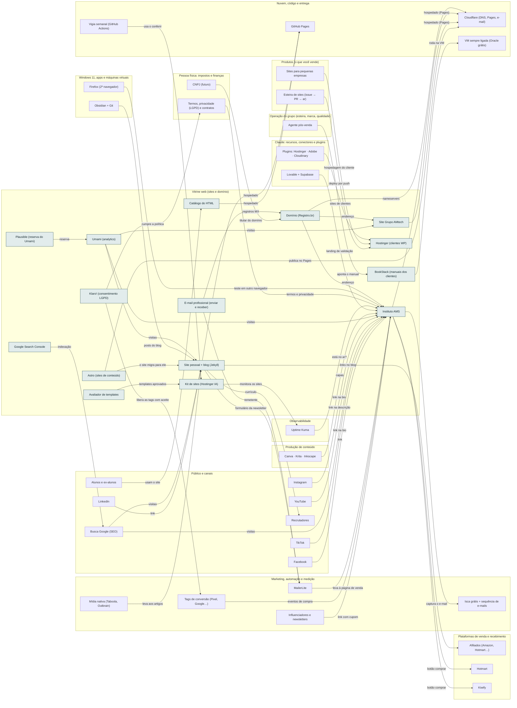

<!-- Arquivo GERADO por tools/gerar_docs.py a partir de data/. Edite os dados, não este arquivo. -->

# Camada 18 · Vitrine web (sites e domínio)

[← Arquitetura](../arquitetura.md) · [Índice da documentação](../README.md)

> **Ligação com a camada de baixo:** Os sites mostram e vendem os produtos e o seu portfólio.

**15 blocos** · 7 precisam de conta · 0 marcados como futuro

## Mapa de conexões

## Blocos

| Bloco | Tipo | O que faz | Quando entra |
|---|---|---|---|
| [E-mail profissional (enviar e receber)](#mail) | Remoto · precisa de conta | contato@seu-dominio. O roteamento da Cloudflare só recebe; para enviar, é preciso um provedor de e-mail. | passo 36.4 · Semanas 6 e 7 · dez/2026 |
| [Domínio (Registro.br)](#dom) | Remoto · precisa de conta | Seu domínio .com.br, registrado no seu CPF. Os nameservers apontam para a Cloudflare. | passo 36.3 · Semanas 6 e 7 · dez/2026 |
| [Site pessoal + blog (Jekyll)](#site) | Remoto | alanmateus17.github.io: portfólio, blog e newsletter. Migra do Jekyll para o Astro (ADR 0008). | passo 24.3 · Nov/2026 a out/2027, revisão no fim de cada trimestre; passo 24.6 · Nov/2026 a out/2027, revisão no fim de cada trimestre; passo 36.7 · Semanas 6 e 7 · dez/2026; passo 46.1 · Fev a dez/2027, uma oferta por vez (começa quando: a primeira venda do mini-curso aconteceu) |
| [Instituto AMS](#inst) | Remoto | Site dos cursos: páginas de venda que levam ao checkout. | passo 36.8 · Semanas 6 e 7 · dez/2026; passo 40.1 · Semanas 12 a 15 · jan a fev/2027; passo 40.7 · Semanas 12 a 15 · jan a fev/2027 |
| [Site Grupo AMtech](#amsite) | Remoto | Site institucional da empresa: serviços, sistemas AM e contato. | passo 23.7 · Nov/2026 a jan/2027 (no CPF); o CNPJ quando a renda de software passar do ponto de virada; passo 36.9 · Semanas 6 e 7 · dez/2026 |
| [Catálogo do HTML](#catal) | Remoto | Site didático para os alunos publicarem os próprios sites. | passo 36.9 · Semanas 6 e 7 · dez/2026; passo 46.2 · Fev a dez/2027, uma oferta por vez (começa quando: a primeira venda do mini-curso aconteceu) |
| [Umami (analytics)](#umami) | Remoto · precisa de conta | Principal do analytics sem cookie (o Plausible é a reserva). Open source. | passo 36.11 · Semanas 6 e 7 · dez/2026 |
| [Google Search Console](#gsc) | Remoto · precisa de conta | Mostra como o Google indexa os sites e quais buscas trazem visitas. | passo 36.12 · Semanas 6 e 7 · dez/2026 |
| [Hostinger (clientes WP)](#hostg) | Remoto · precisa de conta | Hospedagem que você já tem. Deploy por push no GitHub (inclusive Node.js) e MCP oficial com 146 ferramentas para IAs: publicar, ligar domínio e manter WordPress pela conversa. Créditos de IA (construtor, Agent, Reach) são pagos à parte. | passo 23.5 · Nov/2026 a jan/2027 (no CPF); o CNPJ quando a renda de software passar do ponto de virada; passo 28.2 · Semana 6 · nov/2026 a dez/2026; passo 28.4 · Semana 6 · nov/2026 a dez/2026; passo 36.13 · Semanas 6 e 7 · dez/2026; passo 46.10 · Fev a dez/2027, uma oferta por vez (começa quando: a primeira venda do mini-curso aconteceu) |
| [Kit de sites (Hostinger IA)](#kitsites) | Local | Pacotes, ficha do cliente, 26 prompts por tipo de negócio, conferência automática, checklist e relatório mensal. | passo 13.1 · Semanas 4 e 5 · nov/2026; passo 13.2 · Semanas 4 e 5 · nov/2026; passo 13.3 · Semanas 4 e 5 · nov/2026; passo 13.4 · Semanas 4 e 5 · nov/2026; passo 23.3 · Nov/2026 a jan/2027 (no CPF); o CNPJ quando a renda de software passar do ponto de virada |
| [Avaliador de templates](#avaliador) | Local | Lê uma pasta de templates e diz qual é útil, qual adaptar e qual descartar, sem rodar código de terceiros. | passo 13.5 · Semanas 4 e 5 · nov/2026 |
| [Klaro! (consentimento LGPD)](#klaro) | Local | Banner de consentimento aberto: Pixel da Meta, tag do Google e demais só disparam depois do aceite. O Umami não usa cookie e fica fora do banner. | passo 40.6 · Semanas 12 a 15 · jan a fev/2027 |
| [Plausible (reserva do Umami)](#plausible) | Remoto · precisa de conta | Analytics sem cookie, reserva do Umami e painel público para cliente que pedir. | passo 33.11 · Com a primeira página de venda no ar (jan/2027) e por etapas |
| [BookStack (manuais dos clientes)](#bookstack) | Remoto · precisa de conta | Wiki em livros, capítulos e páginas para os manuais que o cliente lê e o pós-venda aponta. A documentação de dev segue no MkDocs. | passo 32.5 · Dez/2026 a jan/2027 na VM grátis da Oracle, depois da Operação 24 horas; VPS e VM paga quando uma renda pagar |
| [Astro (sites de conteúdo)](#astro) | Local | Principal dos sites de conteúdo (ADR 0007 e 0008): blog, landing pages, Instituto AMS, Catálogo do HTML. O site pessoal migra do Jekyll para ele; publica no Cloudflare Pages. | passo 23.7 · Nov/2026 a jan/2027 (no CPF); o CNPJ quando a renda de software passar do ponto de virada; passo 36.14 · Semanas 6 e 7 · dez/2026; passo 45.9 · Recesso escolar de jan/2027 (14 dias seguidos, de dia; o restaurante segue à noite) (começa quando: o recesso começou e uma das 3 rendas de agora já passou no portão) |

### E-mail profissional (enviar e receber)

*Remoto · precisa de conta*

contato@seu-dominio. O roteamento da Cloudflare só recebe; para enviar, é preciso um provedor de e-mail.

**Quando entra:** passo 36.4 · Semanas 6 e 7 · dez/2026 ([roteiro](../implantacao/roteiro.md))

| Direção | Bloco | Camada | O que passa |
|---|---|---|---|
| → envia para | [Domínio (Registro.br)](18-web.md#dom) | Vitrine web (sites e domínio) | registros MX |
| → envia para | [MailerLite](21-mkt.md#mailer) | Marketing, automação e medição | remetente |

### Domínio (Registro.br)

*Remoto · precisa de conta*

Seu domínio .com.br, registrado no seu CPF. Os nameservers apontam para a Cloudflare.

**Quando entra:** passo 36.3 · Semanas 6 e 7 · dez/2026 ([roteiro](../implantacao/roteiro.md))

| Direção | Bloco | Camada | O que passa |
|---|---|---|---|
| → envia para | [Cloudflare (DNS, Pages, e-mail)](12-nuvem.md#cf) | Nuvem, código e entrega | nameservers |
| → envia para | [Instituto AMS](18-web.md#inst) | Vitrine web (sites e domínio) | endereço |
| → envia para | [Site Grupo AMtech](18-web.md#amsite) | Vitrine web (sites e domínio) | endereço |
| ← recebe de | [E-mail profissional (enviar e receber)](18-web.md#mail) | Vitrine web (sites e domínio) | registros MX |
| ← recebe de | [CNPJ (futuro)](19-emp.md#cnpj) | Pessoa física: impostos e finanças | titular do domínio |

### Site pessoal + blog (Jekyll)

*Remoto*

alanmateus17.github.io: portfólio, blog e newsletter. Migra do Jekyll para o Astro (ADR 0008).

**Quando entra:** passo 24.3 · Nov/2026 a out/2027, revisão no fim de cada trimestre; passo 24.6 · Nov/2026 a out/2027, revisão no fim de cada trimestre; passo 36.7 · Semanas 6 e 7 · dez/2026; passo 46.1 · Fev a dez/2027, uma oferta por vez (começa quando: a primeira venda do mini-curso aconteceu) ([roteiro](../implantacao/roteiro.md))

| Direção | Bloco | Camada | O que passa |
|---|---|---|---|
| → envia para | [GitHub Pages](12-nuvem.md#ghp) | Nuvem, código e entrega | hospedado |
| → envia para | [MailerLite](21-mkt.md#mailer) | Marketing, automação e medição | formulário da newsletter |
| → envia para | [Afiliados (Amazon, Hotmart…)](20-venda.md#afil) | Plataformas de venda e recebimento | links no blog |
| → envia para | [Recrutadores](22-pub.md#recr) | Público e canais | currículo |
| ← recebe de | [Busca Google (SEO)](22-pub.md#seo) | Público e canais | visitas |
| ← recebe de | [LinkedIn](22-pub.md#li) | Público e canais | link |
| ← recebe de | [Mídia nativa (Taboola, Outbrain)](21-mkt.md#nativo) | Marketing, automação e medição | leva aos artigos |
| ← recebe de | [Umami (analytics)](18-web.md#umami) | Vitrine web (sites e domínio) | visitas |
| ← recebe de | [Obsidian + Git](03-win.md#obsd) | Windows 11, apps e máquinas virtuais | posts do blog |
| ← recebe de | [Astro (sites de conteúdo)](18-web.md#astro) | Vitrine web (sites e domínio) | o site migra para ele |

### Instituto AMS

*Remoto*

Site dos cursos: páginas de venda que levam ao checkout.

**Quando entra:** passo 36.8 · Semanas 6 e 7 · dez/2026; passo 40.1 · Semanas 12 a 15 · jan a fev/2027; passo 40.7 · Semanas 12 a 15 · jan a fev/2027 ([roteiro](../implantacao/roteiro.md))

| Direção | Bloco | Camada | O que passa |
|---|---|---|---|
| → envia para | [Kiwify](20-venda.md#kiwi) | Plataformas de venda e recebimento | botão comprar |
| → envia para | [Cloudflare (DNS, Pages, e-mail)](12-nuvem.md#cf) | Nuvem, código e entrega | hospedado (Pages) |
| → envia para | [Hotmart](20-venda.md#hotm) | Plataformas de venda e recebimento | botão comprar |
| → envia para | [Isca grátis + sequência de e-mails](21-mkt.md#isca) | Marketing, automação e medição | captura o e-mail |
| ← recebe de | [Firefox (2º navegador)](03-win.md#ffox) | Windows 11, apps e máquinas virtuais | teste em outro navegador |
| ← recebe de | [Termos, privacidade (LGPD) e contratos](19-emp.md#legal) | Pessoa física: impostos e finanças | termos e privacidade |
| ← recebe de | [Uptime Kuma](10-obs.md#kuma) | Observabilidade | está no ar? |
| ← recebe de | [Lovable + Supabase](08-clc.md#clov) | Claude: recursos, conectores e plugins | landing de validação |
| ← recebe de | [Canva · Krita · Inkscape](13-cont.md#img) | Produção de conteúdo | capas |
| ← recebe de | [Domínio (Registro.br)](18-web.md#dom) | Vitrine web (sites e domínio) | endereço |
| ← recebe de | [Umami (analytics)](18-web.md#umami) | Vitrine web (sites e domínio) | visitas |
| ← recebe de | [MailerLite](21-mkt.md#mailer) | Marketing, automação e medição | leva à página de venda |
| ← recebe de | [Instagram](22-pub.md#ig) | Público e canais | link na bio |
| ← recebe de | [YouTube](22-pub.md#yt) | Público e canais | link na descrição |
| ← recebe de | [Busca Google (SEO)](22-pub.md#seo) | Público e canais | visitas |
| ← recebe de | [Tags de conversão (Pixel, Google…)](21-mkt.md#pixel) | Marketing, automação e medição | eventos de compra |
| ← recebe de | [TikTok](22-pub.md#tiktok) | Público e canais | link na bio |
| ← recebe de | [Facebook](22-pub.md#facebook) | Público e canais | link |
| ← recebe de | [Influenciadores e newsletters](21-mkt.md#infl) | Marketing, automação e medição | link com cupom |

### Site Grupo AMtech

*Remoto*

Site institucional da empresa: serviços, sistemas AM e contato.

**Quando entra:** passo 23.7 · Nov/2026 a jan/2027 (no CPF); o CNPJ quando a renda de software passar do ponto de virada; passo 36.9 · Semanas 6 e 7 · dez/2026 ([roteiro](../implantacao/roteiro.md))

| Direção | Bloco | Camada | O que passa |
|---|---|---|---|
| → envia para | [Cloudflare (DNS, Pages, e-mail)](12-nuvem.md#cf) | Nuvem, código e entrega | hospedado (Pages) |
| ← recebe de | [Domínio (Registro.br)](18-web.md#dom) | Vitrine web (sites e domínio) | endereço |
| ← recebe de | [Umami (analytics)](18-web.md#umami) | Vitrine web (sites e domínio) | visitas |

### Catálogo do HTML

*Remoto*

Site didático para os alunos publicarem os próprios sites.

**Quando entra:** passo 36.9 · Semanas 6 e 7 · dez/2026; passo 46.2 · Fev a dez/2027, uma oferta por vez (começa quando: a primeira venda do mini-curso aconteceu) ([roteiro](../implantacao/roteiro.md))

| Direção | Bloco | Camada | O que passa |
|---|---|---|---|
| → envia para | [GitHub Pages](12-nuvem.md#ghp) | Nuvem, código e entrega | hospedado |
| ← recebe de | [Alunos e ex-alunos](22-pub.md#alunos) | Público e canais | usam o site |

### Umami (analytics)

*Remoto · precisa de conta*

Principal do analytics sem cookie (o Plausible é a reserva). Open source.

**Quando entra:** passo 36.11 · Semanas 6 e 7 · dez/2026 ([roteiro](../implantacao/roteiro.md))

| Direção | Bloco | Camada | O que passa |
|---|---|---|---|
| → envia para | [Instituto AMS](18-web.md#inst) | Vitrine web (sites e domínio) | visitas |
| → envia para | [Site pessoal + blog (Jekyll)](18-web.md#site) | Vitrine web (sites e domínio) | visitas |
| → envia para | [Site Grupo AMtech](18-web.md#amsite) | Vitrine web (sites e domínio) | visitas |
| ← recebe de | [Plausible (reserva do Umami)](18-web.md#plausible) | Vitrine web (sites e domínio) | reserva |

### Google Search Console

*Remoto · precisa de conta*

Mostra como o Google indexa os sites e quais buscas trazem visitas.

**Quando entra:** passo 36.12 · Semanas 6 e 7 · dez/2026 ([roteiro](../implantacao/roteiro.md))

| Direção | Bloco | Camada | O que passa |
|---|---|---|---|
| → envia para | [Busca Google (SEO)](22-pub.md#seo) | Público e canais | indexação |

### Hostinger (clientes WP)

*Remoto · precisa de conta*

Hospedagem que você já tem. Deploy por push no GitHub (inclusive Node.js) e MCP oficial com 146 ferramentas para IAs: publicar, ligar domínio e manter WordPress pela conversa. Créditos de IA (construtor, Agent, Reach) são pagos à parte.

**Quando entra:** passo 23.5 · Nov/2026 a jan/2027 (no CPF); o CNPJ quando a renda de software passar do ponto de virada; passo 28.2 · Semana 6 · nov/2026 a dez/2026; passo 28.4 · Semana 6 · nov/2026 a dez/2026; passo 36.13 · Semanas 6 e 7 · dez/2026; passo 46.10 · Fev a dez/2027, uma oferta por vez (começa quando: a primeira venda do mini-curso aconteceu) ([roteiro](../implantacao/roteiro.md))

| Direção | Bloco | Camada | O que passa |
|---|---|---|---|
| ← recebe de | [Plugins: Hostinger · Adobe · Cloudinary](08-clc.md#phst) | Claude: recursos, conectores e plugins | sites de clientes |
| ← recebe de | [Sites para pequenas empresas](17-prod.md#sites) | Produtos (o que você vende) | hospedagem do cliente |
| ← recebe de | [Esteira de sites (issue → PR → ar)](17-prod.md#esteira) | Produtos (o que você vende) | deploy por push |

### Kit de sites (Hostinger IA)

*Local*

Pacotes, ficha do cliente, 26 prompts por tipo de negócio, conferência automática, checklist e relatório mensal.

**Quando entra:** passo 13.1 · Semanas 4 e 5 · nov/2026; passo 13.2 · Semanas 4 e 5 · nov/2026; passo 13.3 · Semanas 4 e 5 · nov/2026; passo 13.4 · Semanas 4 e 5 · nov/2026; passo 23.3 · Nov/2026 a jan/2027 (no CPF); o CNPJ quando a renda de software passar do ponto de virada ([roteiro](../implantacao/roteiro.md))

| Direção | Bloco | Camada | O que passa |
|---|---|---|---|
| → envia para | [Uptime Kuma](10-obs.md#kuma) | Observabilidade | monitora os sites |
| ← recebe de | [Avaliador de templates](18-web.md#avaliador) | Vitrine web (sites e domínio) | templates aprovados |
| ← recebe de | [Vigia semanal (GitHub Actions)](12-nuvem.md#vigia) | Nuvem, código e entrega | usa o conferir |

### Avaliador de templates

*Local*

Lê uma pasta de templates e diz qual é útil, qual adaptar e qual descartar, sem rodar código de terceiros.

**Quando entra:** passo 13.5 · Semanas 4 e 5 · nov/2026 ([roteiro](../implantacao/roteiro.md))

| Direção | Bloco | Camada | O que passa |
|---|---|---|---|
| → envia para | [Kit de sites (Hostinger IA)](18-web.md#kitsites) | Vitrine web (sites e domínio) | templates aprovados |

### Klaro! (consentimento LGPD)

*Local*

Banner de consentimento aberto: Pixel da Meta, tag do Google e demais só disparam depois do aceite. O Umami não usa cookie e fica fora do banner.

**Quando entra:** passo 40.6 · Semanas 12 a 15 · jan a fev/2027 ([roteiro](../implantacao/roteiro.md))

| Direção | Bloco | Camada | O que passa |
|---|---|---|---|
| → envia para | [Tags de conversão (Pixel, Google…)](21-mkt.md#pixel) | Marketing, automação e medição | libera as tags com aceite |
| → envia para | [Termos, privacidade (LGPD) e contratos](19-emp.md#legal) | Pessoa física: impostos e finanças | cumpre a política |

### Plausible (reserva do Umami)

*Remoto · precisa de conta*

Analytics sem cookie, reserva do Umami e painel público para cliente que pedir.

**Quando entra:** passo 33.11 · Com a primeira página de venda no ar (jan/2027) e por etapas ([roteiro](../implantacao/roteiro.md))

| Direção | Bloco | Camada | O que passa |
|---|---|---|---|
| → envia para | [Umami (analytics)](18-web.md#umami) | Vitrine web (sites e domínio) | reserva |

### BookStack (manuais dos clientes)

*Remoto · precisa de conta*

Wiki em livros, capítulos e páginas para os manuais que o cliente lê e o pós-venda aponta. A documentação de dev segue no MkDocs.

**Quando entra:** passo 32.5 · Dez/2026 a jan/2027 na VM grátis da Oracle, depois da Operação 24 horas; VPS e VM paga quando uma renda pagar ([roteiro](../implantacao/roteiro.md))

| Direção | Bloco | Camada | O que passa |
|---|---|---|---|
| → envia para | [VM sempre ligada (Oracle grátis)](12-nuvem.md#vm247) | Nuvem, código e entrega | roda na VM |
| ← recebe de | [Agente pós-venda](23-oper.md#opos) | Operação do grupo (esteira, marca, qualidade) | aponta o manual |

### Astro (sites de conteúdo)

*Local*

Principal dos sites de conteúdo (ADR 0007 e 0008): blog, landing pages, Instituto AMS, Catálogo do HTML. O site pessoal migra do Jekyll para ele; publica no Cloudflare Pages.

**Quando entra:** passo 23.7 · Nov/2026 a jan/2027 (no CPF); o CNPJ quando a renda de software passar do ponto de virada; passo 36.14 · Semanas 6 e 7 · dez/2026; passo 45.9 · Recesso escolar de jan/2027 (14 dias seguidos, de dia; o restaurante segue à noite) (começa quando: o recesso começou e uma das 3 rendas de agora já passou no portão) ([roteiro](../implantacao/roteiro.md))

| Direção | Bloco | Camada | O que passa |
|---|---|---|---|
| → envia para | [Site pessoal + blog (Jekyll)](18-web.md#site) | Vitrine web (sites e domínio) | o site migra para ele |
| → envia para | [Cloudflare (DNS, Pages, e-mail)](12-nuvem.md#cf) | Nuvem, código e entrega | publica no Pages |

---

[↑ Camada 19 · Pessoa física: impostos e finanças](19-emp.md) · [↓ Camada 17 · Produtos (o que você vende)](17-prod.md)
