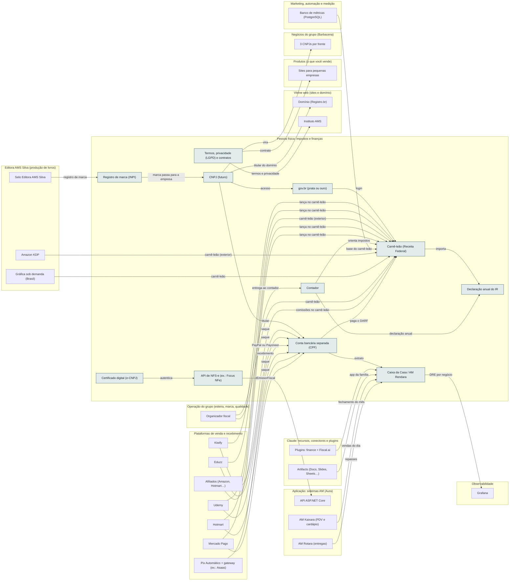

<!-- Arquivo GERADO por tools/gerar_docs.py a partir de data/. Edite os dados, não este arquivo. -->

# Camada 19 · Pessoa física: impostos e finanças

[← Arquitetura](../arquitetura.md) · [Índice da documentação](../README.md)

> **Ligação com a camada de baixo:** Tudo no seu CPF por enquanto; o CNPJ entra quando a renda justificar.

**11 blocos** · 8 precisam de conta · 3 marcados como futuro

## Mapa de conexões

## Blocos

| Bloco | Tipo | O que faz | Quando entra |
|---|---|---|---|
| [Registro de marca (INPI)](#inpi) | Remoto · precisa de conta | Proteger AMtech, Instituto AMS e os nomes AM antes de investir na marca. Pode ser pedido no seu CPF; confira no INPI o desconto disponível para pessoa física. | passo 14.17 · Semanas 8 a 10 · dez/2026 a jan/2027 |
| [Termos, privacidade (LGPD) e contratos](#legal) | Local | Termos de uso, política de privacidade nos sites e contrato padrão de serviço. Obrigatório antes de coletar e-mail ou vender. | passo 14.4 · Semanas 8 a 10 · dez/2026 a jan/2027 |
| [Certificado digital (e-CNPJ)](#ecnpj) | Remoto · precisa de conta · futuro | Só quando houver CNPJ: emissão de nota por API e assinatura de documentos da empresa. | passo 27.2 · Quando a renda pedir (começa quando: a renda passou do valor de virada definido com o contador) |
| [API de NFS-e (ex.: Focus NFe)](#nfapi) | Remoto · precisa de conta · futuro | Só quando houver CNPJ. Implementa o seu IEmissorFiscal: os sistemas AM emitem nota sozinhos. | passo 27.3 · Quando a renda pedir (começa quando: a renda passou do valor de virada definido com o contador) |
| [CNPJ (futuro)](#cnpj) | Remoto · precisa de conta · futuro | Ainda não. Quando a renda crescer, MEI ou SLU. Até lá, tudo no seu CPF. | passo 27.1 · Quando a renda pedir (começa quando: a renda passou do valor de virada definido com o contador) |
| [gov.br (prata ou ouro)](#govbr) | Remoto · precisa de conta | Acesso ao carnê-leão online e à declaração do Imposto de Renda. | passo 2.6 · Semana 1 · out/2026 (o e-mail e as críticas); o resto, 5 contas por semana até dez/2026; passo 14.1 · Semanas 8 a 10 · dez/2026 a jan/2027 |
| [Carnê-leão (Receita Federal)](#nfse) | Remoto · precisa de conta | Todo mês você lança o que recebeu de compradores (Hotmart, Kiwify, aulas, sites) e do exterior (Udemy) e paga o DARF até o último dia útil do mês seguinte. | passo 14.18 · Semanas 8 a 10 · dez/2026 a jan/2027; passo 17.7 · Semanas 12 a 15 · jan a fev/2027 |
| [Declaração anual do IR](#irpf) | Remoto · precisa de conta | Os valores lançados no carnê-leão entram sozinhos na declaração. | passo 14.19 · Semanas 8 a 10 · dez/2026 a jan/2027 |
| [Conta bancária separada (CPF)](#banco) | Remoto · precisa de conta | Uma conta só para receber vendas e serviços, separada do salário. Facilita o carnê-leão e a futura passagem para CNPJ. | passo 2.6 · Semana 1 · out/2026 (o e-mail e as críticas); o resto, 5 contas por semana até dez/2026; passo 14.2 · Semanas 8 a 10 · dez/2026 a jan/2027 |
| [Contador](#conta) | Físico | Uma consulta para montar o carnê-leão do jeito certo e dizer a partir de que renda vale abrir CNPJ. | passo 14.3 · Semanas 8 a 10 · dez/2026 a jan/2027 |
| [Caixa da Casa / AM Rendara](#caixa) | Local | Controle financeiro pessoal e da empresa (seu sistema). | passo 14.20 · Semanas 8 a 10 · dez/2026 a jan/2027; passo 22.4 · Fev a dez/2027, uma oferta por vez (começa quando: a primeira venda do mini-curso aconteceu) |

### Registro de marca (INPI)

*Remoto · precisa de conta*

Proteger AMtech, Instituto AMS e os nomes AM antes de investir na marca. Pode ser pedido no seu CPF; confira no INPI o desconto disponível para pessoa física.

**Quando entra:** passo 14.17 · Semanas 8 a 10 · dez/2026 a jan/2027 ([roteiro](../implantacao/roteiro.md))

| Direção | Bloco | Camada | O que passa |
|---|---|---|---|
| → envia para | [CNPJ (futuro)](19-emp.md#cnpj) | Pessoa física: impostos e finanças | marca passa para a empresa |
| ← recebe de | [Selo Editora AMS Silva](15-editora.md#selo) | Editora AMS Silva (produção de livros) | registro de marca |

### Termos, privacidade (LGPD) e contratos

*Local*

Termos de uso, política de privacidade nos sites e contrato padrão de serviço. Obrigatório antes de coletar e-mail ou vender.

**Quando entra:** passo 14.4 · Semanas 8 a 10 · dez/2026 a jan/2027 ([roteiro](../implantacao/roteiro.md))

| Direção | Bloco | Camada | O que passa |
|---|---|---|---|
| → envia para | [Instituto AMS](18-web.md#inst) | Vitrine web (sites e domínio) | termos e privacidade |
| → envia para | [Sites para pequenas empresas](17-prod.md#sites) | Produtos (o que você vende) | contrato |

### Certificado digital (e-CNPJ)

*Remoto · precisa de conta · futuro*

Só quando houver CNPJ: emissão de nota por API e assinatura de documentos da empresa.

**Quando entra:** passo 27.2 · Quando a renda pedir (começa quando: a renda passou do valor de virada definido com o contador) ([roteiro](../implantacao/roteiro.md))

| Direção | Bloco | Camada | O que passa |
|---|---|---|---|
| → envia para | [API de NFS-e (ex.: Focus NFe)](19-emp.md#nfapi) | Pessoa física: impostos e finanças | autentica |

### API de NFS-e (ex.: Focus NFe)

*Remoto · precisa de conta · futuro*

Só quando houver CNPJ. Implementa o seu IEmissorFiscal: os sistemas AM emitem nota sozinhos.

**Quando entra:** passo 27.3 · Quando a renda pedir (começa quando: a renda passou do valor de virada definido com o contador) ([roteiro](../implantacao/roteiro.md))

| Direção | Bloco | Camada | O que passa |
|---|---|---|---|
| → envia para | [API ASP.NET Core](11-app.md#api) | Aplicação: sistemas AM (Aura) | IEmissorFiscal |
| ← recebe de | [Certificado digital (e-CNPJ)](19-emp.md#ecnpj) | Pessoa física: impostos e finanças | autentica |

### CNPJ (futuro)

*Remoto · precisa de conta · futuro*

Ainda não. Quando a renda crescer, MEI ou SLU. Até lá, tudo no seu CPF.

**Quando entra:** passo 27.1 · Quando a renda pedir (começa quando: a renda passou do valor de virada definido com o contador) ([roteiro](../implantacao/roteiro.md))

| Direção | Bloco | Camada | O que passa |
|---|---|---|---|
| → envia para | [gov.br (prata ou ouro)](19-emp.md#govbr) | Pessoa física: impostos e finanças | acesso |
| → envia para | [Conta bancária separada (CPF)](19-emp.md#banco) | Pessoa física: impostos e finanças | titular |
| → envia para | [Domínio (Registro.br)](18-web.md#dom) | Vitrine web (sites e domínio) | titular do domínio |
| → envia para | [3 CNPJs por frente](16-neg.md#ncnpj) | Negócios do grupo (Barbacena) | vira |
| ← recebe de | [Registro de marca (INPI)](19-emp.md#inpi) | Pessoa física: impostos e finanças | marca passa para a empresa |

### gov.br (prata ou ouro)

*Remoto · precisa de conta*

Acesso ao carnê-leão online e à declaração do Imposto de Renda.

**Quando entra:** passo 2.6 · Semana 1 · out/2026 (o e-mail e as críticas); o resto, 5 contas por semana até dez/2026; passo 14.1 · Semanas 8 a 10 · dez/2026 a jan/2027 ([roteiro](../implantacao/roteiro.md))

| Direção | Bloco | Camada | O que passa |
|---|---|---|---|
| → envia para | [Carnê-leão (Receita Federal)](19-emp.md#nfse) | Pessoa física: impostos e finanças | login |
| ← recebe de | [CNPJ (futuro)](19-emp.md#cnpj) | Pessoa física: impostos e finanças | acesso |

### Carnê-leão (Receita Federal)

*Remoto · precisa de conta*

Todo mês você lança o que recebeu de compradores (Hotmart, Kiwify, aulas, sites) e do exterior (Udemy) e paga o DARF até o último dia útil do mês seguinte.

**Quando entra:** passo 14.18 · Semanas 8 a 10 · dez/2026 a jan/2027; passo 17.7 · Semanas 12 a 15 · jan a fev/2027 ([roteiro](../implantacao/roteiro.md))

| Direção | Bloco | Camada | O que passa |
|---|---|---|---|
| → envia para | [Declaração anual do IR](19-emp.md#irpf) | Pessoa física: impostos e finanças | importa |
| ← recebe de | [Kiwify](20-venda.md#kiwi) | Plataformas de venda e recebimento | lança no carnê-leão |
| ← recebe de | [Eduzz](20-venda.md#eduzz) | Plataformas de venda e recebimento | lança no carnê-leão |
| ← recebe de | [Udemy](20-venda.md#udemy) | Plataformas de venda e recebimento | carnê-leão (exterior) |
| ← recebe de | [Hotmart](20-venda.md#hotm) | Plataformas de venda e recebimento | lança no carnê-leão |
| ← recebe de | [Mercado Pago](20-venda.md#mp) | Plataformas de venda e recebimento | lança no carnê-leão |
| ← recebe de | [Contador](19-emp.md#conta) | Pessoa física: impostos e finanças | orienta impostos |
| ← recebe de | [gov.br (prata ou ouro)](19-emp.md#govbr) | Pessoa física: impostos e finanças | login |
| ← recebe de | [Banco de métricas (PostgreSQL)](21-mkt.md#metrics) | Marketing, automação e medição | base do carnê-leão |
| ← recebe de | [Amazon KDP](15-editora.md#kdp) | Editora AMS Silva (produção de livros) | carnê-leão (exterior) |
| ← recebe de | [Gráfica sob demanda (Brasil)](15-editora.md#pod) | Editora AMS Silva (produção de livros) | carnê-leão |
| ← recebe de | [Organizador fiscal](23-oper.md#ofisc) | Operação do grupo (esteira, marca, qualidade) | carnê-leão |
| ← recebe de | [Afiliados (Amazon, Hotmart…)](20-venda.md#afil) | Plataformas de venda e recebimento | comissões no carnê-leão |
| ← recebe de | [Conta bancária separada (CPF)](19-emp.md#banco) | Pessoa física: impostos e finanças | paga o DARF |

### Declaração anual do IR

*Remoto · precisa de conta*

Os valores lançados no carnê-leão entram sozinhos na declaração.

**Quando entra:** passo 14.19 · Semanas 8 a 10 · dez/2026 a jan/2027 ([roteiro](../implantacao/roteiro.md))

| Direção | Bloco | Camada | O que passa |
|---|---|---|---|
| ← recebe de | [Carnê-leão (Receita Federal)](19-emp.md#nfse) | Pessoa física: impostos e finanças | importa |
| ← recebe de | [Contador](19-emp.md#conta) | Pessoa física: impostos e finanças | declaração anual |

### Conta bancária separada (CPF)

*Remoto · precisa de conta*

Uma conta só para receber vendas e serviços, separada do salário. Facilita o carnê-leão e a futura passagem para CNPJ.

**Quando entra:** passo 2.6 · Semana 1 · out/2026 (o e-mail e as críticas); o resto, 5 contas por semana até dez/2026; passo 14.2 · Semanas 8 a 10 · dez/2026 a jan/2027 ([roteiro](../implantacao/roteiro.md))

| Direção | Bloco | Camada | O que passa |
|---|---|---|---|
| → envia para | [Caixa da Casa / AM Rendara](19-emp.md#caixa) | Pessoa física: impostos e finanças | extrato |
| → envia para | [Carnê-leão (Receita Federal)](19-emp.md#nfse) | Pessoa física: impostos e finanças | paga o DARF |
| ← recebe de | [Kiwify](20-venda.md#kiwi) | Plataformas de venda e recebimento | saque |
| ← recebe de | [Eduzz](20-venda.md#eduzz) | Plataformas de venda e recebimento | saque |
| ← recebe de | [Udemy](20-venda.md#udemy) | Plataformas de venda e recebimento | PayPal ou Payoneer |
| ← recebe de | [Pix Automático + gateway (ex.: Asaas)](20-venda.md#pixa) | Plataformas de venda e recebimento | recebimento |
| ← recebe de | [Hotmart](20-venda.md#hotm) | Plataformas de venda e recebimento | saque |
| ← recebe de | [Mercado Pago](20-venda.md#mp) | Plataformas de venda e recebimento | saque |
| ← recebe de | [CNPJ (futuro)](19-emp.md#cnpj) | Pessoa física: impostos e finanças | titular |

### Contador

*Físico*

Uma consulta para montar o carnê-leão do jeito certo e dizer a partir de que renda vale abrir CNPJ.

**Quando entra:** passo 14.3 · Semanas 8 a 10 · dez/2026 a jan/2027 ([roteiro](../implantacao/roteiro.md))

| Direção | Bloco | Camada | O que passa |
|---|---|---|---|
| → envia para | [Carnê-leão (Receita Federal)](19-emp.md#nfse) | Pessoa física: impostos e finanças | orienta impostos |
| → envia para | [Declaração anual do IR](19-emp.md#irpf) | Pessoa física: impostos e finanças | declaração anual |
| ← recebe de | [Organizador fiscal](23-oper.md#ofisc) | Operação do grupo (esteira, marca, qualidade) | entrega ao contador |

### Caixa da Casa / AM Rendara

*Local*

Controle financeiro pessoal e da empresa (seu sistema).

**Quando entra:** passo 14.20 · Semanas 8 a 10 · dez/2026 a jan/2027; passo 22.4 · Fev a dez/2027, uma oferta por vez (começa quando: a primeira venda do mini-curso aconteceu) ([roteiro](../implantacao/roteiro.md))

| Direção | Bloco | Camada | O que passa |
|---|---|---|---|
| → envia para | [Grafana](10-obs.md#graf) | Observabilidade | DRE por negócio |
| ← recebe de | [Plugins: finance + Fiscal.ai](08-clc.md#pfin) | Claude: recursos, conectores e plugins | fechamento do mês |
| ← recebe de | [Artifacts (Docs, Slides, Sheets…)](08-clc.md#arts) | Claude: recursos, conectores e plugins | app da família |
| ← recebe de | [Conta bancária separada (CPF)](19-emp.md#banco) | Pessoa física: impostos e finanças | extrato |
| ← recebe de | [AM Kaixara (PDV e cardápio)](11-app.md#nkaix) | Aplicação: sistemas AM (Aura) | vendas do dia |
| ← recebe de | [AM Rotara (entregas)](11-app.md#nrot) | Aplicação: sistemas AM (Aura) | repasses |

---

[↑ Camada 20 · Plataformas de venda e recebimento](20-venda.md) · [↓ Camada 18 · Vitrine web (sites e domínio)](18-web.md)
