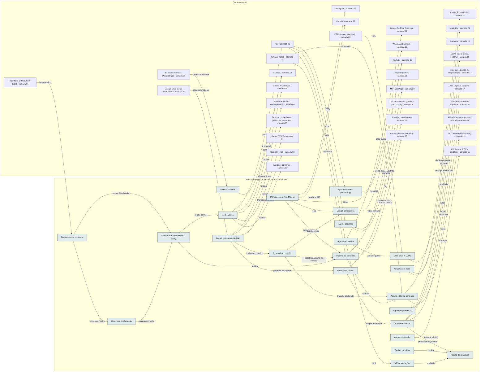

<!-- Arquivo GERADO por tools/gerar_docs.py a partir de data/. Edite os dados, não este arquivo. -->

# Camada 23 · Operação do grupo (esteira, marca, qualidade)

[← Arquitetura](../arquitetura.md) · [Índice da documentação](../README.md)

> **Ligação com a camada de baixo:** Toda oferta passa pela esteira e pelo padrão de qualidade antes de chegar ao público; cada venda e cada trabalho voltam como dado e conteúdo.

**23 blocos** · 1 precisam de conta · 8 marcados como futuro

## Mapa de conexões

## Blocos

| Bloco | Tipo | O que faz | Quando entra |
|---|---|---|---|
| [Portfólio de ofertas](#ocatal) | Local | data/portfolio.json: todas as ofertas do grupo com estágio, notas, pontuação e próximo passo. Gera docs/operacao/portfolio.md e o portfólio interativo. | passo 8.7 · Semanas 3 e 4 · nov/2026; passo 14.14 · Semanas 8 a 10 · dez/2026 a jan/2027; passo 22.20 · Fev a dez/2027, uma oferta por vez (começa quando: a primeira venda do mini-curso aconteceu) |
| [Esteira de ofertas](#oesteira) | Local | Ideia, validação, construção, lançamento e escala, com portões objetivos. Uma oferta em construção e uma em validação por vez. | passo 8.7 · Semanas 3 e 4 · nov/2026; passo 14.14 · Semanas 8 a 10 · dez/2026 a jan/2027 |
| [Padrão de qualidade](#oqual) | Local | Checklist de 'pronto' por tipo de oferta: infoproduto, livro, software, serviço, negócio físico e conteúdo. | passo 14.14 · Semanas 8 a 10 · dez/2026 a jan/2027 |
| [Marca pessoal Alan Mateus](#omarca) | Remoto | O guarda-chuva de confiança do grupo: Instituto AMS, Editora AMS Silva, AMtech e os negócios locais apontam para você. | passo 11.1 · Semana 5 · nov/2026; passo 13.1 · Semanas 6 e 7 · dez/2026 |
| [NPS e avaliações](#oaval) | Remoto | Uma pergunta depois de cada compra ou serviço e pedido de avaliação no Google. Reclamação vira issue da oferta. | passo 14.15 · Semanas 8 a 10 · dez/2026 a jan/2027 |
| [CRM único + LGPD](#ocrm) | Local | Uma ficha por cliente com ofertas compradas, origem e consentimento. Começa em planilha e MailerLite; vira tabela no PostgreSQL do grupo. | passo 14.9 · Semanas 8 a 10 · dez/2026 a jan/2027 |
| [Flywheel de conteúdo](#ofly) | Local | Cada aula, capítulo, projeto, reparo ou prato vira várias peças: cortes, carrossel, artigo, newsletter, questão, template. | passo 11.5 · Semana 5 · nov/2026; passo 11.6 · Semana 5 · nov/2026 |
| [Canal build in public](#obuild) | Remoto · precisa de conta · futuro | Vídeo semanal com rosto mostrando decisões reais do grupo: números, setup, aulas. Gera confiança para todas as ofertas. | passo 23.7 · A partir de fev/2027 (começa quando: o mini-curso vendeu sem anúncio (por exemplo, 10 vendas) e o painel de lucro está no ar) |
| [Agente atendente (WhatsApp)](#oatend) | Local · futuro | Responde perguntas frequentes, mostra catálogo e horários e agenda. Passa para você o que não souber. Nunca promete preço fora da tabela. | passo 22.5 · Fev a dez/2027, uma oferta por vez (começa quando: a primeira venda do mini-curso aconteceu); passo 28.2 · Junto com o primeiro CNPJ (começa quando: clientes e vendas recorrentes) |
| [Agente orçamentista](#oorc) | Local · futuro | Monta propostas a partir dos pacotes e do histórico, para você aprovar. | passo 28.3 · Junto com o primeiro CNPJ (começa quando: clientes e vendas recorrentes) |
| [Agente cobrador](#ocob) | Local · futuro | Lembra vencimentos e envia o Pix; avisa você nos atrasos. Não faz estorno nem acordo sozinho. | passo 28.4 · Junto com o primeiro CNPJ (começa quando: clientes e vendas recorrentes) |
| [Agente pós-venda](#opos) | Local · futuro | Pergunta a nota, pede avaliação e oferece o próximo passo da jornada do cliente. | passo 28.5 · Junto com o primeiro CNPJ (começa quando: clientes e vendas recorrentes) |
| [Agente editor de conteúdo](#oedit) | Local | Transforma transcrições em cortes, títulos, legendas, carrosséis, posts do Google e newsletter, seguindo o guia de estilo da marca. | passo 11.5 · Semana 5 · nov/2026; passo 22.14 · Fev a dez/2027, uma oferta por vez (começa quando: a primeira venda do mini-curso aconteceu) |
| [Analista semanal](#oanal) | Local · futuro | Lê o painel toda segunda e manda 3 fatos e 1 sugestão de decisão. Só leitura. | passo 28.1 · Junto com o primeiro CNPJ (começa quando: clientes e vendas recorrentes) |
| [Organizador fiscal](#ofisc) | Local · futuro | Junta notas, extratos e vendas do mês para o contador e para o carnê-leão. | passo 28.6 · Junto com o primeiro CNPJ (começa quando: clientes e vendas recorrentes) |
| [Revisor de oferta](#orevo) | Local | Confere cada lançamento contra o padrão de qualidade antes de ir ao ar. | passo 14.14 · Semanas 8 a 10 · dez/2026 a jan/2027 |
| [Agente comprador](#ocomp) | Local · futuro | Sugere a lista de compras dos negócios de comida pelo estoque mínimo e pela previsão de produção. | passo 28.7 · Junto com o primeiro CNPJ (começa quando: clientes e vendas recorrentes) |
| [Diagnóstico do notebook](#diag) | Local | scripts/windows/diagnostico.ps1: lê hardware, segurança, programas, WSL, Docker, Ollama e extensões, compara com o setup e diz em que passo cada pendência se resolve. Somente leitura; é a etapa 0 do roteiro. | passo 0.2 · Antes de tudo · semana 1 (out/2026) |
| [Roteiro de implantação](#oimpl) | Local | data/implantacao.json: fases e passos com critério de pronto, cada passo ligado aos blocos que implanta. Gera docs/implantacao/roteiro.md e a página de acompanhamento; o CI falha se um bloco do setup ficar de fora. | passo 0.6 · Antes de tudo · semana 1 (out/2026); passo 16.4 · Semana 11 · jan/2027 |
| [Instaladores (PowerShell e bash)](#oinst) | Local | instalar.ps1 (winget, WSL2, .wslconfig) e bootstrap.sh (ferramentas, linguagens, Claude Code, ai-jail, Git assinado). Seguros para rodar de novo. | passo 3.1 · Semana 1 · out/2026; passo 4.4 · Semana 2 · nov/2026 |
| [Verificadores](#overif) | Local | verificar.ps1 e verificar.sh: somente leitura, dizem 'pronto' ou listam o que falta. Também conferem os serviços da automação. | passo 3.9 · Semana 1 · out/2026; passo 4.10 · Semana 2 · nov/2026; passo 10.3 · Semana 4 · nov/2026; passo 16.4 · Semana 11 · jan/2027 |
| [Pipeline de conteúdo](#opipe) | Local | tools/conteudo/processar.py com timer de 15 min: entrada → transcrição → peças pelo guia de marca → fila de aprovação → aviso no Telegram. | passo 11.4 · Semana 5 · nov/2026; passo 11.5 · Semana 5 · nov/2026; passo 16.2 · Semana 11 · jan/2027 |
| [Acervo (seus documentos)](#acv) | Local | tools/acervo/acervo.py: lê todos os seus documentos sem alterar nada, acha cópias, separa os pessoais, marca o que é de terceiros ou da escola, converte o resto para Markdown no Obsidian e sugere os produtos que dá para vender. Tudo no notebook. | passo 8.3 · Semanas 3 e 4 · nov/2026; passo 8.4 · Semanas 3 e 4 · nov/2026; passo 8.5 · Semanas 3 e 4 · nov/2026; passo 22.3 · Fev a dez/2027, uma oferta por vez (começa quando: a primeira venda do mini-curso aconteceu) |

### Portfólio de ofertas

*Local*

data/portfolio.json: todas as ofertas do grupo com estágio, notas, pontuação e próximo passo. Gera docs/operacao/portfolio.md e o portfólio interativo.

**Quando entra:** passo 8.7 · Semanas 3 e 4 · nov/2026; passo 14.14 · Semanas 8 a 10 · dez/2026 a jan/2027; passo 22.20 · Fev a dez/2027, uma oferta por vez (começa quando: a primeira venda do mini-curso aconteceu) ([roteiro](../implantacao/roteiro.md))

| Direção | Bloco | Camada | O que passa |
|---|---|---|---|
| → envia para | [Esteira de ofertas](23-oper.md#oesteira) | Operação do grupo (esteira, marca, qualidade) | fila por pontuação |
| → envia para | [Planejador do Grupo](16-neg.md#nplan) | Negócios do grupo (Barbacena) | negócios físicos |
| ← recebe de | [Acervo (seus documentos)](23-oper.md#acv) | Operação do grupo (esteira, marca, qualidade) | produtos candidatos |

### Esteira de ofertas

*Local*

Ideia, validação, construção, lançamento e escala, com portões objetivos. Uma oferta em construção e uma em validação por vez.

**Quando entra:** passo 8.7 · Semanas 3 e 4 · nov/2026; passo 14.14 · Semanas 8 a 10 · dez/2026 a jan/2027 ([roteiro](../implantacao/roteiro.md))

| Direção | Bloco | Camada | O que passa |
|---|---|---|---|
| → envia para | [Padrão de qualidade](23-oper.md#oqual) | Operação do grupo (esteira, marca, qualidade) | portão de lançamento |
| → envia para | [Mini-curso Lógica de Programação](17-prod.md#curso) | Produtos (o que você vende) | lança |
| → envia para | [Livro Lógica e Máquina](17-prod.md#livro) | Produtos (o que você vende) | lança |
| → envia para | [AMtech Software (projetos e SaaS)](16-neg.md#nsoft) | Negócios do grupo (Barbacena) | lança |
| ← recebe de | [Portfólio de ofertas](23-oper.md#ocatal) | Operação do grupo (esteira, marca, qualidade) | fila por pontuação |

### Padrão de qualidade

*Local*

Checklist de 'pronto' por tipo de oferta: infoproduto, livro, software, serviço, negócio físico e conteúdo.

**Quando entra:** passo 14.14 · Semanas 8 a 10 · dez/2026 a jan/2027 ([roteiro](../implantacao/roteiro.md))

| Direção | Bloco | Camada | O que passa |
|---|---|---|---|
| ← recebe de | [Esteira de ofertas](23-oper.md#oesteira) | Operação do grupo (esteira, marca, qualidade) | portão de lançamento |
| ← recebe de | [Revisor de oferta](23-oper.md#orevo) | Operação do grupo (esteira, marca, qualidade) | confere |
| ← recebe de | [NPS e avaliações](23-oper.md#oaval) | Operação do grupo (esteira, marca, qualidade) | melhoria |

### Marca pessoal Alan Mateus

*Remoto*

O guarda-chuva de confiança do grupo: Instituto AMS, Editora AMS Silva, AMtech e os negócios locais apontam para você.

**Quando entra:** passo 11.1 · Semana 5 · nov/2026; passo 13.1 · Semanas 6 e 7 · dez/2026 ([roteiro](../implantacao/roteiro.md))

| Direção | Bloco | Camada | O que passa |
|---|---|---|---|
| → envia para | [Instagram](22-pub.md#ig) | Público e canais | perfil |
| → envia para | [YouTube](22-pub.md#yt) | Público e canais | canal |
| → envia para | [LinkedIn](22-pub.md#li) | Público e canais | carreira e B2B |
| → envia para | [Canal build in public](23-oper.md#obuild) | Operação do grupo (esteira, marca, qualidade) | rosto |
| → envia para | [Pipeline de conteúdo](23-oper.md#opipe) | Operação do grupo (esteira, marca, qualidade) | guia de marca |

### NPS e avaliações

*Remoto*

Uma pergunta depois de cada compra ou serviço e pedido de avaliação no Google. Reclamação vira issue da oferta.

**Quando entra:** passo 14.15 · Semanas 8 a 10 · dez/2026 a jan/2027 ([roteiro](../implantacao/roteiro.md))

| Direção | Bloco | Camada | O que passa |
|---|---|---|---|
| → envia para | [Padrão de qualidade](23-oper.md#oqual) | Operação do grupo (esteira, marca, qualidade) | melhoria |
| ← recebe de | [Agente pós-venda](23-oper.md#opos) | Operação do grupo (esteira, marca, qualidade) | NPS |

### CRM único + LGPD

*Local*

Uma ficha por cliente com ofertas compradas, origem e consentimento. Começa em planilha e MailerLite; vira tabela no PostgreSQL do grupo.

**Quando entra:** passo 14.9 · Semanas 8 a 10 · dez/2026 a jan/2027 ([roteiro](../implantacao/roteiro.md))

| Direção | Bloco | Camada | O que passa |
|---|---|---|---|
| → envia para | [MailerLite](21-mkt.md#mailer) | Marketing, automação e medição | etiquetas |
| ← recebe de | [Agente pós-venda](23-oper.md#opos) | Operação do grupo (esteira, marca, qualidade) | próximo passo |
| ← recebe de | [CRM simples (planilha)](20-venda.md#crm) | Plataformas de venda e recebimento | vira |

### Flywheel de conteúdo

*Local*

Cada aula, capítulo, projeto, reparo ou prato vira várias peças: cortes, carrossel, artigo, newsletter, questão, template.

**Quando entra:** passo 11.5 · Semana 5 · nov/2026; passo 11.6 · Semana 5 · nov/2026 ([roteiro](../implantacao/roteiro.md))

| Direção | Bloco | Camada | O que passa |
|---|---|---|---|
| → envia para | [Agente editor de conteúdo](23-oper.md#oedit) | Operação do grupo (esteira, marca, qualidade) | trabalho capturado |
| → envia para | [Canal build in public](23-oper.md#obuild) | Operação do grupo (esteira, marca, qualidade) | decisões reais |
| → envia para | [Pipeline de conteúdo](23-oper.md#opipe) | Operação do grupo (esteira, marca, qualidade) | trabalho na pasta de entrada |
| ← recebe de | [Acervo (seus documentos)](23-oper.md#acv) | Operação do grupo (esteira, marca, qualidade) | ideias de conteúdo |

### Canal build in public

*Remoto · precisa de conta · futuro*

Vídeo semanal com rosto mostrando decisões reais do grupo: números, setup, aulas. Gera confiança para todas as ofertas.

**Quando entra:** passo 23.7 · A partir de fev/2027 (começa quando: o mini-curso vendeu sem anúncio (por exemplo, 10 vendas) e o painel de lucro está no ar) ([roteiro](../implantacao/roteiro.md))

| Direção | Bloco | Camada | O que passa |
|---|---|---|---|
| → envia para | [YouTube](22-pub.md#yt) | Público e canais | vídeo semanal |
| ← recebe de | [Flywheel de conteúdo](23-oper.md#ofly) | Operação do grupo (esteira, marca, qualidade) | decisões reais |
| ← recebe de | [Marca pessoal Alan Mateus](23-oper.md#omarca) | Operação do grupo (esteira, marca, qualidade) | rosto |

### Agente atendente (WhatsApp)

*Local · futuro*

Responde perguntas frequentes, mostra catálogo e horários e agenda. Passa para você o que não souber. Nunca promete preço fora da tabela.

**Quando entra:** passo 22.5 · Fev a dez/2027, uma oferta por vez (começa quando: a primeira venda do mini-curso aconteceu); passo 28.2 · Junto com o primeiro CNPJ (começa quando: clientes e vendas recorrentes) ([roteiro](../implantacao/roteiro.md))

| Direção | Bloco | Camada | O que passa |
|---|---|---|---|
| → envia para | [WhatsApp Business](22-pub.md#wa) | Público e canais | responde |
| ← recebe de | [n8n](21-mkt.md#n8n) | Marketing, automação e medição | roda |

### Agente orçamentista

*Local · futuro*

Monta propostas a partir dos pacotes e do histórico, para você aprovar.

**Quando entra:** passo 28.3 · Junto com o primeiro CNPJ (começa quando: clientes e vendas recorrentes) ([roteiro](../implantacao/roteiro.md))

| Direção | Bloco | Camada | O que passa |
|---|---|---|---|
| → envia para | [Sites para pequenas empresas](17-prod.md#sites) | Produtos (o que você vende) | propostas |

### Agente cobrador

*Local · futuro*

Lembra vencimentos e envia o Pix; avisa você nos atrasos. Não faz estorno nem acordo sozinho.

**Quando entra:** passo 28.4 · Junto com o primeiro CNPJ (começa quando: clientes e vendas recorrentes) ([roteiro](../implantacao/roteiro.md))

| Direção | Bloco | Camada | O que passa |
|---|---|---|---|
| → envia para | [Pix Automático + gateway (ex.: Asaas)](20-venda.md#pixa) | Plataformas de venda e recebimento | Pix |
| → envia para | [Mercado Pago](20-venda.md#mp) | Plataformas de venda e recebimento | cobrança |
| ← recebe de | [n8n](21-mkt.md#n8n) | Marketing, automação e medição | roda |

### Agente pós-venda

*Local · futuro*

Pergunta a nota, pede avaliação e oferece o próximo passo da jornada do cliente.

**Quando entra:** passo 28.5 · Junto com o primeiro CNPJ (começa quando: clientes e vendas recorrentes) ([roteiro](../implantacao/roteiro.md))

| Direção | Bloco | Camada | O que passa |
|---|---|---|---|
| → envia para | [Google Perfil da Empresa](22-pub.md#ogbp) | Público e canais | pede avaliação |
| → envia para | [NPS e avaliações](23-oper.md#oaval) | Operação do grupo (esteira, marca, qualidade) | NPS |
| → envia para | [CRM único + LGPD](23-oper.md#ocrm) | Operação do grupo (esteira, marca, qualidade) | próximo passo |
| ← recebe de | [n8n](21-mkt.md#n8n) | Marketing, automação e medição | roda |

### Agente editor de conteúdo

*Local*

Transforma transcrições em cortes, títulos, legendas, carrosséis, posts do Google e newsletter, seguindo o guia de estilo da marca.

**Quando entra:** passo 11.5 · Semana 5 · nov/2026; passo 22.14 · Fev a dez/2027, uma oferta por vez (começa quando: a primeira venda do mini-curso aconteceu) ([roteiro](../implantacao/roteiro.md))

| Direção | Bloco | Camada | O que passa |
|---|---|---|---|
| → envia para | [Aprovação no celular](21-mkt.md#aprov) | Marketing, automação e medição | fila de aprovação |
| → envia para | [Voz clonada (ElevenLabs)](13-cont.md#voz) | Produção de conteúdo | narração |
| ← recebe de | [Flywheel de conteúdo](23-oper.md#ofly) | Operação do grupo (esteira, marca, qualidade) | trabalho capturado |
| ← recebe de | [Whisper (local)](13-cont.md#whis) | Produção de conteúdo | transcrição |
| ← recebe de | [Pipeline de conteúdo](23-oper.md#opipe) | Operação do grupo (esteira, marca, qualidade) | executa |

### Analista semanal

*Local · futuro*

Lê o painel toda segunda e manda 3 fatos e 1 sugestão de decisão. Só leitura.

**Quando entra:** passo 28.1 · Junto com o primeiro CNPJ (começa quando: clientes e vendas recorrentes) ([roteiro](../implantacao/roteiro.md))

| Direção | Bloco | Camada | O que passa |
|---|---|---|---|
| → envia para | [Grafana](10-obs.md#graf) | Observabilidade | lê o painel |
| ← recebe de | [Banco de métricas (PostgreSQL)](21-mkt.md#metrics) | Marketing, automação e medição | dados da semana |

### Organizador fiscal

*Local · futuro*

Junta notas, extratos e vendas do mês para o contador e para o carnê-leão.

**Quando entra:** passo 28.6 · Junto com o primeiro CNPJ (começa quando: clientes e vendas recorrentes) ([roteiro](../implantacao/roteiro.md))

| Direção | Bloco | Camada | O que passa |
|---|---|---|---|
| → envia para | [Carnê-leão (Receita Federal)](19-emp.md#nfse) | Pessoa física: impostos e finanças | carnê-leão |
| → envia para | [Contador](19-emp.md#conta) | Pessoa física: impostos e finanças | entrega ao contador |

### Revisor de oferta

*Local*

Confere cada lançamento contra o padrão de qualidade antes de ir ao ar.

**Quando entra:** passo 14.14 · Semanas 8 a 10 · dez/2026 a jan/2027 ([roteiro](../implantacao/roteiro.md))

| Direção | Bloco | Camada | O que passa |
|---|---|---|---|
| → envia para | [Padrão de qualidade](23-oper.md#oqual) | Operação do grupo (esteira, marca, qualidade) | confere |

### Agente comprador

*Local · futuro*

Sugere a lista de compras dos negócios de comida pelo estoque mínimo e pela previsão de produção.

**Quando entra:** passo 28.7 · Junto com o primeiro CNPJ (começa quando: clientes e vendas recorrentes) ([roteiro](../implantacao/roteiro.md))

| Direção | Bloco | Camada | O que passa |
|---|---|---|---|
| → envia para | [AM Kaixara (PDV e cardápio)](11-app.md#nkaix) | Aplicação: sistemas AM (Aura) | estoque mínimo |

### Diagnóstico do notebook

*Local*

scripts/windows/diagnostico.ps1: lê hardware, segurança, programas, WSL, Docker, Ollama e extensões, compara com o setup e diz em que passo cada pendência se resolve. Somente leitura; é a etapa 0 do roteiro.

**Quando entra:** passo 0.2 · Antes de tudo · semana 1 (out/2026) ([roteiro](../implantacao/roteiro.md))

| Direção | Bloco | Camada | O que passa |
|---|---|---|---|
| → envia para | [Roteiro de implantação](23-oper.md#oimpl) | Operação do grupo (esteira, marca, qualidade) | começa o roteiro |
| → envia para | [Instaladores (PowerShell e bash)](23-oper.md#oinst) | Operação do grupo (esteira, marca, qualidade) | o que falta instalar |
| ← recebe de | [Acer Nitro (32 GB, GTX 1650)](01-hw.md#nb) | Hardware | hardware lido |

### Roteiro de implantação

*Local*

data/implantacao.json: fases e passos com critério de pronto, cada passo ligado aos blocos que implanta. Gera docs/implantacao/roteiro.md e a página de acompanhamento; o CI falha se um bloco do setup ficar de fora.

**Quando entra:** passo 0.6 · Antes de tudo · semana 1 (out/2026); passo 16.4 · Semana 11 · jan/2027 ([roteiro](../implantacao/roteiro.md))

| Direção | Bloco | Camada | O que passa |
|---|---|---|---|
| → envia para | [Instaladores (PowerShell e bash)](23-oper.md#oinst) | Operação do grupo (esteira, marca, qualidade) | passos com script |
| ← recebe de | [Diagnóstico do notebook](23-oper.md#diag) | Operação do grupo (esteira, marca, qualidade) | começa o roteiro |

### Instaladores (PowerShell e bash)

*Local*

instalar.ps1 (winget, WSL2, .wslconfig) e bootstrap.sh (ferramentas, linguagens, Claude Code, ai-jail, Git assinado). Seguros para rodar de novo.

**Quando entra:** passo 3.1 · Semana 1 · out/2026; passo 4.4 · Semana 2 · nov/2026 ([roteiro](../implantacao/roteiro.md))

| Direção | Bloco | Camada | O que passa |
|---|---|---|---|
| → envia para | [Verificadores](23-oper.md#overif) | Operação do grupo (esteira, marca, qualidade) | depois confere |
| → envia para | [Pipeline de conteúdo](23-oper.md#opipe) | Operação do grupo (esteira, marca, qualidade) | instala |
| ← recebe de | [Roteiro de implantação](23-oper.md#oimpl) | Operação do grupo (esteira, marca, qualidade) | passos com script |
| ← recebe de | [Diagnóstico do notebook](23-oper.md#diag) | Operação do grupo (esteira, marca, qualidade) | o que falta instalar |

### Verificadores

*Local*

verificar.ps1 e verificar.sh: somente leitura, dizem 'pronto' ou listam o que falta. Também conferem os serviços da automação.

**Quando entra:** passo 3.9 · Semana 1 · out/2026; passo 4.10 · Semana 2 · nov/2026; passo 10.3 · Semana 4 · nov/2026; passo 16.4 · Semana 11 · jan/2027 ([roteiro](../implantacao/roteiro.md))

| Direção | Bloco | Camada | O que passa |
|---|---|---|---|
| → envia para | [Ubuntu (WSL2)](04-lin.md#wsl) | Linux (Ubuntu no WSL2, Arch no 2º disco) | confere |
| → envia para | [Docker + Compose](09-cnt.md#docker) | Containers, Kubernetes e infra como código | confere |
| → envia para | [Windows 11 Home](03-win.md#w11) | Windows 11, apps e máquinas virtuais | confere |
| → envia para | [n8n](21-mkt.md#n8n) | Marketing, automação e medição | confere |
| → envia para | [Grafana](10-obs.md#graf) | Observabilidade | confere |
| ← recebe de | [Instaladores (PowerShell e bash)](23-oper.md#oinst) | Operação do grupo (esteira, marca, qualidade) | depois confere |

### Pipeline de conteúdo

*Local*

tools/conteudo/processar.py com timer de 15 min: entrada → transcrição → peças pelo guia de marca → fila de aprovação → aviso no Telegram.

**Quando entra:** passo 11.4 · Semana 5 · nov/2026; passo 11.5 · Semana 5 · nov/2026; passo 16.2 · Semana 11 · jan/2027 ([roteiro](../implantacao/roteiro.md))

| Direção | Bloco | Camada | O que passa |
|---|---|---|---|
| → envia para | [Agente editor de conteúdo](23-oper.md#oedit) | Operação do grupo (esteira, marca, qualidade) | executa |
| → envia para | [Claude (assinatura e API)](08-clc.md#anth) | Claude: recursos, conectores e plugins | API do Claude |
| → envia para | [Telegram (avisos)](21-mkt.md#tg) | Marketing, automação e medição | aviso de peça pronta |
| ← recebe de | [Whisper (local)](13-cont.md#whis) | Produção de conteúdo | transcreve |
| ← recebe de | [Flywheel de conteúdo](23-oper.md#ofly) | Operação do grupo (esteira, marca, qualidade) | trabalho na pasta de entrada |
| ← recebe de | [Instaladores (PowerShell e bash)](23-oper.md#oinst) | Operação do grupo (esteira, marca, qualidade) | instala |
| ← recebe de | [Marca pessoal Alan Mateus](23-oper.md#omarca) | Operação do grupo (esteira, marca, qualidade) | guia de marca |

### Acervo (seus documentos)

*Local*

tools/acervo/acervo.py: lê todos os seus documentos sem alterar nada, acha cópias, separa os pessoais, marca o que é de terceiros ou da escola, converte o resto para Markdown no Obsidian e sugere os produtos que dá para vender. Tudo no notebook.

**Quando entra:** passo 8.3 · Semanas 3 e 4 · nov/2026; passo 8.4 · Semanas 3 e 4 · nov/2026; passo 8.5 · Semanas 3 e 4 · nov/2026; passo 22.3 · Fev a dez/2027, uma oferta por vez (começa quando: a primeira venda do mini-curso aconteceu) ([roteiro](../implantacao/roteiro.md))

| Direção | Bloco | Camada | O que passa |
|---|---|---|---|
| → envia para | [Obsidian + Git](03-win.md#obsd) | Windows 11, apps e máquinas virtuais | Markdown no cofre |
| → envia para | [Base de conhecimento (RAG) das suas notas](05-ia.md#rag) | Agentes de IA e sandbox | indexa |
| → envia para | [Portfólio de ofertas](23-oper.md#ocatal) | Operação do grupo (esteira, marca, qualidade) | produtos candidatos |
| → envia para | [Seus datasets (só conteúdo seu)](06-dados.md#dset) | Dados e treino de IA | só o que é seu |
| → envia para | [Flywheel de conteúdo](23-oper.md#ofly) | Operação do grupo (esteira, marca, qualidade) | ideias de conteúdo |
| ← recebe de | [Google Drive (seus documentos)](12-nuvem.md#gdrv) | Nuvem, código e entrega | cópia pelo Takeout |

---

[↓ Camada 22 · Público e canais](22-pub.md)
