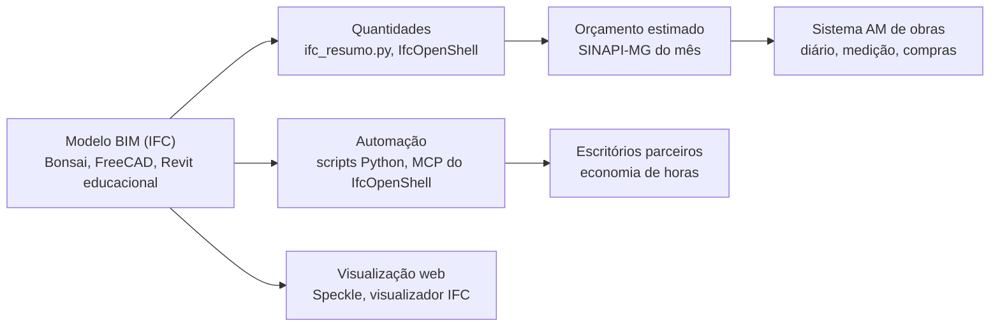

# Construção civil, arquitetura e engenharia civil

[← Índice da documentação](../README.md)

Uma frente nova, montada do jeito que o setup trata tudo: ferramentas no nível dos escritórios grandes, estudo dos conceitos na ordem certa, regras para a IA não inventar nada e uma forma legal de ganhar dinheiro com isso a partir da TI, que é a sua força.

## A verdade antes do plano

- **Projeto de obra só vale com profissional habilitado.** Engenharia civil é regulada pelo CONFEA/CREA (Lei 5.194/1966) e arquitetura pelo CAU (Lei 12.378/2010). Com ADS e Licenciatura em Matemática, você não pode assinar projeto, laudo, ART ou RRT. Ferramenta nenhuma muda isso.
- **O que você pode fazer em nível profissional, hoje:** software para construção, automação de BIM (scripts que economizam horas de escritório), modelagem e documentação **para** um engenheiro ou arquiteto que revisa e assina, orçamento por SINAPI como estimativa, e ensino.
- **Para assinar um dia:** Técnico em Edificações (atribuições limitadas, pelo CFT) ou graduação em Engenharia Civil ou Arquitetura. Fica registrado como decisão sua, sem prazo.

## Por onde a TI entra

## Documentos

1. [Software e ferramentas](01-software.md): BIM aberto, Autodesk educacional, estrutura, topografia, orçamento, IA no BIM e o que fica em cada computador
2. [Estudo, normas e dados](02-estudo-e-normas.md): a trilha de conceitos, as normas que importam, o que é livre e o que é pago, e os dados para treinar o setup

As regras que toda IA segue nesta frente estão em [`infra/templates/regras-ia/construcao.md`](../../infra/templates/regras-ia/construcao.md). O passo a passo é a fase 53 do [roteiro](../implantacao/roteiro.md#f-construcao).
