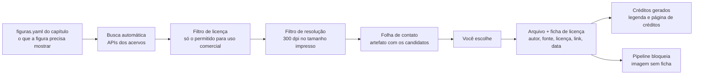

# 10 · Imagens e figuras

[← Editora](README.md)

Dois caminhos, com regras diferentes: **imagens buscadas** em acervos (fotos históricas, retratos, gravuras, peças de museu) e **figuras criadas** a partir de código (diagramas, gráficos, circuitos, tabelas). A meta é um livro altamente ilustrado em que **toda imagem tem licença registrada** e **toda figura técnica é gerada e conferida pelo pipeline**.

## Imagens buscadas

### Acervos

| Acervo | O que tem | Licença típica | Acesso |
|---|---|---|---|
| Openverse | Busca única em milhões de obras abertas (Flickr, Wikimedia, museus) | CC0, CC BY, CC BY-SA e outras; filtro por uso comercial | API |
| Wikimedia Commons | Retratos de cientistas, máquinas históricas, diagramas | Domínio público, CC BY, CC BY-SA (varia por arquivo) | API com metadados de licença |
| Smithsonian Open Access | Objetos e documentos históricos, inclusive da computação | Itens em domínio público com imagem; metadados CC0 | API (chave gratuita no api.data.gov) |
| The Met Open Access | Arte, gravuras, instrumentos científicos | CC0 para obras em domínio público | API |
| Rijksmuseum, Europeana | Gravuras, mapas, instrumentos | CC0 ou domínio público em boa parte | API |
| Library of Congress | Fotografias e documentos históricos | Muitos sem restrição conhecida (confira item a item) | API |
| NASA | Fotos de missões, computadores de bordo | Em geral domínio público nos EUA, com regras de uso de logotipos | API |
| Internet Archive | Livros e manuais antigos de computação | Varia | API |
| Biblioteca Nacional Digital, Brasiliana Fotográfica | Acervo brasileiro | Varia; muitas em domínio público | Site |
| Unsplash, Pexels | Fotos atuais (pessoas, escritórios, equipamentos) | Licença própria, permite uso comercial com restrições | API |

### Regras de licença

| Licença | Pode no livro? | Exige |
|---|---|---|
| Domínio público, CC0 | Sim | Nada (crédito por boa prática) |
| CC BY | Sim | Crédito com autor, fonte e licença |
| CC BY-SA | Sim, com cuidado | Crédito; uma imagem **alterada** precisa sair com a mesma licença |
| CC BY-NC, BY-NC-SA | **Não** | Livro é uso comercial |
| CC BY-ND | Só sem alterar | Crédito; sem recorte, cor ou montagem |
| Licenças de banco (Unsplash, Pexels) | Sim, nos termos do site | Ler os termos de cada uma |
| Sem licença clara | **Não** | Pedir autorização por escrito |

**Brasil:** o prazo geral é de 70 anos contados de 1º de janeiro do ano seguinte à morte do autor (Lei 9.610/98). Para fotografias o prazo conta da divulgação. Uma foto em domínio público nos EUA pode não estar no Brasil: na dúvida, consulte um advogado de direito autoral antes de imprimir. Direitos morais (nome do autor, integridade) valem sempre.

### Esteira automática

1. Cada capítulo declara as figuras de que precisa em `figuras.yaml` (conceito, tipo, palavras-chave em português e inglês).
2. Um script consulta as APIs (Openverse, Wikimedia Commons, Smithsonian, The Met, Europeana, Library of Congress) e traz candidatos com os metadados de licença.
3. O filtro descarta o que não pode (NC, sem licença) e o que tem resolução baixa para impressão.
4. A folha de contato (um artefato) mostra os candidatos lado a lado; você escolhe.
5. A imagem escolhida entra no repositório com uma ficha (`.licenca.yaml`) e o pipeline gera a legenda com crédito e a página de créditos do livro.
6. O build **falha** se alguma imagem estiver sem ficha, com licença proibida ou abaixo de 300 dpi.

## Figuras criadas

Toda figura técnica nasce de código, fica no repositório e é refeita a cada build. Se o dado ou a definição mudar, a figura muda junto.

| Tipo | Ferramenta | Exemplos no livro |
|---|---|---|
| Diagramas e pranchas | TikZ | arquitetura de computador, pilha de rede, memória |
| Circuitos | CircuiTikZ | lei de Ohm, portas lógicas, transistor |
| Gráficos de dados e funções | Matplotlib exportando PGF/SVG | complexidade de algoritmos, logaritmos, estatística |
| Grafos e árvores | Graphviz, TikZ | rotas, árvores de busca, redes |
| Fluxos e sequências | Mermaid | algoritmos, protocolos |
| Tabelas-verdade, conversões de base, tabelas de operações | Scripts geradores (exemplo em `tools/editora/`) | Capítulo 1 (proposições) |
| Animações para o curso | Manim (o mesmo código da figura vira vídeo) | algoritmos passo a passo |

**Estilo único:** todas usam as cores, fontes e espessuras da identidade do livro, definidas uma vez.

**Acessibilidade:** cada figura tem texto alternativo (rascunhado por IA, revisado por você) para o EPUB.

## Imagens geradas por IA

- Para ilustração de conceito e abertura de capítulo, com o seu plano do Gemini ou outra ferramenta com licença comercial.
- A ficha registra a ferramenta, o prompt e a data.
- Nunca para diagrama técnico (precisa estar correto) nem imitando o estilo de um artista vivo.
- Avise no livro quando uma ilustração for gerada por IA.
