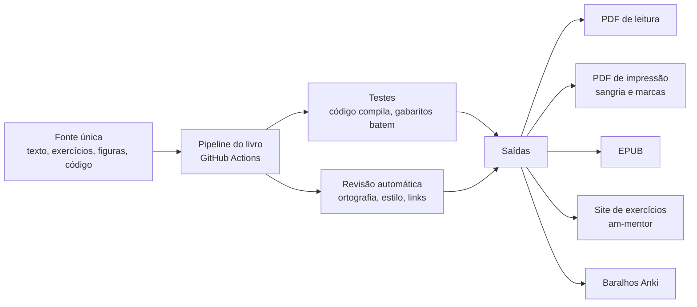

# Editora AMS Silva

[← Índice da documentação](../README.md)

A editora que publica os livros de Alan Mateus, começando por **Lógica e Máquina**, construída dentro do setup: o livro é escrito, testado, diagramado e publicado como um projeto de software, com o mesmo rigor do código.

## A ideia em uma frase

Cada livro é um repositório. O texto, os exercícios, as figuras e o código moram em uma fonte única; a cada mudança, o pipeline compila os exemplos, confere os gabaritos, revisa o texto e gera o PDF, o ebook, o arquivo para impressão e o site de exercícios ao mesmo tempo.

## Documentos

1. [Estrutura legal da editora](01-estrutura-legal.md): selo no CPF, INPI, ISBN, ficha catalográfica, depósito legal e quando abrir CNPJ
2. [Arquitetura de produção](02-arquitetura-de-producao.md): o livro como repositório e o pipeline que gera todas as versões
3. [Rigor editorial](03-rigor-editorial.md): o padrão de qualidade, inspirado no método do VHSlins
4. [Identidade visual e referências](04-identidade-visual.md): sistema visual do livro, quadro de referências e uso de imagens de IA
5. [Avaliação do livro](05-avaliacao-do-livro.md): os critérios para medir se o conteúdo é diferenciado
6. [Produtos e receita](06-produtos-e-receita.md): o que vender junto com os livros
7. [Lançamento e divulgação](07-lancamento-e-divulgacao.md): Brasil primeiro, depois o mundo
8. [Roteiro](08-roteiro.md): as fases, do Capítulo 1 ao lançamento
9. [Nível do livro e concursos](09-nivel-e-concursos.md): um caminho único, autocontido, com domínio total para prova e para o trabalho; PF, PRF e Forças Armadas
10. [Imagens e figuras](10-imagens-e-figuras.md): busca automática em acervos com filtro de licença, figuras geradas por código
11. [Automação e método](11-automacao-e-metodo.md): o seu passo a passo dentro do pipeline e o que é automático

## O que já existe

- Livro **Lógica e Máquina**, 5 volumes planejados; o Capítulo 1 do Volume 1A ("O que é uma Proposição") está escrito.
- Identidade visual definida: papel creme, tinta escura, verdigris e latão, Cormorant Garamond, EB Garamond e IBM Plex Mono, código e diagramas como pranchas técnicas numeradas.
- Site de exercícios **am-mentor** (Next.js), com bloqueio de gabarito por tentativas e certificados planejados.
- TeX Live, GitHub Actions, voz clonada, esteira de vídeo e plataformas de venda já previstos no setup.

## O que depende de você

- **O modelo de criação** que você vai enviar: ele vira o template de capítulo e as regras do pipeline.
- **O texto do Capítulo 1** (e o que mais estiver escrito), para a avaliação de nível com os critérios do documento 5.
