<!-- Arquivo GERADO por tools/gerar_docs.py a partir de data/. Edite os dados, não este arquivo. -->


# Fluxos de ponta a ponta

[← Índice da documentação](README.md)

Cada fluxo mostra o caminho real que o trabalho percorre pelas camadas.

## Vender o mini-curso

```mermaid
flowchart LR
  s0["1. Microfone + câmera"]
  s1["2. OBS Studio"]
  s2["3. DaVinci Resolve ou Kdenlive"]
  s3["4. Mini-curso Lógica de Programação"]
  s4["5. Hotmart"]
  s5["6. Instituto AMS"]
  s6["7. Isca grátis + sequência de e-mails"]
  s7["8. MailerLite"]
  s8["9. Hotmart"]
  s9["10. Carnê-leão (Receita Federal)"]
  s10["11. Conta bancária separada (CPF)"]
  s11["12. Caixa da Casa / AM Rendara"]
  s0 --> s1
  s1 --> s2
  s2 --> s3
  s3 --> s4
  s4 --> s5
  s5 --> s6
  s6 --> s7
  s7 --> s8
  s8 --> s9
  s9 --> s10
  s10 --> s11
```

1. **[Microfone + câmera](camadas/01-hw.md#mic)**: Microfone e câmera captam a aula.
2. **[OBS Studio](camadas/13-cont.md#obss)**: O OBS grava a tela e o áudio.
3. **[DaVinci Resolve ou Kdenlive](camadas/13-cont.md#edit)**: A edição corta e finaliza.
4. **[Mini-curso Lógica de Programação](camadas/17-prod.md#curso)**: O mini-curso é montado com as aulas.
5. **[Hotmart](camadas/20-venda.md#hotm)**: Você cadastra o produto na Hotmart (ou Kiwify, Eduzz) e uma versão na Udemy.
6. **[Instituto AMS](camadas/18-web.md#inst)**: A página do Instituto AMS leva ao checkout; Instagram e YouTube trazem visitas pelo link na bio.
7. **[Isca grátis + sequência de e-mails](camadas/21-mkt.md#isca)**: Quem ainda não compra deixa o e-mail pela aula grátis.
8. **[MailerLite](camadas/21-mkt.md#mailer)**: A sequência de e-mails leva ao mini-curso.
9. **[Hotmart](camadas/20-venda.md#hotm)**: A venda acontece na plataforma.
10. **[Carnê-leão (Receita Federal)](camadas/19-emp.md#nfse)**: Você lança a venda no carnê-leão do mês.
11. **[Conta bancária separada (CPF)](camadas/19-emp.md#banco)**: O saque cai na conta separada, que paga o DARF.
12. **[Caixa da Casa / AM Rendara](camadas/19-emp.md#caixa)**: O Caixa da Casa registra a entrada.

## Codar com agente e publicar

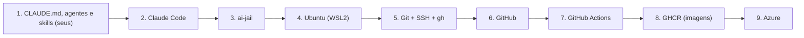

1. **[CLAUDE.md, agentes e skills (seus)](camadas/05-ia.md#kit)**: O CLAUDE.md e os seus agentes dão as regras.
2. **[Claude Code](camadas/05-ia.md#cc)**: O Claude Code faz a tarefa.
3. **[ai-jail](camadas/05-ia.md#jail)**: O ai-jail limita o agente à pasta do projeto.
4. **[Ubuntu (WSL2)](camadas/04-lin.md#wsl)**: Tudo roda no Ubuntu do WSL2, aberto no VS Code.
5. **[Git + SSH + gh](camadas/04-lin.md#git)**: Você revisa e faz o commit assinado.
6. **[GitHub](camadas/12-nuvem.md#gh)**: O push vai ao GitHub.
7. **[GitHub Actions](camadas/12-nuvem.md#gha)**: O Actions testa e gera a imagem.
8. **[GHCR (imagens)](camadas/12-nuvem.md#ghcr)**: A imagem vai para o GHCR.
9. **[Azure](camadas/12-nuvem.md#azure)**: O deploy sobe no Azure.

## Conseguir a vaga de dev

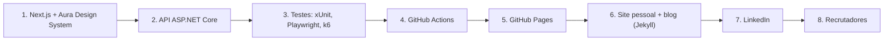

1. **[Next.js + Aura Design System](camadas/11-app.md#front)**: As telas em Next.js com o Aura Design System.
2. **[API ASP.NET Core](camadas/11-app.md#api)**: A API ASP.NET Core de um sistema AM.
3. **[Testes: xUnit, Playwright, k6](camadas/11-app.md#tests)**: Testes de unidade, integração e tela.
4. **[GitHub Actions](camadas/12-nuvem.md#gha)**: O Actions mostra os testes passando (selo verde).
5. **[GitHub Pages](camadas/12-nuvem.md#ghp)**: O Pages publica o portfólio.
6. **[Site pessoal + blog (Jekyll)](camadas/18-web.md#site)**: O site reúne projetos, blog e currículo.
7. **[LinkedIn](camadas/22-pub.md#li)**: O LinkedIn divulga cada entrega.
8. **[Recrutadores](camadas/22-pub.md#recr)**: O recrutador encontra tudo ligado.

## Do livro ao leitor

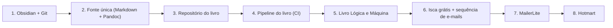

1. **[Obsidian + Git](camadas/03-win.md#obsd)**: Você rascunha no Obsidian.
2. **[Fonte única (Markdown + Pandoc)](camadas/15-editora.md#fonte)**: O texto vai para a fonte única em Markdown.
3. **[Repositório do livro](camadas/15-editora.md#brepo)**: Fica versionado no repositório do livro, com exercícios e figuras.
4. **[Pipeline do livro (CI)](camadas/15-editora.md#bci)**: O pipeline confere tudo e monta PDF, EPUB e o arquivo de impressão.
5. **[Livro Lógica e Máquina](camadas/17-prod.md#livro)**: O livro fica pronto, também para o KDP.
6. **[Isca grátis + sequência de e-mails](camadas/21-mkt.md#isca)**: Um capítulo grátis captura o e-mail do leitor.
7. **[MailerLite](camadas/21-mkt.md#mailer)**: A sequência apresenta o livro.
8. **[Hotmart](camadas/20-venda.md#hotm)**: O leitor compra.

## Estudar e preparar aula com IA

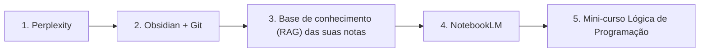

1. **[Perplexity](camadas/07-chat.md#perp)**: O Perplexity traz fontes atuais.
2. **[Obsidian + Git](camadas/03-win.md#obsd)**: Você anota com as suas palavras no Obsidian.
3. **[Base de conhecimento (RAG) das suas notas](camadas/05-ia.md#rag)**: As suas notas são indexadas.
4. **[NotebookLM](camadas/07-chat.md#nblm)**: O NotebookLM responde com base nas suas notas e PDFs.
5. **[Mini-curso Lógica de Programação](camadas/17-prod.md#curso)**: O conteúdo vira aula do mini-curso.

## Laboratório de segurança

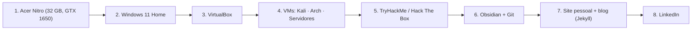

1. **[Acer Nitro (32 GB, GTX 1650)](camadas/01-hw.md#nb)**: O notebook roda tudo.
2. **[Windows 11 Home](camadas/03-win.md#w11)**: O Windows hospeda as VMs.
3. **[VirtualBox](camadas/03-win.md#vbox)**: O VirtualBox executa.
4. **[VMs: Kali · Arch · Servidores](camadas/03-win.md#vms)**: Kali ataca a VM alvo numa rede isolada.
5. **[TryHackMe / Hack The Box](camadas/14-est.md#thm)**: O TryHackMe guia o laboratório.
6. **[Obsidian + Git](camadas/03-win.md#obsd)**: Você documenta o writeup no Obsidian.
7. **[Site pessoal + blog (Jekyll)](camadas/18-web.md#site)**: O writeup vira post no blog.
8. **[LinkedIn](camadas/22-pub.md#li)**: O LinkedIn divulga para recrutadores.

## Site para um cliente

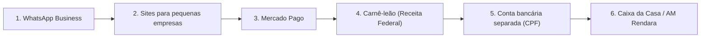

1. **[WhatsApp Business](camadas/22-pub.md#wa)**: O cliente pede orçamento pelo WhatsApp.
2. **[Sites para pequenas empresas](camadas/17-prod.md#sites)**: Você fecha, desenvolve no VS Code, versiona no GitHub e publica na Hostinger do cliente.
3. **[Mercado Pago](camadas/20-venda.md#mp)**: Cobra pelo Mercado Pago.
4. **[Carnê-leão (Receita Federal)](camadas/19-emp.md#nfse)**: Lança no carnê-leão.
5. **[Conta bancária separada (CPF)](camadas/19-emp.md#banco)**: Recebe na conta separada.
6. **[Caixa da Casa / AM Rendara](camadas/19-emp.md#caixa)**: O Caixa da Casa registra a entrada.

## Publicar automaticamente no melhor horário

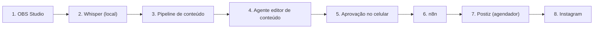

1. **[OBS Studio](camadas/13-cont.md#obss)**: Você grava a tela e o setup.
2. **[Whisper (local)](camadas/13-cont.md#whis)**: O Whisper transcreve no notebook.
3. **[Pipeline de conteúdo](camadas/23-oper.md#opipe)**: O pipeline de conteúdo pega a transcrição a cada 15 minutos.
4. **[Agente editor de conteúdo](camadas/23-oper.md#oedit)**: O agente editor monta cortes, legendas, carrossel e posts.
5. **[Aprovação no celular](camadas/21-mkt.md#aprov)**: Você aprova pelo Telegram, no celular.
6. **[n8n](camadas/21-mkt.md#n8n)**: O n8n escolhe o horário pelo desempenho anterior.
7. **[Postiz (agendador)](camadas/21-mkt.md#postiz)**: O Postiz publica (ou o agendador nativo de cada rede, até você decidir).
8. **[Instagram](camadas/22-pub.md#ig)**: O post sai no Instagram e nas outras redes.

## Medir o lucro de uma campanha

```mermaid
flowchart LR
  s0["1. Padrão de UTM"]
  s1["2. Meta Ads (Instagram, Facebook)"]
  s2["3. Isca grátis + sequência de e-mails"]
  s3["4. MailerLite"]
  s4["5. Hotmart"]
  s5["6. Webhooks de venda"]
  s6["7. n8n"]
  s7["8. Banco de métricas (PostgreSQL)"]
  s8["9. Painel de lucro (Grafana)"]
  s9["10. Regras de corte"]
  s10["11. Lucro por Venda (calculadora)"]
  s0 --> s1
  s1 --> s2
  s2 --> s3
  s3 --> s4
  s4 --> s5
  s5 --> s6
  s6 --> s7
  s7 --> s8
  s8 --> s9
  s9 --> s10
```

1. **[Padrão de UTM](camadas/21-mkt.md#utm)**: Os links do anúncio levam UTM.
2. **[Meta Ads (Instagram, Facebook)](camadas/21-mkt.md#ads)**: A campanha roda com orçamento de teste.
3. **[Isca grátis + sequência de e-mails](camadas/21-mkt.md#isca)**: O anúncio leva à aula grátis.
4. **[MailerLite](camadas/21-mkt.md#mailer)**: A sequência leva à oferta.
5. **[Hotmart](camadas/20-venda.md#hotm)**: A venda acontece na plataforma.
6. **[Webhooks de venda](camadas/21-mkt.md#hooks)**: O webhook avisa a venda.
7. **[n8n](camadas/21-mkt.md#n8n)**: O n8n grava a venda.
8. **[Banco de métricas (PostgreSQL)](camadas/21-mkt.md#metrics)**: O banco junta venda, taxa e gasto.
9. **[Painel de lucro (Grafana)](camadas/21-mkt.md#painel)**: O painel mostra o lucro real.
10. **[Regras de corte](camadas/21-mkt.md#regras)**: As regras pausam ou escalam.
11. **[Lucro por Venda (calculadora)](camadas/21-mkt.md#calc)**: A calculadora compara com o CPA e o ROAS de empate.

## Produzir um capítulo do livro

```mermaid
flowchart LR
  s0["1. Seu método (metodo.yaml)"]
  s1["2. Seu modelo de criação"]
  s2["3. Fonte única (Markdown + Pandoc)"]
  s3["4. Repositório do livro"]
  s4["5. Pipeline do livro (CI)"]
  s5["6. Leitores beta e revisão técnica"]
  s6["7. Errata e edições"]
  s7["8. Livro Lógica e Máquina"]
  s8["9. Amazon KDP"]
  s0 --> s1
  s1 --> s2
  s2 --> s3
  s3 --> s4
  s4 --> s5
  s5 --> s6
  s6 --> s7
  s7 --> s8
```

1. **[Seu método (metodo.yaml)](camadas/15-editora.md#metodo)**: O seu método define as etapas.
2. **[Seu modelo de criação](camadas/15-editora.md#modelo)**: O capítulo nasce do seu modelo de criação.
3. **[Fonte única (Markdown + Pandoc)](camadas/15-editora.md#fonte)**: Você escreve na fonte única.
4. **[Repositório do livro](camadas/15-editora.md#brepo)**: Exercícios, figuras e código entram no repositório; os agentes apontam problemas.
5. **[Pipeline do livro (CI)](camadas/15-editora.md#bci)**: O pipeline testa o código, confere gabaritos e revisa o texto.
6. **[Leitores beta e revisão técnica](camadas/15-editora.md#beta)**: Leitores beta e revisor técnico leem a prévia.
7. **[Errata e edições](camadas/15-editora.md#errata)**: As correções entram com número de edição.
8. **[Livro Lógica e Máquina](camadas/17-prod.md#livro)**: Sai o PDF, o EPUB e o arquivo de impressão.
9. **[Amazon KDP](camadas/15-editora.md#kdp)**: Publicado na Amazon e nas plataformas.

## Ilustrar um capítulo

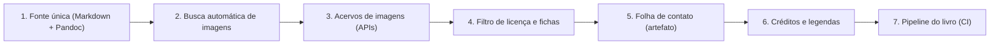

1. **[Fonte única (Markdown + Pandoc)](camadas/15-editora.md#fonte)**: O capítulo declara as figuras de que precisa.
2. **[Busca automática de imagens](camadas/15-editora.md#buscaimg)**: A busca consulta os acervos.
3. **[Acervos de imagens (APIs)](camadas/15-editora.md#acervos)**: Os acervos devolvem candidatos com licença.
4. **[Filtro de licença e fichas](camadas/15-editora.md#licenca)**: O filtro descarta licenças proibidas e baixa resolução.
5. **[Folha de contato (artefato)](camadas/15-editora.md#contato)**: Você escolhe na folha de contato.
6. **[Créditos e legendas](camadas/15-editora.md#creditos)**: Legenda e créditos são gerados.
7. **[Pipeline do livro (CI)](camadas/15-editora.md#bci)**: O pipeline confere tudo e monta o livro.

## Abrir o próximo negócio

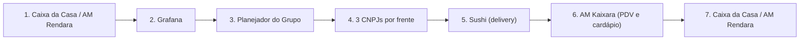

1. **[Caixa da Casa / AM Rendara](camadas/19-emp.md#caixa)**: O lucro do que já funciona acumula o capital.
2. **[Grafana](camadas/10-obs.md#graf)**: O painel confirma 3 meses seguidos acima do ponto de equilíbrio.
3. **[Planejador do Grupo](camadas/16-neg.md#nplan)**: O planejador mostra investimento, rampa e capital mínimo do próximo negócio.
4. **[3 CNPJs por frente](camadas/16-neg.md#ncnpj)**: O CNPJ da frente recebe os novos CNAEs ou nasce.
5. **[Sushi (delivery)](camadas/16-neg.md#nsushi)**: A casa abre, com alvará sanitário e bombeiros em dia.
6. **[AM Kaixara (PDV e cardápio)](camadas/11-app.md#nkaix)**: O AM Kaixara cuida do cardápio, das fichas técnicas e do PDV.
7. **[Caixa da Casa / AM Rendara](camadas/19-emp.md#caixa)**: As vendas do dia voltam para o caixa.

## Do trabalho ao conteúdo

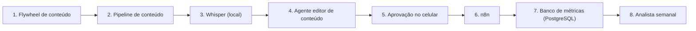

1. **[Flywheel de conteúdo](camadas/23-oper.md#ofly)**: Você grava a aula, o reparo, o capítulo ou a decisão da semana.
2. **[Pipeline de conteúdo](camadas/23-oper.md#opipe)**: O pipeline pega o arquivo na pasta de entrada.
3. **[Whisper (local)](camadas/13-cont.md#whis)**: O Whisper transcreve no notebook.
4. **[Agente editor de conteúdo](camadas/23-oper.md#oedit)**: O agente propõe cortes, legendas, carrossel, post do Google e newsletter.
5. **[Aprovação no celular](camadas/21-mkt.md#aprov)**: Você aprova no celular.
6. **[n8n](camadas/21-mkt.md#n8n)**: O n8n agenda e registra a publicação.
7. **[Banco de métricas (PostgreSQL)](camadas/21-mkt.md#metrics)**: Retenção, cliques e vendas voltam para o banco.
8. **[Analista semanal](camadas/23-oper.md#oanal)**: O analista semanal diz o que funcionou e o que mudar.

## Treinar uma IA sua

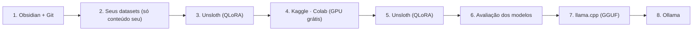

1. **[Obsidian + Git](camadas/03-win.md#obsd)**: As suas notas, exercícios, livro e aulas são a matéria-prima.
2. **[Seus datasets (só conteúdo seu)](camadas/06-dados.md#dset)**: Viram um dataset de perguntas e respostas, só com conteúdo seu.
3. **[Unsloth (QLoRA)](camadas/06-dados.md#unsl)**: O fine-tuning QLoRA ajusta um modelo base de 8B.
4. **[Kaggle · Colab (GPU grátis)](camadas/06-dados.md#kgl)**: O treino roda na GPU grátis do Kaggle (ou numa GPU alugada).
5. **[Unsloth (QLoRA)](camadas/06-dados.md#unsl)**: Sai um adaptador com o que o modelo aprendeu.
6. **[Avaliação dos modelos](camadas/06-dados.md#evals)**: Ele é testado contra o modelo base em perguntas separadas.
7. **[llama.cpp (GGUF)](camadas/06-dados.md#gguf)**: Aprovado, vira GGUF quantizado.
8. **[Ollama](camadas/05-ia.md#oll)**: E roda no Ollama do notebook, offline.

## Dados de venda viram decisão

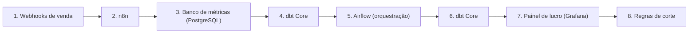

1. **[Webhooks de venda](camadas/21-mkt.md#hooks)**: Cada venda chega pelo webhook.
2. **[n8n](camadas/21-mkt.md#n8n)**: O n8n grava a venda bruta.
3. **[Banco de métricas (PostgreSQL)](camadas/21-mkt.md#metrics)**: O banco guarda vendas, gastos e publicações.
4. **[dbt Core](camadas/06-dados.md#dbt)**: O dbt limpa, junta e testa as tabelas.
5. **[Airflow (orquestração)](camadas/06-dados.md#orq)**: O Airflow roda tudo todo dia e avisa se falhar.
6. **[dbt Core](camadas/06-dados.md#dbt)**: Os modelos ficam prontos.
7. **[Painel de lucro (Grafana)](camadas/21-mkt.md#painel)**: O painel mostra lucro por produto, canal e campanha.
8. **[Regras de corte](camadas/21-mkt.md#regras)**: As regras de corte decidem o que pausar e o que escalar.

## Do documento antigo à venda

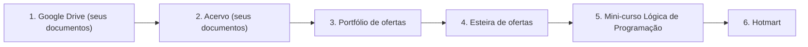

1. **[Google Drive (seus documentos)](camadas/12-nuvem.md#gdrv)**: Os documentos que você já tem saem do Drive pelo Takeout.
2. **[Acervo (seus documentos)](camadas/23-oper.md#acv)**: O acervo separa pessoais, terceiros e escola, converte o resto e sugere produtos.
3. **[Portfólio de ofertas](camadas/23-oper.md#ocatal)**: Os melhores candidatos entram no portfólio de ofertas.
4. **[Esteira de ofertas](camadas/23-oper.md#oesteira)**: Passam pela esteira: validação, construção e lançamento.
5. **[Mini-curso Lógica de Programação](camadas/17-prod.md#curso)**: O material vira curso, apostila, banco de questões ou kit do professor.
6. **[Hotmart](camadas/20-venda.md#hotm)**: E vai para a venda.

## Do notebook à primeira venda

```mermaid
flowchart LR
  s0["1. Acer Nitro (32 GB, GTX 1650)"]
  s1["2. Diagnóstico do notebook"]
  s2["3. Roteiro de implantação"]
  s3["4. Instaladores (PowerShell e bash)"]
  s4["5. Pipeline de conteúdo"]
  s5["6. Agente editor de conteúdo"]
  s6["7. Aprovação no celular"]
  s7["8. n8n"]
  s8["9. Banco de métricas (PostgreSQL)"]
  s0 --> s1
  s1 --> s2
  s2 --> s3
  s3 --> s4
  s4 --> s5
  s5 --> s6
  s6 --> s7
  s7 --> s8
```

1. **[Acer Nitro (32 GB, GTX 1650)](camadas/01-hw.md#nb)**: O diagnóstico lê o que o notebook já tem.
2. **[Diagnóstico do notebook](camadas/23-oper.md#diag)**: Diz o que falta e em que passo se resolve.
3. **[Roteiro de implantação](camadas/23-oper.md#oimpl)**: O roteiro começa a partir do que você já tem.
4. **[Instaladores (PowerShell e bash)](camadas/23-oper.md#oinst)**: Os instaladores põem só o que falta.
5. **[Pipeline de conteúdo](camadas/23-oper.md#opipe)**: O pipeline transforma as aulas gravadas em peças.
6. **[Agente editor de conteúdo](camadas/23-oper.md#oedit)**: O agente editor prepara posts e cortes.
7. **[Aprovação no celular](camadas/21-mkt.md#aprov)**: Você aprova.
8. **[n8n](camadas/21-mkt.md#n8n)**: Os posts levam o público até a página.
9. **[Banco de métricas (PostgreSQL)](camadas/21-mkt.md#metrics)**: A primeira venda chega ao banco e ao painel.

## Um teste de intrusão, do contrato ao reteste

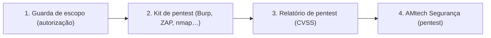

1. **[Guarda de escopo (autorização)](camadas/02-seg.md#escopo)**: O termo assinado vira escopo.toml; a guarda confere assinatura, janela e alvos.
2. **[Kit de pentest (Burp, ZAP, nmap…)](camadas/02-seg.md#kitpent)**: Os testes rodam pelo escopo.py rodar, só nos alvos liberados, e cada comando fica registrado.
3. **[Relatório de pentest (CVSS)](camadas/02-seg.md#relpent)**: Os achados viram relatório com nota CVSS calculada e o registro de atividades no apêndice.
4. **[AMtech Segurança (pentest)](camadas/16-neg.md#nseg)**: A AMtech Segurança entrega, combina as correções e faz o reteste.

## Engenharia reversa com IA (estudo e aula)

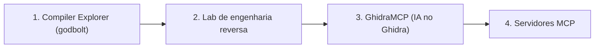

1. **[Compiler Explorer (godbolt)](camadas/14-est.md#godbolt)**: Na aula, o aluno vê o C virar assembly no Compiler Explorer.
2. **[Lab de engenharia reversa](camadas/02-seg.md#relab)**: O binário que ele mesmo compilou (ou um crackme) abre no Ghidra.
3. **[GhidraMCP (IA no Ghidra)](camadas/02-seg.md#ghidramcp)**: O GhidraMCP entrega as funções ao Claude, que renomeia e explica.
4. **[Servidores MCP](camadas/05-ia.md#mcp)**: Tudo passa pelos servidores MCP com permissão limitada.

## Um comando de voz até a tomada

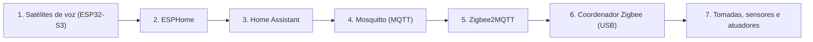

1. **[Satélites de voz (ESP32-S3)](camadas/01-hw.md#satvoz)**: O satélite do cômodo ouve "hey jarvis" e grava o pedido.
2. **[ESPHome](camadas/09-cnt.md#esphome)**: O firmware ESPHome manda o áudio ao Home Assistant.
3. **[Home Assistant](camadas/01-hw.md#ha)**: O Assist transcreve (Whisper), resolve a frase ou pergunta ao Claude, e confere a política.
4. **[Mosquitto (MQTT)](camadas/09-cnt.md#mqtt)**: O comando sai pelo MQTT.
5. **[Zigbee2MQTT](camadas/09-cnt.md#z2m)**: O Zigbee2MQTT traduz para o rádio.
6. **[Coordenador Zigbee (USB)](camadas/01-hw.md#zbdongle)**: O coordenador envia pelo Zigbee.
7. **[Tomadas, sensores e atuadores](camadas/01-hw.md#dispcasa)**: A tomada desliga, e o Piper confirma em voz.

## Do modelo BIM à estimativa da obra

```mermaid
flowchart LR
  s0["1. QGIS (terreno e mapas)"]
  s1["2. Bonsai + IfcOpenShell (BIM aberto)"]
  s2["3. Resumo de IFC (ifc_resumo.py)"]
  s3["4. AM Obra (diário, medição, compras)"]
  s0 --> s1
  s1 --> s2
  s2 --> s3
```

1. **[QGIS (terreno e mapas)](camadas/03-win.md#qgis)**: O terreno sai do QGIS.
2. **[Bonsai + IfcOpenShell (BIM aberto)](camadas/03-win.md#bonsai)**: A casa é modelada em IFC no Bonsai.
3. **[Resumo de IFC (ifc_resumo.py)](camadas/23-oper.md#ifcresumo)**: O resumo confere pavimentos, elementos e quantidades.
4. **[AM Obra (diário, medição, compras)](camadas/11-app.md#nobra)**: O AM Obra cruza as quantidades com os preços do SINAPI-MG do mês: estimativa para o profissional revisar.

## Da engenharia reversa ao pentest, no seu laboratório

```mermaid
flowchart LR
  s0["1. Lab de engenharia reversa"]
  s1["2. Lab de alvo isolado (rede sem internet)"]
  s2["3. Kit de pentest (Burp, ZAP, nmap…)"]
  s3["4. Relatório de pentest (CVSS)"]
  s0 --> s1
  s1 --> s2
  s2 --> s3
```

1. **[Lab de engenharia reversa](camadas/02-seg.md#relab)**: O programa abre no Ghidra ou no ILSpy: onde confere senha, que dados guarda, com quem fala na rede.
2. **[Lab de alvo isolado (rede sem internet)](camadas/02-seg.md#labalvo)**: Uma cópia dele roda na rede isolada, com foto do estado limpo.
3. **[Kit de pentest (Burp, ZAP, nmap…)](camadas/02-seg.md#kitpent)**: O atacante testa os pontos que a engenharia reversa apontou.
4. **[Relatório de pentest (CVSS)](camadas/02-seg.md#relpent)**: Os achados viram relatório com CVSS; se o software for de terceiro, aviso em particular ao projeto.
