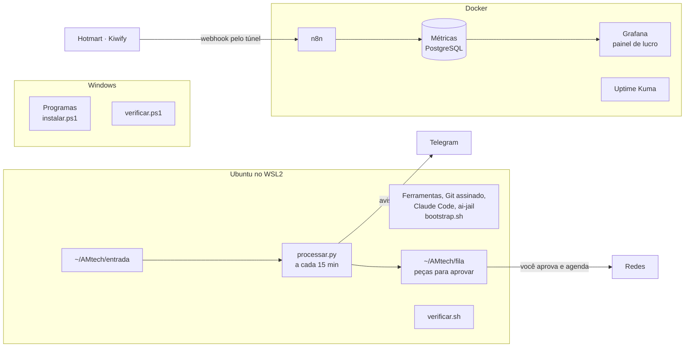

# Implantação

[← Índice da documentação](../README.md)

Como sair do planejamento para o setup funcionando: scripts que instalam, scripts que conferem e um roteiro com o critério de pronto de cada passo. Quando a última fase passar, alimentar o sistema é só colocar arquivos numa pasta.

- [Roteiro de implantação](roteiro.md): 34 fases e 253 passos, na ordem, com o que cada passo implanta (gerado)
- [`acompanhamento.html`](acompanhamento.html): a mesma lista para marcar o progresso no navegador (gerado)

## Todo o planejamento está no passo a passo

Nada foi retirado. Cada um dos 326 blocos do [mapa do setup](../mapa.html), de todas as 23 camadas, e cada uma das 47 ofertas do [portfólio](../operacao/portfolio.md) entram em algum passo do roteiro. Cada fase diz **quando**: a semana e o mês, ou o gatilho que precisa acontecer antes (a primeira venda, a renda passar do valor de virada, o capítulo 1 ficar pronto, o portão de cada negócio).

| Período | Fases |
|---|---|
| Antes de tudo (semana 1) | 0 Diagnóstico: o que você já tem |
| Semanas 1 a 11 (out/2026 a jan/2027) | 1 a 15: o núcleo, tudo o que o notebook já suporta |
| Semanas 12 a 15 (jan a fev/2027) | 16 Primeira venda: o mini-curso no ar |
| Jan a abr/2027 | 17 Base dos sistemas AM, 18 Nuvem e deploy |
| Quando o capítulo 1 estiver pronto | 19 Editora |
| Semana 2 em diante e 2027 | 20 Dados, IA e pendrives |
| Fev a dez/2027, depois da primeira venda | 21 Mais ofertas, uma por vez (as 20 ofertas seguintes, na ordem da pontuação), 22 Marketing pago |
| 2027, por gatilho ou compra | 23 Linux nativo, 24 IA nos sistemas AM, 25 Sistemas AM à venda, 26 CNPJ, 27 Agentes do grupo, 28 Editora depois do primeiro livro |
| 2028 | 29 Distribuído, plataforma e segunda nuvem, 30 Infraestrutura própria |
| Fase A, B e C, pelos portões | 31 Negócios do grupo em Barbacena, um por vez |
| Sempre | 32 Estudo contínuo |

No fim do [roteiro](roteiro.md#quando-entra-cada-bloco) e do acompanhamento há a tabela **Quando entra cada bloco**, camada por camada. No diagrama do ecossistema e no mapa, tocar num bloco mostra o passo e a data; no portfólio, cada oferta mostra o passo em que entra à venda. O CI confere a cada envio: um bloco ou uma oferta sem passo, ou uma fase sem data, faz o teste falhar.

As datas são uma proposta para caber em umas 5 horas por semana; os gatilhos não têm data porque dependem de resultado. O que não entra de jeito nenhum está em [Decisões](../fora-do-setup.md), com o motivo.

## Etapa 0: o que você já tem

Antes de instalar qualquer coisa, `scripts/windows/diagnostico.ps1` lê o notebook (somente leitura): modelo, processador, memória e slots livres, placa de vídeo, discos e saúde, espaço livre, bateria, monitores, Secure Boot, TPM, criptografia, Defender, os programas do setup que já estão instalados e os que faltam, WSL, Docker, modelos do Ollama e extensões do VS Code. O relatório `diagnostico.md` diz em que passo do roteiro cada pendência se resolve. Junto com a lista das contas que você já tem e a contagem dos seus documentos, é dele que o resto do roteiro parte.

Para rodar: extraia o `dev-setup.zip` (botão direito > Extrair tudo), entre na pasta que tem `RODAR-DIAGNOSTICO.cmd` e a pasta `scripts` (o Windows costuma criar `dev-setup\dev-setup`; a certa é a de dentro, e ela fica em `C:\Users\SEU_USUARIO\dev-setup`, porque todos os comandos do Windows do roteiro apontam para lá e assim funcionam de qualquer pasta) e clique com o botão direito em `RODAR-DIAGNOSTICO.cmd` > Executar como administrador. Ele entra sozinho na pasta certa e não mexe em mais nada do computador. O relatório fica em `diagnostico-AAAAMMDD`, dentro da mesma pasta.

## Pelo terminal

Todo passo tem o comando para copiar ou, quando não dá, a linha **Fora do terminal** com o motivo. Dos 253 passos, 131 têm comando e 127 se fazem inteiros pelo terminal: os do Windows no PowerShell (como Administrador), os do Linux no Ubuntu, e os marcados como Claude com `claude "Passo ..."`, que abre o Claude Code no repositório com o pedido daquele passo. O resto não tem como: criar conta e ligar a verificação em duas etapas é sempre no site do serviço com o celular, órgão público e contador têm atendimento próprio, montar hardware é com as mãos, e gravar, vender e decidir são com você. O CI falha se um passo ficar sem comando e sem motivo.

## Senhas: recuperar, trocar e guardar

Logo depois de preparar a máquina vem a fase das senhas, porque o resto do roteiro cria dezenas de contas. O KeePassXC guarda todas, com uma senha mestra de 6 palavras que é a única que você decora, e um kit de emergência em papel garante que perder o notebook e o celular não tranca você para fora. A ordem importa: primeiro o e-mail principal (todo "Esqueci minha senha" passa por ele), depois as senhas salvas nos navegadores vão para o cofre, o relatório do KeePassXC aponta as fracas, repetidas e vazadas, e as contas críticas são trocadas uma por uma com verificação em duas etapas. O resto vai 5 contas por semana. O Claude não vê nem guarda nenhuma senha: quem digita é sempre você.

## O caminho até vender

A primeira venda do mini-curso está na fase 17, mas o dinheiro pode entrar antes: aulas particulares com agenda e Pix, sites para pequenas empresas e links de afiliado ficam prontos na fase 14. Depois da primeira venda, a fase 22 põe as outras ofertas à venda uma por vez, começando pelas de maior pontuação (página 'meu setup', kit de aulas para professores, planilha do Caixa da Casa, automação com IA, banco de questões, baralhos Anki).

## O que fica funcionando no fim do núcleo

## O que acontece quando você alimenta o sistema

| Você coloca | Onde | O sistema faz |
|---|---|---|
| Uma aula gravada | `~/AMtech/entrada/aulas` | Transcreve no notebook, gera 3 cortes com início e fim, carrossel, newsletter, questão de concurso e legendas; avisa no Telegram |
| Um capítulo ou trecho do livro | `~/AMtech/entrada/capitulos` | Artigo de blog, cards de conceito, newsletter e roteiro de vídeo curto |
| Anotações de um reparo | `~/AMtech/entrada/reparos` | Post do Google Perfil, dica para Reels e pergunta frequente do site |
| Uma decisão da semana | `~/AMtech/entrada/decisoes` | Roteiro do vídeo de build in public, post no LinkedIn e newsletter |
| Uma ideia solta | `~/AMtech/entrada/ideias` | Ângulos de conteúdo, rascunho de post e a linha para o portfólio de ofertas |
| Todos os documentos que você já tem | `uv run tools/acervo/acervo.py --origem PASTA` | Separa cópias, pessoais, material de terceiros e da escola; converte o resto para o Obsidian (30-Acervo) e escreve 40-Produtos/Produtos do acervo.md com o que dá para vender |
| Uma venda | (chega sozinha) | Webhook da plataforma → n8n → tabela de vendas → painel de lucro por produto e campanha |

Tudo segue o seu [guia de marca](../../config/marca.md). Arquivo que dá erro três vezes vai para `entrada/_com-erro` com o motivo, sem travar a fila.

## Como você sabe que está funcionando

Três verificadores, todos somente leitura, que terminam dizendo "pronto" ou listando exatamente o que falta:

| Verificador | Onde roda | Confere |
|---|---|---|
| `RODAR-DIAGNOSTICO.cmd` → `scripts/windows/diagnostico.ps1` | Botão direito > Executar como administrador, antes de tudo | O que o notebook já tem de hardware, segurança e programas, e em que passo cada pendência se resolve |
| `scripts/windows/verificar.ps1` | PowerShell | Programas, WSL2, .wslconfig, Docker, Ollama e, como Administrador, Secure Boot, TPM e criptografia |
| `scripts/wsl/verificar.sh` | Ubuntu | Ferramentas e versões (inclusive nmap, dig, Azure CLI, Terraform, Vercel CLI e Wrangler como opcionais), Git com commits assinados, login no GitHub, pastas |
| `scripts/wsl/verificar.sh --servicos` | Ubuntu | n8n, banco de métricas, Grafana, Uptime Kuma, Postiz e o pipeline de conteúdo |

## O que eu testei e o que não consegui testar

Testado aqui, num Ubuntu 24.04 igual ao do WSL:

- `bootstrap.sh` rodado de verdade duas vezes: instalou .NET 10, fnm, gitleaks, trivy e ai-jail, configurou Git e criou as pastas; na segunda vez não refez nada.
- `verificar.sh`, inclusive a saída em JSON.
- O banco de métricas com dados de exemplo: lucro, CPA, venda repetida que não duplica, e o usuário do Grafana que só lê.
- O pipeline de conteúdo com 10 testes automáticos (transcrição, fila, quarentena, nomes repetidos) e uma rodada simulada.
- O `compose.yaml` validado pelo Docker Compose; os scripts passaram no ShellCheck e no PSScriptAnalyzer.
- Os scripts do Windows rodaram no PowerShell 7 com `winget`, `wsl` e `code` simulados.
- `diagnostico.ps1` rodado no PowerShell 7 fora do Windows (sem hardware para ler): termina sem erro e escreve o relatório; no CI ele roda a cada envio. A leitura de verdade do hardware só dá para conferir no seu notebook.
- `acervo.py` rodado de verdade com .docx, .pptx, .pdf, .md e .zip parecidos com os do seu Drive: achou a cópia repetida, barrou o contracheque, marcou o livro de editora como terceiros e a prova com nome de aluno como escola com dado pessoal, e sugeriu mini-curso, apostila e estudo de caso. `vault.sh` rodado duas vezes sem sobrescrever nada.
- `lab-ia.sh` rodado de verdade: instalou PyTorch 2.14 (CUDA 13), Transformers, PEFT, TRL, DuckDB, dbt, PySpark e MLflow; um job PySpark e uma consulta DuckDB rodaram; na segunda vez não refez nada.
- `nuvem.sh` rodado de verdade duas vezes: instalou Azure CLI 2.91, Vercel CLI e Wrangler; na segunda vez não refez nada.

Não deu para testar aqui:

- O Windows de verdade (winget, WSL, criptografia). Por isso todo script do Windows tem o modo que só mostra o que faria, e o verificador confere depois.
- Baixar as imagens Docker e subir a stack (o ambiente daqui bloqueia os registros de imagens). O primeiro `docker compose up -d` no seu notebook é o teste.
- O instalador do Node pelo fnm e o do Claude Code, que dependem de sites bloqueados aqui.
- A GPU: aqui não há placa NVIDIA, então o PyTorch rodou na CPU. No notebook, `nvidia-smi` dentro do Ubuntu e o próprio `lab-ia.sh` mostram se a GTX 1650 foi vista; para o CUDA 13 o driver da NVIDIA no Windows precisa estar atualizado.
- O Terraform, que vem do repositório da HashiCorp, também bloqueado aqui. O `nuvem.sh` avisa com ERRO se falhar no seu notebook.
- Os nomes das extensões do VS Code no Marketplace (bloqueado aqui). Se algum mudou, o script mostra ERRO só naquela extensão e segue.
- A chamada real à API do Claude e ao Telegram, que precisam das suas chaves.

## O que nenhum script faz por você

- Criar contas, senhas, 2FA e aprovar pagamentos.
- Aprovar as peças antes de publicar. O pipeline deixa tudo pronto na fila; publicar sem revisão é exatamente o risco que o setup evita.
- Publicar no TikTok pela API sem a auditoria do app (só sai como privado).
- Conectar os webhooks de venda: o n8n precisa de um endereço público (túnel), e o fluxo é montado com você na fase 15.

## Custos novos

| Item | Custo |
|---|---|
| API do Claude para o pipeline | Por uso, separado da assinatura; defina um limite mensal no console da Anthropic |
| Backblaze B2 (cópia fora de casa) | Cerca de US$ 6,95 por TB por mês, ou o armazenamento do plano Google que você já tem |
| Domínio .com.br | Anuidade do Registro.br |
| Azure, Resend, Sentry, SonarQube Cloud | Começam no plano grátis; ligue o alerta de orçamento da Azure antes de criar qualquer recurso |
| ElevenLabs (voz clonada) | Plano pago, só se decidir usar |
| GPU para treinar | Kaggle grátis (30 horas por semana de T4 de 16 GB); se faltar, RunPod com crédito pré-pago, de cerca de US$ 0,27 a 0,90 por hora em GPU de 24 GB (out/2026) |
| ISBN e ficha catalográfica | Por livro, na CBL, quando o primeiro livro estiver pronto |
| Todo o resto (n8n, Grafana, PostgreSQL, Uptime Kuma, Postiz, ai-jail, restic) | Grátis, rodando no seu notebook |

## Primeiro o que dá para fazer hoje

No acompanhamento, o filtro **Só o que dá para fazer hoje** esconde os passos que precisam de compra, de pagamento, de um conteúdo seu que ainda não existe ou de um gatilho que ainda não aconteceu. Sobram 168 dos 253 passos, só com o notebook e contas grátis.

## Ritmo sugerido

O caminho até a primeira venda (fases 0 a 17) leva cerca de 81 horas: umas 16 semanas no bloco de construção da sua semana (quinta e sexta de manhã, umas 5 horas). Da 18 em diante o ritmo é o da sua renda e das suas compras; os tempos dessas fases são estimativas grosseiras, e os negócios levam anos.

| Semana | Fases |
|---|---|
| 1 | 0 Diagnóstico, 1 Preparar, 2 Windows |
| 2 | 3 Linux, 4 GitHub, 5 Agentes |
| 3 | 6 Backup, começo do 7 Acervo |
| 4 | Fim do 7 Acervo, 8 Claude e assistentes, 9 Automação |
| 5 | 10 Pipeline de conteúdo, 11 Estúdio |
| 6 e 7 | 12 Contas, canais e sites |
| 8 a 10 | 13 Vendas e finanças no CPF (aulas particulares e sites já podem vender aqui) |
| 11 | 14 Vendas medidas, 15 Teste do núcleo |
| 12 a 15 | 16 Primeira venda: o mini-curso no ar |
| Depois | As fases 18 a 33, cada uma na data ou no gatilho da tabela acima |

O acervo vem cedo de propósito: na semana 4 você já sabe tudo o que tem e o que dá para vender, e o pipeline de conteúdo da semana 5 passa a ter material para trabalhar.
