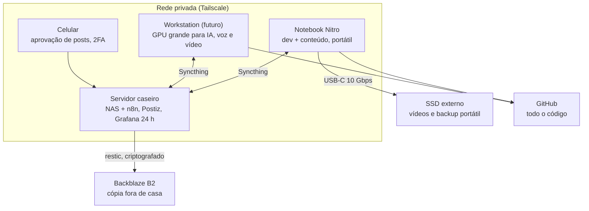

# Vários computadores, SSD externo e NAS

[← Índice da documentação](../README.md)

Sim, dá para ter vários computadores, SSD externo e NAS local e em nuvem no mesmo setup. A regra que deixa isso simples: **nenhuma máquina guarda algo que só exista nela.** Código no GitHub, configuração nos dotfiles, arquivos sincronizados e backup em três lugares. Qualquer máquina pode quebrar ou ser trocada sem perder nada.

## Como fica

## Cada peça

| Peça | Para que serve | Quando |
|---|---|---|
| **Notebook Nitro** | Desenvolvimento, gravação e edição. Continua sendo a máquina principal. | já |
| **SSD externo (USB-C)** | Projetos de vídeo (gravações do OBS, cache do DaVinci) e uma cópia de backup que você leva com você. | agora |
| **Segundo NVMe interno** | Arch Linux com boot próprio, ou espaço para WSL e Docker. | próximos meses |
| **Servidor caseiro (NAS + serviços)** | Dois HDs em espelho (RAID 1) e os serviços que precisam ficar ligados: n8n, Postiz, banco de métricas, Grafana, Uptime Kuma, Gitea. | quando a publicação automática estiver testada |
| **Armazenamento em nuvem** | A terceira cópia do backup, fora de casa, e arquivos públicos dos sites e sistemas. | junto com o servidor |
| **Workstation com GPU** | Voz, vídeo e modelos de IA locais com 12 GB ou mais de memória de vídeo. | só se sair mais barato que assinaturas e GPU por hora |
| **Raspberry Pi e placas** | Robótica e automação da casa. Entram na mesma rede privada. | já planejado |

## SSD externo no seu notebook

- A porta USB-C do AN515-45 é **USB 3.2 Gen 2 (10 Gbps)**, sem Thunderbolt e sem vídeo. Um SSD NVMe em gabinete USB 3.2 Gen 2 chega perto de 1 GB/s nessa porta; gabinetes Thunderbolt ou de 20/40 Gbps funcionam, mas limitados a 10 Gbps.
- Também há uma porta USB-A 3.2 Gen 2 (10 Gbps) e duas Gen 1 (5 Gbps). Use a de 10 Gbps para o SSD.
- Criptografe o disco (VeraCrypt funciona no Windows Home) se ele for carregar backup ou dados de alunos.
- Não rode o WSL nem o Docker a partir do SSD externo: um cabo que solta corrompe a máquina virtual.

## NAS local ou em nuvem?

Os dois, com papéis diferentes. "NAS em nuvem" não existe do mesmo jeito; o equivalente é armazenamento de objetos com uma ferramenta de sincronização ou backup.

| | NAS local | Nuvem |
|---|---|---|
| Velocidade | Rede de 1 Gbps (a placa do Nitro é gigabit): cerca de 110 MB/s | Depende da internet |
| Custo | Compra uma vez (máquina + 2 HDs) e energia | Mensal por TB |
| Protege contra | Disco que queima (RAID 1) | Roubo, incêndio, raio na casa |
| Não protege contra | Roubo, incêndio, apagar sem querer (RAID não é backup) | Internet fora do ar |

**Opções de nuvem (out/2026):**
- **Backblaze B2:** US$ 6,95 por TB/mês; download grátis até 3× o armazenado. O restic grava direto nele. Melhor para o backup.
- **Cloudflare R2:** US$ 0,015 por GB/mês (cerca de US$ 15 por TB), 10 GB grátis e **download sempre grátis**. Melhor para arquivos que os sites e sistemas entregam ao público.
- **Google One:** confira se o seu plano do Gemini inclui armazenamento; se incluir, serve como cópia extra de documentos.

## Sistema do servidor caseiro

| Opção | Custo | Para quem |
|---|---|---|
| **OpenMediaVault** | grátis, open source | Começo barato em PC antigo; roda em pouca memória. Você já vai saber Debian/Ubuntu. |
| **TrueNAS Community Edition** | grátis | Quem quer ZFS, snapshots e máxima integridade; pede 8 GB de RAM no mínimo, 16 GB para crescer. |
| **Unraid** | pago (US$ 49 a US$ 249) | Discos de tamanhos diferentes e tudo em um, com interface fácil. |
| **NAS pronto (Synology e similares)** | compra do aparelho | Menos trabalho, menos aprendizado. |

Recomendação para o seu plano: **um PC antigo ou mini PC com 16 GB de RAM, dois HDs iguais em espelho, Ubuntu Server com Docker** (ou OpenMediaVault, se quiser interface). É o mesmo Linux do seu WSL, os mesmos containers do seu Docker Compose e conta como homelab no currículo.

## Ligando tudo

- **Tailscale:** rede privada entre todas as máquinas e o celular, sem abrir porta no roteador. O plano grátis tem até 6 usuários e dispositivos ilimitados.
- **Syncthing:** sincroniza o vault, os projetos de vídeo e o cofre do KeePassXC entre notebook, servidor e workstation, direto entre as máquinas (open source, sem nuvem no meio).
- **dotfiles + install.sh:** qualquer máquina nova fica igual à atual em uma tarde.
- **GitHub:** o código nunca depende de uma máquina.

## Backup 3-2-1 com tudo isso

1. **Original:** notebook (e workstation).
2. **Segunda cópia, outro meio:** servidor caseiro em RAID 1, via Syncthing e restic; o SSD externo como cópia portátil.
3. **Fora de casa:** restic do servidor para o Backblaze B2, criptografado, todos os dias.

Teste de restauração todo mês: recuperar um arquivo do B2 e abrir.
