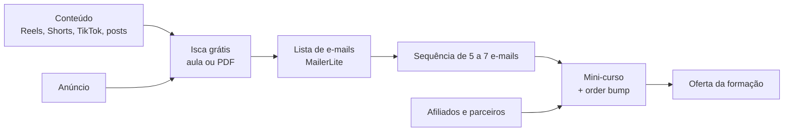

# 1 · Funil e ofertas

[← Marketing](README.md)

## Escada de produtos

Cada degrau financia o próximo e alimenta a lista de e-mails.

| Degrau | Produto | Preço (faixa a testar) | Papel |
|---|---|---|---|
| Grátis | Aula, PDF ou desafio de 5 dias de lógica | R$ 0 | Capturar e-mail e mostrar seu jeito de explicar |
| Entrada | Mini-curso Lógica de Programação | R$ 47 a R$ 97 | Validar a oferta; pagar os primeiros anúncios |
| Complemento | Templates, frontends prontos, código-fonte | R$ 19 a R$ 49 | Aumentar o ticket no checkout (order bump) |
| Principal | Formações (TI, Matemática, Finanças) | R$ 297 a R$ 997 | Lucro principal |
| Livro | Lógica e Máquina (PDF, depois impresso) | R$ 39 a R$ 79 | Autoridade e porta de entrada |
| Alto valor | Aulas particulares e mentoria | por hora | Margem alta, poucas vagas |
| Recorrente | Sistemas AM (SaaS) | mensal | Receita previsível (depois de CNPJ) |

As faixas são pontos de partida para teste, não preços recomendados. O preço final sai da [calculadora](07-medicao-e-lucro.md): ele precisa deixar espaço para o anúncio e para a margem.

## Funil

## Regras da oferta

- Uma promessa clara por produto ("seus primeiros 10 programas em 7 dias"), com prova: aulas gratuitas, depoimentos reais e projetos de alunos.
- Garantia de 7 dias (padrão das plataformas). Reembolso alto avisa que a promessa e a entrega estão desalinhadas.
- Bônus que custam zero por venda: templates, aula ao vivo gravada, comunidade.
- Preço com centavos e parcelamento aparecem no checkout; a calculadora considera o custo do parcelado se você absorver os juros.
