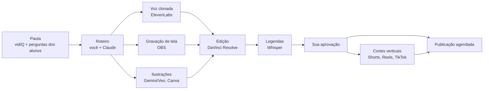

# 2 · Canais sem rosto, vídeo com IA e voz clonada

[← Marketing](README.md)

## O que as redes exigem (out/2026)

- **YouTube:** desde 15/07/2025 a regra de "conteúdo repetitivo" virou "conteúdo inautêntico" e mira vídeo produzido em massa, modelos com mudanças mínimas e vídeo de IA sem contribuição criativa. Em janeiro de 2026 houve uma onda de canais removidos do Programa de Parcerias com narração sintética sobre banco de imagens e ritmo de postagem impossível para uma pessoa. A fiscalização passou a olhar o canal inteiro, não só o vídeo.
- **YouTube:** conteúdo realista criado ou alterado por IA precisa ser declarado no envio. Desde 27/05/2026 o próprio YouTube rotula o que detecta sem declaração.
- **TikTok:** conteúdo realista gerado por IA precisa do rótulo; sem rótulo, pode ser removido. Pela API existe o campo `is_aigc`.
- **Meta (Instagram e Facebook):** aplica rótulo de informação de IA; declare quando a imagem ou o vídeo forem realistas.

O que pesa não é a falta de rosto nem a voz de IA: é a falta de explicação original. Por isso, o canal sem rosto aqui é **você explicando**, com a sua voz clonada e as suas ideias, não um robô repetindo texto genérico.

## O formato que funciona com as regras

- Tela do seu computador e do seu setup de verdade (VS Code, terminal, diagramas, o próprio Ecossistema AMtech), gravada no OBS.
- Roteiro escrito por você, com a IA ajudando a organizar e revisar.
- Animações e imagens de IA só para ilustrar conceitos (memória, rede, algoritmo), nunca como o vídeo inteiro.
- Voz: a sua, clonada, lendo o seu roteiro.
- Ritmo humano: 2 a 4 vídeos longos por semana no máximo; cortes curtos derivados deles.

## Esteira de produção

## Voz clonada

- **ElevenLabs:** clonagem profissional (a mais fiel) a partir do plano Creator, só com a sua própria voz verificada; planos pagos dão direito de uso comercial. Plano Creator: US$ 22/mês, com 121 mil créditos (preços de out/2026 segundo terceiros; confira no site).
- **Gravação de treino:** 30 minutos ou mais de áudio limpo, em ambiente silencioso, no tom das aulas. O microfone importa mais que a câmera.
- **Local no futuro:** modelos abertos de voz rodam bem em GPU com mais memória (nuvem por hora). A GTX 1650 de 4 GB não é suficiente para clonagem de qualidade.
- **Segurança:** a voz clonada é uma credencial. Conta com 2FA, nunca compartilhada, e você avisa o público que usa voz gerada por IA.

## Imagens e vídeo de IA

- **Gemini (seu plano pago):** os planos Google AI incluem acesso a vídeo com o Veo; o limite depende do plano. Use para cenas curtas de ilustração.
- **vidIQ (conectado):** pesquisa de palavras-chave, títulos, thumbnails, roteiro e cortes.
- **Canva (conectado):** thumbnails e posts no padrão da marca.
- Música e efeitos: só bibliotecas com licença (Biblioteca de áudio do YouTube, bancos com licença comercial). Música gerada por IA: confira a licença do serviço.

## Canais

Um canal por nicho, não por plataforma: **TI/Programação** primeiro (validação e seu público de alunos), **Matemática** depois, **Finanças** por último (exige mais cuidado com promessa e regulação). Cada canal existe em YouTube, Instagram, TikTok e Facebook, com o mesmo nome.
