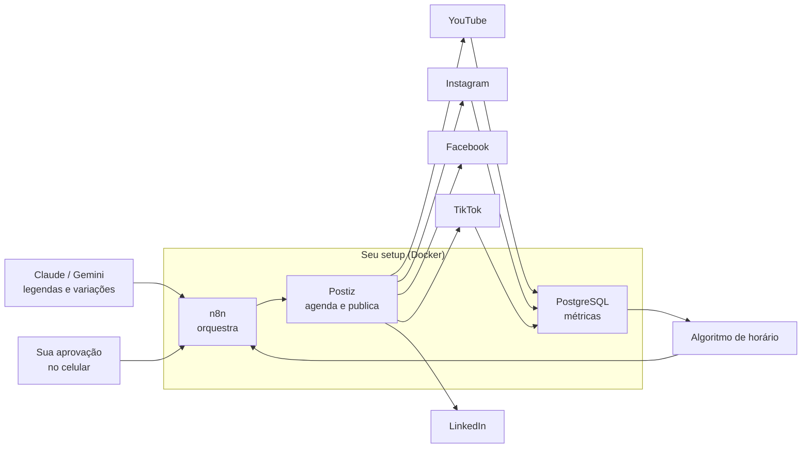

# 3 · Publicação autônoma no melhor horário

[← Marketing](README.md)

## Arquitetura

- **Postiz:** agendador open source (licença AGPL-3.0) que publica em mais de 28 redes, incluindo YouTube, Instagram, Facebook, TikTok, LinkedIn e Threads. Roda em Docker com PostgreSQL e Redis, a mesma base do seu setup, e tem API e integração com o n8n. Pede pelo menos 4 GB de RAM.
- **n8n:** recebe o vídeo aprovado, gera título, descrição e hashtags por rede com IA, escolhe o horário e manda para o Postiz.
- **Aprovação:** nada sai sem o seu "ok" no celular (Telegram ou e-mail). É o que protege o canal de um erro da IA virar post público.

## Limites das APIs oficiais

| Rede | Limite que importa |
|---|---|
| Instagram | Conta profissional; a documentação cita 50 e 100 publicações por API a cada 24 h (os dois números aparecem). Reels, Stories e carrossel são suportados. |
| TikTok | App que não passou pela auditoria do TikTok só publica como **privado**. Para publicar público pela API, o app precisa ser auditado, ou o Postiz usa o fluxo já aprovado dele. |
| YouTube | Cota diária da API; agendamento nativo no YouTube Studio como alternativa. |

## Como o "melhor horário" é escolhido

1. Nas primeiras 4 semanas, publique em horários variados e registre alcance, retenção e cliques de cada post.
2. O n8n calcula, por rede e por dia da semana, o desempenho médio em cada faixa de 1 hora.
3. **80% das publicações** vão para as 3 melhores faixas; **20%** testam faixas novas (assim o algoritmo não fica preso a um horário antigo).
4. Recalcula toda semana. Dados de outros criadores servem só como ponto de partida; o seu público decide.

## Volume por semana (ponto de partida)

| Formato | Quantidade |
|---|---|
| Vídeo longo no YouTube | 2 |
| Cortes verticais (Shorts, Reels, TikTok) | 1 por dia, o mesmo corte nas três redes |
| Stories | 3 a 5 por semana |
| Posts de carrossel | 2 |
| E-mail para a lista | 1 |

Volume maior só depois que a retenção mostrar que o público quer mais. Postar demais e igual é exatamente o padrão que as redes punem.
