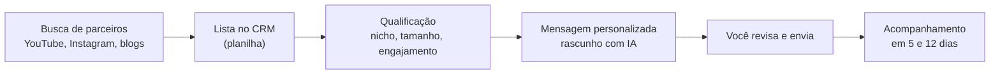

# 5 · Parcerias e afiliados

[← Marketing](README.md)

## Tipos de parceria

| Tipo | Como funciona | Quando |
|---|---|---|
| Afiliados | Você define a comissão na Hotmart, Kiwify ou Eduzz; o afiliado divulga e recebe por venda | Depois de 20 vendas próprias e uma página que converte |
| Coprodução | Alguém com público divide o produto com você em porcentagem | Formações e livro |
| Troca de divulgação | Lives, colabs e menções cruzadas com criadores do mesmo tamanho | Desde o início, custo zero |
| Escolas e cursos técnicos | Licença do material para turmas | Depois do livro |
| Parceiros de ferramenta | Programas de afiliados de ferramentas que você já usa e indica | Desde o início |

## Comissão sem prejuízo

A calculadora tem os campos "comissão do afiliado" e "vendas que vêm de afiliados". A comissão máxima é a que ainda deixa o **lucro por venda** positivo depois das taxas e do imposto. Comissões de 30 a 50% são comuns em infoproduto; o que vale é o seu número na calculadora.

## Prospecção com IA, contato humano

- Os plugins de vendas do Claude (busca de leads, rascunho de propostas) e o vidIQ (canais semelhantes) aceleram a busca.
- Mensagem enviada por robô em massa queima a sua reputação e pode violar as regras das redes. A IA rascunha; você envia.
- Métrica do processo: mensagens enviadas, respostas, parcerias fechadas e vendas por parceiro (registradas como campanha "Afiliado/parceria" na calculadora).
