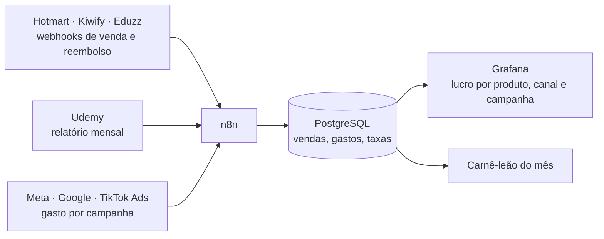

# 7 · Medição e lucro

[← Marketing](README.md)

## A conta de cada venda

```
Preço
− taxa da plataforma (% + fixa)
− custo do parcelamento (se você absorve)
− comissão de afiliados (média)
= você recebe
− imposto (carnê-leão)
− reembolsos (média)
− custo variável
− ferramentas (rateio por venda)
= sobra para anúncio e lucro   →  CPA máximo de empate
```

- **CPA de empate** = o que sobra por venda. Pagar mais que isso por venda em anúncio é prejuízo.
- **ROAS de empate** = preço ÷ CPA de empate. Faturamento dividido pelo gasto abaixo disso é prejuízo.
- **CPA da margem desejada** = CPA de empate − margem × preço.
- **Preço mínimo** = o menor preço que mantém a margem com um CPA esperado.

Exemplo conferido na calculadora: mini-curso de R$ 97 na Hotmart, 5% de reembolso, 15% de imposto e R$ 150/mês de ferramentas para 20 vendas → sobram **R$ 61,06** por venda; ROAS de empate **1,59×**; para 20% de margem, o CPA máximo é **R$ 41,66**.

Taxas usadas (consultadas em 08/10/2026): Hotmart 9,9% + R$ 2,49; Kiwify 8,99% + R$ 2,49; Eduzz Básico 4,9% + R$ 2,49. Udemy: 97% para você nas vendas pelo seu cupom e 37% nas orgânicas.

## Ferramentas

- **Lucro por Venda** (artefato): produtos, taxas, imposto, simulador de anúncios e o registro de cada campanha com o lucro real.
- **Painel automático** (fase seguinte): cada venda chega sozinha.



## Tabelas do banco

| Tabela | O que guarda |
|---|---|
| `produtos` | preço, plataforma, taxas, custos |
| `vendas` | data, produto, valor, taxa cobrada, comissão, país, UTM, status (paga, reembolsada) |
| `gastos` | data, canal, campanha, criativo, valor |
| `ferramentas` | assinatura, valor mensal, produtos que atende |
| `impostos` | mês, base, imposto pago |

## Imposto (pessoa física)

Desde janeiro de 2026 (Lei 15.270/2025) há uma redução mensal: até R$ 5.000 de rendimento o imposto pode zerar, e entre R$ 5.000,01 e R$ 7.350 a redução é R$ 978,62 − 0,133145 × rendimento. A calculadora aplica isso, mas lembre que no ajuste anual as vendas se somam aos seus salários. Para não ter prejuízo, use a alíquota marginal da sua faixa e confirme com um contador.

## O que "100%" quer dizer

- **Medido 100%:** cada venda, reembolso, taxa, comissão, imposto e real de anúncio registrado e ligado ao produto e à campanha.
- **Calculado antes:** limites (CPA e ROAS de empate) e cenários em faixa. O resultado de uma campanha nunca é conhecido antes; ele é limitado pelas regras de corte, que impedem que uma perda passe do valor do teste.
