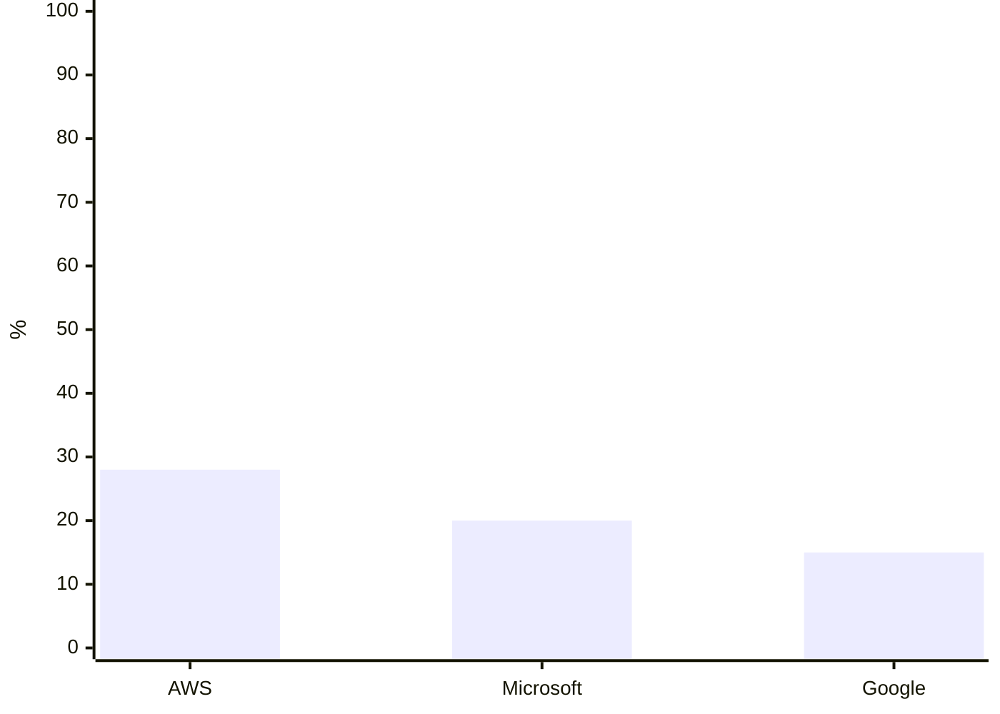
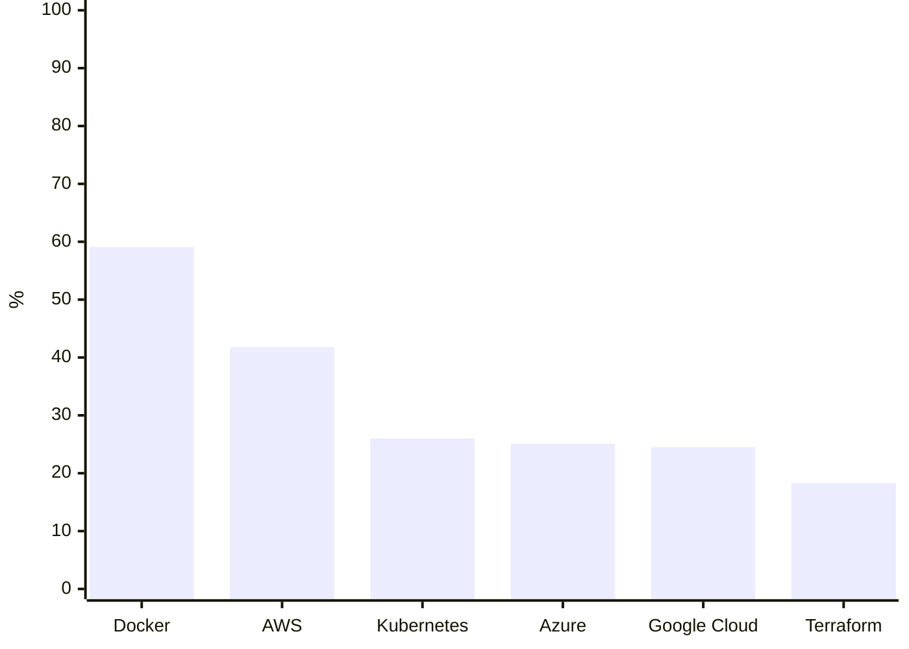

<!-- Arquivo GERADO por tools/gerar_docs.py a partir de data/. Edite os dados, não este arquivo. -->

# Mercado

[← Índice da documentação](README.md)

## Fatia do mercado de nuvem (receita)

Fonte: Synergy Research, 2º trimestre de 2026

| Item | % |
|---|---|
| AWS | 28 |
| Microsoft | 20 |
| Google | 15 |

## Uso entre desenvolvedores

Fonte: Stack Overflow Developer Survey 2026

| Item | % |
|---|---|
| Docker | 59,1 |
| AWS | 41,8 |
| Kubernetes | 26 |
| Azure | 25,1 |
| Google Cloud | 24,5 |
| Terraform | 18,3 |

## Tendências

- **Engenharia de IA e agentes:** Pesquisa SoftServe/MIT (2026): 51% dos executivos dizem que engenheiro de IA é o perfil mais procurado. Na prática: RAG, MCP, avaliação de respostas e orquestração de agentes. No seu setup: pgvector, Microsoft.Extensions.AI, MCP e os agentes do Claude Code.
- **Arquitetura de software:** 32% esperam mais demanda por arquitetos. Você já está no caminho certo com Clean Architecture, DDD e ADRs; falta mensageria e sistemas distribuídos.
- **Plataforma e DevOps:** Kubernetes, Terraform, CI/CD e observabilidade aparecem em vaga pleno e sênior. Docker sozinho já é obrigatório.
- **DevSecOps e LGPD:** Segurança dentro do pipeline (CodeQL, Trivy, gitleaks) e cuidado com dados pessoais. Combina com sua pós em cibersegurança.
- **Inglês:** Aparece como diferencial em toda lista de mercado. A documentação de tudo acima está em inglês primeiro.
