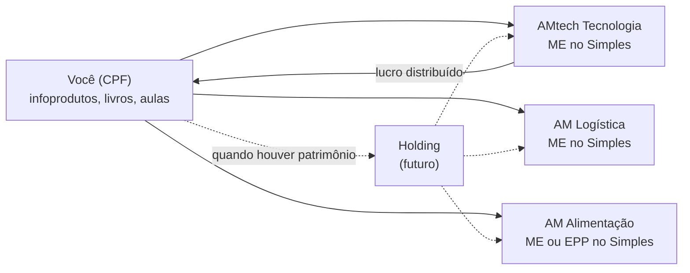

# Estrutura, ordem e capital

[← Negócios do grupo](README.md)

## Três CNPJs, não nove

Abrir nove empresas multiplica contador, certificado, alvarás e declarações. Juntar tudo em uma só mistura o risco de um restaurante com o caixa do software. O meio-termo é **um CNPJ por frente**, cada um com as atividades (CNAEs) da sua frente:

| CNPJ | Negócios | Atividades principais (CNAE, a confirmar com o contador) | Anexo do Simples |
|---|---|---|---|
| **AMtech Tecnologia** | Software, loja, peças, ponto de retirada, Maker | 6201-5/01 e 6202-3/00 (software), 6203-1/00 (software não customizável), 9511-8/00 (reparação de computadores), 4751-2/01 (comércio de informática), serviços de ponto de coleta | III (Fator R), I (comércio), II (kits montados) |
| **AM Logística** | Entregas, Flex, delivery | 5320-2/02 (entrega rápida), 4930-2/01 (transporte municipal de carga), 7490-1/04 (intermediação, para o app) | III |
| **AM Alimentação** | Sushi, cafeteria, padaria | 5611-2/01 (restaurante), 5611-2/03 (lanchonete e cafeteria), 1091-1/02 (padaria com venda própria), 5620-1/04 (marmitas) | I |

Regras que pesam nessa escolha:

- **Programação não pode ser MEI.** A AMtech Tecnologia nasce como ME no Simples, sócio único (SLU).
- **Quem é sócio de uma empresa não pode ser MEI.** Se você abrir um MEI antes (por exemplo, para a assistência), ele precisa virar ME quando o primeiro CNPJ do grupo nascer.
- **O limite do Simples é somado.** Se você tiver mais de 10% de várias empresas do Simples, a receita somada delas não pode passar de R$ 4,8 milhões por ano. Com os nove no alvo, o grupo fatura cerca de R$ 5,5 milhões por ano (a alimentação sozinha, R$ 4 milhões): no último estágio, o contador vai precisar planejar a saída de uma das empresas do Simples ou outra estrutura.
- **Holding só depois.** Uma holding patrimonial ou de participações faz sentido quando houver lucro e patrimônio para proteger e organizar a sucessão. Antes disso é custo sem retorno.
- **Contas separadas por CNPJ.** Cada empresa com conta, cartão e caixa próprios. O empréstimo de uma para outra é registrado em contrato de mútuo, nunca "por fora".

## A ordem e os portões

Cada fase só começa quando a anterior passa no portão. O portão é objetivo: ou os números estão lá, ou não estão.

| Fase | Abre | Capital mínimo | Portão para a próxima fase |
|---|---|---:|---|
| **A1** | AMtech Software (CNPJ AMtech Tecnologia) | R$ 21,6 mil | 3 meses seguidos com lucro e 10 clientes pagantes somando projetos, manutenção e SaaS |
| **A2** | Loja AMtech com ponto de retirada; o Maker começa dentro dela | R$ 62,7 mil (loja + Maker) | Loja acima do ponto de equilíbrio por 3 meses e técnico-atendente que abre e fecha sem você |
| **B1** | AM Entregas (CNPJ AM Logística): empresas, Flex e coleta | R$ 41,4 mil | 1.000 entregas por mês e 5 contratos fixos |
| **B2** | AM Delivery, começando pelos restaurantes parceiros | R$ 64,4 mil | 20 lojistas ativos e 1.500 pedidos por mês |
| **C1** | Sushi (CNPJ AM Alimentação), delivery primeiro | R$ 124,6 mil | Lucro por 3 meses e sushiman que toca a noite sem você |
| **C2** | Padaria com café da manhã e almoço | R$ 328,2 mil | Gerente da casa no comando e CMV dentro da meta por 3 meses |
| **C3** | Cafeteria: dentro da padaria (cerca de R$ 30 mil) ou em ponto próprio (R$ 123,4 mil) | R$ 30 a 123 mil | — |

Valores do [documento de números](numeros.md). Capital mínimo = investimento + prejuízo da rampa + 3 meses de custos fixos de reserva.

Os portões valem para todas as fases:

1. **O negócio anterior se paga** há 3 meses seguidos, medido no painel, não na sensação.
2. **O capital do próximo está em caixa.** No máximo 30% financiado, e só se a parcela couber em 30% da margem de contribuição prevista no cenário de 70%.
3. **Alguém de confiança toca o negócio anterior.** Você continua professor; ninguém consegue estar em nove lugares.
4. **O sistema AM do negócio anterior está rodando** e mandando números para o painel.
5. **Sua reserva pessoal de 6 meses está intacta.** Dinheiro do grupo não paga as contas da casa, e vice-versa.

## De onde vem o dinheiro

O plano seguro é crescer com o lucro do negócio anterior, mais as suas rendas atuais (escola, infoprodutos e livros). Em ordem de preferência:

1. **Lucro reinvestido** das fases anteriores.
2. **Pré-venda e sinal:** projetos de software com 50% de entrada; encomendas de padaria com sinal; contratos de rota pagos no início do mês.
3. **Fornecedores:** prazo de 28 a 35 dias para insumos e equipamentos em comodato (máquina de café de torrefação, freezer de sorvete e refrigerante, massa congelada com freezer cedido).
4. **Equipamento usado** em bom estado para forno, geladeiras e mesas de inox, com nota e revisão.
5. **Crédito para pequena empresa** (Pronampe, linhas do BDMG e do Sebrae), só dentro do limite do portão 2 e com o custo total da dívida no planejador.
6. **Sócio operador** em um restaurante: alguém que entra com trabalho e parte do capital em troca de participação. É a forma mais comum de abrir comida sem estar lá todo dia, e precisa de acordo de sócios escrito.

## Quanto tempo leva

Não há como prometer data: o ritmo depende de quanto cada fase lucra. Uma referência, se cada negócio bater o cenário-alvo e quase todo o lucro for reinvestido:

- **Fase A:** 12 a 18 meses (software se paga no 7º mês; loja no 11º).
- **Fase B:** mais 12 a 18 meses (entregas no 15º mês; delivery no 16º).
- **Fase C:** a partir do 3º ou 4º ano, um restaurante por vez.

Se os números ficarem perto do cenário de 70%, tudo isso dobra. O planejador mostra os dois.

## O que muda na sua vida

- **Agora:** professor, infoprodutos, editora e software. Tudo cabe em noites e fins de semana.
- **Fase A2:** a loja exige um técnico-atendente contratado. Você passa a gerir, não a atender.
- **Fase B:** despacho de entregas das 8h às 23h. Precisa de dois turnos de gente que não é você.
- **Fase C:** restaurante é presença. Sem sushiman, gerente ou sócio operador de confiança, o portão não abre.
