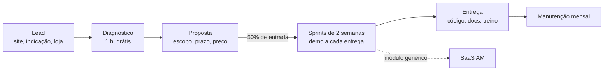

# 1 · AMtech Software

[← Negócios do grupo](README.md) · [Números](numeros.md#software)

Desenvolvimento de software para terceiros, ferramentas, SaaS e plataformas. É o primeiro CNPJ do grupo e a fábrica dos sistemas que os outros oito negócios vão usar.

## Quatro fontes de receita, em ordem de risco

| Fonte | Como vende | Por que entra |
|---|---|---|
| **Sites e lojas para pequenas empresas** | Pacote fechado (R$ 1.500), entrega em 2 semanas | Venda rápida em Barbacena, gera caixa e portfólio |
| **Sistemas sob encomenda** | Escopo + 50% de entrada + entregas quinzenais | Ticket alto; cada projeto vira peça reaproveitável |
| **Manutenção e hospedagem** | Mensalidade (R$ 250) depois de cada entrega | Receita recorrente que sustenta os meses fracos |
| **SaaS AM** | Assinatura por Pix Automático (R$ 149) | AM Kaixara (PDV), AM Rotara (entregas), AM Rendara (finanças), testados primeiro nos negócios do grupo |

A regra de ouro: **todo projeto sob encomenda deixa um módulo para o SaaS.** O contrato garante que você mantém a propriedade do código-base genérico e o cliente recebe licença de uso, salvo quando ele pagar pela exclusividade.

## Como funciona

- **Contrato padrão** com escopo, critério de aceite, propriedade intelectual, LGPD (você é operador dos dados do cliente) e multa por atraso de pagamento.
- **Preço pelo valor, não pela hora**, mas com a hora como piso: estime as horas, multiplique pelo seu valor-hora mínimo (comece em R$ 80) e compare com o valor que o sistema gera para o cliente.
- **Stack fixa do setup:** .NET 10, PostgreSQL, Next.js, Docker, GitHub Actions, Azure. Tudo multi-tenant com RLS desde o início, para virar SaaS sem reescrever.

## Fator R: o detalhe que muda o imposto de 15,5% para 6%

Desenvolvimento de software cai no Anexo V do Simples (15,5% na 1ª faixa), a não ser que a folha, incluindo o pró-labore, seja pelo menos 28% da receita dos últimos 12 meses. Com isso, vai para o Anexo III (6%). No cenário de R$ 12,7 mil por mês, um pró-labore de R$ 3.600 resolve, e esse dinheiro é seu (com 11% de INSS). O motor de [números](numeros.md#software) calcula o anexo mês a mês.

## Riscos

- **Escopo que cresce sem preço:** todo pedido fora do escopo vira aditivo por escrito.
- **Calote:** 50% de entrada, entregas parciais, código só vai para o repositório do cliente depois da quitação.
- **Concentração:** nenhum cliente acima de 40% da receita.
- **Seu tempo:** no começo, o gargalo é você. O portão para a fase A2 exige 10 clientes pagantes justamente para provar que o negócio anda.

## O que medir

Receita recorrente mensal (MRR), churn do SaaS, horas vendidas × horas gastas por projeto, prazo médio de recebimento e lucro por projeto. Tudo no painel do grupo ([Sistemas e medição](12-sistemas-do-grupo.md)).
