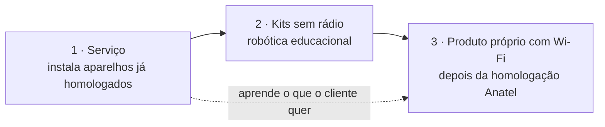

# 3 · AMtech Maker: produtos próprios

[← Negócios do grupo](README.md) · [Números](numeros.md#produtos)

Produtos originais e personalizados de robótica e automação residencial, empresarial, rural e virtual. Nasce dentro da Loja AMtech, usa a bancada e o CNPJ dela e quase não tem custo fixo próprio.

## A ordem certa: serviço, depois kit, depois produto com rádio

1. **Serviço primeiro.** Automação residencial e empresarial instalando aparelhos que já têm selo da Anatel (tomadas, interruptores e sensores Wi-Fi e Zigbee) com Home Assistant. A margem está no projeto e na instalação, e você aprende o que o cliente realmente quer antes de fabricar.
2. **Kits sem rádio.** Robótica educacional com placas sem Wi-Fi e sem Bluetooth, para escolas e famílias. Sem transmissor de rádio, o caminho de homologação é outro, bem mais simples. Você é professor: as oficinas em escolas vendem os kits.
3. **Produto próprio com Wi-Fi ou Bluetooth** (controlador de irrigação, monitor de caixa d'água, painel de automação). Todo equipamento com radiofrequência vendido no Brasil precisa de homologação da Anatel. Usar um módulo já homologado (como os ESP32 que a Espressif certificou) ajuda, mas o produto final ainda precisa passar pelo processo com um organismo certificador designado (OCD). Peça o orçamento antes de projetar o produto.

## Linhas de produto

| Linha | Exemplos | Para quem |
|---|---|---|
| **Residencial** | Iluminação por cena, portão pelo celular, sensores de porta e vazamento, painel na parede | Casas e apartamentos |
| **Empresarial** | Controle de acesso, desligamento automático de ar-condicionado e luzes, sensores de temperatura em câmaras frias | Comércio, clínicas, os restaurantes do grupo |
| **Rural** | Irrigação por horário e umidade do solo, nível de caixa d'água, bomba com alerta, cerca e porteira | Sítios e produtores da região |
| **Virtual** | Painéis, alertas no WhatsApp, automações em n8n e integrações com os SaaS AM | Quem já tem aparelhos e quer que conversem |
| **Educacional** | Kits de robótica por níveis, apostila, desafios e oficinas | Escolas, alunos, famílias |

## Cuidados legais que valem dinheiro

- **Brinquedo ou material didático?** Kits para crianças menores de 14 anos podem ser enquadrados como brinquedo, e brinquedo tem certificação compulsória do Inmetro. Defina a faixa etária e o enquadramento com um consultor antes do primeiro lote.
- **Instalação elétrica** em quadro de energia precisa de profissional habilitado (NR-10 para quem trabalha com eletricidade). Até você ter a qualificação, o serviço elétrico é feito por eletricista parceiro.
- **Garantia e manual em português**, com dados do fabricante (o CNPJ da AMtech Tecnologia), como exige o Código de Defesa do Consumidor.
- **Marca:** registre AMtech Maker no INPI na classe dos produtos.

## Fabricação

Impressora 3D para caixas e suportes, placas montadas na bancada da loja em lotes pequenos, firmware versionado no GitHub com testes, como o resto do setup. Quando um produto vender mais de 100 unidades por mês, a montagem da placa vai para uma montadora (SMT) e a loja fica só com o teste final.
