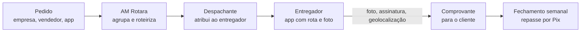

# 5 · Logística de marketplaces e entregas

[← Negócios do grupo](README.md) · [Números da AM Entregas](numeros.md#entregas)

A AM Entregas faz a última milha em Barbacena: pacotes de marketplaces, entregas de empresas e rotas fixas, com motoboys e carros. É a mesma frota que depois atende o [AM Delivery](06-delivery-multiempresas.md).

## O que dá para fazer com cada marketplace

| Marketplace | O que existe | Como a AM Entregas entra |
|---|---|---|
| **Mercado Livre: Envios Flex** | O próprio vendedor entrega no mesmo dia ou no dia seguinte, sem passar por centro de distribuição. Com frete grátis, o vendedor paga parte da tarifa da zona ([JaguarSheet, 2026](https://jaguarsheet.com/pt/blog/que-es-mercado-livre-flex)) | O vendedor local terceiriza o Flex para você: coleta na loja dele no fim da tarde e entrega na cidade. Ele paga por pacote |
| **Mercado Livre: agências** | Pontos de postagem e retirada | A Loja AMtech é a agência; a AM Entregas faz a coleta nos vendedores e leva até a agência |
| **Mercado Livre e Shopee: transporte parceiro** | As plataformas contratam transportadoras e motoristas para a última milha a partir dos seus centros | Só se houver um centro atendendo Barbacena. Pergunte nos canais de parceiros das duas antes de contar com isso |
| **Amazon** | Programa DSP (empresas de entrega com investimento inicial de cerca de R$ 45 mil, em 2023) e Amazon Flex | Em 2023, os DSPs operavam em capitais e grandes cidades ([Consumidor Moderno](https://consumidormoderno.com.br/amazon-dps-logistica/)). Barbacena hoje não está no mapa; acompanhe |

A base do negócio, então, não depende de contrato com marketplace: são os **vendedores de Barbacena** e as **empresas da cidade**. Os programas oficiais entram como bônus quando abrirem.

## Fontes de receita

| Fonte | Preço de referência | Quem paga o entregador |
|---|---|---|
| Entregas avulsas para empresas (farmácia, laboratório, autopeças, cartório, floricultura) | R$ 10 na cidade | 70% da tarifa vai para o entregador |
| Flex para vendedores locais | R$ 11 por pacote | Rota com 20 a 40 pacotes; o entregador ganha por pacote |
| Coleta nos vendedores e entrega nas agências | R$ 35 por coleta | Rota diária fixa |
| Rotas fixas por contrato (carro) | R$ 2.800 por mês | Motorista agregado com carro próprio |

## O motofretista, pela lei

A atividade é regulada pela Lei 12.009/2009 e pelas resoluções do Contran. O que se exige do motoboy profissional, em resumo ([Portal do Trânsito](https://www.portaldotransito.com.br/noticias/mobilidade-e-tecnologia/veiculos/regras-para-motoboys-comecam-a-vigorar-neste-sabado-2/)):

- 21 anos ou mais e CNH categoria A há pelo menos 2 anos.
- Curso especializado de motofretista (30 horas) anotado na CNH.
- Moto na categoria aluguel (placa vermelha) com vistoria, antena corta-pipa e protetor de pernas.
- Carga só em baú ou grelha, nunca em mochila; botijão de gás e galão de água só em side-car ou reboque.
- Colete refletivo e equipamentos de proteção.

Confira no DETRAN-MG e na prefeitura se Barbacena tem cadastro municipal de motofrete (a lei deixa a regulamentação local para o município).

## Entregador MEI e o risco de vínculo

O caminho comum é contratar entregadores como MEI (CNAE 5320-2/02, permitido no MEI). O risco: se a empresa impõe horário, rota exclusiva, uniforme obrigatório, punições e subordinação, a Justiça do Trabalho pode reconhecer vínculo de emprego, com todos os encargos retroativos. Por isso:

- O contrato e a operação precisam ser desenhados com um advogado trabalhista **antes** do primeiro entregador.
- Pagamento por entrega, liberdade para recusar chamadas e atender outras empresas, sem escala obrigatória.
- Quem precisa de exclusividade e horário (o despachante, o motorista de rota fixa diária) é CLT.

## Operação

- **Roteirização** no AM Rotara (PostGIS + MapLibre, já previsto no setup), com rota agrupada por região: é o que torna o Flex lucrativo.
- **Prova de entrega:** foto, nome de quem recebeu e geolocalização. Sem isso, não há como contestar extravio.
- **Seguro de carga** e de responsabilidade civil, e regras de valor máximo por volume.
- **Repasse semanal** aos entregadores pelo extrato do sistema, sem conta de cabeça.

## Riscos

- **Margem fina:** 9% no alvo e quase zero a 70% ([números](numeros.md#entregas)). Este negócio vive de volume e rota bem montada.
- **Acidentes:** treinamento, EPI conferido, seguro de vida e acidentes pessoais para os entregadores.
- **Dependência de poucos vendedores Flex:** nenhum acima de 30% do volume.
