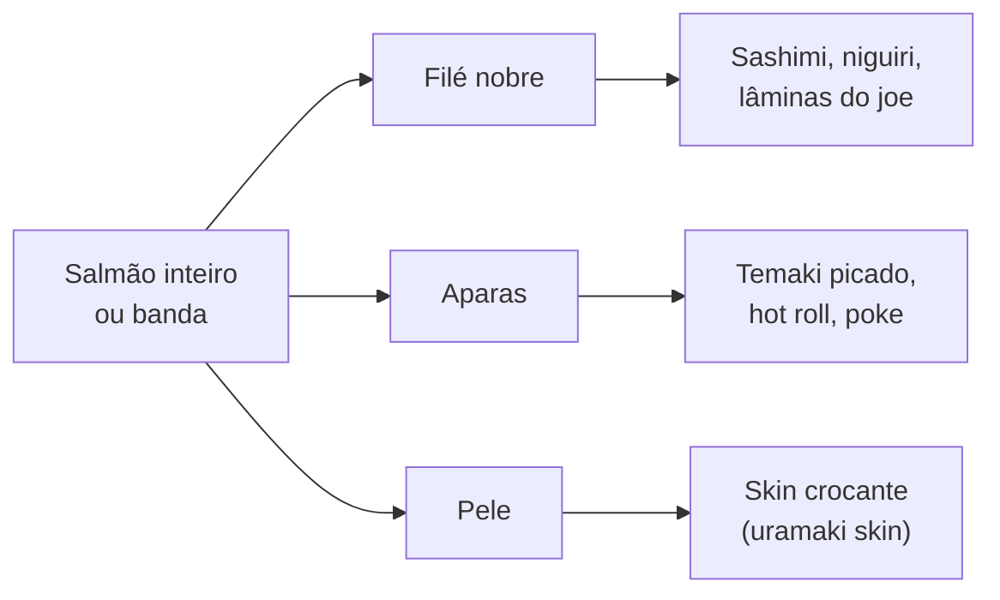

# 7 · Sushi

[← Negócios do grupo](README.md) · [Números](numeros.md#sushi) · [Método de cardápio](10-cardapios-e-desperdicio.md)

Começa como **delivery com balcão de retirada**, de quarta a domingo, das 18h às 23h. Salão só quando o delivery provar a demanda. É o primeiro restaurante por um motivo: você é sushiman, e o produto é o que você sabe fazer melhor.

## Por que delivery primeiro

- **Investimento menor:** cozinha de 40 a 50 m² sem salão, mesas, garçons e banheiro de clientes.
- **Ponto mais barato:** não precisa de rua de passeio; precisa de acesso fácil para os entregadores.
- **Entrega da própria frota** ([AM Entregas](05-logistica-e-entregas.md)) e pedido pelo próprio app: no cenário-alvo, o delivery próprio deixa 49 centavos de margem por real vendido, e o iFood, 25 centavos ([números](numeros.md#sushi)). O iFood fica como canal de descoberta, não como canal principal.

## O cardápio, desenhado para pouca perda

O cardápio é curto e gira em torno de **um peixe (salmão), um arroz e oito insumos**. Cada parte do salmão tem destino:

| Item | Papel no cardápio | Insumos | O que aproveita |
|---|---|---|---|
| **Combinados de 15, 20, 30 e 50 peças** | Carro-chefe: preço por peça cai com o tamanho e puxa o ticket | Uramaki, hossomaki, niguiri, sashimi | Montagem mistura peças de custo baixo (kani, pepino) com peças nobres |
| **Hot roll (hot philadelphia)** | O mais pedido no interior; margem alta | Salmão, cream cheese, nori, arroz, empanamento | Aparas de salmão |
| **Temaki** (salmão, salmão grelhado, hot) | Ticket individual, preparo rápido | Arroz, nori, salmão picado, cream cheese, cebolinha | Aparas |
| **Uramaki skin** | Diferencial crocante | Pele grelhada, pepino, tarê | Pele, que costuma ir para o lixo |
| **Joe (salmão com cream cheese)** | Peça "de foto" | Lâminas de salmão | Filé |
| **Poke** | Opção leve, saudável | Arroz, salmão em cubos, pepino, manga, gergelim | Aparas, manga da época |
| **Sashimi de salmão** | Preço alto, margem percentual menor; mantém a percepção de qualidade | Filé nobre | — |
| **Sobremesa: harumaki de chocolate com banana** | Aumenta o ticket com custo baixo | Massa de harumaki, chocolate, banana | Banana madura |
| **Bebidas** | Margem alta | Refrigerante, chá gelado, água | — |

Nada de atum, polvo ou peixes caros no início: perda alta e giro baixo numa cidade do tamanho de Barbacena. Entram como "peça do fim de semana", com quantidade fixa, quando houver demanda.

## Rotina de produção

- **15h:** recebimento e conferência do peixe (temperatura até 4 °C na chegada, cheiro, cor, firmeza), porcionamento, etiqueta com data e validade.
- **16h:** arroz em lotes pela previsão do dia (média das últimas 4 quartas, quintas e assim por diante), tempero do shari.
- **17h30:** mise en place pronta, vitrine abastecida com o porcionado do turno.
- **18h às 23h:** produção sob pedido. Arroz novo só a cada lote acabando.
- **23h:** contagem do que sobrou (arroz descartado; peixe porcionado só segue para o dia seguinte se nunca saiu da refrigeração e estiver na validade), registro no controle de perdas, limpeza.

## Mínimo para abrir

Ver [Mínimo legal para abrir](11-minimo-para-abrir.md#alimentacao). Específico do sushi: fornecedor de pescado com inspeção sanitária (SIF, SIE ou SIM) e nota; controle de temperatura registrado duas vezes ao dia; peixe para consumo cru com procedência e cadeia de frio comprovadas.

## Riscos

- **Preço do salmão:** varia com o câmbio. A ficha técnica é revisada todo mês, e o preço do cardápio, a cada trimestre ou quando o custo subir mais de 8%.
- **Você é o gargalo:** o cenário conta com você na cozinha de quarta a domingo. Sem isso, entra um sushiman de cerca de R$ 4.200 de custo por mês e o lucro do alvo cai para perto de R$ 10 mil.
- **Segurança alimentar:** um caso de intoxicação fecha a casa. Boas práticas não são burocracia aqui.
