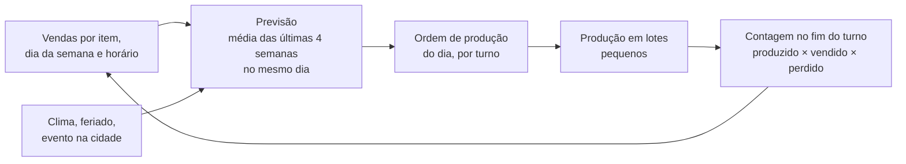

# Cardápios e desperdício

[← Negócios do grupo](README.md)

O método que vale para o sushi, a cafeteria e a padaria: cada prato tem custo conhecido, cada item do cardápio tem um motivo para estar lá e cada sobra tem destino definido antes de existir.

## 1 · Ficha técnica: o custo real de cada prato

Toda receita vira uma ficha no AM Kaixara, com:

| Campo | O que é | Exemplo |
|---|---|---|
| Ingrediente e quantidade líquida | O que vai no prato | 80 g de salmão limpo |
| Fator de correção (FC) | Peso bruto ÷ peso limpo | Banda de salmão: 1,25 (perde pele e aparas) |
| Quantidade bruta | Líquida × FC | 100 g para comprar |
| Custo | Bruta × preço do quilo | 100 g × R$ 90/kg = R$ 9,00 |
| Índice de cocção | Peso pronto ÷ peso cru | Arroz: cerca de 2,5 |
| Rendimento e porção | Quantas porções saem da receita | 1 kg de arroz cru → 25 porções de 100 g |

**Custo do prato = soma dos ingredientes + embalagem.** O preço de venda sai do custo e da meta de CMV:

> Preço = custo do prato ÷ CMV-alvo. Prato de R$ 12 de custo com CMV-alvo de 33% → R$ 36,36, arredondado para R$ 36,90.

CMV-alvo de partida: sushi 33%, cafeteria 28%, padaria 35% a 38%, almoço 38%. Os valores reais saem da ficha técnica, e o mês fecha com o CMV medido: (estoque inicial + compras − estoque final) ÷ vendas.

## 2 · Engenharia de cardápio: o que fica e o que sai

Todo trimestre, cada item do cardápio é colocado na matriz de popularidade × margem de contribuição em reais (método de Kasavana e Smith):

| | **Pouco vendido** | **Muito vendido** |
|---|---|---|
| **Margem alta** | Quebra-cabeça: reposicionar | Estrela: manter e destacar |
| **Margem baixa** | Cão: tirar do cardápio | Burro de carga: rever custo |

- **Popular** = vendeu mais que 70% da média esperada (1 ÷ número de itens da categoria).
- **Margem alta** = margem de contribuição em reais acima da média ponderada da categoria.
- **Estrela:** destaque no cardápio e no app, foto melhor, primeiro da lista.
- **Burro de carga** (vende muito, margem baixa): rever porção, fornecedor ou preço aos poucos; nunca tirar.
- **Quebra-cabeça** (margem alta, vende pouco): mudar nome, foto, posição, oferecer em combo.
- **Cão:** sai. Cada item a menos é um insumo a menos para estragar.

O AM Kaixara gera a matriz sozinho a partir das vendas e das fichas técnicas.

## 3 · Cardápio curto e ingredientes cruzados

- **Poucos itens, bem feitos.** Cardápio enxuto gira o estoque mais rápido e perde menos.
- **Um ingrediente, três pratos.** Todo insumo perecível precisa aparecer em pelo menos dois itens. Se só um prato usa, ou o prato sai ou o insumo muda.
- **Ingredientes compartilhados entre as casas do grupo:** pão da padaria nos sanduíches da cafeteria, a mesma massa de pão de queijo nas duas, ovos, queijo, leite e café do mesmo fornecedor (compra maior, preço menor).

## 4 · Produzir pela previsão, não pelo palpite

- A previsão começa simples: média móvel das últimas 4 semanas no mesmo dia da semana, com ajuste manual para chuva, feriado e eventos.
- Com 6 meses de dados, o aura-analytics (já previsto no setup) testa modelos melhores. Só troca se errar menos.
- **Ruptura no fim do dia é aceitável; sobra todo dia não é.** Meta: o item acaba na última hora, não na primeira.

## 5 · Estoque

- **PVPS** (primeiro que vence, primeiro que sai) em todas as geladeiras e prateleiras.
- **Etiqueta** em tudo que foi aberto ou porcionado: produto, data de manipulação, validade, responsável.
- **Compra pelo estoque mínimo e máximo** de cada insumo, calculado pela previsão e pelo prazo do fornecedor. O AM Kaixara avisa o que comprar.
- **Inventário semanal** dos 20 itens mais caros (eles são quase todo o CMV) e mensal de tudo.

## 6 · Controle de perdas

Toda perda é registrada com motivo, quantidade e custo: venceu, produção a mais, erro de preparo, devolução do cliente, queda, recebimento ruim. O painel mostra:

- **Perda em reais por semana e por motivo.** Meta inicial: abaixo de 3% das vendas (é o que o planejador já desconta).
- **Os 5 itens que mais perdem.** São os primeiros candidatos a mudar de receita, de porção ou de lote.

## 7 · O destino de cada sobra

| Sobra | Destino | Regra |
|---|---|---|
| Pão do dia anterior | Torrada, farinha de rosca, croutons, pudim de pão, tosta da cafeteria | Só pão que ficou guardado corretamente |
| Bolo do dia anterior | Bolo no pote com cobertura | No dia seguinte, não depois |
| Fruta madura | Suco, vitamina, doce | Antes de passar do ponto |
| Comida pronta que nunca saiu da cozinha | Resfriada, etiquetada e usada em outro preparo em até 5 dias | Resfriamento de 60 °C a 10 °C em até 2 horas (RDC 216) |
| Comida exposta no balcão | Descarte | Nunca reaproveitar |
| Excedente próprio para consumo | Doação | A Lei 14.016/2020 autoriza a doação de excedentes ainda próprios para consumo; formalize com uma instituição e registre cada doação |
| Óleo de fritura usado | Coleta para reciclagem | Nunca na pia |
| Resíduo orgânico | Compostagem ou coleta separada | Se a cidade oferecer |

Fontes: [Ledware, CMV e ficha técnica (2026)](https://www.ledware.com.br/2026/05/21/cmv-restaurante-ficha-tecnica-2026-guia/), [Sebrae PR, cálculo do CMV](https://www.sebraepr.com.br/comunidade/artigo/entendendo-o-cmv-de-restaurante-como-fazer-o-calculo-e-sua-importancia), [Lei 14.016/2020](https://legis.senado.leg.br/norma/32285364/publicacao/32285490).
