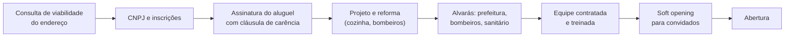

# Mínimo legal para abrir

[← Negócios do grupo](README.md)

O que cada negócio precisa ter antes de abrir as portas. É uma lista de verificação, não orientação jurídica: confirme cada item com o contador, a prefeitura de Barbacena, o Corpo de Bombeiros de Minas Gerais e a vigilância sanitária.

## Para todos

1. **Consulta de viabilidade** na prefeitura (pela Redesim e pela JUCEMG) **antes de assinar o aluguel**: confirma se a atividade é permitida naquele endereço.
2. **CNPJ** com os CNAEs da frente ([Estrutura](00-estrutura-e-ordem.md)), inscrição municipal e, para comércio e alimentação, inscrição estadual na SEF-MG.
3. **Alvará de localização e funcionamento** da prefeitura.
4. **Segurança contra incêndio** do Corpo de Bombeiros Militar de Minas Gerais: extintores, sinalização e iluminação de emergência; processo simplificado ou projeto, conforme área e risco.
5. **Certificado digital** e-CNPJ e emissão de nota (NFS-e para serviços, NF-e e NFC-e para vendas).
6. **Placa de fachada** com licença de publicidade, se a prefeitura exigir.
7. **Exemplar do Código de Defesa do Consumidor** disponível no estabelecimento (Lei 12.291/2010) e preços expostos.
8. **Com funcionários:** registro no eSocial, exame admissional (ASO), PGR e PCMSO (NR-1 e NR-7), contrato de trabalho e convenção coletiva da categoria.
9. **Termos de uso e política de privacidade** (LGPD) em tudo que coleta dados de clientes.
10. **Seguro** do ponto e de responsabilidade civil.

## Por negócio

| Negócio | Além da lista geral |
|---|---|
| **AMtech Software** | Contrato padrão de serviço e de licença de SaaS; política de privacidade e acordo de tratamento de dados com cada cliente (você é operador) |
| **Loja AMtech** (assistência e peças) | Termo de entrada e garantia de serviço; política de guarda de aparelhos; nota de venda de peças |
| **Ponto de retirada** | Aprovação no programa da Shopee e do Mercado Livre; loja no térreo, aberta de segunda a sexta; conta no Mercado Pago |
| **AMtech Maker** | Registro de marca; homologação Anatel para produto com rádio; avaliação do Inmetro se o kit for brinquedo; manual e garantia em português; NR-10 ou eletricista parceiro para instalações |
| **AM Entregas** | Entregadores com curso de motofretista, CNH A há 2 anos, placa vermelha e equipamentos (Lei 12.009/2009); contrato de prestação revisado por advogado trabalhista; seguro de carga e de acidentes pessoais; cadastro municipal de motofrete, se houver |
| **AM Delivery** | Termos de uso para cliente e lojista, política de reembolso, intermediador de pagamento com split, contrato com cada lojista |

## Alimentação (sushi, cafeteria e padaria)

| Item | O que é |
|---|---|
| **Alvará sanitário** | Emitido pela vigilância sanitária municipal ou estadual. Em Minas, o nível de risco define se basta o procedimento simplificado ou se há aprovação de projeto e inspeção antes de abrir (Resolução SES/MG 10.601/2025). O pedido estadual é pelo Visa Digital, com prazo estimado de 45 dias úteis ([MG.gov.br](https://www.mg.gov.br/servico/solicitar-alvara-sanitario-para-estabelecimentos-de-alto-risco?page=1%2C0)). Comece pela vigilância municipal de Barbacena: ela diz qual caminho vale para cada casa |
| **Projeto arquitetônico da cozinha** | Fluxo sem cruzamento (recebimento → estoque → preparo → expedição), pia exclusiva para lavar as mãos, piso e paredes laváveis, ralos sifonados, telas nas janelas, exaustão |
| **Manual de Boas Práticas e POPs** | Exigidos pela RDC 216/2004 da Anvisa: higiene das instalações, controle da água, controle de pragas, higiene e saúde dos manipuladores |
| **Responsável pela manipulação** | Pessoa com curso de boas práticas em manipulação de alimentos |
| **Controle de pragas** | Empresa licenciada, com comprovante de cada aplicação |
| **Água** | Limpeza da caixa d'água a cada 6 meses, com registro, e análise quando exigida |
| **Saúde dos manipuladores** | Exames conforme o PCMSO, uniforme, sem adornos |
| **Fornecedores** | Produtos de origem animal com inspeção (SIF, SIE ou SIM) e nota fiscal |
| **Balança do self-service** | Aferida pelo IPEM-MG (Inmetro) |
| **Música ambiente** | Licença do ECAD |
| **Gás** | Central de GLP em local aprovado pelos bombeiros, se o volume exigir |
| **Delivery** | Embalagem lacrada, temperatura no transporte, rótulo com data |

## Ordem prática

Negocie **carência de 2 a 3 meses no aluguel** para o período de reforma e licenças: é dinheiro que o planejador não está contando e que faz diferença.
