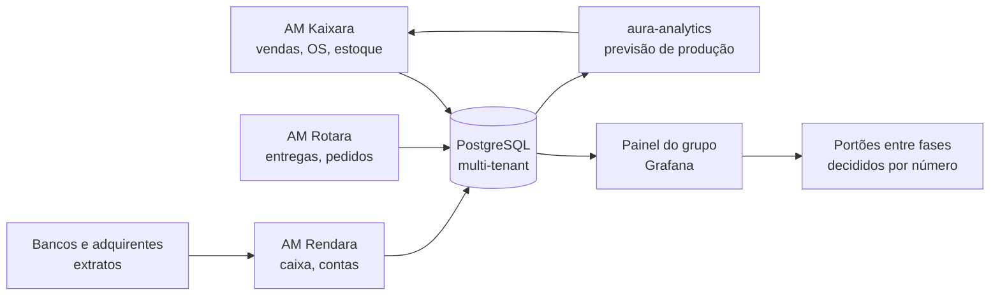

# Sistemas e medição do grupo

[← Negócios do grupo](README.md)

Os negócios do grupo são o primeiro cliente dos sistemas AM. Cada problema resolvido numa loja ou cozinha do grupo vira funcionalidade vendida pela [AMtech Software](01-software-house.md).

## Qual sistema roda onde

| Sistema | O que faz | Loja | Maker | Entregas | Delivery | Sushi | Cafeteria | Padaria |
|---|---|:---:|:---:|:---:|:---:|:---:|:---:|:---:|
| **AM Kaixara** | PDV, comandas, ordem de serviço, estoque, ficha técnica, engenharia de cardápio | ✓ | ✓ | | | ✓ | ✓ | ✓ |
| **AM Rotara** | Pedidos, roteirização, app do entregador, prova de entrega, repasse | | | ✓ | ✓ | ✓ | ✓ | ✓ |
| **AM Rendara** | Contas a pagar e receber, fluxo de caixa, DRE por negócio | ✓ | ✓ | ✓ | ✓ | ✓ | ✓ | ✓ |
| **Painel do grupo** (Grafana) | Indicadores de todos os negócios num lugar só | ✓ | ✓ | ✓ | ✓ | ✓ | ✓ | ✓ |
| **Emissor fiscal** (API de NF-e e NFS-e) | Nota automática em cada venda | ✓ | ✓ | ✓ | ✓ | ✓ | ✓ | ✓ |

## Como os dados correm

Cada negócio é um tenant. O painel do grupo lê todos, com permissão só para você e o contador.

## Os números que decidem

| Indicador | Onde se aplica | Meta inicial |
|---|---|---|
| Receita × ponto de equilíbrio | Todos | Acima por 3 meses seguidos (portão) |
| Margem de contribuição por fonte | Todos | Igual ou acima da prevista em [Números](numeros.md) |
| CMV medido × CMV da ficha | Alimentação | Diferença abaixo de 2 pontos |
| Perdas em reais | Alimentação | Abaixo de 3% das vendas |
| Ticket médio e pedidos por dia | Alimentação, delivery | Crescendo mês a mês na rampa |
| Participação do canal próprio | Sushi, cafeteria | Acima de 60% dos pedidos |
| Conversão do ponto de retirada | Loja | 3% das retiradas viram venda |
| Entregas por rota e custo por entrega | Entregas | 20 ou mais pacotes por rota de Flex |
| Lojistas ativos e pedidos por lojista | Delivery | 20 lojistas e 75 pedidos por lojista |
| MRR e churn | Software | Churn abaixo de 3% ao mês |
| Prazo médio de recebimento e de pagamento | Todos | Receber antes de pagar |
| Caixa em dias de custo fixo | Todos | 90 dias (a reserva do planejador) |

## Fechamento do mês

1. Extratos conciliados no AM Rendara (o banco é a verdade).
2. Inventário e CMV medido nos negócios de comida.
3. DRE por negócio: receita, variáveis, impostos, margem, fixos, lucro.
4. Comparação com o cenário de [Números](numeros.md) e atualização do `data/negocios.json` com o realizado.
5. Decisão do mês: seguir, corrigir (cardápio, preço, equipe) ou parar.
