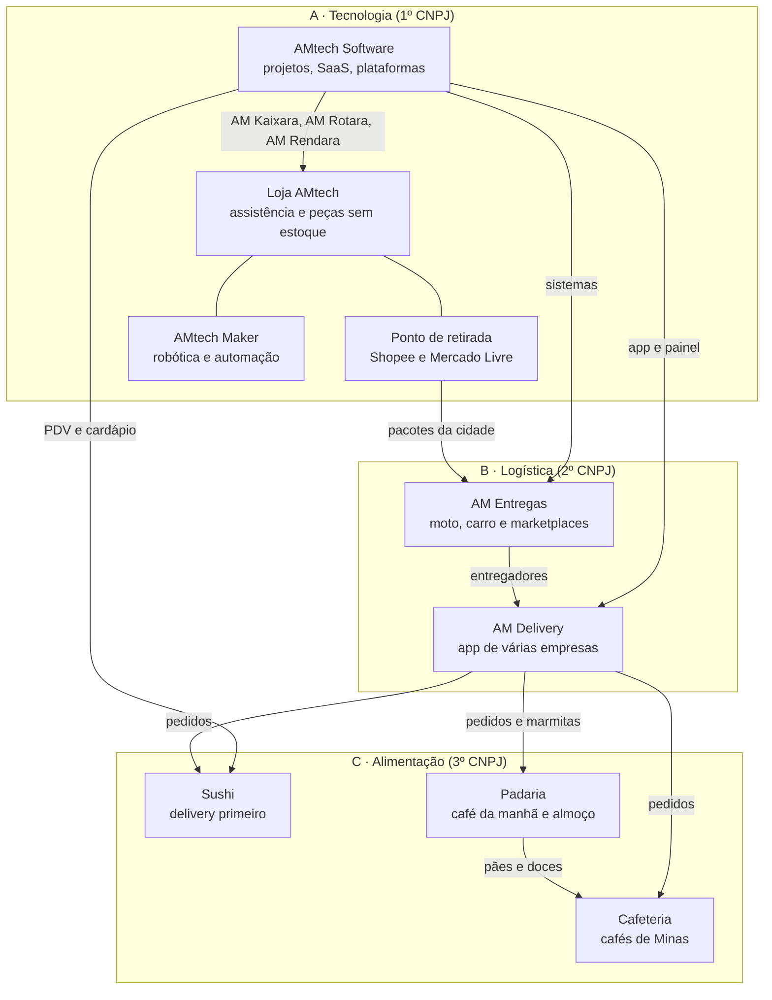

# Negócios do grupo

[← Índice da documentação](../README.md)

Os nove negócios do Grupo AMtech Digital em Barbacena, organizados em três frentes que se alimentam: a tecnologia constrói os sistemas e abre a loja; a logística entrega para a loja, para os vendedores da cidade e para os restaurantes; os restaurantes usam os sistemas e as entregas e viram vitrine de tudo.

> **Antes de tudo:** os nove juntos pedem cerca de **R$ 766 mil** de capital mínimo (ver [Números](numeros.md)), mais gente de confiança para tocar cada operação. Abrir todos ao mesmo tempo é o caminho mais rápido para fechar todos. Este plano abre um por vez, e só passa ao próximo quando o anterior se paga. Cada ponto legal e tributário aqui precisa ser confirmado por contador e advogado antes de assinar qualquer coisa.

## O mapa do grupo

## Os nove negócios

| # | Negócio | Frente | O que faz | Documento |
|---|---|---|---|---|
| 1 | AMtech Software | A | Sistemas sob encomenda, sites, SaaS AM e plataformas | [01](01-software-house.md) |
| 2 | Assistência técnica e peças | A | Reparo, upgrade e venda de peças e acessórios sem estoque, na loja e on-line | [02](02-assistencia-e-pecas.md) |
| 3 | AMtech Maker | A | Kits de robótica, automação residencial, empresarial, rural e virtual | [03](03-produtos-proprios.md) |
| 4 | Ponto de retirada | A | Agência Shopee e Agência Mercado Livre dentro da loja | [04](04-ponto-de-retirada.md) |
| 5 | Logística de marketplaces e entregas | B | Mercado Envios Flex, coleta para as agências, entregas de moto e carro para empresas | [05](05-logistica-e-entregas.md) |
| 6 | AM Delivery | B | App de pedidos de vários restaurantes e lojas da cidade | [06](06-delivery-multiempresas.md) |
| 7 | Sushi | C | Delivery e retirada; salão depois | [07](07-sushi.md) |
| 8 | Cafeteria | C | Cafés especiais, pão de queijo, doces, café em grão | [08](08-cafeteria.md) |
| 9 | Padaria com café da manhã e almoço | C | Padaria de finalização, café mineiro, almoço por quilo e marmitas | [09](09-padaria-e-almoco.md) |

## Documentos do grupo

- [Estrutura, ordem e capital](00-estrutura-e-ordem.md): CNPJs, ordem de abertura, portões entre fases e de onde vem o dinheiro
- [Números de cada negócio](numeros.md): investimento, custos, fontes de receita, ponto de equilíbrio, rampa e capital mínimo (gerado)
- [Cardápios e desperdício](10-cardapios-e-desperdicio.md): engenharia de cardápio, ficha técnica, previsão de produção e o destino de cada sobra
- [Mínimo legal para abrir](11-minimo-para-abrir.md): licenças, alvarás e obrigações de cada negócio
- [Sistemas e medição do grupo](12-sistemas-do-grupo.md): qual sistema AM roda em cada negócio e o painel único de números
- [Planejador do Grupo](planejador.html): versão interativa (baixe e abra no navegador), com as mesmas fórmulas de `tools/negocios/financas.py`

## Por que esta ordem

1. **Tecnologia primeiro** porque é o que você já sabe fazer, cabe no seu tempo, quase não pede capital (R$ 3 mil para o software) e gera os sistemas que os outros negócios vão usar.
2. **A loja vem logo depois** porque une três receitas em um aluguel só (assistência, peças e pacotes) e vira a base física do grupo.
3. **Logística em seguida** porque a loja já recebe os pacotes da cidade e conhece os vendedores locais: o Flex e a coleta nascem com clientes.
4. **Alimentação por último** porque é a frente de maior capital, mais regras sanitárias, mais funcionários e menor margem de erro. Quando chegar a vez dela, o delivery próprio e os sistemas já estarão prontos, e isso corta a comissão de 23% do iFood.

## Como os números foram feitos

Os valores de [Números](numeros.md) saem de `data/negocios.json` e do motor `tools/negocios/financas.py`, com testes em `tools/negocios/test_financas.py`. O CI confere se o documento está em dia com os dados. Para mudar um aluguel, um salário ou um preço, edite o JSON e rode `python tools/negocios/gerar.py`.

## Fontes

- População: [IBGE Cidades, Barbacena](https://www.ibge.gov.br/cidades-e-estados/mg/3105608.html)
- Aluguéis no Centro: [Casa Mineira, outubro de 2026](https://www.casamineira.com.br/aluguel/imovel/centro_barbacena_mg)
- Simples Nacional 2026: [Agilize, tabela atualizada em 29/06/2026](https://artigos.agilize.com.br/tabela-simples-nacional-anexos-aliquotas/)
- Salário mínimo de 2026: [TNH1](https://www.tnh1.com.br/noticia/nid/decreto-fixando-novo-valor-do-salario-minimo-de-2026-e-publicado-no-diario-oficial/)
- Demais fontes em cada documento
