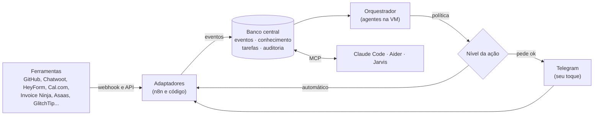

<!-- Escrito à mão. Plano do Núcleo AMtech (ADR 0009). -->

# Núcleo AMtech: o setup conectado e autônomo

[← Índice da documentação](../README.md)

O Núcleo é o cérebro do setup: guarda tudo o que acontece, lembra de tudo o que foi decidido, distribui o trabalho para os agentes e só para no seu ok quando a regra manda. As ferramentas continuam as mesmas; o núcleo faz elas conversarem ([ADR 0009](../adr/0009-nucleo-amtech.md)).

## Para que serve: mais renda com menos horas suas

| Empresa ou frente | O que o núcleo faz sozinho | O que fica com você |
|---|---|---|
| AMtech Software (empresa de TI) | Garimpa, testa e abre PR; esteira de sites do pedido ao deploy; monitora e corrige versão com erro | Aprovar PR e falar com o cliente |
| Produtos digitais (mini-curso, templates, livro) | Transcreve, corta, legenda, rascunha post, agenda rascunho, mede venda | Gravar e aprovar a publicação |
| Automação para pequenos negócios | O próprio núcleo com os adaptadores, implantado no cliente | Vender e treinar |
| Finanças (CPF agora, CNPJ depois) | Importa, lança, concilia, relatório, aporte pelas suas regras | Baixar extrato e aprovar compra |
| Negócios físicos do grupo | Pedidos, estoque, entregas e cobrança pelos sistemas AM ligados ao núcleo | Operar e decidir |

## Como funciona

## Níveis de autonomia

| Área | Automático | Para no seu ok |
|---|---|---|
| Desenvolvimento | garimpo, testes, revisão, PR, documentação, dependências | merge na main |
| Infraestrutura | backup, atualização, monitoramento, rollback em erro | deploy de cliente, gasto novo |
| Conteúdo | transcrever, cortar, legendar, rascunhar, agendar rascunho | publicar |
| Vendas e atendimento | qualificar, responder dúvida frequente, agendar, rascunhar proposta | enviar proposta, preço fora da tabela |
| Cobrança | lembrete, conciliação | cobrança firme, cancelamento |
| Finanças | importar, lançar, conciliar, relatório, sugestão de aporte | compra, transferência |
| Estudo e aulas | aula da ementa, exercícios, flashcards | usar em sala |
| Segurança | varredura dos seus sistemas | teste em terceiro (só com termo no escopo.py) |
| Casa | o que a política do Jarvis define | portas, janelas, alarme |

## Garimpo de código

1. Busca no GitHub, no grep.app e na base do núcleo.
2. Filtro dos 5 indicadores pela API: commit em 6 meses, licença MIT/Apache/BSD, poucas dependências, tipagem forte, sem vulnerabilidade conhecida.
3. Clone num container Podman sem internet e sem as suas chaves.
4. O tree-sitter recorta só o que foi pedido.
5. O agente escreve os testes e roda no isolamento; se falhar, próximo candidato.
6. Limpeza, adaptação ao seu padrão e triagem de segurança (Trivy e Semgrep).
7. PR com o código em `src/lib/vendor/`, testes, licença e origem. Você aprova o merge.
8. Tudo registrado na base para o próximo pedido começar dali.

## Fases

| # | Fase | Entrega | Situação |
|---|---|---|---|
| 0 | Fundação | `just instalar`, backup diário, atualização semanal de verdade, padronização semanal | **feita (v2.13)** |
| 1 | Banco central | esquema, `just lembrar` e `just buscar`, triagem que lê e grava | **começada (v2.13)** |
| 2 | Garimpo | o pipeline completo com PR | próxima |
| 3 | Política e auditoria | níveis, ok pelo Telegram, botão de parar | |
| 4 | Arquiteto e ganchos | Claude Code consultando o núcleo sozinho; roteamento automático | |
| 5 | Adaptadores de dev | GitHub, Forgejo, Kamal, GlitchTip, SigNoz | |
| 6 | Adaptadores de negócio | HeyForm, Cal.com, Twenty, Invoice Ninja, Asaas, Formbricks, Beancount | |
| 7 | Orquestrador 24 h | agentes na VM; Jarvis por voz como porta de entrada | |
| 8 | Teste do sistema | simulação noturna de ponta a ponta e relatório de manhã | |

## Hoje: o que já roda sozinho

| Função | Situação | O que falta |
|---|---|---|
| Instalação do setup | um comando | `just instalar` monta tudo; você roda uma vez |
| Backup | sozinho | agendado às 22h30, avisa no Telegram se falhar |
| Atualização das ferramentas | sozinho | domingo às 9h; o apt segue simulado porque pede sudo |
| Padrão em todo repositório | sozinho | toda semana, junto da manutenção |
| CI, tag e vigia | sozinho | a cada push e toda segunda |
| Resumo da manhã | sozinho | 6h10 no Telegram |
| Triagem e arquiteto consultando a base | um comando | gravam e leem o núcleo; falta o Claude Code ler sozinho (fase 4) |
| Contexto enxuto para a IA | um comando | `just contexto-ia`; vira automático com os ganchos (fase 4) |
| Roteamento local → Claude | não existe | fase 4 |
| Garimpo de código | não existe | fase 2 |
| Política de autonomia e ok pelo Telegram | não existe | fase 3 |
| Alertas de erro e queda no Telegram | não existe | fase 5 |
| Funil comercial ligado (formulário → agenda → CRM → contrato → fatura → NPS) | não existe | fase 6 |
| Financeiro → Beancount → rentabilidade | não existe | fase 6 |
| Agentes 24 horas | não existe | fase 7 |
| Simulação noturna de ponta a ponta | não existe | fase 8 |

## Limites

- Autonomia 24 horas precisa da VM ligada; o notebook é reforço.
- Banco, B3 e gov.br pedem o seu login: baixar extrato e nota fica com você.
- Teto de US$ 20/mês de IA dos agentes (LiteLLM); o modelo local na GTX 1650 classifica e resume, não arquiteta.
- Publicar, enviar em seu nome, cobrar, comprar, assinar e digitar senha passam sempre pelo seu ok.
