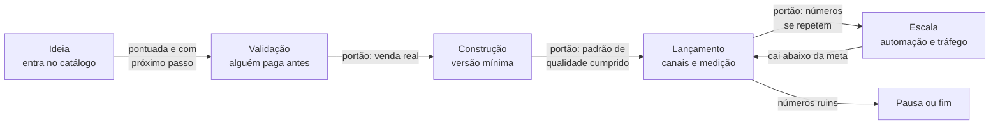

# 1 · Esteira de ofertas

[← Operação do grupo](README.md)

Toda oferta, de um template de R$ 27 a uma padaria, anda pelos mesmos estágios. O que muda é o tamanho de cada passo, não a ordem.



## Os estágios

| Estágio | Pergunta que responde | O que sai | Portão para seguir |
|---|---|---|---|
| **Ideia** | Vale a pena olhar? | Linha no `data/portfolio.json` com notas, receita, canais e próximo passo | Pontuação calculada e próximo passo concreto |
| **Validação** | Alguém paga? | Pré-venda, lista de espera com sinal, piloto pago ou grátis em troca de depoimento | Pelo menos uma venda real, ou 30 pessoas pedindo com contato deixado, conforme a oferta |
| **Construção** | Dá para entregar bem? | Versão mínima que cumpre o [padrão de qualidade](05-padrao-de-qualidade.md) | Checklist do tipo de oferta 100% cumprido |
| **Lançamento** | Vende de forma repetida? | Página, canais, sequência de e-mails, métricas no painel | 3 meses (ou 3 ciclos de venda) com a métrica-chave estável |
| **Escala** | Cresce sem você crescer junto? | Automação, tráfego pago, equipe, versões derivadas | Lucro por venda mantido enquanto o volume sobe |
| **Pausa ou fim** | Ainda faz sentido? | Registro do porquê e do que se aprendeu | — |

A regra que você mesmo adotou fica gravada aqui: **validar antes de construir.** A planilha vende antes do sistema; a pré-venda vem antes do curso; o evento de sushi vem antes do restaurante.

## Validações baratas por tipo

| Tipo | Validação |
|---|---|
| Infoproduto | Página com pré-venda e desconto de fundador; se não vender, devolve e muda |
| Livro | Capítulo grátis + lista de espera; leitores beta |
| SaaS | Planilha ou serviço manual vendido antes do sistema |
| Serviço B2B | Piloto em um cliente conhecido, pago ou trocado por estudo de caso |
| Produto físico | Lote de 10 vendido antes de comprar o lote de 100 |
| Negócio físico | Evento, encomenda ou balcão de teste antes do ponto (dentro das regras sanitárias) |
| Canal | 8 semanas de publicação regular antes de julgar |

## O que o setup faz em cada estágio

| Estágio | Ferramentas e agentes |
|---|---|
| Ideia | Catálogo em `data/portfolio.json`, pesquisa de mercado no Claude e no Perplexity, palavras-chave no vidIQ |
| Validação | Página rápida (Lovable ou o template do Instituto AMS), checkout na Hotmart ou Kiwify, lista no MailerLite, anúncio pequeno com UTM |
| Construção | Repositório por oferta, CI, agentes de revisão (código, texto, exercícios), Aura Design System |
| Lançamento | Postiz com aprovação no celular, sequências de e-mail, Pixel e API de conversões, painel de lucro |
| Escala | n8n, agentes do grupo, tráfego pago com regras de corte, dublagem, Udemy, white-label |

## Cada oferta é um repositório

Toda oferta que passa da validação ganha um repositório (ou uma pasta, se for pequena) com o mesmo esqueleto:

```
oferta/
  README.md          o que é, para quem, preço, estágio, métrica-chave
  validacao.md       como foi validada e com quais números
  qualidade.md       o checklist do tipo de oferta, marcado
  conteudo/          roteiros, aulas, textos
  entregaveis/       o que o cliente recebe (gerado pelo CI quando possível)
  metricas.md        link para o painel e decisões tomadas
  CHANGELOG.md       versões
```

Assim, uma aula, um template, um livro ou um sistema seguem o mesmo ritual de versão, revisão e entrega que você já usa no código.
