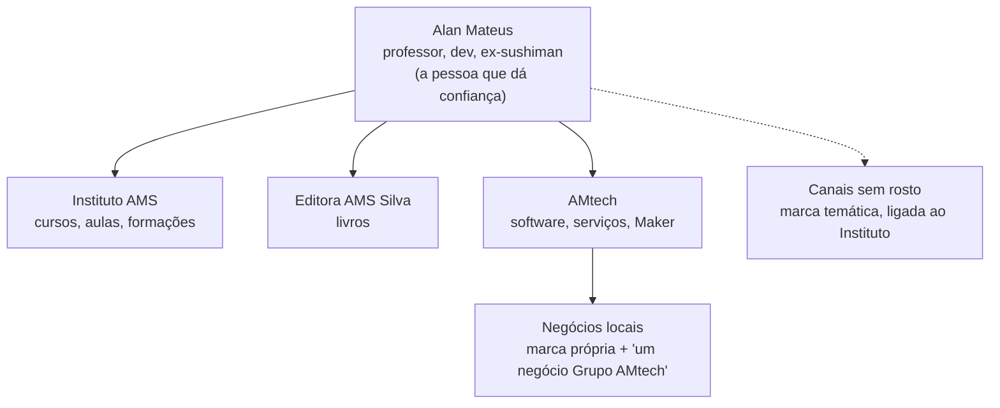

# 2 · Marca e presença

[← Operação do grupo](README.md)

Ficar conhecido não é estar em todas as redes todos os dias. É ser a referência certa para o público certo, com uma rotina que você aguenta por anos, e ter uma audiência que é sua, não da plataforma.

## Arquitetura de marcas

- **Você é o guarda-chuva.** A sua história (do primeiro emprego como sushiman à sala de aula e ao código) é o que nenhum concorrente copia. Conte o quanto quiser; é escolha sua o que fica privado.
- **Instituto AMS, Editora AMS Silva e AMtech** são as marcas de produto. Cada uma tem página e perfil, mas todas apontam para você e entre si.
- **Os negócios locais** têm nome próprio (o cliente do sushi não precisa saber de SaaS) com o endosso discreto "um negócio Grupo AMtech" no site e no rodapé.
- **Canais sem rosto** têm marca temática (ex.: lógica, matemática, finanças) e levam ao Instituto AMS. Rótulo de conteúdo feito com IA sempre que a plataforma pedir.

## O papel de cada canal

| Canal | Papel | Para quais ofertas | Ritmo sustentável |
|---|---|---|---|
| **Instagram** | Vitrine e prova social; Reels para alcance | Todas | 3 Reels + 2 carrosséis por semana, agendados |
| **YouTube** | Busca e profundidade; o vídeo que vende o curso | Instituto, livro, build in public, Maker | 1 vídeo longo por semana + cortes |
| **TikTok** | Alcance de público novo | Instituto, canais sem rosto | Os mesmos cortes dos Reels |
| **LinkedIn** | B2B e carreira | Software, automação com IA, vaga de dev | 2 posts por semana |
| **Google Perfil da Empresa** | O canal local mais importante | Loja, assistência, restaurantes, serviços | 1 post e fotos novas por semana; resposta a avaliações em 24 h |
| **WhatsApp Business** | Conversão e atendimento | Tudo que vende para pessoa da cidade | Catálogo atualizado; respostas rápidas |
| **Newsletter** | A audiência que é sua | Instituto, livro, afiliados | 1 edição por semana |
| **GitHub** | Prova técnica | Software, vaga de dev, templates | Commits do dia a dia |
| **Site e blog** | Busca no Google e casa de tudo | Todas | 2 artigos por mês, derivados do flywheel |

Kwai, Pinterest e Threads ficam como decisão sua, depois que os canais acima rodarem por 3 meses.

## A audiência é sua, não da plataforma

Toda peça de conteúdo tem um próximo passo que leva para algo que você controla: a newsletter, a lista de WhatsApp com consentimento ou o site. Uma conta suspensa não pode apagar o seu negócio.

## Presença local (Google Perfil da Empresa)

Para a loja, a assistência e os restaurantes, o Google decide quem a cidade encontra.

- Perfil completo: categorias certas, horário real (inclusive feriados), fotos de fachada, interior, equipe e produtos, link do WhatsApp e do cardápio.
- Mesmo nome, endereço e telefone em todo lugar (site, Instagram, marketplaces, iFood).
- Post semanal (novidade, prato, antes e depois de reparo) gerado pelo flywheel.
- **Pedido de avaliação automático** depois de cada serviço ou pedido (QR no balcão e mensagem no WhatsApp). Responder todas em até 24 h, as ruins com mais cuidado ainda.
- Nunca comprar avaliações nem oferecer desconto em troca de nota 5: é proibido pelas regras do Google e pode derrubar o perfil.

## Rotina que cabe na sua semana

Feita para quem tem TDAH e 63 horas de trabalho fixo: poucas decisões, blocos fechados, nada que dependa de lembrar.

| Quando | O quê | Tempo |
|---|---|---|
| Quinta de manhã (sem escola) | Bloco de gravação: 1 vídeo longo e 4 a 6 trechos curtos | 2 h |
| Quinta à tarde | Revisão do que os agentes prepararam (cortes, legendas, carrosséis, newsletter) e agendamento no Postiz | 1 h 30 |
| Todo dia, 15 min | Aprovar no celular os posts do dia e responder comentários e avaliações | 15 min |
| Domingo antes do restaurante | Ler o relatório semanal do painel e escolher 1 ajuste | 20 min |

O que o setup faz sozinho entre esses blocos está no [flywheel de conteúdo](03-flywheel-de-conteudo.md) e em [automação e escala](04-automacao-e-escala.md).

## Regras que protegem a marca

- Rosto e voz de alunos e clientes só com autorização por escrito; de menores, com autorização dos responsáveis e da escola.
- Nenhum dado de cliente ou aluno em vídeo, print ou exemplo.
- Conteúdo feito com IA rotulado como a plataforma exige; voz clonada só a sua.
- Promessa só do que a oferta entrega. Nada de "fique rico", "aprovação garantida" ou números que você não pode provar.
